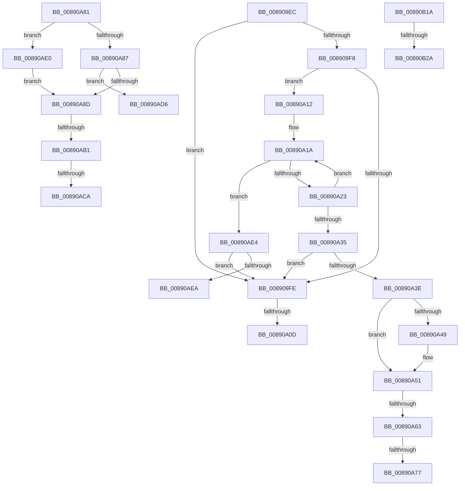

# sub_008909EC

- RVA: `0x008909EC`–`0x00890B3D` (길이 `337` bytes)
- VA: `0x00000001408909EC`
- 실행 섹션: `PAGE`
- PDB 이름 있음: `아니요`; PDB Function 태그: `아니요`
- unwind 정보 RVA: `0x0007D794`
- 디코드: `83`개 명령, `337/337` bytes 표시
- 미해석 바이트: `0` (있으면 어셈블리에 `.byte`로 보존)

> 이 문서는 커널 이미지의 기계어와 PDB 기호를 분석해 생성했습니다. 4번과 5번은 함수 원형과 자료형을 바이너리 사용 방식에서 추정한 C 해석이며 원본 소스 복구 결과는 아닙니다.

## 1. Dependencies

- 직접 호출 지점: **8**; 고유 호출 대상: **7**
- 직접 호출자로 확인된 함수: **0**
- RIP 상대 이미지 참조: **0**

### Outgoing calls
- `0x00890A4C` → [ExfReleasePushLockShared](../../text/26/ExfReleasePushLockShared_function_00263440.md) (function, `0x00263440`)
- `0x00890A54` → [KeAbPostRelease](../../text/2E/KeAbPostRelease_function_002E1600.md) (function, `0x002E1600`)
- `0x00890A77` → [ExfAcquireReleasePushLockExclusive](../../text/41/ExfAcquireReleasePushLockExclusive_function_00419C2C.md) (function, `0x00419C2C`)
- `0x00890AA4` → [AlpcpCreateSecurityContext](AlpcpCreateSecurityContext_function_00890D94.md) (function, `0x00890D94`)
- `0x00890AFD` → [KeBugCheckEx](../../text/4F/KeBugCheckEx_function_004FD660.md) (function, `0x004FD660`)
- `0x00890B0B` → [AlpcpDereferenceBlobEx](../88/AlpcpDereferenceBlobEx_function_0088AF00.md) (function, `0x0088AF00`)
- `0x00890B1D` → [AlpcpDeleteBlob](../88/AlpcpDeleteBlob_function_0088A11C.md) (function, `0x0088A11C`)
- `0x00890B32` → [AlpcpDereferenceBlobEx](../88/AlpcpDereferenceBlobEx_function_0088AF00.md) (function, `0x0088AF00`)

### Direct callers
- 이 함수 시작 RVA로 연결되는 직접 call은 확인되지 않았습니다. 간접 호출은 완전히 역산할 수 없습니다.

### Static image references
- 디코드된 RIP-relative 메모리 참조가 없습니다.

## 2. Other-region calls and transfers

- 다른 실행 섹션으로 향하는 call: **4**
  - `0x00890A4C` → [ExfReleasePushLockShared](../../text/26/ExfReleasePushLockShared_function_00263440.md) (`PAGE` → `.text`)
  - `0x00890A54` → [KeAbPostRelease](../../text/2E/KeAbPostRelease_function_002E1600.md) (`PAGE` → `.text`)
  - `0x00890A77` → [ExfAcquireReleasePushLockExclusive](../../text/41/ExfAcquireReleasePushLockExclusive_function_00419C2C.md) (`PAGE` → `.text`)
  - `0x00890AFD` → [KeBugCheckEx](../../text/4F/KeBugCheckEx_function_004FD660.md) (`PAGE` → `.text`)
- call이 아닌 외부 분기/꼬리 이동: **12**
  - `0x00890A07` → [sub_0089090A + 0x8](Unknown_function_0089090A.md) (`tail-transfer`)
  - `0x00890A0D` → [sub_0089090A](Unknown_function_0089090A.md) (`tail-transfer`)
  - `0x00890A5D` → [sub_0089090A + 0x13](Unknown_function_0089090A.md) (`tail-transfer`)
  - `0x00890A71` → [sub_0089090A + 0x13](Unknown_function_0089090A.md) (`tail-transfer`)
  - `0x00890A7C` → [sub_0089090A + 0x13](Unknown_function_0089090A.md) (`tail-transfer`)
  - `0x00890AAB` → [sub_0089090A + 0x44](Unknown_function_0089090A.md) (`tail-transfer`)
  - `0x00890AC4` → [sub_0089090A + 0x44](Unknown_function_0089090A.md) (`tail-transfer`)
  - `0x00890AD1` → [sub_0089090A + 0x44](Unknown_function_0089090A.md) (`tail-transfer`)
  - `0x00890ADB` → [sub_0089090A + 0x44](Unknown_function_0089090A.md) (`tail-transfer`)
  - `0x00890B15` → [sub_0089090A + 0x44](Unknown_function_0089090A.md) (`tail-transfer`)
  - `0x00890B24` → [sub_00B193FE](../B1/Unknown_function_00B193FE.md) (`tail-transfer`)
  - `0x00890B38` → [sub_00B193FE](../B1/Unknown_function_00B193FE.md) (`tail-transfer`)

## 3. Assembly (complete function range)

```asm
008909EC  48 8B 03                        mov rax, qword ptr [rbx]
008909EF  48 8B 1C C8                     mov rbx, qword ptr [rax + rcx*8]
008909F3  48 85 DB                        test rbx, rbx
008909F6  74 06                           je 0x1408909fe
008909F8  80 7B E1 03                     cmp byte ptr [rbx - 0x1f], 3
008909FC  74 14                           je 0x140890a12
008909FE  49 8B C5                        mov rax, r13
00890A01  F0 4C 0F B1 65 00               lock cmpxchg qword ptr [rbp], r12
00890A07  0F 84 05 FF FF FF               je 0x140890912
00890A0D  E9 F8 FE FF FF                  jmp 0x14089090a
00890A12  0F 0D 4B E8                     prefetchw byte ptr [rbx - 0x18]
00890A16  48 8B 43 E8                     mov rax, qword ptr [rbx - 0x18]
00890A1A  48 85 C0                        test rax, rax
00890A1D  0F 8E C1 00 00 00               jle 0x140890ae4
00890A23  48 8B D0                        mov rdx, rax
00890A26  48 8D 48 01                     lea rcx, [rax + 1]
00890A2A  F0 48 0F B1 4B E8               lock cmpxchg qword ptr [rbx - 0x18], rcx
00890A30  48 3B C2                        cmp rax, rdx
00890A33  75 E5                           jne 0x140890a1a
00890A35  48 8D 48 01                     lea rcx, [rax + 1]
00890A39  48 85 C9                        test rcx, rcx
00890A3C  74 C0                           je 0x1408909fe
00890A3E  49 8B C5                        mov rax, r13
00890A41  F0 4C 0F B1 65 00               lock cmpxchg qword ptr [rbp], r12
00890A47  74 08                           je 0x140890a51
00890A49  48 8B CD                        mov rcx, rbp
00890A4C  E8 EF 29 9D FF                  call 0x140263440
00890A51  48 8B CD                        mov rcx, rbp
00890A54  E8 A7 0B A5 FF                  call 0x1402e1600
00890A59  F6 43 E0 04                     test byte ptr [rbx - 0x20], 4
00890A5D  0F 84 BA FE FF FF               je 0x14089091d
00890A63  48 8D 4B F0                     lea rcx, [rbx - 0x10]
00890A67  F0 44 09 24 24                  lock or dword ptr [rsp], r12d
00890A6C  48 8B 01                        mov rax, qword ptr [rcx]
00890A6F  A8 01                           test al, 1
00890A71  0F 84 A6 FE FF FF               je 0x14089091d
00890A77  E8 B0 91 B8 FF                  call 0x140419c2c
00890A7C  E9 9C FE FF FF                  jmp 0x14089091d
00890A81  0F BA E7 11                     bt edi, 0x11
00890A85  72 59                           jb 0x140890ae0
00890A87  0F BA E7 10                     bt edi, 0x10
00890A8B  72 49                           jb 0x140890ad6
00890A8D  65 48 8B 14 25 88 01 00 00      mov rdx, qword ptr gs:[0x188]
00890A96  48 8D 44 24 30                  lea rax, [rsp + 0x30]
00890A9B  44 0F B6 C3                     movzx r8d, bl
00890A9F  48 89 44 24 20                  mov qword ptr [rsp + 0x20], rax
00890AA4  E8 EB 02 00 00                  call 0x140890d94
00890AA9  85 C0                           test eax, eax
00890AAB  0F 88 9D FE FF FF               js 0x14089094e
00890AB1  48 8B 8C 24 90 00 00 00         mov rcx, qword ptr [rsp + 0x90]
00890AB9  48 8B 54 24 30                  mov rdx, qword ptr [rsp + 0x30]
00890ABE  48 89 51 20                     mov qword ptr [rcx + 0x20], rdx
00890AC2  84 DB                           test bl, bl
00890AC4  0F 84 84 FE FF FF               je 0x14089094e
00890ACA  48 8B 4A 08                     mov rcx, qword ptr [rdx + 8]
00890ACE  48 89 0E                        mov qword ptr [rsi], rcx
00890AD1  E9 78 FE FF FF                  jmp 0x14089094e
00890AD6  B8 08 00 00 C0                  mov eax, 0xc0000008
00890ADB  E9 6E FE FF FF                  jmp 0x14089094e
00890AE0  B3 01                           mov bl, 1
00890AE2  EB A9                           jmp 0x140890a8d
00890AE4  0F 84 14 FF FF FF               je 0x1408909fe
00890AEA  33 D2                           xor edx, edx
00890AEC  48 89 44 24 20                  mov qword ptr [rsp + 0x20], rax
00890AF1  41 B9 20 00 00 00               mov r9d, 0x20
00890AF7  4C 8B C3                        mov r8, rbx
00890AFA  8D 4A 18                        lea ecx, [rdx + 0x18]
00890AFD  E8 5E CB C6 FF                  call 0x1404fd660
00890B02  CC                              int3
00890B03  BA 01 00 00 00                  mov edx, 1
00890B08  48 8B CB                        mov rcx, rbx
00890B0B  E8 F0 A3 FF FF                  call 0x14088af00
00890B10  B8 22 00 00 C0                  mov eax, 0xc0000022
00890B15  E9 34 FE FF FF                  jmp 0x14089094e
00890B1A  48 8B CB                        mov rcx, rbx
00890B1D  E8 FA 95 FF FF                  call 0x14088a11c
00890B22  84 C0                           test al, al
00890B24  0F 84 D4 88 28 00               je 0x140b193fe
00890B2A  BA 01 00 00 00                  mov edx, 1
00890B2F  48 8B CB                        mov rcx, rbx
00890B32  E8 C9 A3 FF FF                  call 0x14088af00
00890B37  90                              nop
00890B38  E9 C1 88 28 00                  jmp 0x140b193fe
```

## 4. C-style interpretation (structured pseudocode)

```c
__int64 __fastcall sub_008909EC(__int64 a1)
{
    __int64 result;
    unsigned int v_stack_p0;
    unsigned __int64 v_stack_p20;
    unsigned __int64 v_stack_p30;
    unsigned __int64 v_stack_p90;

    if (*(unsigned __int64 *)(*(unsigned __int64 *)(v_rbx) + a1 * 8) == 0) goto loc_008909FE;
    if ((*(unsigned __int8 *)(*(unsigned __int64 *)(*(unsigned __int64 *)(v_rbx) + a1 * 8) - 31)) == 3) goto loc_00890A12;
loc_008909FE:
loc_00890A12:
loc_00890A1A:
    if (condition_is_less_or_equal) goto loc_00890AE4;
    if ((*(unsigned __int64 *)(*(unsigned __int64 *)(*(unsigned __int64 *)(v_rbx) + a1 * 8) - 24)) != (*(unsigned __int64 *)(*(unsigned __int64 *)(*(unsigned __int64 *)(v_rbx) + a1 * 8) - 24))) goto loc_00890A1A;
    if (*(unsigned __int64 *)(*(unsigned __int64 *)(*(unsigned __int64 *)(v_rbx) + a1 * 8) - 24) + 1 == 0) goto loc_008909FE;
    result = v_r13;
    if (*(unsigned __int64 *)(*(unsigned __int64 *)(*(unsigned __int64 *)(v_rbx) + a1 * 8) - 24) + 1 != 0) {
        a1 = v_rbp;
        result = ExfReleasePushLockShared(a1, *(unsigned __int64 *)(*(unsigned __int64 *)(*(unsigned __int64 *)(v_rbx) + a1 * 8) - 24), a3, a4);
    }
    result = KeAbPostRelease(v_rbp, *(unsigned __int64 *)(*(unsigned __int64 *)(*(unsigned __int64 *)(v_rbx) + a1 * 8) - 24), a3, a4);
    result = ExfAcquireReleasePushLockExclusive(*(unsigned __int64 *)(*(unsigned __int64 *)(v_rbx) + a1 * 8) - 16, *(unsigned __int64 *)(*(unsigned __int64 *)(*(unsigned __int64 *)(v_rbx) + a1 * 8) - 24), a3, a4);
loc_00890AE4:
    if ((((unsigned __int8)(*(unsigned __int64 *)(*(unsigned __int64 *)(*(unsigned __int64 *)(v_rbx) + a1 * 8) - 16))) & (1)) == 0) goto loc_008909FE;
    a2 = 0;
    v_stack_p20 = result;
    result = KeBugCheckEx(a2 + 24, a2, *(unsigned __int64 *)(*(unsigned __int64 *)(v_rbx) + a1 * 8), 32);
    result = AlpcpDereferenceBlobEx(*(unsigned __int64 *)(*(unsigned __int64 *)(v_rbx) + a1 * 8), 1, *(unsigned __int64 *)(*(unsigned __int64 *)(v_rbx) + a1 * 8), 32);
}
```

## 5. (Beta) C Style

```c
int64_t sub_008909EC(int64_t Arg1)
{
    int64_t result;
    uint32_t v_stack_p0;
    uint64_t v_stack_p20;
    uint64_t v_stack_p30;
    uint64_t v_stack_p90;

    if (*(uint64_t *)(*(uint64_t *)(local_rbx) + Arg1 * 8) == 0) goto loc_008909FE;
    if ((*(uint8_t *)(*(uint64_t *)(*(uint64_t *)(local_rbx) + Arg1 * 8) - 0x1F)) == 3) goto loc_00890A12;
loc_008909FE:
loc_00890A12:
loc_00890A1A:
    if (condition_is_less_or_equal) goto loc_00890AE4;
    if ((*(uint64_t *)(*(uint64_t *)(*(uint64_t *)(local_rbx) + Arg1 * 8) - 0x18)) != (*(uint64_t *)(*(uint64_t *)(*(uint64_t *)(local_rbx) + Arg1 * 8) - 0x18))) goto loc_00890A1A;
    if (*(uint64_t *)(*(uint64_t *)(*(uint64_t *)(local_rbx) + Arg1 * 8) - 0x18) + 1 == 0) goto loc_008909FE;
    result = local_r13;
    if (*(uint64_t *)(*(uint64_t *)(*(uint64_t *)(local_rbx) + Arg1 * 8) - 0x18) + 1 != 0) {
        Arg1 = local_rbp;
        result = ExfReleasePushLockShared(Arg1, *(uint64_t *)(*(uint64_t *)(*(uint64_t *)(local_rbx) + Arg1 * 8) - 0x18), a3, a4);
    }
    result = KeAbPostRelease(local_rbp, *(uint64_t *)(*(uint64_t *)(*(uint64_t *)(local_rbx) + Arg1 * 8) - 0x18), a3, a4);
    result = ExfAcquireReleasePushLockExclusive(*(uint64_t *)(*(uint64_t *)(local_rbx) + Arg1 * 8) - 16, *(uint64_t *)(*(uint64_t *)(*(uint64_t *)(local_rbx) + Arg1 * 8) - 0x18), a3, a4);
loc_00890AE4:
    if ((((uint8_t)(*(uint64_t *)(*(uint64_t *)(*(uint64_t *)(local_rbx) + Arg1 * 8) - 0x10))) & (1)) == 0) goto loc_008909FE;
    a2 = 0;
    v_stack_p20 = result;
    result = KeBugCheckEx(a2 + 24, a2, *(uint64_t *)(*(uint64_t *)(local_rbx) + Arg1 * 8), 32);
    result = AlpcpDereferenceBlobEx(*(uint64_t *)(*(uint64_t *)(local_rbx) + Arg1 * 8), 1, *(uint64_t *)(*(uint64_t *)(local_rbx) + Arg1 * 8), 32);
}
```

## 6. Execution-region graph

[열기: 2D/3D 그래프와 함수 탐색 컨트롤 패널](../../../control-panel.html?section=page&rva=0x008909EC&view=graph)

- 2D 그래프는 위에서 아래로 흐르고, 3D 그래프는 빈 공간을 드래그해 회전합니다. Shift+드래그는 이동, 휠은 확대·축소, 함수 노드 선택은 대상 보고서 이동입니다.

### Static fallback


