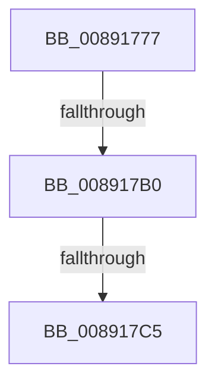

# sub_00891777

- RVA: `0x00891777`–`0x00891876` (길이 `255` bytes)
- VA: `0x0000000140891777`
- 실행 섹션: `PAGE`
- PDB 이름 있음: `아니요`; PDB Function 태그: `아니요`
- unwind 정보 RVA: `0x0007D898`
- 디코드: `51`개 명령, `255/255` bytes 표시
- 미해석 바이트: `0` (있으면 어셈블리에 `.byte`로 보존)

> 이 문서는 커널 이미지의 기계어와 PDB 기호를 분석해 생성했습니다. 4번과 5번은 함수 원형과 자료형을 바이너리 사용 방식에서 추정한 C 해석이며 원본 소스 복구 결과는 아닙니다.

## 1. Dependencies

- 직접 호출 지점: **3**; 고유 호출 대상: **3**
- 직접 호출자로 확인된 함수: **0**
- RIP 상대 이미지 참조: **0**

### Outgoing calls
- `0x008917CD` → [PsReferencePrimaryTokenWithTag](../../text/20/PsReferencePrimaryTokenWithTag_function_0020FF80.md) (function, `0x0020FF80`)
- `0x00891806` → [SepReconcileTrustSidWithProcessProtection](../../text/3E/SepReconcileTrustSidWithProcessProtection_function_003EDE50.md) (function, `0x003EDE50`)
- `0x0089184D` → [SepCreateClientSecurityEx](SepCreateClientSecurityEx_function_00891C90.md) (function, `0x00891C90`)

### Direct callers
- 이 함수 시작 RVA로 연결되는 직접 call은 확인되지 않았습니다. 간접 호출은 완전히 역산할 수 없습니다.

### Static image references
- 디코드된 RIP-relative 메모리 참조가 없습니다.

## 2. Other-region calls and transfers

- 다른 실행 섹션으로 향하는 call: **2**
  - `0x008917CD` → [PsReferencePrimaryTokenWithTag](../../text/20/PsReferencePrimaryTokenWithTag_function_0020FF80.md) (`PAGE` → `.text`)
  - `0x00891806` → [SepReconcileTrustSidWithProcessProtection](../../text/3E/SepReconcileTrustSidWithProcessProtection_function_003EDE50.md) (`PAGE` → `.text`)
- call이 아닌 외부 분기/꼬리 이동: **3**
  - `0x008917AA` → [sub_0089189E + 0x7E](Unknown_function_0089189E.md) (`tail-transfer`)
  - `0x008917BF` → [sub_0089189E](Unknown_function_0089189E.md) (`tail-transfer`)
  - `0x00891870` → [sub_00891924](Unknown_function_00891924.md) (`tail-transfer`)

## 3. Assembly (complete function range)

```asm
00891777  48 89 68 20                     mov qword ptr [rax + 0x20], rbp
0089177B  48 8D B9 20 02 00 00            lea rdi, [rcx + 0x220]
00891782  4C 89 60 D8                     mov qword ptr [rax - 0x28], r12
00891786  33 ED                           xor ebp, ebp
00891788  4C 89 68 D0                     mov qword ptr [rax - 0x30], r13
0089178C  49 8B F1                        mov rsi, r9
0089178F  4C 89 78 C8                     mov qword ptr [rax - 0x38], r15
00891793  48 8B D9                        mov rbx, rcx
00891796  40 88 68 B8                     mov byte ptr [rax - 0x48], bpl
0089179A  48 89 68 C0                     mov qword ptr [rax - 0x40], rbp
0089179E  65 48 8B 04 25 88 01 00 00      mov rax, qword ptr gs:[0x188]
008917A7  48 3B C8                        cmp rcx, rax
008917AA  0F 85 6C 01 00 00               jne 0x14089191c
008917B0  4C 8B B8 B8 00 00 00            mov r15, qword ptr [rax + 0xb8]
008917B7  8B 81 A0 05 00 00               mov eax, dword ptr [rcx + 0x5a0]
008917BD  A8 08                           test al, 8
008917BF  0F 85 D9 00 00 00               jne 0x14089189e
008917C5  BA 53 65 43 63                  mov edx, 0x63436553
008917CA  49 8B CF                        mov rcx, r15
008917CD  E8 AE E7 97 FF                  call 0x14020ff80
008917D2  41 0F B6 8F FA 05 00 00         movzx ecx, byte ptr [r15 + 0x5fa]
008917DA  4C 8B F0                        mov r14, rax
008917DD  88 8C 24 B0 00 00 00            mov byte ptr [rsp + 0xb0], cl
008917E4  41 BD 01 00 00 00               mov r13d, 1
008917EA  45 32 E4                        xor r12b, r12b
008917ED  49 8B 8E 50 04 00 00            mov rcx, qword ptr [r14 + 0x450]
008917F4  4C 8D 4C 24 68                  lea r9, [rsp + 0x68]
008917F9  4C 8D 44 24 60                  lea r8, [rsp + 0x60]
008917FE  48 8D 94 24 B0 00 00 00         lea rdx, [rsp + 0xb0]
00891806  E8 45 C6 B5 FF                  call 0x1403ede50
0089180B  48 8B 4C 24 68                  mov rcx, qword ptr [rsp + 0x68]
00891810  45 8B CD                        mov r9d, r13d
00891813  0F B6 44 24 60                  movzx eax, byte ptr [rsp + 0x60]
00891818  44 0F B6 84 24 C0 00 00 00      movzx r8d, byte ptr [rsp + 0xc0]
00891821  48 8B 94 24 B8 00 00 00         mov rdx, qword ptr [rsp + 0xb8]
00891829  48 89 74 24 50                  mov qword ptr [rsp + 0x50], rsi
0089182E  48 89 4C 24 48                  mov qword ptr [rsp + 0x48], rcx
00891833  49 8B CE                        mov rcx, r14
00891836  88 44 24 40                     mov byte ptr [rsp + 0x40], al
0089183A  48 89 5C 24 38                  mov qword ptr [rsp + 0x38], rbx
0089183F  C6 44 24 30 01                  mov byte ptr [rsp + 0x30], 1
00891844  89 6C 24 28                     mov dword ptr [rsp + 0x28], ebp
00891848  44 88 64 24 20                  mov byte ptr [rsp + 0x20], r12b
0089184D  E8 3E 04 00 00                  call 0x140891c90
00891852  4C 8B 7C 24 70                  mov r15, qword ptr [rsp + 0x70]
00891857  8B D8                           mov ebx, eax
00891859  4C 8B 6C 24 78                  mov r13, qword ptr [rsp + 0x78]
0089185E  4C 8B A4 24 80 00 00 00         mov r12, qword ptr [rsp + 0x80]
00891866  48 8B AC 24 C8 00 00 00         mov rbp, qword ptr [rsp + 0xc8]
0089186E  85 C0                           test eax, eax
00891870  0F 88 AE 00 00 00               js 0x140891924
```

## 4. C-style interpretation (structured pseudocode)

```c
__int64 __fastcall sub_00891777(__int64 a1, __int64 a2, __int64 a3, __int64 a4, __int64 a5, __int64 a6, __int64 a7, __int64 a8, __int64 a9, __int64 a10, __int64 a11, unsigned __int8 a12, __int64 a13, __int64 a14, __int64 a15, __int64 a16, __int64 a17, __int64 a18, __int64 a19, __int64 a20, __int64 a21, __int64 a22, __int64 a23, unsigned __int8 a24, __int64 a25)
{
    __int64 result;
    __int64 v_r12;
    __int64 v_rbp;
    unsigned __int8 v_stack_p20;
    unsigned int v_stack_p28;
    unsigned __int8 v_stack_p30;
    unsigned __int64 v_stack_p38;
    unsigned __int8 v_stack_p40;
    unsigned __int64 v_stack_p48;
    unsigned __int64 v_stack_p50;
    unsigned __int8 v_stack_pB0;

    *(unsigned __int64 *)(result + 32) = v_rbp;
    *(unsigned __int64 *)(result - 40) = v_r12;
    v_rbp = 0;
    *(unsigned __int64 *)(result - 48) = v_r13;
    *(unsigned __int64 *)(result - 56) = v_r15;
    *(unsigned __int8 *)(result - 72) = 0;
    *(unsigned __int64 *)(result - 64) = 0;
    result = PsReferencePrimaryTokenWithTag(*(unsigned __int64 *)(*(unsigned __int64 *)(gs_base + (0 + 392)) + 184), (unsigned int)(0x63436553ULL), a3, a4);
    v_stack_pB0 = (unsigned __int8)(*(unsigned __int8 *)(*(unsigned __int64 *)(*(unsigned __int64 *)(gs_base + (0 + 392)) + 184) + 1530));
    v_r12 = 0;
    result = SepReconcileTrustSidWithProcessProtection(*(unsigned __int64 *)(result + 1104), a22, a12, a13);
    v_stack_p50 = a4;
    v_stack_p48 = a13;
    v_stack_p40 = a12;
    v_stack_p38 = a1;
    v_stack_p30 = 1;
    v_stack_p28 = 0;
    v_stack_p20 = 0;
    result = SepCreateClientSecurityEx(result, a23, a24, 1);
}
```

## 5. (Beta) C Style

```c
int64_t sub_00891777(void *Arg1, int64_t Arg2, int64_t Arg3, int64_t Arg4, uint64_t Arg5, uint64_t Arg6, uint64_t Arg7, uint64_t Arg8, uint64_t Arg9, uint64_t Arg10, uint64_t Arg11, uint8_t Arg12, int64_t Arg13, int64_t Arg14, int64_t Arg15, int64_t Arg16, uint64_t Arg17, uint64_t Arg18, uint64_t Arg19, uint64_t Arg20, uint64_t Arg21, int64_t Arg22, int64_t Arg23, uint8_t Arg24, int64_t Arg25)
{
    uint8_t *arg1 = (uint8_t *)Arg1;

    int64_t result;
    int64_t local_r12;
    int64_t local_rbp;
    uint8_t v_stack_p20;
    uint32_t v_stack_p28;
    uint8_t v_stack_p30;
    uint64_t v_stack_p38;
    uint8_t v_stack_p40;
    uint64_t v_stack_p48;
    uint64_t v_stack_p50;
    uint8_t v_stack_pB0;

    *(uint64_t *)(result + 0x20) = local_rbp;
    *(uint64_t *)(result - 0x28) = local_r12;
    local_rbp = 0;
    *(uint64_t *)(result - 0x30) = local_r13;
    *(uint64_t *)(result - 0x38) = local_r15;
    *(uint8_t *)(result - 0x48) = 0;
    *(uint64_t *)(result - 0x40) = 0;
    result = PsReferencePrimaryTokenWithTag(*(uint64_t *)(*(uint64_t *)(gs_base + (0 + 0x188)) + 0xB8), (uint32_t)(0x63436553ULL), Arg3, Arg4);
    v_stack_pB0 = (uint8_t)(*(uint8_t *)(*(uint64_t *)(*(uint64_t *)(gs_base + (0 + 0x188)) + 0xB8) + 0x5FA));
    local_r12 = 0;
    result = SepReconcileTrustSidWithProcessProtection(*(uint64_t *)(result + 0x450), Arg22, Arg12, Arg13);
    v_stack_p50 = Arg4;
    v_stack_p48 = Arg13;
    v_stack_p40 = Arg12;
    v_stack_p38 = Arg1;
    v_stack_p30 = 1;
    v_stack_p28 = 0;
    v_stack_p20 = 0;
    result = SepCreateClientSecurityEx(result, Arg23, Arg24, 1);
}
```

### 관측된 메모리 오프셋

구조체 형식이 확인되지 않은 접근은 인자 기준의 오프셋으로만 기록했습니다.

| 기준 인자 | 오프셋 표현 | 폭 (bit) | 접근 |
|---|---:|---:|---|
| `Arg1` | `+ 0x220` | `64` | `R` |

## 6. Execution-region graph

[열기: 2D/3D 그래프와 함수 탐색 컨트롤 패널](../../../control-panel.html?section=page&rva=0x00891777&view=graph)

- 2D 그래프는 위에서 아래로 흐르고, 3D 그래프는 빈 공간을 드래그해 회전합니다. Shift+드래그는 이동, 휠은 확대·축소, 함수 노드 선택은 대상 보고서 이동입니다.

### Static fallback


