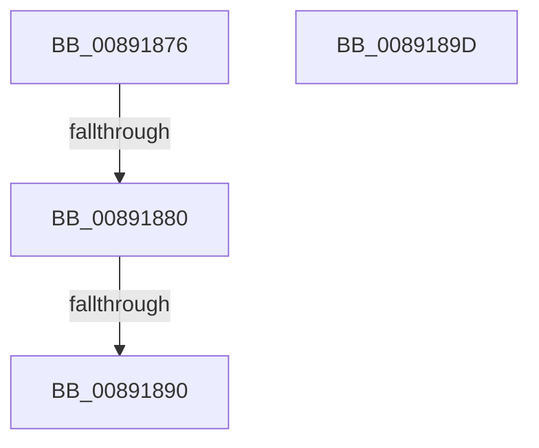

# sub_00891876

- RVA: `0x00891876`–`0x0089189E` (길이 `40` bytes)
- VA: `0x0000000140891876`
- 실행 섹션: `PAGE`
- PDB 이름 있음: `아니요`; PDB Function 태그: `아니요`
- unwind 정보 RVA: `0x0007D8B8`
- 디코드: `12`개 명령, `40/40` bytes 표시
- 미해석 바이트: `0` (있으면 어셈블리에 `.byte`로 보존)

> 이 문서는 커널 이미지의 기계어와 PDB 기호를 분석해 생성했습니다. 4번과 5번은 함수 원형과 자료형을 바이너리 사용 방식에서 추정한 C 해석이며 원본 소스 복구 결과는 아닙니다.

## 1. Dependencies

- 직접 호출 지점: **0**; 고유 호출 대상: **0**
- 직접 호출자로 확인된 함수: **0**
- RIP 상대 이미지 참조: **1**

### Outgoing calls
- 직접 디코드된 call 명령이 없습니다.

### Direct callers
- 이 함수 시작 RVA로 연결되는 직접 call은 확인되지 않았습니다. 간접 호출은 완전히 역산할 수 없습니다.

### Static image references
- `0x00891880` → RVA `0x00FC6AB0` (`ALMOSTRO`; read)

## 2. Other-region calls and transfers

- 다른 실행 섹션으로 향하는 call: **0**
- call이 아닌 외부 분기/꼬리 이동: **2**
  - `0x0089187A` → [sub_00891924](Unknown_function_00891924.md) (`tail-transfer`)
  - `0x0089188A` → [sub_00891948](Unknown_function_00891948.md) (`tail-transfer`)

## 3. Assembly (complete function range)

```asm
00891876  80 7E 08 00                     cmp byte ptr [rsi + 8], 0
0089187A  0F 84 A4 00 00 00               je 0x140891924
00891880  48 8B 0D 29 52 73 00            mov rcx, qword ptr [rip + 0x735229]
00891887  48 39 0F                        cmp qword ptr [rdi], rcx
0089188A  0F 84 B8 00 00 00               je 0x140891948
00891890  48 81 C4 88 00 00 00            add rsp, 0x88
00891897  41 5E                           pop r14
00891899  5F                              pop rdi
0089189A  5E                              pop rsi
0089189B  5B                              pop rbx
0089189C  C3                              ret
0089189D  CC                              int3
```

## 4. C-style interpretation (structured pseudocode)

```c
void __fastcall sub_00891876(void)
{
    __int64 v_rsp;

    v_rsp = (v_rsp) + (136);
    return;
}
```

## 5. (Beta) C Style

```c
void sub_00891876(void)
{
    int64_t local_rsp;

    local_rsp = (local_rsp) + (136);
    return;
}
```

## 6. Execution-region graph

[열기: 2D/3D 그래프와 함수 탐색 컨트롤 패널](../../../control-panel.html?section=page&rva=0x00891876&view=graph)

- 2D 그래프는 위에서 아래로 흐르고, 3D 그래프는 빈 공간을 드래그해 회전합니다. Shift+드래그는 이동, 휠은 확대·축소, 함수 노드 선택은 대상 보고서 이동입니다.

### Static fallback


