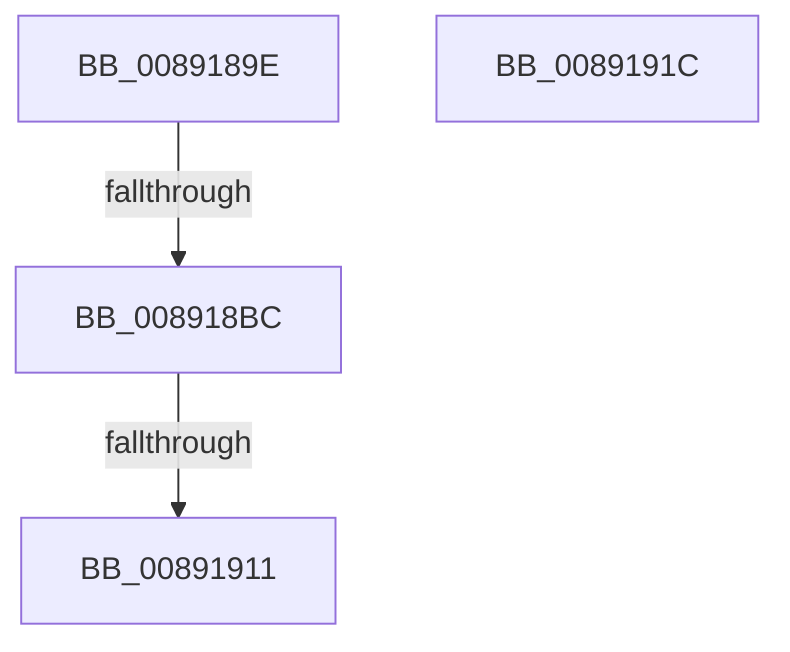

# sub_0089189E

- RVA: `0x0089189E`–`0x00891924` (길이 `134` bytes)
- VA: `0x000000014089189E`
- 실행 섹션: `PAGE`
- PDB 이름 있음: `아니요`; PDB Function 태그: `아니요`
- unwind 정보 RVA: `0x0007D8CC`
- 디코드: `28`개 명령, `134/134` bytes 표시
- 미해석 바이트: `0` (있으면 어셈블리에 `.byte`로 보존)

> 이 문서는 커널 이미지의 기계어와 PDB 기호를 분석해 생성했습니다. 4번과 5번은 함수 원형과 자료형을 바이너리 사용 방식에서 추정한 C 해석이며 원본 소스 복구 결과는 아닙니다.

## 1. Dependencies

- 직접 호출 지점: **3**; 고유 호출 대상: **3**
- 직접 호출자로 확인된 함수: **0**
- RIP 상대 이미지 참조: **0**

### Outgoing calls
- `0x008918AD` → [PspLockThreadSecurityShared](../../text/3C/PspLockThreadSecurityShared_function_003C4720.md) (function, `0x003C4720`)
- `0x008918CF` → [ObfReferenceObjectWithTag](../../text/21/ObfReferenceObjectWithTag_function_00210710.md) (function, `0x00210710`)
- `0x00891903` → [PspUnlockThreadSecurityShared](../../text/3C/PspUnlockThreadSecurityShared_function_003C2E40.md) (function, `0x003C2E40`)

### Direct callers
- 이 함수 시작 RVA로 연결되는 직접 call은 확인되지 않았습니다. 간접 호출은 완전히 역산할 수 없습니다.

### Static image references
- 디코드된 RIP-relative 메모리 참조가 없습니다.

## 2. Other-region calls and transfers

- 다른 실행 섹션으로 향하는 call: **3**
  - `0x008918AD` → [PspLockThreadSecurityShared](../../text/3C/PspLockThreadSecurityShared_function_003C4720.md) (`PAGE` → `.text`)
  - `0x008918CF` → [ObfReferenceObjectWithTag](../../text/21/ObfReferenceObjectWithTag_function_00210710.md) (`PAGE` → `.text`)
  - `0x00891903` → [PspUnlockThreadSecurityShared](../../text/3C/PspUnlockThreadSecurityShared_function_003C2E40.md) (`PAGE` → `.text`)
- call이 아닌 외부 분기/꼬리 이동: **4**
  - `0x008918BA` → [sub_00891938](Unknown_function_00891938.md) (`tail-transfer`)
  - `0x0089190B` → [sub_00891777 + 0x4E](Unknown_function_00891777.md) (`tail-transfer`)
  - `0x00891917` → [sub_00891777 + 0x76](Unknown_function_00891777.md) (`tail-transfer`)
  - `0x0089191F` → [sub_00891777 + 0x40](Unknown_function_00891777.md) (`tail-transfer`)

## 3. Assembly (complete function range)

```asm
0089189E  65 4C 8B 2C 25 88 01 00 00      mov r13, qword ptr gs:[0x188]
008918A7  4C 8B 27                        mov r12, qword ptr [rdi]
008918AA  49 8B D5                        mov rdx, r13
008918AD  E8 6E 2E B3 FF                  call 0x1403c4720
008918B2  8B 83 A0 05 00 00               mov eax, dword ptr [rbx + 0x5a0]
008918B8  A8 08                           test al, 8
008918BA  74 7C                           je 0x140891938
008918BC  4C 8B B3 38 05 00 00            mov r14, qword ptr [rbx + 0x538]
008918C3  BA 53 65 43 63                  mov edx, 0x63436553
008918C8  49 83 E6 F8                     and r14, 0xfffffffffffffff8
008918CC  49 8B CE                        mov rcx, r14
008918CF  E8 3C EE 97 FF                  call 0x140210710
008918D4  41 0F B6 84 24 FA 05 00 00      movzx eax, byte ptr [r12 + 0x5fa]
008918DD  49 8B D5                        mov rdx, r13
008918E0  44 0F B6 A3 38 05 00 00         movzx r12d, byte ptr [rbx + 0x538]
008918E8  48 8B CB                        mov rcx, rbx
008918EB  8B AB 38 05 00 00               mov ebp, dword ptr [rbx + 0x538]
008918F1  41 C0 EC 02                     shr r12b, 2
008918F5  83 E5 03                        and ebp, 3
008918F8  41 80 E4 01                     and r12b, 1
008918FC  88 84 24 B0 00 00 00            mov byte ptr [rsp + 0xb0], al
00891903  E8 38 15 B3 FF                  call 0x1403c2e40
00891908  4D 85 F6                        test r14, r14
0089190B  0F 84 B4 FE FF FF               je 0x1408917c5
00891911  41 BD 02 00 00 00               mov r13d, 2
00891917  E9 D1 FE FF FF                  jmp 0x1408917ed
0089191C  4C 8B 3F                        mov r15, qword ptr [rdi]
0089191F  E9 93 FE FF FF                  jmp 0x1408917b7
```

## 4. C-style interpretation (structured pseudocode)

```c
__int64 __fastcall sub_0089189E(void)
{
    __int64 result;
    __int64 v_r12;
    __int64 v_r14;
    __int64 v_rbp;
    unsigned __int8 v_stack_pB0;

    result = PspLockThreadSecurityShared(a1, *(unsigned __int64 *)(gs_base + (0 + 392)), a3, a4);
    v_r14 = (*(unsigned __int64 *)(v_rbx + 1336)) & (-8);
    result = ObfReferenceObjectWithTag(v_r14, (unsigned int)(0x63436553ULL), a3, a4);
    v_r12 = (unsigned __int8)((*(unsigned __int8 *)(v_rbx + 1336)) >> (2));
    v_rbp = (unsigned int)(((unsigned int)(*(unsigned int *)(v_rbx + 1336))) & (3));
    v_r12 = (unsigned __int8)((v_r12) & (1));
    v_stack_pB0 = (unsigned __int8)(*(unsigned __int8 *)(*(unsigned __int64 *)(v_rdi) + 1530));
    result = PspUnlockThreadSecurityShared(v_rbx, *(unsigned __int64 *)(gs_base + (0 + 392)), a3, a4);
}
```

## 5. (Beta) C Style

```c
void sub_0089189E(void)
{
    int64_t result;
    int64_t local_r12;
    int64_t local_r14;
    int64_t local_rbp;
    uint8_t v_stack_pB0;

    result = PspLockThreadSecurityShared(a1, *(uint64_t *)(gs_base + (0 + 0x188)), a3, a4);
    local_r14 = (*(uint64_t *)(local_rbx + 0x538)) & (-8);
    result = ObfReferenceObjectWithTag(local_r14, (uint32_t)(0x63436553ULL), a3, a4);
    local_r12 = (uint8_t)((*(uint8_t *)(local_rbx + 0x538)) >> (2));
    local_rbp = (uint32_t)(((uint32_t)(*(uint32_t *)(local_rbx + 0x538))) & (3));
    local_r12 = (uint8_t)((local_r12) & (1));
    v_stack_pB0 = (uint8_t)(*(uint8_t *)(*(uint64_t *)(local_rdi) + 0x5FA));
    result = PspUnlockThreadSecurityShared(local_rbx, *(uint64_t *)(gs_base + (0 + 0x188)), a3, a4);
}
```

## 6. Execution-region graph

[열기: 2D/3D 그래프와 함수 탐색 컨트롤 패널](../../../control-panel.html?section=page&rva=0x0089189E&view=graph)

- 2D 그래프는 위에서 아래로 흐르고, 3D 그래프는 빈 공간을 드래그해 회전합니다. Shift+드래그는 이동, 휠은 확대·축소, 함수 노드 선택은 대상 보고서 이동입니다.

### Static fallback


