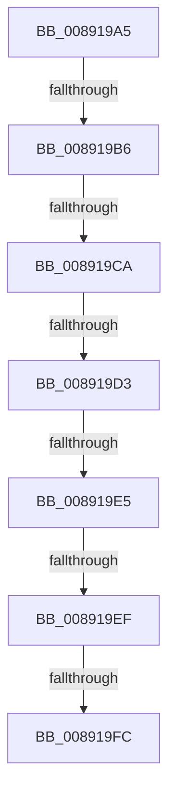

# sub_008919A5

- RVA: `0x008919A5`–`0x00891A05` (길이 `96` bytes)
- VA: `0x00000001408919A5`
- 실행 섹션: `PAGE`
- PDB 이름 있음: `아니요`; PDB Function 태그: `아니요`
- unwind 정보 RVA: `0x0007D938`
- 디코드: `22`개 명령, `96/96` bytes 표시
- 미해석 바이트: `0` (있으면 어셈블리에 `.byte`로 보존)

> 이 문서는 커널 이미지의 기계어와 PDB 기호를 분석해 생성했습니다. 4번과 5번은 함수 원형과 자료형을 바이너리 사용 방식에서 추정한 C 해석이며 원본 소스 복구 결과는 아닙니다.

## 1. Dependencies

- 직접 호출 지점: **0**; 고유 호출 대상: **0**
- 직접 호출자로 확인된 함수: **0**
- RIP 상대 이미지 참조: **0**

### Outgoing calls
- 직접 디코드된 call 명령이 없습니다.

### Direct callers
- 이 함수 시작 RVA로 연결되는 직접 call은 확인되지 않았습니다. 간접 호출은 완전히 역산할 수 없습니다.

### Static image references
- 디코드된 RIP-relative 메모리 참조가 없습니다.

## 2. Other-region calls and transfers

- 다른 실행 섹션으로 향하는 call: **0**
- call이 아닌 외부 분기/꼬리 이동: **6**
  - `0x008919B0` → [sub_00891B46 + 0x10](Unknown_function_00891B46.md) (`tail-transfer`)
  - `0x008919C4` → [sub_00891B46 + 0x9](Unknown_function_00891B46.md) (`tail-transfer`)
  - `0x008919CD` → [sub_00891B46 + 0x9](Unknown_function_00891B46.md) (`tail-transfer`)
  - `0x008919DF` → [sub_00891B46 + 0x9](Unknown_function_00891B46.md) (`tail-transfer`)
  - `0x008919E9` → [sub_00891B46](Unknown_function_00891B46.md) (`tail-transfer`)
  - `0x008919F6` → [sub_00891B46 + 0x9](Unknown_function_00891B46.md) (`tail-transfer`)

## 3. Assembly (complete function range)

```asm
008919A5  49 89 5B 08                     mov qword ptr [r11 + 8], rbx
008919A9  49 89 7B 20                     mov qword ptr [r11 + 0x20], rdi
008919AD  48 85 C0                        test rax, rax
008919B0  0F 85 A0 01 00 00               jne 0x140891b56
008919B6  8B 81 A0 01 00 00               mov eax, dword ptr [rcx + 0x1a0]
008919BC  48 8B 7A 18                     mov rdi, qword ptr [rdx + 0x18]
008919C0  24 06                           and al, 6
008919C2  3C 02                           cmp al, 2
008919C4  0F 85 85 01 00 00               jne 0x140891b4f
008919CA  48 85 FF                        test rdi, rdi
008919CD  0F 84 7C 01 00 00               je 0x140891b4f
008919D3  8B 8F A0 01 00 00               mov ecx, dword ptr [rdi + 0x1a0]
008919D9  8B C1                           mov eax, ecx
008919DB  24 06                           and al, 6
008919DD  3C 04                           cmp al, 4
008919DF  0F 85 6A 01 00 00               jne 0x140891b4f
008919E5  0F BA E1 0A                     bt ecx, 0xa
008919E9  0F 83 57 01 00 00               jae 0x140891b46
008919EF  48 8B 5A 20                     mov rbx, qword ptr [rdx + 0x20]
008919F3  48 85 DB                        test rbx, rbx
008919F6  0F 84 53 01 00 00               je 0x140891b4f
008919FC  65 48 8B 04 25 88 01 00 00      mov rax, qword ptr gs:[0x188]
```

## 4. C-style interpretation (structured pseudocode)

```c
__int64 __fastcall sub_008919A5(__int64 a1, __int64 a2)
{
    __int64 result;

    *(unsigned __int64 *)(v_r11 + 8) = v_rbx;
    *(unsigned __int64 *)(v_r11 + 32) = v_rdi;
    result = (unsigned __int8)(((unsigned int)(*(unsigned int *)(a1 + 416))) & (6));
    result = (unsigned __int8)(((unsigned int)((unsigned int)((unsigned int)(*(unsigned int *)(*(unsigned __int64 *)(a2 + 24) + 416))))) & (6));
    return *(unsigned __int64 *)(gs_base + (0 + 392));
}
```

## 5. (Beta) C Style

```c
int64_t sub_008919A5(void *Arg1, void *Arg2)
{
    uint8_t *arg1 = (uint8_t *)Arg1;
    uint8_t *arg2 = (uint8_t *)Arg2;

    int64_t result;

    *(uint64_t *)(local_r11 + 0x8) = local_rbx;
    *(uint64_t *)(local_r11 + 0x20) = local_rdi;
    result = (uint8_t)(((uint32_t)(*(uint32_t *)(arg1 + 0x1A0))) & (6));
    result = (uint8_t)(((uint32_t)((uint32_t)((uint32_t)(*(uint32_t *)(*(uint64_t *)(arg2 + 0x18) + 0x1A0))))) & (6));
    return *(uint64_t *)(gs_base + (0 + 0x188));
}
```

### 관측된 메모리 오프셋

구조체 형식이 확인되지 않은 접근은 인자 기준의 오프셋으로만 기록했습니다.

| 기준 인자 | 오프셋 표현 | 폭 (bit) | 접근 |
|---|---:|---:|---|
| `Arg1` | `+ 0x1A0` | `32` | `R` |
| `Arg2` | `+ 0x18` | `64` | `R` |
| `Arg2` | `+ 0x20` | `64` | `R` |

## 6. Execution-region graph

[열기: 2D/3D 그래프와 함수 탐색 컨트롤 패널](../../../control-panel.html?section=page&rva=0x008919A5&view=graph)

- 2D 그래프는 위에서 아래로 흐르고, 3D 그래프는 빈 공간을 드래그해 회전합니다. Shift+드래그는 이동, 휠은 확대·축소, 함수 노드 선택은 대상 보고서 이동입니다.

### Static fallback


