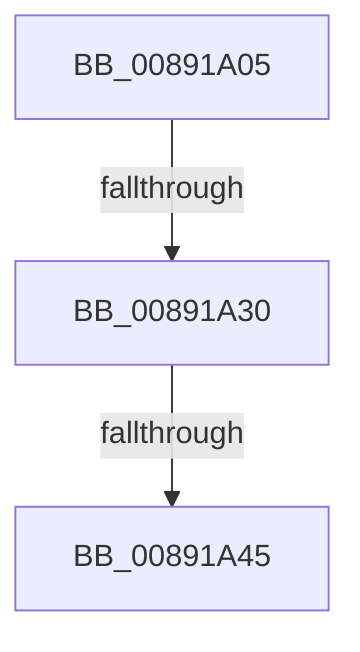

# sub_00891A05

- RVA: `0x00891A05`–`0x00891AEC` (길이 `231` bytes)
- VA: `0x0000000140891A05`
- 실행 섹션: `PAGE`
- PDB 이름 있음: `아니요`; PDB Function 태그: `아니요`
- unwind 정보 RVA: `0x0007D950`
- 디코드: `47`개 명령, `231/231` bytes 표시
- 미해석 바이트: `0` (있으면 어셈블리에 `.byte`로 보존)

> 이 문서는 커널 이미지의 기계어와 PDB 기호를 분석해 생성했습니다. 4번과 5번은 함수 원형과 자료형을 바이너리 사용 방식에서 추정한 C 해석이며 원본 소스 복구 결과는 아닙니다.

## 1. Dependencies

- 직접 호출 지점: **3**; 고유 호출 대상: **3**
- 직접 호출자로 확인된 함수: **0**
- RIP 상대 이미지 참조: **0**

### Outgoing calls
- `0x00891A4D` → [PsReferencePrimaryTokenWithTag](../../text/20/PsReferencePrimaryTokenWithTag_function_0020FF80.md) (function, `0x0020FF80`)
- `0x00891A89` → [SepReconcileTrustSidWithProcessProtection](../../text/3E/SepReconcileTrustSidWithProcessProtection_function_003EDE50.md) (function, `0x003EDE50`)
- `0x00891ACD` → [SepCreateClientSecurityEx](SepCreateClientSecurityEx_function_00891C90.md) (function, `0x00891C90`)

### Direct callers
- 이 함수 시작 RVA로 연결되는 직접 call은 확인되지 않았습니다. 간접 호출은 완전히 역산할 수 없습니다.

### Static image references
- 디코드된 RIP-relative 메모리 참조가 없습니다.

## 2. Other-region calls and transfers

- 다른 실행 섹션으로 향하는 call: **2**
  - `0x00891A4D` → [PsReferencePrimaryTokenWithTag](../../text/20/PsReferencePrimaryTokenWithTag_function_0020FF80.md) (`PAGE` → `.text`)
  - `0x00891A89` → [SepReconcileTrustSidWithProcessProtection](../../text/3E/SepReconcileTrustSidWithProcessProtection_function_003EDE50.md) (`PAGE` → `.text`)
- call이 아닌 외부 분기/꼬리 이동: **3**
  - `0x00891A2A` → [sub_00891B72 + 0x9A](Unknown_function_00891B72.md) (`tail-transfer`)
  - `0x00891A3F` → [sub_00891B72](Unknown_function_00891B72.md) (`tail-transfer`)
  - `0x00891AE6` → [sub_00891C14](Unknown_function_00891C14.md) (`tail-transfer`)

## 3. Assembly (complete function range)

```asm
00891A05  49 89 6B 18                     mov qword ptr [r11 + 0x18], rbp
00891A09  33 ED                           xor ebp, ebp
00891A0B  4D 89 63 E8                     mov qword ptr [r11 - 0x18], r12
00891A0F  4D 89 6B E0                     mov qword ptr [r11 - 0x20], r13
00891A13  4D 89 73 D8                     mov qword ptr [r11 - 0x28], r14
00891A17  4C 8D B3 20 02 00 00            lea r14, [rbx + 0x220]
00891A1E  40 88 6C 24 60                  mov byte ptr [rsp + 0x60], bpl
00891A23  49 89 6B C0                     mov qword ptr [r11 - 0x40], rbp
00891A27  48 3B D8                        cmp rbx, rax
00891A2A  0F 85 DC 01 00 00               jne 0x140891c0c
00891A30  4C 8B A0 B8 00 00 00            mov r12, qword ptr [rax + 0xb8]
00891A37  8B 83 A0 05 00 00               mov eax, dword ptr [rbx + 0x5a0]
00891A3D  A8 08                           test al, 8
00891A3F  0F 85 2D 01 00 00               jne 0x140891b72
00891A45  BA 53 65 43 63                  mov edx, 0x63436553
00891A4A  49 8B CC                        mov rcx, r12
00891A4D  E8 2E E5 97 FF                  call 0x14020ff80
00891A52  41 0F B6 8C 24 FA 05 00 00      movzx ecx, byte ptr [r12 + 0x5fa]
00891A5B  4C 8B E8                        mov r13, rax
00891A5E  88 8C 24 B8 00 00 00            mov byte ptr [rsp + 0xb8], cl
00891A65  41 BC 01 00 00 00               mov r12d, 1
00891A6B  C6 44 24 61 00                  mov byte ptr [rsp + 0x61], 0
00891A70  49 8B 8D 50 04 00 00            mov rcx, qword ptr [r13 + 0x450]
00891A77  4C 8D 4C 24 68                  lea r9, [rsp + 0x68]
00891A7C  4C 8D 44 24 60                  lea r8, [rsp + 0x60]
00891A81  48 8D 94 24 B8 00 00 00         lea rdx, [rsp + 0xb8]
00891A89  E8 C2 C3 B5 FF                  call 0x1403ede50
00891A8E  0F B6 44 24 60                  movzx eax, byte ptr [rsp + 0x60]
00891A93  48 8D 97 04 01 00 00            lea rdx, [rdi + 0x104]
00891A9A  48 8B 4C 24 68                  mov rcx, qword ptr [rsp + 0x68]
00891A9F  45 8B CC                        mov r9d, r12d
00891AA2  48 89 74 24 50                  mov qword ptr [rsp + 0x50], rsi
00891AA7  45 33 C0                        xor r8d, r8d
00891AAA  48 89 4C 24 48                  mov qword ptr [rsp + 0x48], rcx
00891AAF  49 8B CD                        mov rcx, r13
00891AB2  88 44 24 40                     mov byte ptr [rsp + 0x40], al
00891AB6  0F B6 44 24 61                  movzx eax, byte ptr [rsp + 0x61]
00891ABB  48 89 5C 24 38                  mov qword ptr [rsp + 0x38], rbx
00891AC0  C6 44 24 30 01                  mov byte ptr [rsp + 0x30], 1
00891AC5  89 6C 24 28                     mov dword ptr [rsp + 0x28], ebp
00891AC9  88 44 24 20                     mov byte ptr [rsp + 0x20], al
00891ACD  E8 BE 01 00 00                  call 0x140891c90
00891AD2  4C 8B A4 24 90 00 00 00         mov r12, qword ptr [rsp + 0x90]
00891ADA  8B D8                           mov ebx, eax
00891ADC  48 8B AC 24 C0 00 00 00         mov rbp, qword ptr [rsp + 0xc0]
00891AE4  85 C0                           test eax, eax
00891AE6  0F 88 28 01 00 00               js 0x140891c14
```

## 4. C-style interpretation (structured pseudocode)

```c
__int64 __fastcall sub_00891A05(__int64 a1, __int64 a2, __int64 a3, __int64 a4, __int64 a5, __int64 a6, __int64 a7, __int64 a8, __int64 a9, __int64 a10, __int64 a11, unsigned __int8 a12, __int64 a13, __int64 a14, __int64 a15, __int64 a16, __int64 a17, __int64 a18, __int64 a19, __int64 a20, __int64 a21, __int64 a22, __int64 a23, __int64 a24)
{
    __int64 result;
    __int64 v_rbp;
    unsigned __int8 v_stack_p20;
    unsigned int v_stack_p28;
    unsigned __int8 v_stack_p30;
    unsigned __int64 v_stack_p38;
    unsigned __int8 v_stack_p40;
    unsigned __int64 v_stack_p48;
    unsigned __int64 v_stack_p50;
    unsigned __int8 v_stack_p60;
    unsigned __int8 v_stack_p61;
    unsigned __int8 v_stack_pB8;

    *(unsigned __int64 *)(v_r11 + 24) = v_rbp;
    v_rbp = 0;
    *(unsigned __int64 *)(v_r11 - 24) = v_r12;
    *(unsigned __int64 *)(v_r11 - 32) = v_r13;
    *(unsigned __int64 *)(v_r11 - 40) = v_r14;
    v_stack_p60 = 0;
    *(unsigned __int64 *)(v_r11 - 64) = 0;
    result = PsReferencePrimaryTokenWithTag(*(unsigned __int64 *)(result + 184), (unsigned int)(0x63436553ULL), a3, a4);
    v_stack_pB8 = (unsigned __int8)(*(unsigned __int8 *)(*(unsigned __int64 *)(result + 184) + 1530));
    v_stack_p61 = 0;
    result = SepReconcileTrustSidWithProcessProtection(*(unsigned __int64 *)(result + 1104), a23, a12, a13);
    v_stack_p50 = v_rsi;
    a3 = 0;
    v_stack_p48 = a13;
    v_stack_p40 = a12;
    v_stack_p38 = v_rbx;
    v_stack_p30 = 1;
    v_stack_p28 = 0;
    v_stack_p20 = (unsigned __int8)(v_stack_p61);
    result = SepCreateClientSecurityEx(result, v_rdi + 260, a3, 1);
}
```

## 5. (Beta) C Style

```c
int64_t sub_00891A05(int64_t Arg1, int64_t Arg2, int64_t Arg3, int64_t Arg4, uint64_t Arg5, uint64_t Arg6, uint64_t Arg7, uint64_t Arg8, uint64_t Arg9, uint64_t Arg10, uint64_t Arg11, uint8_t Arg12, int64_t Arg13, uint64_t Arg14, uint64_t Arg15, uint64_t Arg16, uint64_t Arg17, int64_t Arg18, uint64_t Arg19, uint64_t Arg20, uint64_t Arg21, uint64_t Arg22, int64_t Arg23, int64_t Arg24)
{
    int64_t result;
    int64_t local_rbp;
    uint8_t v_stack_p20;
    uint32_t v_stack_p28;
    uint8_t v_stack_p30;
    uint64_t v_stack_p38;
    uint8_t v_stack_p40;
    uint64_t v_stack_p48;
    uint64_t v_stack_p50;
    uint8_t v_stack_p60;
    uint8_t v_stack_p61;
    uint8_t v_stack_pB8;

    *(uint64_t *)(local_r11 + 0x18) = local_rbp;
    local_rbp = 0;
    *(uint64_t *)(local_r11 - 0x18) = local_r12;
    *(uint64_t *)(local_r11 - 0x20) = local_r13;
    *(uint64_t *)(local_r11 - 0x28) = local_r14;
    v_stack_p60 = 0;
    *(uint64_t *)(local_r11 - 0x40) = 0;
    result = PsReferencePrimaryTokenWithTag(*(uint64_t *)(result + 0xB8), (uint32_t)(0x63436553ULL), Arg3, Arg4);
    v_stack_pB8 = (uint8_t)(*(uint8_t *)(*(uint64_t *)(result + 0xB8) + 0x5FA));
    v_stack_p61 = 0;
    result = SepReconcileTrustSidWithProcessProtection(*(uint64_t *)(result + 0x450), Arg23, Arg12, Arg13);
    v_stack_p50 = local_rsi;
    Arg3 = 0;
    v_stack_p48 = Arg13;
    v_stack_p40 = Arg12;
    v_stack_p38 = local_rbx;
    v_stack_p30 = 1;
    v_stack_p28 = 0;
    v_stack_p20 = (uint8_t)(v_stack_p61);
    result = SepCreateClientSecurityEx(result, local_rdi + 260, Arg3, 1);
}
```

## 6. Execution-region graph

[열기: 2D/3D 그래프와 함수 탐색 컨트롤 패널](../../../control-panel.html?section=page&rva=0x00891A05&view=graph)

- 2D 그래프는 위에서 아래로 흐르고, 3D 그래프는 빈 공간을 드래그해 회전합니다. Shift+드래그는 이동, 휠은 확대·축소, 함수 노드 선택은 대상 보고서 이동입니다.

### Static fallback


