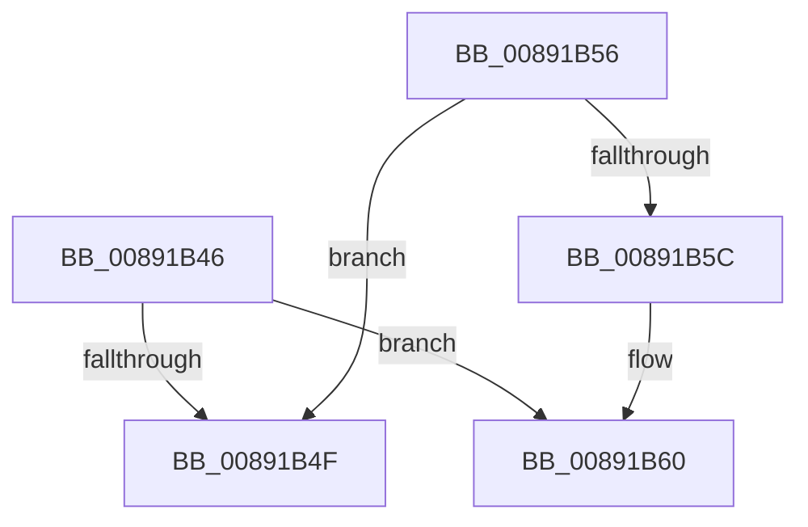

# sub_00891B46

- RVA: `0x00891B46`–`0x00891B72` (길이 `44` bytes)
- VA: `0x0000000140891B46`
- 실행 섹션: `PAGE`
- PDB 이름 있음: `아니요`; PDB Function 태그: `아니요`
- unwind 정보 RVA: `0x0007D9AC`
- 디코드: `13`개 명령, `44/44` bytes 표시
- 미해석 바이트: `0` (있으면 어셈블리에 `.byte`로 보존)

> 이 문서는 커널 이미지의 기계어와 PDB 기호를 분석해 생성했습니다. 4번과 5번은 함수 원형과 자료형을 바이너리 사용 방식에서 추정한 C 해석이며 원본 소스 복구 결과는 아닙니다.

## 1. Dependencies

- 직접 호출 지점: **0**; 고유 호출 대상: **0**
- 직접 호출자로 확인된 함수: **0**
- RIP 상대 이미지 참조: **0**

### Outgoing calls
- 직접 디코드된 call 명령이 없습니다.

### Direct callers
- 이 함수 시작 RVA로 연결되는 직접 call은 확인되지 않았습니다. 간접 호출은 완전히 역산할 수 없습니다.

### Static image references
- 디코드된 RIP-relative 메모리 참조가 없습니다.

## 2. Other-region calls and transfers

- 다른 실행 섹션으로 향하는 call: **0**
- call이 아닌 외부 분기/꼬리 이동: **2**
  - `0x00891B54` → [sub_00891B2A](Unknown_function_00891B2A.md) (`tail-transfer`)
  - `0x00891B70` → [sub_00891B2A](Unknown_function_00891B2A.md) (`tail-transfer`)

## 3. Assembly (complete function range)

```asm
00891B46  48 8B 47 50                     mov rax, qword ptr [rdi + 0x50]
00891B4A  48 85 C0                        test rax, rax
00891B4D  75 11                           jne 0x140891b60
00891B4F  B8 22 00 00 C0                  mov eax, 0xc0000022
00891B54  EB D4                           jmp 0x140891b2a
00891B56  83 78 24 01                     cmp dword ptr [rax + 0x24], 1
00891B5A  7C F3                           jl 0x140891b4f
00891B5C  48 8B 40 30                     mov rax, qword ptr [rax + 0x30]
00891B60  49 89 00                        mov qword ptr [r8], rax
00891B63  48 8B 84 24 D0 00 00 00         mov rax, qword ptr [rsp + 0xd0]
00891B6B  C6 00 00                        mov byte ptr [rax], 0
00891B6E  33 C0                           xor eax, eax
00891B70  EB B8                           jmp 0x140891b2a
```

## 4. C-style interpretation (structured pseudocode)

```c
__int64 __fastcall sub_00891B46(__int64 a1, __int64 a2, __int64 a3, __int64 a4, __int64 a5, __int64 a6, __int64 a7, __int64 a8, __int64 a9, __int64 a10, __int64 a11, __int64 a12, __int64 a13, __int64 a14, __int64 a15, __int64 a16, __int64 a17, __int64 a18, __int64 a19, __int64 a20, __int64 a21, __int64 a22, __int64 a23, __int64 a24, __int64 a25, __int64 a26)
{
    __int64 result;

    if (*(unsigned __int64 *)(v_rdi + 80) != 0) goto loc_00891B60;
loc_00891B4F:
loc_00891B60:
    *(unsigned __int64 *)(a3) = (unsigned int)(0xC0000022ULL);
    *(unsigned __int8 *)(a26) = 0;
    result = 0;
}
```

## 5. (Beta) C Style

```c
int64_t sub_00891B46(int64_t Arg1, int64_t Arg2, void *Arg3, int64_t Arg4, uint64_t Arg5, uint64_t Arg6, uint64_t Arg7, uint64_t Arg8, uint64_t Arg9, uint64_t Arg10, uint64_t Arg11, uint64_t Arg12, uint64_t Arg13, uint64_t Arg14, uint64_t Arg15, uint64_t Arg16, uint64_t Arg17, uint64_t Arg18, uint64_t Arg19, uint64_t Arg20, uint64_t Arg21, uint64_t Arg22, uint64_t Arg23, uint64_t Arg24, uint64_t Arg25, void *Arg26)
{
    uint8_t *arg3 = (uint8_t *)Arg3;
    uint8_t *arg26 = (uint8_t *)Arg26;

    int64_t result;

    if (*(uint64_t *)(local_rdi + 0x50) != 0) goto loc_00891B60;
loc_00891B4F:
loc_00891B60:
    *(uint64_t *)(arg3) = (uint32_t)(0xC0000022ULL);
    *(uint8_t *)(arg26) = 0;
    result = 0;
}
```

### 관측된 메모리 오프셋

구조체 형식이 확인되지 않은 접근은 인자 기준의 오프셋으로만 기록했습니다.

| 기준 인자 | 오프셋 표현 | 폭 (bit) | 접근 |
|---|---:|---:|---|
| `Arg3` | `+ 0x0` | `64` | `W` |
| `Arg26` | `+ 0x0` | `8` | `W` |

## 6. Execution-region graph

[열기: 2D/3D 그래프와 함수 탐색 컨트롤 패널](../../../control-panel.html?section=page&rva=0x00891B46&view=graph)

- 2D 그래프는 위에서 아래로 흐르고, 3D 그래프는 빈 공간을 드래그해 회전합니다. Shift+드래그는 이동, 휠은 확대·축소, 함수 노드 선택은 대상 보고서 이동입니다.

### Static fallback


