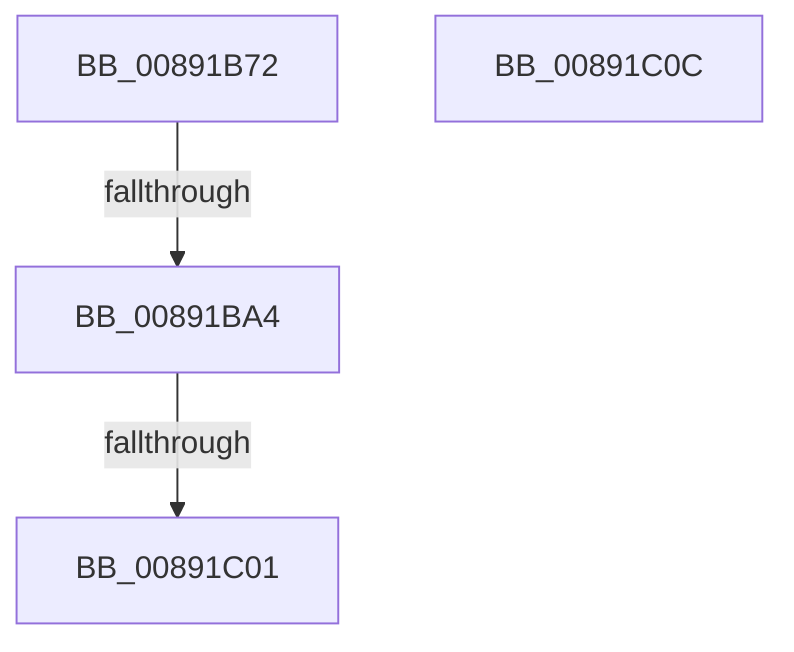

# sub_00891B72

- RVA: `0x00891B72`–`0x00891C14` (길이 `162` bytes)
- VA: `0x0000000140891B72`
- 실행 섹션: `PAGE`
- PDB 이름 있음: `아니요`; PDB Function 태그: `아니요`
- unwind 정보 RVA: `0x0007D9C4`
- 디코드: `33`개 명령, `162/162` bytes 표시
- 미해석 바이트: `0` (있으면 어셈블리에 `.byte`로 보존)

> 이 문서는 커널 이미지의 기계어와 PDB 기호를 분석해 생성했습니다. 4번과 5번은 함수 원형과 자료형을 바이너리 사용 방식에서 추정한 C 해석이며 원본 소스 복구 결과는 아닙니다.

## 1. Dependencies

- 직접 호출 지점: **3**; 고유 호출 대상: **3**
- 직접 호출자로 확인된 함수: **0**
- RIP 상대 이미지 참조: **0**

### Outgoing calls
- `0x00891B91` → [PspLockThreadSecurityShared](../../text/3C/PspLockThreadSecurityShared_function_003C4720.md) (function, `0x003C4720`)
- `0x00891BB7` → [ObfReferenceObjectWithTag](../../text/21/ObfReferenceObjectWithTag_function_00210710.md) (function, `0x00210710`)
- `0x00891BF3` → [PspUnlockThreadSecurityShared](../../text/3C/PspUnlockThreadSecurityShared_function_003C2E40.md) (function, `0x003C2E40`)

### Direct callers
- 이 함수 시작 RVA로 연결되는 직접 call은 확인되지 않았습니다. 간접 호출은 완전히 역산할 수 없습니다.

### Static image references
- 디코드된 RIP-relative 메모리 참조가 없습니다.

## 2. Other-region calls and transfers

- 다른 실행 섹션으로 향하는 call: **3**
  - `0x00891B91` → [PspLockThreadSecurityShared](../../text/3C/PspLockThreadSecurityShared_function_003C4720.md) (`PAGE` → `.text`)
  - `0x00891BB7` → [ObfReferenceObjectWithTag](../../text/21/ObfReferenceObjectWithTag_function_00210710.md) (`PAGE` → `.text`)
  - `0x00891BF3` → [PspUnlockThreadSecurityShared](../../text/3C/PspUnlockThreadSecurityShared_function_003C2E40.md) (`PAGE` → `.text`)
- call이 아닌 외부 분기/꼬리 이동: **4**
  - `0x00891B9E` → [sub_00891C3F](Unknown_function_00891C3F.md) (`tail-transfer`)
  - `0x00891BFB` → [sub_00891A05 + 0x40](Unknown_function_00891A05.md) (`tail-transfer`)
  - `0x00891C07` → [sub_00891A05 + 0x6B](Unknown_function_00891A05.md) (`tail-transfer`)
  - `0x00891C0F` → [sub_00891A05 + 0x32](Unknown_function_00891A05.md) (`tail-transfer`)

## 3. Assembly (complete function range)

```asm
00891B72  65 4C 8B 2C 25 88 01 00 00      mov r13, qword ptr gs:[0x188]
00891B7B  48 8B CB                        mov rcx, rbx
00891B7E  49 8B 06                        mov rax, qword ptr [r14]
00891B81  49 8B D5                        mov rdx, r13
00891B84  48 89 84 24 B8 00 00 00         mov qword ptr [rsp + 0xb8], rax
00891B8C  4C 89 6C 24 70                  mov qword ptr [rsp + 0x70], r13
00891B91  E8 8A 2B B3 FF                  call 0x1403c4720
00891B96  8B 83 A0 05 00 00               mov eax, dword ptr [rbx + 0x5a0]
00891B9C  A8 08                           test al, 8
00891B9E  0F 84 9B 00 00 00               je 0x140891c3f
00891BA4  4C 8B AB 38 05 00 00            mov r13, qword ptr [rbx + 0x538]
00891BAB  BA 53 65 43 63                  mov edx, 0x63436553
00891BB0  49 83 E5 F8                     and r13, 0xfffffffffffffff8
00891BB4  49 8B CD                        mov rcx, r13
00891BB7  E8 54 EB 97 FF                  call 0x140210710
00891BBC  48 8B 84 24 B8 00 00 00         mov rax, qword ptr [rsp + 0xb8]
00891BC4  48 8B CB                        mov rcx, rbx
00891BC7  8B AB 38 05 00 00               mov ebp, dword ptr [rbx + 0x538]
00891BCD  48 8B 54 24 70                  mov rdx, qword ptr [rsp + 0x70]
00891BD2  83 E5 03                        and ebp, 3
00891BD5  0F B6 80 FA 05 00 00            movzx eax, byte ptr [rax + 0x5fa]
00891BDC  88 84 24 B8 00 00 00            mov byte ptr [rsp + 0xb8], al
00891BE3  0F B6 83 38 05 00 00            movzx eax, byte ptr [rbx + 0x538]
00891BEA  C0 E8 02                        shr al, 2
00891BED  24 01                           and al, 1
00891BEF  88 44 24 61                     mov byte ptr [rsp + 0x61], al
00891BF3  E8 48 12 B3 FF                  call 0x1403c2e40
00891BF8  4D 85 ED                        test r13, r13
00891BFB  0F 84 44 FE FF FF               je 0x140891a45
00891C01  41 BC 02 00 00 00               mov r12d, 2
00891C07  E9 64 FE FF FF                  jmp 0x140891a70
00891C0C  4D 8B 26                        mov r12, qword ptr [r14]
00891C0F  E9 23 FE FF FF                  jmp 0x140891a37
```

## 4. C-style interpretation (structured pseudocode)

```c
__int64 __fastcall sub_00891B72(__int64 a1, __int64 a2, __int64 a3, __int64 a4, __int64 a5, __int64 a6, __int64 a7, __int64 a8, __int64 a9, __int64 a10, __int64 a11, __int64 a12, __int64 a13, __int64 a14, __int64 a15, __int64 a16, __int64 a17, __int64 a18, __int64 a19, __int64 a20, __int64 a21, __int64 a22, __int64 a23)
{
    __int64 result;
    __int64 v_r13;
    __int64 v_rbp;
    unsigned __int8 v_stack_p61;
    unsigned __int64 v_stack_p70;
    unsigned __int64 v_stack_pB8;

    v_stack_pB8 = *(unsigned __int64 *)(v_r14);
    v_stack_p70 = *(unsigned __int64 *)(gs_base + (0 + 392));
    result = PspLockThreadSecurityShared(v_rbx, *(unsigned __int64 *)(gs_base + (0 + 392)), a3, a4);
    v_r13 = (*(unsigned __int64 *)(v_rbx + 1336)) & (-8);
    result = ObfReferenceObjectWithTag(v_r13, (unsigned int)(0x63436553ULL), a3, a4);
    v_rbp = (unsigned int)(((unsigned int)(*(unsigned int *)(v_rbx + 1336))) & (3));
    v_stack_pB8 = (unsigned __int8)(*(unsigned __int8 *)(a23 + 1530));
    result = (unsigned __int8)((*(unsigned __int8 *)(v_rbx + 1336)) >> (2));
    result = (unsigned __int8)((result) & (1));
    v_stack_p61 = (unsigned __int8)(result);
    result = PspUnlockThreadSecurityShared(v_rbx, a14, a3, a4);
}
```

## 5. (Beta) C Style

```c
int64_t sub_00891B72(int64_t Arg1, int64_t Arg2, int64_t Arg3, int64_t Arg4, uint64_t Arg5, uint64_t Arg6, uint64_t Arg7, uint64_t Arg8, uint64_t Arg9, uint64_t Arg10, uint64_t Arg11, uint64_t Arg12, uint64_t Arg13, int64_t Arg14, uint64_t Arg15, uint64_t Arg16, uint64_t Arg17, uint64_t Arg18, uint64_t Arg19, uint64_t Arg20, uint64_t Arg21, uint64_t Arg22, void *Arg23)
{
    uint8_t *arg23 = (uint8_t *)Arg23;

    int64_t result;
    int64_t local_r13;
    int64_t local_rbp;
    uint8_t v_stack_p61;
    uint64_t v_stack_p70;
    uint64_t v_stack_pB8;

    v_stack_pB8 = *(uint64_t *)(local_r14);
    v_stack_p70 = *(uint64_t *)(gs_base + (0 + 0x188));
    result = PspLockThreadSecurityShared(local_rbx, *(uint64_t *)(gs_base + (0 + 0x188)), Arg3, Arg4);
    local_r13 = (*(uint64_t *)(local_rbx + 0x538)) & (-8);
    result = ObfReferenceObjectWithTag(local_r13, (uint32_t)(0x63436553ULL), Arg3, Arg4);
    local_rbp = (uint32_t)(((uint32_t)(*(uint32_t *)(local_rbx + 0x538))) & (3));
    v_stack_pB8 = (uint8_t)(*(uint8_t *)(arg23 + 0x5FA));
    result = (uint8_t)((*(uint8_t *)(local_rbx + 0x538)) >> (2));
    result = (uint8_t)((result) & (1));
    v_stack_p61 = (uint8_t)(result);
    result = PspUnlockThreadSecurityShared(local_rbx, Arg14, Arg3, Arg4);
}
```

### 관측된 메모리 오프셋

구조체 형식이 확인되지 않은 접근은 인자 기준의 오프셋으로만 기록했습니다.

| 기준 인자 | 오프셋 표현 | 폭 (bit) | 접근 |
|---|---:|---:|---|
| `Arg23` | `+ 0x5FA` | `8` | `R` |

## 6. Execution-region graph

[열기: 2D/3D 그래프와 함수 탐색 컨트롤 패널](../../../control-panel.html?section=page&rva=0x00891B72&view=graph)

- 2D 그래프는 위에서 아래로 흐르고, 3D 그래프는 빈 공간을 드래그해 회전합니다. Shift+드래그는 이동, 휠은 확대·축소, 함수 노드 선택은 대상 보고서 이동입니다.

### Static fallback


