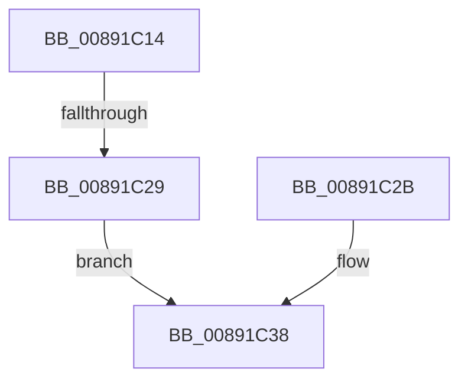

# sub_00891C14

- RVA: `0x00891C14`–`0x00891C3F` (길이 `43` bytes)
- VA: `0x0000000140891C14`
- 실행 섹션: `PAGE`
- PDB 이름 있음: `아니요`; PDB Function 태그: `아니요`
- unwind 정보 RVA: `0x0007D9EC`
- 디코드: `11`개 명령, `43/43` bytes 표시
- 미해석 바이트: `0` (있으면 어셈블리에 `.byte`로 보존)

> 이 문서는 커널 이미지의 기계어와 PDB 기호를 분석해 생성했습니다. 4번과 5번은 함수 원형과 자료형을 바이너리 사용 방식에서 추정한 C 해석이며 원본 소스 복구 결과는 아닙니다.

## 1. Dependencies

- 직접 호출 지점: **2**; 고유 호출 대상: **1**
- 직접 호출자로 확인된 함수: **0**
- RIP 상대 이미지 참조: **0**

### Outgoing calls
- `0x00891C1C` → [ObfDereferenceObjectWithTag](../../text/2F/ObfDereferenceObjectWithTag_function_002F78E0.md) (function, `0x002F78E0`)
- `0x00891C33` → [ObfDereferenceObjectWithTag](../../text/2F/ObfDereferenceObjectWithTag_function_002F78E0.md) (function, `0x002F78E0`)

### Direct callers
- 이 함수 시작 RVA로 연결되는 직접 call은 확인되지 않았습니다. 간접 호출은 완전히 역산할 수 없습니다.

### Static image references
- 디코드된 RIP-relative 메모리 참조가 없습니다.

## 2. Other-region calls and transfers

- 다른 실행 섹션으로 향하는 call: **2**
  - `0x00891C1C` → [ObfDereferenceObjectWithTag](../../text/2F/ObfDereferenceObjectWithTag_function_002F78E0.md) (`PAGE` → `.text`)
  - `0x00891C33` → [ObfDereferenceObjectWithTag](../../text/2F/ObfDereferenceObjectWithTag_function_002F78E0.md) (`PAGE` → `.text`)
- call이 아닌 외부 분기/꼬리 이동: **2**
  - `0x00891C23` → [sub_00891AEC + 0x1A](Unknown_function_00891AEC.md) (`tail-transfer`)
  - `0x00891C3A` → [sub_00891AEC + 0x2E](Unknown_function_00891AEC.md) (`tail-transfer`)

## 3. Assembly (complete function range)

```asm
00891C14  BA 53 65 43 63                  mov edx, 0x63436553
00891C19  49 8B CD                        mov rcx, r13
00891C1C  E8 BF 5C A6 FF                  call 0x1402f78e0
00891C21  85 DB                           test ebx, ebx
00891C23  0F 89 DD FE FF FF               jns 0x140891b06
00891C29  EB 0D                           jmp 0x140891c38
00891C2B  BA 53 65 43 63                  mov edx, 0x63436553
00891C30  49 8B CD                        mov rcx, r13
00891C33  E8 A8 5C A6 FF                  call 0x1402f78e0
00891C38  8B C3                           mov eax, ebx
00891C3A  E9 DB FE FF FF                  jmp 0x140891b1a
```

## 4. C-style interpretation (structured pseudocode)

```c
__int64 __fastcall sub_00891C14(void)
{
    __int64 result;

    result = ObfDereferenceObjectWithTag(v_r13, (unsigned int)(0x63436553ULL), a3, a4);
    goto loc_00891C38;
loc_00891C38:
}
```

## 5. (Beta) C Style

```c
void sub_00891C14(void)
{
    int64_t result;

    result = ObfDereferenceObjectWithTag(local_r13, (uint32_t)(0x63436553ULL), a3, a4);
    goto loc_00891C38;
loc_00891C38:
}
```

## 6. Execution-region graph

[열기: 2D/3D 그래프와 함수 탐색 컨트롤 패널](../../../control-panel.html?section=page&rva=0x00891C14&view=graph)

- 2D 그래프는 위에서 아래로 흐르고, 3D 그래프는 빈 공간을 드래그해 회전합니다. Shift+드래그는 이동, 휠은 확대·축소, 함수 노드 선택은 대상 보고서 이동입니다.

### Static fallback


