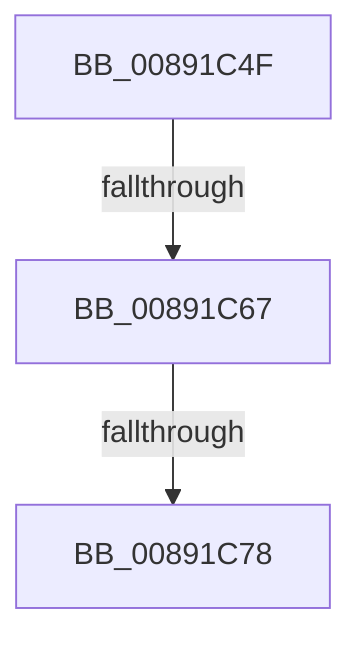

# sub_00891C4F

- RVA: `0x00891C4F`–`0x00891C7A` (길이 `43` bytes)
- VA: `0x0000000140891C4F`
- 실행 섹션: `PAGE`
- PDB 이름 있음: `아니요`; PDB Function 태그: `아니요`
- unwind 정보 RVA: `0x0007DA34`
- 디코드: `13`개 명령, `43/43` bytes 표시
- 미해석 바이트: `0` (있으면 어셈블리에 `.byte`로 보존)

> 이 문서는 커널 이미지의 기계어와 PDB 기호를 분석해 생성했습니다. 4번과 5번은 함수 원형과 자료형을 바이너리 사용 방식에서 추정한 C 해석이며 원본 소스 복구 결과는 아닙니다.

## 1. Dependencies

- 직접 호출 지점: **3**; 고유 호출 대상: **3**
- 직접 호출자로 확인된 함수: **0**
- RIP 상대 이미지 참조: **0**

### Outgoing calls
- `0x00891C4F` → [PsGetCurrentServerSilo](../../text/22/PsGetCurrentServerSilo_function_00225710.md) (function, `0x00225710`)
- `0x00891C5A` → [PsIsHostSilo](../../text/44/PsIsHostSilo_function_00443B30.md) (function, `0x00443B30`)
- `0x00891C6D` → [SepUpdateSiloInClientSecurity](../AD/SepUpdateSiloInClientSecurity_function_00AD4E10.md) (function, `0x00AD4E10`)

### Direct callers
- 이 함수 시작 RVA로 연결되는 직접 call은 확인되지 않았습니다. 간접 호출은 완전히 역산할 수 없습니다.

### Static image references
- 디코드된 RIP-relative 메모리 참조가 없습니다.

## 2. Other-region calls and transfers

- 다른 실행 섹션으로 향하는 call: **2**
  - `0x00891C4F` → [PsGetCurrentServerSilo](../../text/22/PsGetCurrentServerSilo_function_00225710.md) (`PAGE` → `.text`)
  - `0x00891C5A` → [PsIsHostSilo](../../text/44/PsIsHostSilo_function_00443B30.md) (`PAGE` → `.text`)
- call이 아닌 외부 분기/꼬리 이동: **3**
  - `0x00891C61` → [sub_00891AEC + 0x1A](Unknown_function_00891AEC.md) (`tail-transfer`)
  - `0x00891C76` → [sub_00891C14 + 0xD](Unknown_function_00891C14.md) (`tail-transfer`)
  - `0x00891C78` → [sub_00891C14 + 0x17](Unknown_function_00891C14.md) (`tail-transfer`)

## 3. Assembly (complete function range)

```asm
00891C4F  E8 BC 3A 99 FF                  call 0x140225710
00891C54  48 8B C8                        mov rcx, rax
00891C57  48 8B D8                        mov rbx, rax
00891C5A  E8 D1 1E BB FF                  call 0x140443b30
00891C5F  84 C0                           test al, al
00891C61  0F 85 9F FE FF FF               jne 0x140891b06
00891C67  48 8B D3                        mov rdx, rbx
00891C6A  48 8B CE                        mov rcx, rsi
00891C6D  E8 9E 31 24 00                  call 0x140ad4e10
00891C72  8B D8                           mov ebx, eax
00891C74  85 C0                           test eax, eax
00891C76  79 A9                           jns 0x140891c21
00891C78  EB B1                           jmp 0x140891c2b
```

## 4. C-style interpretation (structured pseudocode)

```c
__int64 __fastcall sub_00891C4F(void)
{
    __int64 result;

    result = PsGetCurrentServerSilo(a1, a2, a3, a4);
    result = PsIsHostSilo(result, a2, a3, a4);
    result = SepUpdateSiloInClientSecurity(v_rsi, result, a3, a4);
}
```

## 5. (Beta) C Style

```c
void sub_00891C4F(void)
{
    int64_t result;

    result = PsGetCurrentServerSilo(a1, a2, a3, a4);
    result = PsIsHostSilo(result, a2, a3, a4);
    result = SepUpdateSiloInClientSecurity(local_rsi, result, a3, a4);
}
```

## 6. Execution-region graph

[열기: 2D/3D 그래프와 함수 탐색 컨트롤 패널](../../../control-panel.html?section=page&rva=0x00891C4F&view=graph)

- 2D 그래프는 위에서 아래로 흐르고, 3D 그래프는 빈 공간을 드래그해 회전합니다. Shift+드래그는 이동, 휠은 확대·축소, 함수 노드 선택은 대상 보고서 이동입니다.

### Static fallback


