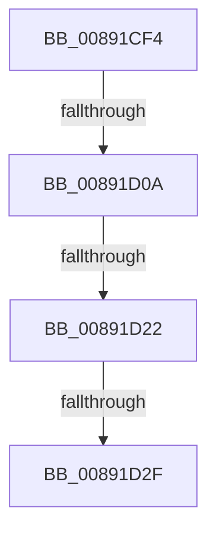

# sub_00891CF4

- RVA: `0x00891CF4`–`0x00891D68` (길이 `116` bytes)
- VA: `0x0000000140891CF4`
- 실행 섹션: `PAGE`
- PDB 이름 있음: `아니요`; PDB Function 태그: `아니요`
- unwind 정보 RVA: `0x0007DA7C`
- 디코드: `25`개 명령, `116/116` bytes 표시
- 미해석 바이트: `0` (있으면 어셈블리에 `.byte`로 보존)

> 이 문서는 커널 이미지의 기계어와 PDB 기호를 분석해 생성했습니다. 4번과 5번은 함수 원형과 자료형을 바이너리 사용 방식에서 추정한 C 해석이며 원본 소스 복구 결과는 아닙니다.

## 1. Dependencies

- 직접 호출 지점: **0**; 고유 호출 대상: **0**
- 직접 호출자로 확인된 함수: **0**
- RIP 상대 이미지 참조: **0**

### Outgoing calls
- 직접 디코드된 call 명령이 없습니다.

### Direct callers
- 이 함수 시작 RVA로 연결되는 직접 call은 확인되지 않았습니다. 간접 호출은 완전히 역산할 수 없습니다.

### Static image references
- 디코드된 RIP-relative 메모리 참조가 없습니다.

## 2. Other-region calls and transfers

- 다른 실행 섹션으로 향하는 call: **0**
- call이 아닌 외부 분기/꼬리 이동: **4**
  - `0x00891D08` → [sub_00891D68](Unknown_function_00891D68.md) (`tail-transfer`)
  - `0x00891D1C` → [sub_00891D68 + 0x4A](Unknown_function_00891D68.md) (`tail-transfer`)
  - `0x00891D29` → [sub_008920C1](Unknown_function_008920C1.md) (`tail-transfer`)
  - `0x00891D63` → [SepCreateClientSecurityEx + 0x3D](SepCreateClientSecurityEx_function_00891C90.md) (`tail-transfer`)

## 3. Assembly (complete function range)

```asm
00891CF4  48 89 9C 24 B0 00 00 00         mov qword ptr [rsp + 0xb0], rbx
00891CFC  48 89 BC 24 C0 00 00 00         mov qword ptr [rsp + 0xc0], rdi
00891D04  41 83 F9 02                     cmp r9d, 2
00891D08  74 5E                           je 0x140891d68
00891D0A  48 8B 9D 80 00 00 00            mov rbx, qword ptr [rbp + 0x80]
00891D11  0F B6 46 09                     movzx eax, byte ptr [rsi + 9]
00891D15  88 43 19                        mov byte ptr [rbx + 0x19], al
00891D18  44 38 6E 08                     cmp byte ptr [rsi + 8], r13b
00891D1C  0F 84 90 00 00 00               je 0x140891db2
00891D22  C6 43 18 01                     mov byte ptr [rbx + 0x18], 1
00891D26  45 84 F6                        test r14b, r14b
00891D29  0F 85 92 03 00 00               jne 0x1408920c1
00891D2F  C7 03 0C 00 00 00               mov dword ptr [rbx], 0xc
00891D35  8B 46 04                        mov eax, dword ptr [rsi + 4]
00891D38  89 43 04                        mov dword ptr [rbx + 4], eax
00891D3B  0F B6 46 08                     movzx eax, byte ptr [rsi + 8]
00891D3F  88 43 08                        mov byte ptr [rbx + 8], al
00891D42  0F B6 46 09                     movzx eax, byte ptr [rsi + 9]
00891D46  4C 89 7B 10                     mov qword ptr [rbx + 0x10], r15
00891D4A  88 43 09                        mov byte ptr [rbx + 9], al
00891D4D  33 C0                           xor eax, eax
00891D4F  44 88 73 1A                     mov byte ptr [rbx + 0x1a], r14b
00891D53  48 8B 9C 24 B0 00 00 00         mov rbx, qword ptr [rsp + 0xb0]
00891D5B  48 8B BC 24 C0 00 00 00         mov rdi, qword ptr [rsp + 0xc0]
00891D63  E9 65 FF FF FF                  jmp 0x140891ccd
```

## 4. C-style interpretation (structured pseudocode)

```c
__int64 __fastcall sub_00891CF4(__int64 a1, __int64 a2, __int64 a3, int a4, __int64 a5, __int64 a6, __int64 a7, __int64 a8, __int64 a9, __int64 a10, __int64 a11, __int64 a12, __int64 a13, __int64 a14, __int64 a15, __int64 a16, __int64 a17, __int64 a18, __int64 a19, __int64 a20, __int64 a21, __int64 a22, __int64 a23, __int64 a24)
{
    __int64 result;
    unsigned __int64 v_stack_pB0;
    unsigned __int64 v_stack_pC0;

    v_stack_pB0 = v_rbx;
    v_stack_pC0 = v_rdi;
    *(unsigned __int8 *)(*(unsigned __int64 *)(v_rbp + 128) + 25) = (unsigned __int8)(*(unsigned __int8 *)(v_rsi + 9));
    *(unsigned __int8 *)(*(unsigned __int64 *)(v_rbp + 128) + 24) = 1;
    *(unsigned int *)(*(unsigned __int64 *)(v_rbp + 128)) = 12;
    *(unsigned int *)(*(unsigned __int64 *)(v_rbp + 128) + 4) = (unsigned int)((unsigned int)(*(unsigned int *)(v_rsi + 4)));
    *(unsigned __int8 *)(*(unsigned __int64 *)(v_rbp + 128) + 8) = (unsigned __int8)(*(unsigned __int8 *)(v_rsi + 8));
    *(unsigned __int64 *)(*(unsigned __int64 *)(v_rbp + 128) + 16) = v_r15;
    *(unsigned __int8 *)(*(unsigned __int64 *)(v_rbp + 128) + 9) = (unsigned __int8)(*(unsigned __int8 *)(v_rsi + 9));
    result = 0;
    *(unsigned __int8 *)(*(unsigned __int64 *)(v_rbp + 128) + 26) = (unsigned __int8)(v_r14);
}
```

## 5. (Beta) C Style

```c
int64_t sub_00891CF4(int64_t Arg1, int64_t Arg2, int64_t Arg3, int32_t Arg4, uint64_t Arg5, uint64_t Arg6, uint64_t Arg7, uint64_t Arg8, uint64_t Arg9, uint64_t Arg10, uint64_t Arg11, uint64_t Arg12, uint64_t Arg13, uint64_t Arg14, uint64_t Arg15, uint64_t Arg16, uint64_t Arg17, uint64_t Arg18, uint64_t Arg19, uint64_t Arg20, uint64_t Arg21, int64_t Arg22, uint64_t Arg23, int64_t Arg24)
{
    int64_t result;
    uint64_t v_stack_pB0;
    uint64_t v_stack_pC0;

    v_stack_pB0 = local_rbx;
    v_stack_pC0 = local_rdi;
    *(uint8_t *)(*(uint64_t *)(local_rbp + 0x80) + 0x19) = (uint8_t)(*(uint8_t *)(local_rsi + 0x9));
    *(uint8_t *)(*(uint64_t *)(local_rbp + 0x80) + 0x18) = 1;
    *(uint32_t *)(*(uint64_t *)(local_rbp + 0x80)) = 12;
    *(uint32_t *)(*(uint64_t *)(local_rbp + 0x80) + 0x4) = (uint32_t)((uint32_t)(*(uint32_t *)(local_rsi + 0x4)));
    *(uint8_t *)(*(uint64_t *)(local_rbp + 0x80) + 0x8) = (uint8_t)(*(uint8_t *)(local_rsi + 0x8));
    *(uint64_t *)(*(uint64_t *)(local_rbp + 0x80) + 0x10) = local_r15;
    *(uint8_t *)(*(uint64_t *)(local_rbp + 0x80) + 0x9) = (uint8_t)(*(uint8_t *)(local_rsi + 0x9));
    result = 0;
    *(uint8_t *)(*(uint64_t *)(local_rbp + 0x80) + 0x1A) = (uint8_t)(local_r14);
}
```

## 6. Execution-region graph

[열기: 2D/3D 그래프와 함수 탐색 컨트롤 패널](../../../control-panel.html?section=page&rva=0x00891CF4&view=graph)

- 2D 그래프는 위에서 아래로 흐르고, 3D 그래프는 빈 공간을 드래그해 회전합니다. Shift+드래그는 이동, 휠은 확대·축소, 함수 노드 선택은 대상 보고서 이동입니다.

### Static fallback


