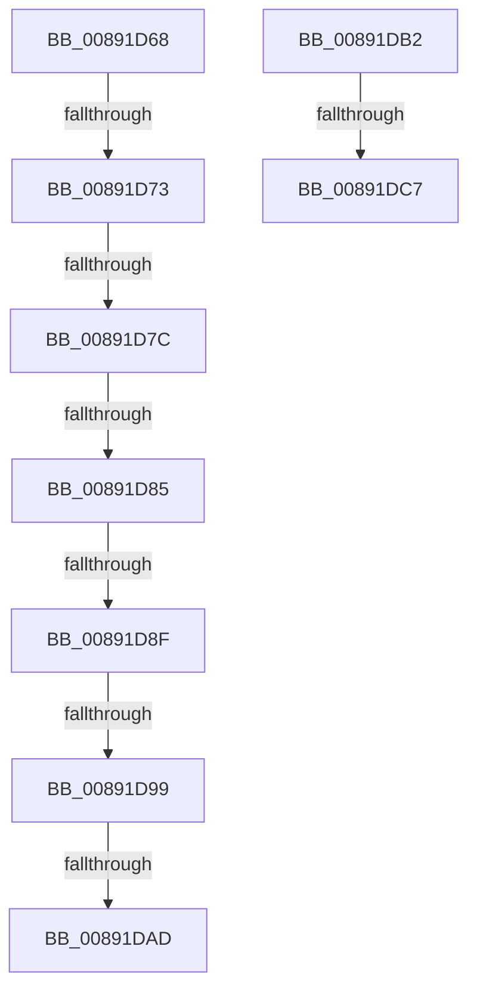

# sub_00891D68

- RVA: `0x00891D68`–`0x00891DF4` (길이 `140` bytes)
- VA: `0x0000000140891D68`
- 실행 섹션: `PAGE`
- PDB 이름 있음: `아니요`; PDB Function 태그: `아니요`
- unwind 정보 RVA: `0x0007DA94`
- 디코드: `33`개 명령, `140/140` bytes 표시
- 미해석 바이트: `0` (있으면 어셈블리에 `.byte`로 보존)

> 이 문서는 커널 이미지의 기계어와 PDB 기호를 분석해 생성했습니다. 4번과 5번은 함수 원형과 자료형을 바이너리 사용 방식에서 추정한 C 해석이며 원본 소스 복구 결과는 아닙니다.

## 1. Dependencies

- 직접 호출 지점: **1**; 고유 호출 대상: **1**
- 직접 호출자로 확인된 함수: **0**
- RIP 상대 이미지 참조: **0**

### Outgoing calls
- `0x00891DB6` → [PsIsCurrentThreadInServerSilo](../../text/43/PsIsCurrentThreadInServerSilo_function_004362E0.md) (function, `0x004362E0`)

### Direct callers
- 이 함수 시작 RVA로 연결되는 직접 call은 확인되지 않았습니다. 간접 호출은 완전히 역산할 수 없습니다.

### Static image references
- 디코드된 RIP-relative 메모리 참조가 없습니다.

## 2. Other-region calls and transfers

- 다른 실행 섹션으로 향하는 call: **1**
  - `0x00891DB6` → [PsIsCurrentThreadInServerSilo](../../text/43/PsIsCurrentThreadInServerSilo_function_004362E0.md) (`PAGE` → `.text`)
- call이 아닌 외부 분기/꼬리 이동: **8**
  - `0x00891D6D` → [sub_00891E2F + 0x48](Unknown_function_00891E2F.md) (`tail-transfer`)
  - `0x00891D76` → [sub_00891E2F + 0x5D](Unknown_function_00891E2F.md) (`tail-transfer`)
  - `0x00891D7F` → [sub_00891E2F + 0x54](Unknown_function_00891E2F.md) (`tail-transfer`)
  - `0x00891D89` → [sub_00891E2F + 0x169](Unknown_function_00891E2F.md) (`tail-transfer`)
  - `0x00891D93` → [sub_00891E2F + 0x169](Unknown_function_00891E2F.md) (`tail-transfer`)
  - `0x00891DA7` → [sub_00891CF4 + 0x24](Unknown_function_00891CF4.md) (`tail-transfer`)
  - `0x00891DAD` → [sub_00891E2F + 0x74](Unknown_function_00891E2F.md) (`tail-transfer`)
  - `0x00891DC1` → [sub_00B1943A](../B1/Unknown_function_00B1943A.md) (`tail-transfer`)

## 3. Assembly (complete function range)

```asm
00891D68  8B 4D 58                        mov ecx, dword ptr [rbp + 0x58]
00891D6B  3B C1                           cmp eax, ecx
00891D6D  0F 8F 04 01 00 00               jg 0x140891e77
00891D73  83 F9 01                        cmp ecx, 1
00891D76  0F 86 10 01 00 00               jbe 0x140891e8c
00891D7C  45 84 F6                        test r14b, r14b
00891D7F  0F 85 FE 00 00 00               jne 0x140891e83
00891D85  44 38 6D 50                     cmp byte ptr [rbp + 0x50], r13b
00891D89  0F 85 09 02 00 00               jne 0x140891f98
00891D8F  44 38 6E 09                     cmp byte ptr [rsi + 9], r13b
00891D93  0F 85 FF 01 00 00               jne 0x140891f98
00891D99  32 C0                           xor al, al
00891D9B  48 8B 9D 80 00 00 00            mov rbx, qword ptr [rbp + 0x80]
00891DA2  88 43 19                        mov byte ptr [rbx + 0x19], al
00891DA5  84 D2                           test dl, dl
00891DA7  0F 84 6B FF FF FF               je 0x140891d18
00891DAD  E9 F1 00 00 00                  jmp 0x140891ea3
00891DB2  44 88 6B 18                     mov byte ptr [rbx + 0x18], r13b
00891DB6  E8 25 45 BA FF                  call 0x1404362e0
00891DBB  4C 89 6D 38                     mov qword ptr [rbp + 0x38], r13
00891DBF  84 C0                           test al, al
00891DC1  0F 85 73 76 28 00               jne 0x140b1943a
00891DC7  8B 46 04                        mov eax, dword ptr [rsi + 4]
00891DCA  48 8D 4D 38                     lea rcx, [rbp + 0x38]
00891DCE  48 89 4C 24 38                  mov qword ptr [rsp + 0x38], rcx
00891DD3  48 8D 55 C8                     lea rdx, [rbp - 0x38]
00891DD7  44 88 6C 24 30                  mov byte ptr [rsp + 0x30], r13b
00891DDC  0F 57 C0                        xorps xmm0, xmm0
00891DDF  44 88 6C 24 28                  mov byte ptr [rsp + 0x28], r13b
00891DE4  41 B9 02 00 00 00               mov r9d, 2
00891DEA  45 33 C0                        xor r8d, r8d
00891DED  89 44 24 20                     mov dword ptr [rsp + 0x20], eax
00891DF1  49 8B CF                        mov rcx, r15
```

## 4. C-style interpretation (structured pseudocode)

```c
__int64 __fastcall sub_00891D68(__int64 a1, unsigned __int8 a2, int a3)
{
    __int64 result;
    unsigned int v_stack_p20;
    unsigned __int8 v_stack_p28;
    unsigned __int8 v_stack_p30;
    unsigned __int64 v_stack_p38;

    result = 0;
    *(unsigned __int8 *)(*(unsigned __int64 *)(v_rbp + 128) + 25) = 0;
}
```

## 5. (Beta) C Style

```c
int64_t sub_00891D68(int64_t Arg1, uint8_t Arg2, int32_t Arg3)
{
    int64_t result;
    uint32_t v_stack_p20;
    uint8_t v_stack_p28;
    uint8_t v_stack_p30;
    uint64_t v_stack_p38;

    result = 0;
    *(uint8_t *)(*(uint64_t *)(local_rbp + 0x80) + 0x19) = 0;
}
```

## 6. Execution-region graph

[열기: 2D/3D 그래프와 함수 탐색 컨트롤 패널](../../../control-panel.html?section=page&rva=0x00891D68&view=graph)

- 2D 그래프는 위에서 아래로 흐르고, 3D 그래프는 빈 공간을 드래그해 회전합니다. Shift+드래그는 이동, 휠은 확대·축소, 함수 노드 선택은 대상 보고서 이동입니다.

### Static fallback


