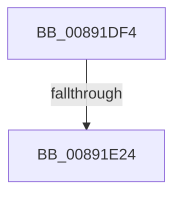

# sub_00891DF4

- RVA: `0x00891DF4`–`0x00891E2F` (길이 `59` bytes)
- VA: `0x0000000140891DF4`
- 실행 섹션: `PAGE`
- PDB 이름 있음: `아니요`; PDB Function 태그: `아니요`
- unwind 정보 RVA: `0x0007DAAC`
- 디코드: `12`개 명령, `59/59` bytes 표시
- 미해석 바이트: `0` (있으면 어셈블리에 `.byte`로 보존)

> 이 문서는 커널 이미지의 기계어와 PDB 기호를 분석해 생성했습니다. 4번과 5번은 함수 원형과 자료형을 바이너리 사용 방식에서 추정한 C 해석이며 원본 소스 복구 결과는 아닙니다.

## 1. Dependencies

- 직접 호출 지점: **1**; 고유 호출 대상: **1**
- 직접 호출자로 확인된 함수: **0**
- RIP 상대 이미지 참조: **0**

### Outgoing calls
- `0x00891E15` → [SepDuplicateToken](../8B/SepDuplicateToken_function_008B87EC.md) (function, `0x008B87EC`)

### Direct callers
- 이 함수 시작 RVA로 연결되는 직접 call은 확인되지 않았습니다. 간접 호출은 완전히 역산할 수 없습니다.

### Static image references
- 디코드된 RIP-relative 메모리 참조가 없습니다.

## 2. Other-region calls and transfers

- 다른 실행 섹션으로 향하는 call: **0**
- call이 아닌 외부 분기/꼬리 이동: **1**
  - `0x00891E1E` → [sub_00891F9F](Unknown_function_00891F9F.md) (`tail-transfer`)

## 3. Assembly (complete function range)

```asm
00891DF4  4C 89 A4 24 C8 00 00 00         mov qword ptr [rsp + 0xc8], r12
00891DFC  48 C7 45 C8 30 00 00 00         mov qword ptr [rbp - 0x38], 0x30
00891E04  4C 89 6D E0                     mov qword ptr [rbp - 0x20], r13
00891E08  4C 89 6D D0                     mov qword ptr [rbp - 0x30], r13
00891E0C  4C 89 6D D8                     mov qword ptr [rbp - 0x28], r13
00891E10  F3 0F 7F 45 E8                  movdqu xmmword ptr [rbp - 0x18], xmm0
00891E15  E8 D2 69 02 00                  call 0x1408b87ec
00891E1A  8B F8                           mov edi, eax
00891E1C  85 C0                           test eax, eax
00891E1E  0F 89 7B 01 00 00               jns 0x140891f9f
00891E24  4D 8B FD                        mov r15, r13
00891E27  4C 8B A4 24 C8 00 00 00         mov r12, qword ptr [rsp + 0xc8]
```

## 4. C-style interpretation (structured pseudocode)

```c
__int64 __fastcall sub_00891DF4(__int64 a1, __int64 a2, __int64 a3, __int64 a4, __int64 a5, __int64 a6, __int64 a7, __int64 a8, __int64 a9, __int64 a10, __int64 a11, __int64 a12, __int64 a13, __int64 a14, __int64 a15, __int64 a16, __int64 a17, __int64 a18, __int64 a19, __int64 a20, __int64 a21, __int64 a22, __int64 a23, __int64 a24, __int64 a25)
{
    __int64 result;
    unsigned __int64 v_stack_pC8;

    v_stack_pC8 = v_r12;
    *(unsigned __int64 *)(v_rbp - 56) = 48;
    *(unsigned __int64 *)(v_rbp - 32) = v_r13;
    *(unsigned __int64 *)(v_rbp - 48) = v_r13;
    *(unsigned __int64 *)(v_rbp - 40) = v_r13;
    *(unsigned __int64 *)(v_rbp - 24) = v_xmm0;
    result = SepDuplicateToken(a1, a2, a3, a4);
    return result;
}
```

## 5. (Beta) C Style

```c
int64_t sub_00891DF4(int64_t Arg1, int64_t Arg2, int64_t Arg3, int64_t Arg4, uint64_t Arg5, uint64_t Arg6, uint64_t Arg7, uint64_t Arg8, uint64_t Arg9, uint64_t Arg10, uint64_t Arg11, uint64_t Arg12, uint64_t Arg13, uint64_t Arg14, uint64_t Arg15, uint64_t Arg16, uint64_t Arg17, uint64_t Arg18, uint64_t Arg19, uint64_t Arg20, uint64_t Arg21, uint64_t Arg22, uint64_t Arg23, uint64_t Arg24, int64_t Arg25)
{
    int64_t result;
    uint64_t v_stack_pC8;

    v_stack_pC8 = local_r12;
    *(uint64_t *)(local_rbp - 0x38) = 48;
    *(uint64_t *)(local_rbp - 0x20) = local_r13;
    *(uint64_t *)(local_rbp - 0x30) = local_r13;
    *(uint64_t *)(local_rbp - 0x28) = local_r13;
    *(uint64_t *)(local_rbp - 0x18) = v_xmm0;
    result = SepDuplicateToken(Arg1, Arg2, Arg3, Arg4);
    return result;
}
```

## 6. Execution-region graph

[열기: 2D/3D 그래프와 함수 탐색 컨트롤 패널](../../../control-panel.html?section=page&rva=0x00891DF4&view=graph)

- 2D 그래프는 위에서 아래로 흐르고, 3D 그래프는 빈 공간을 드래그해 회전합니다. Shift+드래그는 이동, 휠은 확대·축소, 함수 노드 선택은 대상 보고서 이동입니다.

### Static fallback


