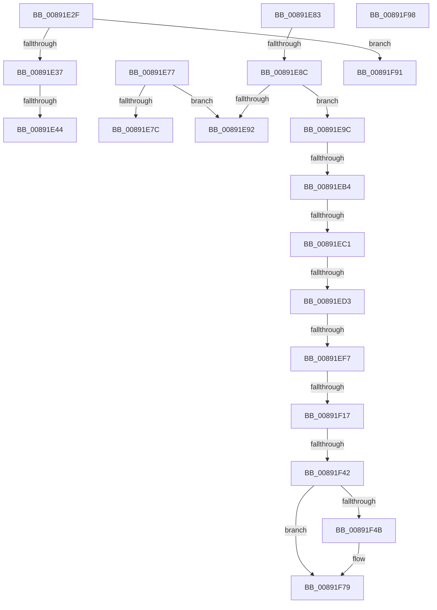

# sub_00891E2F

- RVA: `0x00891E2F`–`0x00891F9F` (길이 `368` bytes)
- VA: `0x0000000140891E2F`
- 실행 섹션: `PAGE`
- PDB 이름 있음: `아니요`; PDB Function 태그: `아니요`
- unwind 정보 RVA: `0x0007DAC0`
- 디코드: `80`개 명령, `368/368` bytes 표시
- 미해석 바이트: `0` (있으면 어셈블리에 `.byte`로 보존)

> 이 문서는 커널 이미지의 기계어와 PDB 기호를 분석해 생성했습니다. 4번과 5번은 함수 원형과 자료형을 바이너리 사용 방식에서 추정한 C 해석이며 원본 소스 복구 결과는 아닙니다.

## 1. Dependencies

- 직접 호출 지점: **8**; 고유 호출 대상: **5**
- 직접 호출자로 확인된 함수: **0**
- RIP 상대 이미지 참조: **1**

### Outgoing calls
- `0x00891E54` → [ObpPushStackInfo](../../text/21/ObpPushStackInfo_function_002109E4.md) (function, `0x002109E4`)
- `0x00891E6D` → [ObpPushStackInfo](../../text/21/ObpPushStackInfo_function_002109E4.md) (function, `0x002109E4`)
- `0x00891EDF` → [PsReferencePrimaryTokenWithTag](../../text/20/PsReferencePrimaryTokenWithTag_function_0020FF80.md) (function, `0x0020FF80`)
- `0x00891EFE` → [SepGetAnonymousToken](../../text/30/SepGetAnonymousToken_function_00301830.md) (function, `0x00301830`)
- `0x00891F09` → [ObfDereferenceObject](../../text/2F/ObfDereferenceObject_function_002F9350.md) (function, `0x002F9350`)
- `0x00891F35` → [ObInsertObjectEx](../8B/ObInsertObjectEx_function_008B97A0.md) (function, `0x008B97A0`)
- `0x00891F5B` → [ObpPushStackInfo](../../text/21/ObpPushStackInfo_function_002109E4.md) (function, `0x002109E4`)
- `0x00891F74` → [ObpPushStackInfo](../../text/21/ObpPushStackInfo_function_002109E4.md) (function, `0x002109E4`)

### Direct callers
- 이 함수 시작 RVA로 연결되는 직접 call은 확인되지 않았습니다. 간접 호출은 완전히 역산할 수 없습니다.

### Static image references
- `0x00891E37` → RVA `0x00FC5010` (`ALMOSTRO`; read)

## 2. Other-region calls and transfers

- 다른 실행 섹션으로 향하는 call: **7**
  - `0x00891E54` → [ObpPushStackInfo](../../text/21/ObpPushStackInfo_function_002109E4.md) (`PAGE` → `.text`)
  - `0x00891E6D` → [ObpPushStackInfo](../../text/21/ObpPushStackInfo_function_002109E4.md) (`PAGE` → `.text`)
  - `0x00891EDF` → [PsReferencePrimaryTokenWithTag](../../text/20/PsReferencePrimaryTokenWithTag_function_0020FF80.md) (`PAGE` → `.text`)
  - `0x00891EFE` → [SepGetAnonymousToken](../../text/30/SepGetAnonymousToken_function_00301830.md) (`PAGE` → `.text`)
  - `0x00891F09` → [ObfDereferenceObject](../../text/2F/ObfDereferenceObject_function_002F9350.md) (`PAGE` → `.text`)
  - `0x00891F5B` → [ObpPushStackInfo](../../text/21/ObpPushStackInfo_function_002109E4.md) (`PAGE` → `.text`)
  - `0x00891F74` → [ObpPushStackInfo](../../text/21/ObpPushStackInfo_function_002109E4.md) (`PAGE` → `.text`)
- call이 아닌 외부 분기/꼬리 이동: **14**
  - `0x00891E3E` → [sub_00891CF4 + 0x3B](Unknown_function_00891CF4.md) (`tail-transfer`)
  - `0x00891E72` → [sub_00891CF4 + 0x3B](Unknown_function_00891CF4.md) (`tail-transfer`)
  - `0x00891E7E` → [sub_00891D68 + 0xB](Unknown_function_00891D68.md) (`tail-transfer`)
  - `0x00891E86` → [sub_00891D68 + 0x1D](Unknown_function_00891D68.md) (`tail-transfer`)
  - `0x00891E97` → [sub_00891CF4 + 0x5F](Unknown_function_00891CF4.md) (`tail-transfer`)
  - `0x00891EAE` → [sub_0089208C](Unknown_function_0089208C.md) (`tail-transfer`)
  - `0x00891EBB` → [sub_0089208C + 0x1C](Unknown_function_0089208C.md) (`tail-transfer`)
  - `0x00891ECD` → [sub_00892017](Unknown_function_00892017.md) (`tail-transfer`)
  - `0x00891EF1` → [sub_0089208C + 0x20](Unknown_function_0089208C.md) (`tail-transfer`)
  - `0x00891F11` → [sub_0089208C + 0x14](Unknown_function_0089208C.md) (`tail-transfer`)
  - `0x00891F3C` → [sub_00891CF4 + 0x5F](Unknown_function_00891CF4.md) (`tail-transfer`)
  - `0x00891F8C` → [sub_00891CF4 + 0x52](Unknown_function_00891CF4.md) (`tail-transfer`)
  - `0x00891F93` → [sub_00891CF4 + 0x5F](Unknown_function_00891CF4.md) (`tail-transfer`)
  - `0x00891F9A` → [sub_00891D68 + 0x33](Unknown_function_00891D68.md) (`tail-transfer`)

## 3. Assembly (complete function range)

```asm
00891E2F  85 FF                           test edi, edi
00891E31  0F 88 5A 01 00 00               js 0x140891f91
00891E37  83 3D D2 31 73 00 00            cmp dword ptr [rip + 0x7331d2], 0
00891E3E  0F 84 EB FE FF FF               je 0x140891d2f
00891E44  33 D2                           xor edx, edx
00891E46  49 8D 4F D0                     lea rcx, [r15 - 0x30]
00891E4A  41 B9 44 66 6C 74               mov r9d, 0x746c6644
00891E50  44 8D 42 01                     lea r8d, [rdx + 1]
00891E54  E8 8B EB 97 FF                  call 0x1402109e4
00891E59  41 B8 01 00 00 00               mov r8d, 1
00891E5F  49 8D 4F D0                     lea rcx, [r15 - 0x30]
00891E63  41 0F B6 D0                     movzx edx, r8b
00891E67  41 B9 53 65 43 63               mov r9d, 0x63436553
00891E6D  E8 72 EB 97 FF                  call 0x1402109e4
00891E72  E9 B8 FE FF FF                  jmp 0x140891d2f
00891E77  38 55 60                        cmp byte ptr [rbp + 0x60], dl
00891E7A  74 16                           je 0x140891e92
00891E7C  B2 01                           mov dl, 1
00891E7E  E9 F0 FE FF FF                  jmp 0x140891d73
00891E83  83 F9 03                        cmp ecx, 3
00891E86  0F 84 F9 FE FF FF               je 0x140891d85
00891E8C  44 38 6D 60                     cmp byte ptr [rbp + 0x60], r13b
00891E90  75 0A                           jne 0x140891e9c
00891E92  B8 A5 00 00 C0                  mov eax, 0xc00000a5
00891E97  E9 B7 FE FF FF                  jmp 0x140891d53
00891E9C  48 8B 9D 80 00 00 00            mov rbx, qword ptr [rbp + 0x80]
00891EA3  41 F7 87 C8 00 00 00 00 40 00 00  test dword ptr [r15 + 0xc8], 0x4000
00891EAE  0F 85 D8 01 00 00               jne 0x14089208c
00891EB4  48 8B 45 68                     mov rax, qword ptr [rbp + 0x68]
00891EB8  48 85 C0                        test rax, rax
00891EBB  0F 84 E7 01 00 00               je 0x1408920a8
00891EC1  65 48 8B 0C 25 88 01 00 00      mov rcx, qword ptr gs:[0x188]
00891ECA  48 3B C1                        cmp rax, rcx
00891ECD  0F 84 44 01 00 00               je 0x140892017
00891ED3  48 8B 88 20 02 00 00            mov rcx, qword ptr [rax + 0x220]
00891EDA  BA 44 66 6C 74                  mov edx, 0x746c6644
00891EDF  E8 9C E0 97 FF                  call 0x14020ff80
00891EE4  48 8B F8                        mov rdi, rax
00891EE7  F7 80 C8 00 00 00 00 40 00 00   test dword ptr [rax + 0xc8], 0x4000
00891EF1  0F 85 B5 01 00 00               jne 0x1408920ac
00891EF7  49 8B CD                        mov rcx, r13
00891EFA  48 8D 55 38                     lea rdx, [rbp + 0x38]
00891EFE  E8 2D F9 A6 FF                  call 0x140301830
00891F03  48 8B CF                        mov rcx, rdi
00891F06  44 8B F8                        mov r15d, eax
00891F09  E8 42 74 A6 FF                  call 0x1402f9350
00891F0E  45 85 FF                        test r15d, r15d
00891F11  0F 88 89 01 00 00               js 0x1408920a0
00891F17  4C 8B 7D 38                     mov r15, qword ptr [rbp + 0x38]
00891F1B  45 33 C9                        xor r9d, r9d
00891F1E  4C 89 6C 24 30                  mov qword ptr [rsp + 0x30], r13
00891F23  49 8B CF                        mov rcx, r15
00891F26  4C 89 6C 24 28                  mov qword ptr [rsp + 0x28], r13
00891F2B  45 33 C0                        xor r8d, r8d
00891F2E  33 D2                           xor edx, edx
00891F30  44 89 6C 24 20                  mov dword ptr [rsp + 0x20], r13d
00891F35  E8 66 78 02 00                  call 0x1408b97a0
00891F3A  85 C0                           test eax, eax
00891F3C  0F 88 11 FE FF FF               js 0x140891d53
00891F42  44 39 2D C7 30 73 00            cmp dword ptr [rip + 0x7330c7], r13d
00891F49  74 2E                           je 0x140891f79
00891F4B  33 D2                           xor edx, edx
00891F4D  49 8D 4F D0                     lea rcx, [r15 - 0x30]
00891F51  41 B9 44 66 6C 74               mov r9d, 0x746c6644
00891F57  44 8D 42 01                     lea r8d, [rdx + 1]
00891F5B  E8 84 EA 97 FF                  call 0x1402109e4
00891F60  41 B8 01 00 00 00               mov r8d, 1
00891F66  49 8D 4F D0                     lea rcx, [r15 - 0x30]
00891F6A  41 0F B6 D0                     movzx edx, r8b
00891F6E  41 B9 53 65 43 63               mov r9d, 0x63436553
00891F74  E8 6B EA 97 FF                  call 0x1402109e4
00891F79  48 C7 03 0C 00 00 00            mov qword ptr [rbx], 0xc
00891F80  44 88 6B 08                     mov byte ptr [rbx + 8], r13b
00891F84  0F B6 46 09                     movzx eax, byte ptr [rsi + 9]
00891F88  44 88 6B 18                     mov byte ptr [rbx + 0x18], r13b
00891F8C  E9 B5 FD FF FF                  jmp 0x140891d46
00891F91  8B C7                           mov eax, edi
00891F93  E9 BB FD FF FF                  jmp 0x140891d53
00891F98  B0 01                           mov al, 1
00891F9A  E9 FC FD FF FF                  jmp 0x140891d9b
```

## 4. C-style interpretation (structured pseudocode)

```c
__int64 __fastcall sub_00891E2F(__int64 a1, int a2)
{
    __int64 result;
    unsigned int v_stack_p20;
    unsigned __int64 v_stack_p28;
    unsigned __int64 v_stack_p30;

    if (sign_flag) goto loc_00891F91;
    a2 = 0;
    result = ObpPushStackInfo(v_r15 - 48, a2, a2 + 1, (unsigned int)(0x746C6644ULL));
    result = ObpPushStackInfo(v_r15 - 48, 1, 1, (unsigned int)(0x63436553ULL));
loc_00891F91:
}
```

## 5. (Beta) C Style

```c
int64_t sub_00891E2F(int64_t Arg1, int32_t Arg2)
{
    int64_t result;
    uint32_t v_stack_p20;
    uint64_t v_stack_p28;
    uint64_t v_stack_p30;

    if (sign_flag) goto loc_00891F91;
    Arg2 = 0;
    result = ObpPushStackInfo(local_r15 - 48, Arg2, Arg2 + 1, (uint32_t)(0x746C6644ULL));
    result = ObpPushStackInfo(local_r15 - 48, 1, 1, (uint32_t)(0x63436553ULL));
loc_00891F91:
}
```

## 6. Execution-region graph

[열기: 2D/3D 그래프와 함수 탐색 컨트롤 패널](../../../control-panel.html?section=page&rva=0x00891E2F&view=graph)

- 2D 그래프는 위에서 아래로 흐르고, 3D 그래프는 빈 공간을 드래그해 회전합니다. Shift+드래그는 이동, 휠은 확대·축소, 함수 노드 선택은 대상 보고서 이동입니다.

### Static fallback


