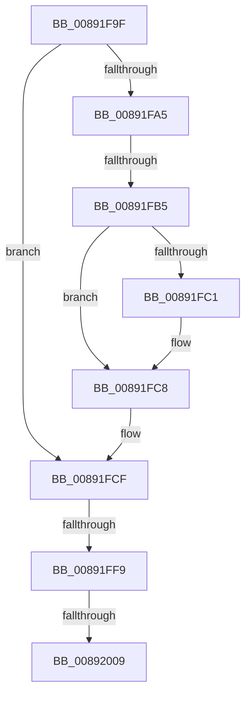

# sub_00891F9F

- RVA: `0x00891F9F`–`0x00892017` (길이 `120` bytes)
- VA: `0x0000000140891F9F`
- 실행 섹션: `PAGE`
- PDB 이름 있음: `아니요`; PDB Function 태그: `아니요`
- unwind 정보 RVA: `0x0007DAD0`
- 디코드: `30`개 명령, `120/120` bytes 표시
- 미해석 바이트: `0` (있으면 어셈블리에 `.byte`로 보존)

> 이 문서는 커널 이미지의 기계어와 PDB 기호를 분석해 생성했습니다. 4번과 5번은 함수 원형과 자료형을 바이너리 사용 방식에서 추정한 C 해석이며 원본 소스 복구 결과는 아닙니다.

## 1. Dependencies

- 직접 호출 지점: **3**; 고유 호출 대상: **3**
- 직접 호출자로 확인된 함수: **0**
- RIP 상대 이미지 참조: **0**

### Outgoing calls
- `0x00891FC3` → [ExFreePoolWithTag](../../poolcode/B8/ExFreePoolWithTag_function_00B82870.md) (function, `0x00B82870`)
- `0x00891FEA` → [ObInsertObjectEx](../8B/ObInsertObjectEx_function_008B97A0.md) (function, `0x008B97A0`)
- `0x00892009` → [SepFinalizeTokenAcls](../8B/SepFinalizeTokenAcls_function_008B63F4.md) (function, `0x008B63F4`)

### Direct callers
- 이 함수 시작 RVA로 연결되는 직접 call은 확인되지 않았습니다. 간접 호출은 완전히 역산할 수 없습니다.

### Static image references
- 디코드된 RIP-relative 메모리 참조가 없습니다.

## 2. Other-region calls and transfers

- 다른 실행 섹션으로 향하는 call: **1**
  - `0x00891FC3` → [ExFreePoolWithTag](../../poolcode/B8/ExFreePoolWithTag_function_00B82870.md) (`PAGE` → `POOLCODE`)
- call이 아닌 외부 분기/꼬리 이동: **4**
  - `0x00891FB3` → [sub_00892023](Unknown_function_00892023.md) (`tail-transfer`)
  - `0x00891FF3` → [sub_00891DF4 + 0x30](Unknown_function_00891DF4.md) (`tail-transfer`)
  - `0x00892007` → [sub_00892023 + 0x3F](Unknown_function_00892023.md) (`tail-transfer`)
  - `0x00892012` → [sub_00891DF4 + 0x33](Unknown_function_00891DF4.md) (`tail-transfer`)

## 3. Assembly (complete function range)

```asm
00891F9F  44 38 6D 70                     cmp byte ptr [rbp + 0x70], r13b
00891FA3  74 2A                           je 0x140891fcf
00891FA5  4C 8B 65 78                     mov r12, qword ptr [rbp + 0x78]
00891FA9  4D 8B FD                        mov r15, r13
00891FAC  48 8B 7D 38                     mov rdi, qword ptr [rbp + 0x38]
00891FB0  4D 85 E4                        test r12, r12
00891FB3  75 6E                           jne 0x140892023
00891FB5  48 8B 8F 50 04 00 00            mov rcx, qword ptr [rdi + 0x450]
00891FBC  48 85 C9                        test rcx, rcx
00891FBF  74 07                           je 0x140891fc8
00891FC1  33 D2                           xor edx, edx
00891FC3  E8 A8 08 2F 00                  call 0x140b82870
00891FC8  4C 89 BF 50 04 00 00            mov qword ptr [rdi + 0x450], r15
00891FCF  48 8B 4D 38                     mov rcx, qword ptr [rbp + 0x38]
00891FD3  45 33 C9                        xor r9d, r9d
00891FD6  4C 89 6C 24 30                  mov qword ptr [rsp + 0x30], r13
00891FDB  45 33 C0                        xor r8d, r8d
00891FDE  4C 89 6C 24 28                  mov qword ptr [rsp + 0x28], r13
00891FE3  33 D2                           xor edx, edx
00891FE5  44 89 6C 24 20                  mov dword ptr [rsp + 0x20], r13d
00891FEA  E8 B1 77 02 00                  call 0x1408b97a0
00891FEF  8B F8                           mov edi, eax
00891FF1  85 C0                           test eax, eax
00891FF3  0F 88 2B FE FF FF               js 0x140891e24
00891FF9  48 8B 4D 38                     mov rcx, qword ptr [rbp + 0x38]
00891FFD  F7 81 C8 00 00 00 00 40 00 00   test dword ptr [rcx + 0xc8], 0x4000
00892007  75 59                           jne 0x140892062
00892009  E8 E6 43 02 00                  call 0x1408b63f4
0089200E  4C 8B 7D 38                     mov r15, qword ptr [rbp + 0x38]
00892012  E9 10 FE FF FF                  jmp 0x140891e27
```

## 4. C-style interpretation (structured pseudocode)

```c
__int64 __fastcall sub_00891F9F(__int64 a1, int a2, int a3, int a4)
{
    __int64 result;
    unsigned int v_stack_p20;
    unsigned __int64 v_stack_p28;
    unsigned __int64 v_stack_p30;

    if ((*(unsigned __int8 *)(v_rbp + 112)) == ((unsigned __int8)(v_r13))) goto loc_00891FCF;
    if (*(unsigned __int64 *)(*(unsigned __int64 *)(v_rbp + 56) + 1104) != 0) {
        a2 = 0;
        result = ExFreePoolWithTag(*(unsigned __int64 *)(*(unsigned __int64 *)(v_rbp + 56) + 1104), a2, a3, a4);
    }
    *(unsigned __int64 *)(*(unsigned __int64 *)(v_rbp + 56) + 1104) = v_r13;
loc_00891FCF:
    a4 = 0;
    v_stack_p30 = v_r13;
    a3 = 0;
    v_stack_p28 = v_r13;
    a2 = 0;
    v_stack_p20 = (unsigned int)(v_r13);
    result = ObInsertObjectEx(*(unsigned __int64 *)(v_rbp + 56), a2, a3, a4);
    result = SepFinalizeTokenAcls(*(unsigned __int64 *)(v_rbp + 56), a2, a3, a4);
}
```

## 5. (Beta) C Style

```c
int64_t sub_00891F9F(int64_t Arg1, int32_t Arg2, int32_t Arg3, int32_t Arg4)
{
    int64_t result;
    uint32_t v_stack_p20;
    uint64_t v_stack_p28;
    uint64_t v_stack_p30;

    if ((*(uint8_t *)(local_rbp + 0x70)) == ((uint8_t)(local_r13))) goto loc_00891FCF;
    if (*(uint64_t *)(*(uint64_t *)(local_rbp + 0x38) + 0x450) != 0) {
        Arg2 = 0;
        result = ExFreePoolWithTag(*(uint64_t *)(*(uint64_t *)(local_rbp + 0x38) + 0x450), Arg2, Arg3, Arg4);
    }
    *(uint64_t *)(*(uint64_t *)(local_rbp + 0x38) + 0x450) = local_r13;
loc_00891FCF:
    Arg4 = 0;
    v_stack_p30 = local_r13;
    Arg3 = 0;
    v_stack_p28 = local_r13;
    Arg2 = 0;
    v_stack_p20 = (uint32_t)(local_r13);
    result = ObInsertObjectEx(*(uint64_t *)(local_rbp + 0x38), Arg2, Arg3, Arg4);
    result = SepFinalizeTokenAcls(*(uint64_t *)(local_rbp + 0x38), Arg2, Arg3, Arg4);
}
```

## 6. Execution-region graph

[열기: 2D/3D 그래프와 함수 탐색 컨트롤 패널](../../../control-panel.html?section=page&rva=0x00891F9F&view=graph)

- 2D 그래프는 위에서 아래로 흐르고, 3D 그래프는 빈 공간을 드래그해 회전합니다. Shift+드래그는 이동, 휠은 확대·축소, 함수 노드 선택은 대상 보고서 이동입니다.

### Static fallback


