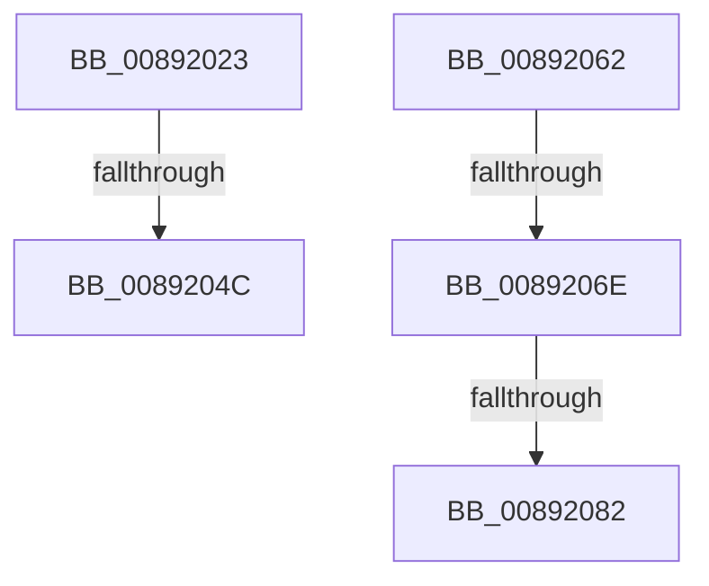

# sub_00892023

- RVA: `0x00892023`–`0x0089208C` (길이 `105` bytes)
- VA: `0x0000000140892023`
- 실행 섹션: `PAGE`
- PDB 이름 있음: `아니요`; PDB Function 태그: `아니요`
- unwind 정보 RVA: `0x0007DAF4`
- 디코드: `26`개 명령, `105/105` bytes 표시
- 미해석 바이트: `0` (있으면 어셈블리에 `.byte`로 보존)

> 이 문서는 커널 이미지의 기계어와 PDB 기호를 분석해 생성했습니다. 4번과 5번은 함수 원형과 자료형을 바이너리 사용 방식에서 추정한 C 해석이며 원본 소스 복구 결과는 아닙니다.

## 1. Dependencies

- 직접 호출 지점: **4**; 고유 호출 대상: **4**
- 직접 호출자로 확인된 함수: **0**
- RIP 상대 이미지 참조: **0**

### Outgoing calls
- `0x0089203F` → [ExAllocatePool2](../../poolcode/B8/ExAllocatePool2_function_00B820F0.md) (function, `0x00B820F0`)
- `0x00892055` → [RtlCopySid](../9A/RtlCopySid_function_009A9A50.md) (function, `0x009A9A50`)
- `0x00892073` → [SepAppendAceToTokenObjectAcl](../8B/SepAppendAceToTokenObjectAcl_function_008B6430.md) (function, `0x008B6430`)
- `0x00892082` → [ObfDereferenceObject](../../text/2F/ObfDereferenceObject_function_002F9350.md) (function, `0x002F9350`)

### Direct callers
- 이 함수 시작 RVA로 연결되는 직접 call은 확인되지 않았습니다. 간접 호출은 완전히 역산할 수 없습니다.

### Static image references
- 디코드된 RIP-relative 메모리 참조가 없습니다.

## 2. Other-region calls and transfers

- 다른 실행 섹션으로 향하는 call: **2**
  - `0x0089203F` → [ExAllocatePool2](../../poolcode/B8/ExAllocatePool2_function_00B820F0.md) (`PAGE` → `POOLCODE`)
  - `0x00892082` → [ObfDereferenceObject](../../text/2F/ObfDereferenceObject_function_002F9350.md) (`PAGE` → `.text`)
- call이 아닌 외부 분기/꼬리 이동: **5**
  - `0x0089204A` → [sub_008920B4](Unknown_function_008920B4.md) (`tail-transfer`)
  - `0x0089205D` → [sub_00891F9F + 0x16](Unknown_function_00891F9F.md) (`tail-transfer`)
  - `0x0089206C` → [sub_00891F9F + 0x6A](Unknown_function_00891F9F.md) (`tail-transfer`)
  - `0x00892080` → [sub_00891F9F + 0x6A](Unknown_function_00891F9F.md) (`tail-transfer`)
  - `0x00892087` → [sub_00891DF4 + 0x30](Unknown_function_00891DF4.md) (`tail-transfer`)

## 3. Assembly (complete function range)

```asm
00892023  41 0F B6 44 24 01               movzx eax, byte ptr [r12 + 1]
00892029  B9 00 01 00 00                  mov ecx, 0x100
0089202E  41 B8 53 65 53 69               mov r8d, 0x69536553
00892034  44 8D 2C 85 08 00 00 00         lea r13d, [rax*4 + 8]
0089203C  41 8B D5                        mov edx, r13d
0089203F  E8 AC 00 2F 00                  call 0x140b820f0
00892044  4C 8B F8                        mov r15, rax
00892047  48 85 C0                        test rax, rax
0089204A  74 68                           je 0x1408920b4
0089204C  4D 8B C4                        mov r8, r12
0089204F  48 8B D0                        mov rdx, rax
00892052  41 8B CD                        mov ecx, r13d
00892055  E8 F6 79 11 00                  call 0x1409a9a50
0089205A  45 33 ED                        xor r13d, r13d
0089205D  E9 53 FF FF FF                  jmp 0x140891fb5
00892062  4C 8B 81 10 03 00 00            mov r8, qword ptr [rcx + 0x310]
00892069  4D 85 C0                        test r8, r8
0089206C  74 9B                           je 0x140892009
0089206E  BA FF 01 0F 00                  mov edx, 0xf01ff
00892073  E8 B8 43 02 00                  call 0x1408b6430
00892078  48 8B 4D 38                     mov rcx, qword ptr [rbp + 0x38]
0089207C  8B F8                           mov edi, eax
0089207E  85 C0                           test eax, eax
00892080  79 87                           jns 0x140892009
00892082  E8 C9 72 A6 FF                  call 0x1402f9350
00892087  E9 98 FD FF FF                  jmp 0x140891e24
```

## 4. C-style interpretation (structured pseudocode)

```c
__int64 __fastcall sub_00892023(void)
{
    __int64 result;
    __int64 v_r13;

    result = ExAllocatePool2(256, (unsigned int)((unsigned int)(*(unsigned __int8 *)(v_r12 + 1) * 4 + 8)), (unsigned int)(0x69536553ULL), a4);
    result = RtlCopySid((unsigned int)((unsigned int)(*(unsigned __int8 *)(v_r12 + 1) * 4 + 8)), result, v_r12, a4);
    v_r13 = 0;
}
```

## 5. (Beta) C Style

```c
void sub_00892023(void)
{
    int64_t result;
    int64_t local_r13;

    result = ExAllocatePool2(256, (uint32_t)((uint32_t)(*(uint8_t *)(local_r12 + 0x1) * 4 + 8)), (uint32_t)(0x69536553ULL), a4);
    result = RtlCopySid((uint32_t)((uint32_t)(*(uint8_t *)(local_r12 + 0x1) * 4 + 8)), result, local_r12, a4);
    local_r13 = 0;
}
```

## 6. Execution-region graph

[열기: 2D/3D 그래프와 함수 탐색 컨트롤 패널](../../../control-panel.html?section=page&rva=0x00892023&view=graph)

- 2D 그래프는 위에서 아래로 흐르고, 3D 그래프는 빈 공간을 드래그해 회전합니다. Shift+드래그는 이동, 휠은 확대·축소, 함수 노드 선택은 대상 보고서 이동입니다.

### Static fallback


