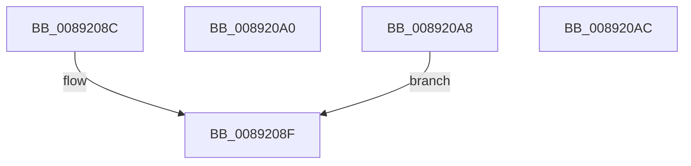

# sub_0089208C

- RVA: `0x0089208C`–`0x008920B4` (길이 `40` bytes)
- VA: `0x000000014089208C`
- 실행 섹션: `PAGE`
- PDB 이름 있음: `아니요`; PDB Function 태그: `아니요`
- unwind 정보 RVA: `0x0007DB08`
- 디코드: `11`개 명령, `40/40` bytes 표시
- 미해석 바이트: `0` (있으면 어셈블리에 `.byte`로 보존)

> 이 문서는 커널 이미지의 기계어와 PDB 기호를 분석해 생성했습니다. 4번과 5번은 함수 원형과 자료형을 바이너리 사용 방식에서 추정한 C 해석이며 원본 소스 복구 결과는 아닙니다.

## 1. Dependencies

- 직접 호출 지점: **1**; 고유 호출 대상: **1**
- 직접 호출자로 확인된 함수: **0**
- RIP 상대 이미지 참조: **0**

### Outgoing calls
- `0x00892093` → [SepGetAnonymousToken](../../text/30/SepGetAnonymousToken_function_00301830.md) (function, `0x00301830`)

### Direct callers
- 이 함수 시작 RVA로 연결되는 직접 call은 확인되지 않았습니다. 간접 호출은 완전히 역산할 수 없습니다.

### Static image references
- 디코드된 RIP-relative 메모리 참조가 없습니다.

## 2. Other-region calls and transfers

- 다른 실행 섹션으로 향하는 call: **1**
  - `0x00892093` → [SepGetAnonymousToken](../../text/30/SepGetAnonymousToken_function_00301830.md) (`PAGE` → `.text`)
- call이 아닌 외부 분기/꼬리 이동: **3**
  - `0x0089209B` → [sub_00891E2F + 0xDF](Unknown_function_00891E2F.md) (`tail-transfer`)
  - `0x008920A3` → [sub_00891CF4 + 0x5F](Unknown_function_00891CF4.md) (`tail-transfer`)
  - `0x008920AF` → [sub_00891E2F + 0xCB](Unknown_function_00891E2F.md) (`tail-transfer`)

## 3. Assembly (complete function range)

```asm
0089208C  49 8B CF                        mov rcx, r15
0089208F  48 8D 55 38                     lea rdx, [rbp + 0x38]
00892093  E8 98 F7 A6 FF                  call 0x140301830
00892098  44 8B F8                        mov r15d, eax
0089209B  E9 6E FE FF FF                  jmp 0x140891f0e
008920A0  41 8B C7                        mov eax, r15d
008920A3  E9 AB FC FF FF                  jmp 0x140891d53
008920A8  33 C9                           xor ecx, ecx
008920AA  EB E3                           jmp 0x14089208f
008920AC  48 8B CF                        mov rcx, rdi
008920AF  E9 46 FE FF FF                  jmp 0x140891efa
```

## 4. C-style interpretation (structured pseudocode)

```c
__int64 __fastcall sub_0089208C(void)
{
    __int64 result;

loc_0089208F:
    result = SepGetAnonymousToken(v_r15, v_rbp + 56, a3, a4);
}
```

## 5. (Beta) C Style

```c
void sub_0089208C(void)
{
    int64_t result;

loc_0089208F:
    result = SepGetAnonymousToken(local_r15, local_rbp + 56, a3, a4);
}
```

## 6. Execution-region graph

[열기: 2D/3D 그래프와 함수 탐색 컨트롤 패널](../../../control-panel.html?section=page&rva=0x0089208C&view=graph)

- 2D 그래프는 위에서 아래로 흐르고, 3D 그래프는 빈 공간을 드래그해 회전합니다. Shift+드래그는 이동, 휠은 확대·축소, 함수 노드 선택은 대상 보고서 이동입니다.

### Static fallback


