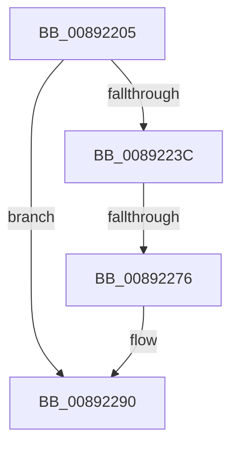

# sub_00892205

- RVA: `0x00892205`–`0x008922A8` (길이 `163` bytes)
- VA: `0x0000000140892205`
- 실행 섹션: `PAGE`
- PDB 이름 있음: `아니요`; PDB Function 태그: `아니요`
- unwind 정보 RVA: `0x0007DB7C`
- 디코드: `39`개 명령, `163/163` bytes 표시
- 미해석 바이트: `0` (있으면 어셈블리에 `.byte`로 보존)

> 이 문서는 커널 이미지의 기계어와 PDB 기호를 분석해 생성했습니다. 4번과 5번은 함수 원형과 자료형을 바이너리 사용 방식에서 추정한 C 해석이며 원본 소스 복구 결과는 아닙니다.

## 1. Dependencies

- 직접 호출 지점: **4**; 고유 호출 대상: **4**
- 직접 호출자로 확인된 함수: **0**
- RIP 상대 이미지 참조: **1**

### Outgoing calls
- `0x00892225` → [ExAllocatePool2](../../poolcode/B8/ExAllocatePool2_function_00B820F0.md) (function, `0x00B820F0`)
- `0x00892244` → [memset](../../text/6C/memset_function_006C6C40.md) (function, `0x006C6C40`)
- `0x00892257` → [memcpy](../../text/6C/memcpy_function_006C6840.md) (function, `0x006C6840`)
- `0x00892280` → [ExFreeToPagedLookasideList](../../text/38/ExFreeToPagedLookasideList_function_00387D30.md) (function, `0x00387D30`)

### Direct callers
- 이 함수 시작 RVA로 연결되는 직접 call은 확인되지 않았습니다. 간접 호출은 완전히 역산할 수 없습니다.

### Static image references
- `0x00892279` → RVA `0x00E27280` (`.data`; read)

## 2. Other-region calls and transfers

- 다른 실행 섹션으로 향하는 call: **4**
  - `0x00892225` → [ExAllocatePool2](../../poolcode/B8/ExAllocatePool2_function_00B820F0.md) (`PAGE` → `POOLCODE`)
  - `0x00892244` → [memset](../../text/6C/memset_function_006C6C40.md) (`PAGE` → `.text`)
  - `0x00892257` → [memcpy](../../text/6C/memcpy_function_006C6840.md) (`PAGE` → `.text`)
  - `0x00892280` → [ExFreeToPagedLookasideList](../../text/38/ExFreeToPagedLookasideList_function_00387D30.md) (`PAGE` → `.text`)
- call이 아닌 외부 분기/꼬리 이동: **2**
  - `0x00892270` → [sub_00892302](Unknown_function_00892302.md) (`tail-transfer`)
  - `0x008922A6` → [sub_008922EC](Unknown_function_008922EC.md) (`tail-transfer`)

## 3. Assembly (complete function range)

```asm
00892205  4C 89 74 24 58                  mov qword ptr [rsp + 0x58], r14
0089220A  41 B8 41 6C 48 61               mov r8d, 0x61486c41
00892210  4C 89 7C 24 60                  mov qword ptr [rsp + 0x60], r15
00892215  B9 00 01 00 00                  mov ecx, 0x100
0089221A  4C 8D 3C ED 00 00 00 00         lea r15, [rbp*8]
00892222  49 8B D7                        mov rdx, r15
00892225  E8 C6 FE 2E 00                  call 0x140b820f0
0089222A  48 C7 C3 FF FF FF FF            mov rbx, 0xffffffffffffffff
00892231  4C 8B F0                        mov r14, rax
00892234  48 8B FB                        mov rdi, rbx
00892237  48 85 C0                        test rax, rax
0089223A  74 54                           je 0x140892290
0089223C  4D 8B C7                        mov r8, r15
0089223F  33 D2                           xor edx, edx
00892241  48 8B C8                        mov rcx, rax
00892244  E8 F7 49 E3 FF                  call 0x1406c6c40
00892249  4C 8B 46 10                     mov r8, qword ptr [rsi + 0x10]
0089224D  49 8B CE                        mov rcx, r14
00892250  48 8B 16                        mov rdx, qword ptr [rsi]
00892253  49 C1 E0 03                     shl r8, 3
00892257  E8 E4 45 E3 FF                  call 0x1406c6840
0089225C  48 8B 7E 10                     mov rdi, qword ptr [rsi + 0x10]
00892260  49 8B 45 00                     mov rax, qword ptr [r13]
00892264  49 89 04 FE                     mov qword ptr [r14 + rdi*8], rax
00892268  48 83 7E 10 10                  cmp qword ptr [rsi + 0x10], 0x10
0089226D  48 8B 0E                        mov rcx, qword ptr [rsi]
00892270  0F 85 8C 00 00 00               jne 0x140892302
00892276  48 8B D1                        mov rdx, rcx
00892279  48 8D 0D 00 50 59 00            lea rcx, [rip + 0x595000]
00892280  E8 AB 5A AF FF                  call 0x140387d30
00892285  4C 89 36                        mov qword ptr [rsi], r14
00892288  48 83 C7 10                     add rdi, 0x10
0089228C  48 89 6E 10                     mov qword ptr [rsi + 0x10], rbp
00892290  F0 48 0F C1 5E 08               lock xadd qword ptr [rsi + 8], rbx
00892296  4C 8B 7C 24 60                  mov r15, qword ptr [rsp + 0x60]
0089229B  80 E3 06                        and bl, 6
0089229E  4C 8B 74 24 58                  mov r14, qword ptr [rsp + 0x58]
008922A3  80 FB 02                        cmp bl, 2
008922A6  74 44                           je 0x1408922ec
```

## 4. C-style interpretation (structured pseudocode)

```c
__int64 __fastcall sub_00892205(__int64 a1, __int64 a2, __int64 a3, __int64 a4, __int64 a5, __int64 a6, __int64 a7, __int64 a8, __int64 a9, __int64 a10, __int64 a11, __int64 a12)
{
    __int64 result;
    __int64 v_rbx;
    __int64 v_rdi;
    unsigned __int64 v_stack_p58;
    unsigned __int64 v_stack_p60;

    v_stack_p58 = v_r14;
    v_stack_p60 = v_r15;
    result = ExAllocatePool2(256, v_rbp * 8, (unsigned int)(0x61486C41ULL), a4);
    if (result == 0) goto loc_00892290;
    a2 = 0;
    result = memset(result, a2, v_rbp * 8, a4);
    a3 = (*(unsigned __int64 *)(v_rsi + 16)) << (3);
    result = memcpy(result, *(unsigned __int64 *)(v_rsi), a3, a4);
    *(unsigned __int64 *)(result + *(unsigned __int64 *)(v_rsi + 16) * 8) = *(unsigned __int64 *)(v_r13);
    result = ExFreeToPagedLookasideList(v_rip + 5853184, *(unsigned __int64 *)(v_rsi), a3, a4);
    *(unsigned __int64 *)(v_rsi) = result;
    v_rdi = (*(unsigned __int64 *)(v_rsi + 16)) + (16);
    *(unsigned __int64 *)(v_rsi + 16) = v_rbp;
loc_00892290:
    v_rbx = (unsigned __int8)((-1) & (6));
}
```

## 5. (Beta) C Style

```c
int64_t sub_00892205(int64_t Arg1, int64_t Arg2, int64_t Arg3, int64_t Arg4, uint64_t Arg5, uint64_t Arg6, uint64_t Arg7, uint64_t Arg8, uint64_t Arg9, uint64_t Arg10, int64_t Arg11, int64_t Arg12)
{
    int64_t result;
    int64_t local_rbx;
    int64_t local_rdi;
    uint64_t v_stack_p58;
    uint64_t v_stack_p60;

    v_stack_p58 = local_r14;
    v_stack_p60 = local_r15;
    result = ExAllocatePool2(256, local_rbp * 8, (uint32_t)(0x61486C41ULL), Arg4);
    if (result == 0) goto loc_00892290;
    Arg2 = 0;
    result = memset(result, Arg2, local_rbp * 8, Arg4);
    Arg3 = (*(uint64_t *)(local_rsi + 0x10)) << (3);
    result = memcpy(result, *(uint64_t *)(local_rsi), Arg3, Arg4);
    *(uint64_t *)(result + *(uint64_t *)(local_rsi + 0x10) * 8) = *(uint64_t *)(local_r13);
    result = ExFreeToPagedLookasideList(v_rip + 5853184, *(uint64_t *)(local_rsi), Arg3, Arg4);
    *(uint64_t *)(local_rsi) = result;
    local_rdi = (*(uint64_t *)(local_rsi + 0x10)) + (16);
    *(uint64_t *)(local_rsi + 0x10) = local_rbp;
loc_00892290:
    local_rbx = (uint8_t)((-1) & (6));
}
```

## 6. Execution-region graph

[열기: 2D/3D 그래프와 함수 탐색 컨트롤 패널](../../../control-panel.html?section=page&rva=0x00892205&view=graph)

- 2D 그래프는 위에서 아래로 흐르고, 3D 그래프는 빈 공간을 드래그해 회전합니다. Shift+드래그는 이동, 휠은 확대·축소, 함수 노드 선택은 대상 보고서 이동입니다.

### Static fallback


