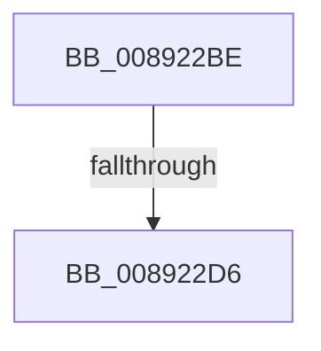

# sub_008922BE

- RVA: `0x008922BE`–`0x008922EC` (길이 `46` bytes)
- VA: `0x00000001408922BE`
- 실행 섹션: `PAGE`
- PDB 이름 있음: `아니요`; PDB Function 태그: `아니요`
- unwind 정보 RVA: `0x0007DBA4`
- 디코드: `11`개 명령, `46/46` bytes 표시
- 미해석 바이트: `0` (있으면 어셈블리에 `.byte`로 보존)

> 이 문서는 커널 이미지의 기계어와 PDB 기호를 분석해 생성했습니다. 4번과 5번은 함수 원형과 자료형을 바이너리 사용 방식에서 추정한 C 해석이며 원본 소스 복구 결과는 아닙니다.

## 1. Dependencies

- 직접 호출 지점: **1**; 고유 호출 대상: **1**
- 직접 호출자로 확인된 함수: **0**
- RIP 상대 이미지 참조: **0**

### Outgoing calls
- `0x008922DA` → [KeAbPostRelease](../../text/2E/KeAbPostRelease_function_002E1600.md) (function, `0x002E1600`)

### Direct callers
- 이 함수 시작 RVA로 연결되는 직접 call은 확인되지 않았습니다. 간접 호출은 완전히 역산할 수 없습니다.

### Static image references
- 디코드된 RIP-relative 메모리 참조가 없습니다.

## 2. Other-region calls and transfers

- 다른 실행 섹션으로 향하는 call: **1**
  - `0x008922DA` → [KeAbPostRelease](../../text/2E/KeAbPostRelease_function_002E1600.md) (`PAGE` → `.text`)
- call이 아닌 외부 분기/꼬리 이동: **2**
  - `0x008922D4` → [sub_008922EC + 0xB](Unknown_function_008922EC.md) (`tail-transfer`)
  - `0x008922E7` → [AlpcAddHandleTableEntry + 0x91](AlpcAddHandleTableEntry_function_00892140.md) (`tail-transfer`)

## 3. Assembly (complete function range)

```asm
008922BE  48 C7 C3 FF FF FF FF            mov rbx, 0xffffffffffffffff
008922C5  48 8B CB                        mov rcx, rbx
008922C8  F0 48 0F C1 4E 08               lock xadd qword ptr [rsi + 8], rcx
008922CE  80 E1 06                        and cl, 6
008922D1  80 F9 02                        cmp cl, 2
008922D4  74 21                           je 0x1408922f7
008922D6  48 8D 4E 08                     lea rcx, [rsi + 8]
008922DA  E8 21 F3 A4 FF                  call 0x1402e1600
008922DF  48 8B 6C 24 50                  mov rbp, qword ptr [rsp + 0x50]
008922E4  48 8B C3                        mov rax, rbx
008922E7  E9 E5 FE FF FF                  jmp 0x1408921d1
```

## 4. C-style interpretation (structured pseudocode)

```c
__int64 __fastcall sub_008922BE(__int64 a1, __int64 a2, __int64 a3, __int64 a4, __int64 a5, __int64 a6, __int64 a7, __int64 a8, __int64 a9, __int64 a10)
{
    __int64 result;

    a1 = (unsigned __int8)((-1) & (6));
    result = KeAbPostRelease(v_rsi + 8, a2, a3, a4);
}
```

## 5. (Beta) C Style

```c
int64_t sub_008922BE(int64_t Arg1, int64_t Arg2, int64_t Arg3, int64_t Arg4, uint64_t Arg5, uint64_t Arg6, uint64_t Arg7, uint64_t Arg8, uint64_t Arg9, int64_t Arg10)
{
    int64_t result;

    Arg1 = (uint8_t)((-1) & (6));
    result = KeAbPostRelease(local_rsi + 8, Arg2, Arg3, Arg4);
}
```

## 6. Execution-region graph

[열기: 2D/3D 그래프와 함수 탐색 컨트롤 패널](../../../control-panel.html?section=page&rva=0x008922BE&view=graph)

- 2D 그래프는 위에서 아래로 흐르고, 3D 그래프는 빈 공간을 드래그해 회전합니다. Shift+드래그는 이동, 휠은 확대·축소, 함수 노드 선택은 대상 보고서 이동입니다.

### Static fallback


