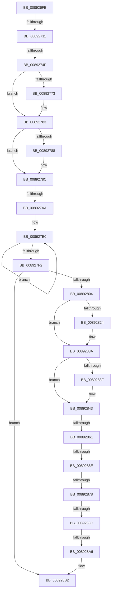

# sub_008926FB

- RVA: `0x008926FB`–`0x008928D9` (길이 `478` bytes)
- VA: `0x00000001408926FB`
- 실행 섹션: `PAGE`
- PDB 이름 있음: `아니요`; PDB Function 태그: `아니요`
- unwind 정보 RVA: `0x0007DC2C`
- 디코드: `106`개 명령, `478/478` bytes 표시
- 미해석 바이트: `0` (있으면 어셈블리에 `.byte`로 보존)

> 이 문서는 커널 이미지의 기계어와 PDB 기호를 분석해 생성했습니다. 4번과 5번은 함수 원형과 자료형을 바이너리 사용 방식에서 추정한 C 해석이며 원본 소스 복구 결과는 아닙니다.

## 1. Dependencies

- 직접 호출 지점: **6**; 고유 호출 대상: **4**
- 직접 호출자로 확인된 함수: **0**
- RIP 상대 이미지 참조: **7**

### Outgoing calls
- `0x00892762` → [KeAbPreAcquire](../../text/21/KeAbPreAcquire_function_00210230.md) (function, `0x00210230`)
- `0x0089277E` → [ExfAcquirePushLockExclusiveEx](../../text/20/ExfAcquirePushLockExclusiveEx_function_0020FC90.md) (function, `0x0020FC90`)
- `0x008927BB` → [memset](../../text/6C/memset_function_006C6C40.md) (function, `0x006C6C40`)
- `0x00892810` → [KeAbPreAcquire](../../text/21/KeAbPreAcquire_function_00210230.md) (function, `0x00210230`)
- `0x00892835` → [ExfAcquirePushLockExclusiveEx](../../text/20/ExfAcquirePushLockExclusiveEx_function_0020FC90.md) (function, `0x0020FC90`)
- `0x008928AD` → [KeAbPostRelease](../../text/2E/KeAbPostRelease_function_002E1600.md) (function, `0x002E1600`)

### Direct callers
- 이 함수 시작 RVA로 연결되는 직접 call은 확인되지 않았습니다. 간접 호출은 완전히 역산할 수 없습니다.

### Static image references
- `0x008927E5` → RVA `0x00FCF300` (`CACHEALI`; read/write)
- `0x008927F8` → RVA `0x00F100D0` (`.data`; read)
- `0x00892807` → RVA `0x00F10080` (`.data`; read)
- `0x00892815` → RVA `0x00F10080` (`.data`; read/write)
- `0x00892843` → RVA `0x00F100C0` (`.data`; read)
- `0x00892851` → RVA `0x00F100B0` (`.data`; read)
- `0x00892878` → RVA `0x00F100C0` (`.data`; write)

## 2. Other-region calls and transfers

- 다른 실행 섹션으로 향하는 call: **6**
  - `0x00892762` → [KeAbPreAcquire](../../text/21/KeAbPreAcquire_function_00210230.md) (`PAGE` → `.text`)
  - `0x0089277E` → [ExfAcquirePushLockExclusiveEx](../../text/20/ExfAcquirePushLockExclusiveEx_function_0020FC90.md) (`PAGE` → `.text`)
  - `0x008927BB` → [memset](../../text/6C/memset_function_006C6C40.md) (`PAGE` → `.text`)
  - `0x00892810` → [KeAbPreAcquire](../../text/21/KeAbPreAcquire_function_00210230.md) (`PAGE` → `.text`)
  - `0x00892835` → [ExfAcquirePushLockExclusiveEx](../../text/20/ExfAcquirePushLockExclusiveEx_function_0020FC90.md) (`PAGE` → `.text`)
  - `0x008928AD` → [KeAbPostRelease](../../text/2E/KeAbPostRelease_function_002E1600.md) (`PAGE` → `.text`)
- call이 아닌 외부 분기/꼬리 이동: **8**
  - `0x0089270B` → [sub_0089294B](Unknown_function_0089294B.md) (`tail-transfer`)
  - `0x00892749` → [sub_0089294B](Unknown_function_0089294B.md) (`tail-transfer`)
  - `0x008927A4` → [sub_00892962](Unknown_function_00892962.md) (`tail-transfer`)
  - `0x0089285B` → [sub_00B194D4](../B1/Unknown_function_00B194D4.md) (`tail-transfer`)
  - `0x00892868` → [sub_00892933](Unknown_function_00892933.md) (`tail-transfer`)
  - `0x00892872` → [sub_00892933](Unknown_function_00892933.md) (`tail-transfer`)
  - `0x00892886` → [sub_00B194D4 + 0xB2](../B1/Unknown_function_00B194D4.md) (`tail-transfer`)
  - `0x008928A0` → [sub_00892933 + 0x7](Unknown_function_00892933.md) (`tail-transfer`)

## 3. Assembly (complete function range)

```asm
008926FB  48 89 6C 24 48                  mov qword ptr [rsp + 0x48], rbp
00892700  48 8B C8                        mov rcx, rax
00892703  48 89 74 24 50                  mov qword ptr [rsp + 0x50], rsi
00892708  48 85 C0                        test rax, rax
0089270B  0F 84 3A 02 00 00               je 0x14089294b
00892711  66 C7 40 10 00 02               mov word ptr [rax + 0x10], 0x200
00892717  48 8D 71 30                     lea rsi, [rcx + 0x30]
0089271B  33 ED                           xor ebp, ebp
0089271D  89 68 12                        mov dword ptr [rax + 0x12], ebp
00892720  66 89 68 16                     mov word ptr [rax + 0x16], bp
00892724  48 89 68 28                     mov qword ptr [rax + 0x28], rbp
00892728  48 89 68 20                     mov qword ptr [rax + 0x20], rbp
0089272C  48 89 40 08                     mov qword ptr [rax + 8], rax
00892730  48 89 00                        mov qword ptr [rax], rax
00892733  0F B6 40 10                     movzx eax, byte ptr [rax + 0x10]
00892737  24 FD                           and al, 0xfd
00892739  48 C7 41 18 01 00 00 00         mov qword ptr [rcx + 0x18], 1
00892741  0A C2                           or al, dl
00892743  88 41 10                        mov byte ptr [rcx + 0x10], al
00892746  48 85 F6                        test rsi, rsi
00892749  0F 84 FC 01 00 00               je 0x14089294b
0089274F  48 89 5C 24 40                  mov qword ptr [rsp + 0x40], rbx
00892754  48 8D 4E F0                     lea rcx, [rsi - 0x10]
00892758  45 33 C0                        xor r8d, r8d
0089275B  48 89 7C 24 58                  mov qword ptr [rsp + 0x58], rdi
00892760  33 D2                           xor edx, edx
00892762  E8 C9 DA 97 FF                  call 0x140210230
00892767  F0 48 0F BA 6E F0 00            lock bts qword ptr [rsi - 0x10], 0
0089276E  48 8B F8                        mov rdi, rax
00892771  73 10                           jae 0x140892783
00892773  4C 8D 46 F0                     lea r8, [rsi - 0x10]
00892777  48 8B D0                        mov rdx, rax
0089277A  48 8D 4E F0                     lea rcx, [rsi - 0x10]
0089277E  E8 0D D5 97 FF                  call 0x14020fc90
00892783  48 85 FF                        test rdi, rdi
00892786  74 04                           je 0x14089278c
00892788  C6 47 0A 01                     mov byte ptr [rdi + 0xa], 1
0089278C  80 4E E0 01                     or byte ptr [rsi - 0x20], 1
00892790  B8 00 00 01 00                  mov eax, 0x10000
00892795  F0 48 0F C1 46 E8               lock xadd qword ptr [rsi - 0x18], rax
0089279B  48 05 00 00 01 00               add rax, 0x10000
008927A1  48 85 C0                        test rax, rax
008927A4  0F 8E B8 01 00 00               jle 0x140892962
008927AA  8B 9E 08 01 00 00               mov ebx, dword ptr [rsi + 0x108]
008927B0  33 D2                           xor edx, edx
008927B2  41 B8 18 01 00 00               mov r8d, 0x118
008927B8  48 8B CE                        mov rcx, rsi
008927BB  E8 80 44 E3 FF                  call 0x1406c6c40
008927C0  BF 28 00 00 00                  mov edi, 0x28
008927C5  66 89 BE F2 00 00 00            mov word ptr [rsi + 0xf2], di
008927CC  66 FF 4E E2                     dec word ptr [rsi - 0x1e]
008927D0  0F BA F3 1F                     btr ebx, 0x1f
008927D4  89 9E 08 01 00 00               mov dword ptr [rsi + 0x108], ebx
008927DA  66 0F 1F 44 00 00               nop word ptr [rax + rax]
008927E0  B8 01 00 00 00                  mov eax, 1
008927E5  F0 0F C1 05 13 CB 73 00         lock xadd dword ptr [rip + 0x73cb13], eax
008927ED  83 C0 01                        add eax, 1
008927F0  74 EE                           je 0x1408927e0
008927F2  89 86 10 01 00 00               mov dword ptr [rsi + 0x110], eax
008927F8  39 2D D2 D8 67 00               cmp dword ptr [rip + 0x67d8d2], ebp
008927FE  0F 84 AE 00 00 00               je 0x1408928b2
00892804  45 33 C0                        xor r8d, r8d
00892807  48 8D 0D 72 D8 67 00            lea rcx, [rip + 0x67d872]
0089280E  33 D2                           xor edx, edx
00892810  E8 1B DA 97 FF                  call 0x140210230
00892815  F0 48 0F BA 2D 61 D8 67 00 00   lock bts qword ptr [rip + 0x67d861], 0
0089281F  48 8B D8                        mov rbx, rax
00892822  73 16                           jae 0x14089283a
00892824  4C 8D 05 55 D8 67 00            lea r8, [rip + 0x67d855]
0089282B  48 8B D0                        mov rdx, rax
0089282E  48 8D 0D 4B D8 67 00            lea rcx, [rip + 0x67d84b]
00892835  E8 56 D4 97 FF                  call 0x14020fc90
0089283A  48 85 DB                        test rbx, rbx
0089283D  74 04                           je 0x140892843
0089283F  C6 43 0A 01                     mov byte ptr [rbx + 0xa], 1
00892843  48 8B 0D 76 D8 67 00            mov rcx, qword ptr [rip + 0x67d876]
0089284A  48 8D 15 6F D8 67 00            lea rdx, [rip + 0x67d86f]
00892851  4C 8D 0D 58 D8 67 00            lea r9, [rip + 0x67d858]
00892858  48 3B CA                        cmp rcx, rdx
0089285B  0F 84 73 6C 28 00               je 0x140b194d4
00892861  48 8B 01                        mov rax, qword ptr [rcx]
00892864  48 39 51 08                     cmp qword ptr [rcx + 8], rdx
00892868  0F 85 C5 00 00 00               jne 0x140892933
0089286E  48 39 48 08                     cmp qword ptr [rax + 8], rcx
00892872  0F 85 BB 00 00 00               jne 0x140892933
00892878  48 89 05 41 D8 67 00            mov qword ptr [rip + 0x67d841], rax
0089287F  48 89 50 08                     mov qword ptr [rax + 8], rdx
00892883  48 85 C9                        test rcx, rcx
00892886  0F 85 FA 6C 28 00               jne 0x140b19586
0089288C  48 C7 C0 FF FF FF FF            mov rax, 0xffffffffffffffff
00892893  F0 48 0F C1 05 E4 D7 67 00      lock xadd qword ptr [rip + 0x67d7e4], rax
0089289C  24 06                           and al, 6
0089289E  3C 02                           cmp al, 2
008928A0  0F 84 94 00 00 00               je 0x14089293a
008928A6  48 8D 0D D3 D7 67 00            lea rcx, [rip + 0x67d7d3]
008928AD  E8 4E ED A4 FF                  call 0x1402e1600
008928B2  48 8B 5C 24 40                  mov rbx, qword ptr [rsp + 0x40]
008928B7  33 C0                           xor eax, eax
008928B9  48 8B 6C 24 48                  mov rbp, qword ptr [rsp + 0x48]
008928BE  66 89 BE F2 00 00 00            mov word ptr [rsi + 0xf2], di
008928C5  48 8B 7C 24 58                  mov rdi, qword ptr [rsp + 0x58]
008928CA  49 89 36                        mov qword ptr [r14], rsi
008928CD  48 8B 74 24 50                  mov rsi, qword ptr [rsp + 0x50]
008928D2  48 83 C4 30                     add rsp, 0x30
008928D6  41 5E                           pop r14
008928D8  C3                              ret
```

## 4. C-style interpretation (structured pseudocode)

```c
__int64 __fastcall sub_008926FB(__int64 a1, int a2, int a3, __int64 a4, __int64 a5, __int64 a6, __int64 a7, __int64 a8, __int64 a9, __int64 a10, __int64 a11)
{
    __int64 result;
    __int64 v_rbp;
    __int64 v_rsp;
    unsigned __int64 v_stack_p40;
    unsigned __int64 v_stack_p48;
    unsigned __int64 v_stack_p50;
    unsigned __int64 v_stack_p58;

    v_stack_p48 = v_rbp;
    v_stack_p50 = v_rsi;
    *(unsigned __int16 *)(result + 16) = 512;
    v_rbp = 0;
    *(unsigned int *)(result + 18) = 0;
    *(unsigned __int16 *)(result + 22) = 0;
    *(unsigned __int64 *)(result + 40) = 0;
    *(unsigned __int64 *)(result + 32) = 0;
    *(unsigned __int64 *)(result + 8) = result;
    *(unsigned __int64 *)(result) = result;
    result = (unsigned __int8)((*(unsigned __int8 *)(result + 16)) & (253));
    *(unsigned __int64 *)(result + 24) = 1;
    result = (unsigned __int8)((result) | ((unsigned __int8)(a2)));
    *(unsigned __int8 *)(result + 16) = (unsigned __int8)(result);
    v_stack_p40 = v_rbx;
    a3 = 0;
    v_stack_p58 = v_rdi;
    a2 = 0;
    result = KeAbPreAcquire(result + 48 - 16, a2, a3, a4);
    if (!(condition_is_above_or_equal)) {
        a3 = result + 48 - 16;
        a2 = result;
        a1 = result + 48 - 16;
        result = ExfAcquirePushLockExclusiveEx(a1, a2, a3, a4);
    }
    if (result != 0) {
        *(unsigned __int8 *)(result + 10) = 1;
    }
    result = ((unsigned int)(0x10000ULL)) + (0x10000ULL);
    a2 = 0;
    result = memset(result + 48, a2, 280, a4);
    *(unsigned __int16 *)(result + 48 + 242) = 40;
    *(unsigned int *)(result + 48 + 264) = (unsigned int)((unsigned int)(*(unsigned int *)(result + 48 + 264)));
loc_008927E0:
    result = (unsigned int)((1) + (1));
    if (condition_is_equal) goto loc_008927E0;
    *(unsigned int *)(result + 48 + 272) = (unsigned int)(result);
    if ((*(unsigned int *)(v_rip + 6805714)) == 0) goto loc_008928B2;
    a3 = 0;
    a2 = 0;
    result = KeAbPreAcquire(v_rip + 6805618, a2, a3, a4);
    if (!(condition_is_above_or_equal)) {
        a3 = v_rip + 6805589;
        a2 = result;
        a1 = v_rip + 6805579;
        result = ExfAcquirePushLockExclusiveEx(a1, a2, a3, a4);
    }
    if (result != 0) {
        *(unsigned __int8 *)(result + 10) = 1;
    }
    *(unsigned __int64 *)(v_rip + 6805569) = *(unsigned __int64 *)(*(unsigned __int64 *)(v_rip + 6805622));
    *(unsigned __int64 *)(*(unsigned __int64 *)(*(unsigned __int64 *)(v_rip + 6805622)) + 8) = v_rip + 6805615;
    result = (unsigned __int8)((-1) & (6));
    result = KeAbPostRelease(v_rip + 6805459, v_rip + 6805615, a3, v_rip + 6805592);
loc_008928B2:
    result = 0;
    *(unsigned __int16 *)(result + 48 + 242) = 40;
    *(unsigned __int64 *)(v_r14) = result + 48;
    v_rsp = (v_rsp) + (48);
    return result;
}
```

## 5. (Beta) C Style

```c
int64_t sub_008926FB(int64_t Arg1, int32_t Arg2, int32_t Arg3, int64_t Arg4, uint64_t Arg5, uint64_t Arg6, uint64_t Arg7, int64_t Arg8, int64_t Arg9, int64_t Arg10, int64_t Arg11)
{
    int64_t result;
    int64_t local_rbp;
    int64_t local_rsp;
    uint64_t v_stack_p40;
    uint64_t v_stack_p48;
    uint64_t v_stack_p50;
    uint64_t v_stack_p58;

    v_stack_p48 = local_rbp;
    v_stack_p50 = local_rsi;
    *(uint16_t *)(result + 0x10) = 512;
    local_rbp = 0;
    *(uint32_t *)(result + 0x12) = 0;
    *(uint16_t *)(result + 0x16) = 0;
    *(uint64_t *)(result + 0x28) = 0;
    *(uint64_t *)(result + 0x20) = 0;
    *(uint64_t *)(result + 0x8) = result;
    *(uint64_t *)(result) = result;
    result = (uint8_t)((*(uint8_t *)(result + 0x10)) & (253));
    *(uint64_t *)(result + 0x18) = 1;
    result = (uint8_t)((result) | ((uint8_t)(Arg2)));
    *(uint8_t *)(result + 0x10) = (uint8_t)(result);
    v_stack_p40 = local_rbx;
    Arg3 = 0;
    v_stack_p58 = local_rdi;
    Arg2 = 0;
    result = KeAbPreAcquire(result + 48 - 16, Arg2, Arg3, Arg4);
    if (!(condition_is_above_or_equal)) {
        Arg3 = result + 48 - 16;
        Arg2 = result;
        Arg1 = result + 48 - 16;
        result = ExfAcquirePushLockExclusiveEx(Arg1, Arg2, Arg3, Arg4);
    }
    if (result != 0) {
        *(uint8_t *)(result + 0xA) = 1;
    }
    result = ((uint32_t)(0x10000ULL)) + (0x10000ULL);
    Arg2 = 0;
    result = memset(result + 48, Arg2, 280, Arg4);
    *(uint16_t *)(result + 0x30 + 0xF2) = 40;
    *(uint32_t *)(result + 0x30 + 0x108) = (uint32_t)((uint32_t)(*(uint32_t *)(result + 0x30 + 0x108)));
loc_008927E0:
    result = (uint32_t)((1) + (1));
    if (condition_is_equal) goto loc_008927E0;
    *(uint32_t *)(result + 0x30 + 0x110) = (uint32_t)(result);
    if ((*(uint32_t *)(v_rip + 0x67D8D2)) == 0) goto loc_008928B2;
    Arg3 = 0;
    Arg2 = 0;
    result = KeAbPreAcquire(v_rip + 6805618, Arg2, Arg3, Arg4);
    if (!(condition_is_above_or_equal)) {
        Arg3 = v_rip + 6805589;
        Arg2 = result;
        Arg1 = v_rip + 6805579;
        result = ExfAcquirePushLockExclusiveEx(Arg1, Arg2, Arg3, Arg4);
    }
    if (result != 0) {
        *(uint8_t *)(result + 0xA) = 1;
    }
    *(uint64_t *)(v_rip + 0x67D841) = *(uint64_t *)(*(uint64_t *)(v_rip + 0x67D876));
    *(uint64_t *)(*(uint64_t *)(*(uint64_t *)(v_rip + 0x67D876)) + 0x8) = v_rip + 6805615;
    result = (uint8_t)((-1) & (6));
    result = KeAbPostRelease(v_rip + 6805459, v_rip + 6805615, Arg3, v_rip + 6805592);
loc_008928B2:
    result = 0;
    *(uint16_t *)(result + 0x30 + 0xF2) = 40;
    *(uint64_t *)(local_r14) = result + 48;
    local_rsp = (local_rsp) + (48);
    return result;
}
```

## 6. Execution-region graph

[열기: 2D/3D 그래프와 함수 탐색 컨트롤 패널](../../../control-panel.html?section=page&rva=0x008926FB&view=graph)

- 2D 그래프는 위에서 아래로 흐르고, 3D 그래프는 빈 공간을 드래그해 회전합니다. Shift+드래그는 이동, 휠은 확대·축소, 함수 노드 선택은 대상 보고서 이동입니다.

### Static fallback


