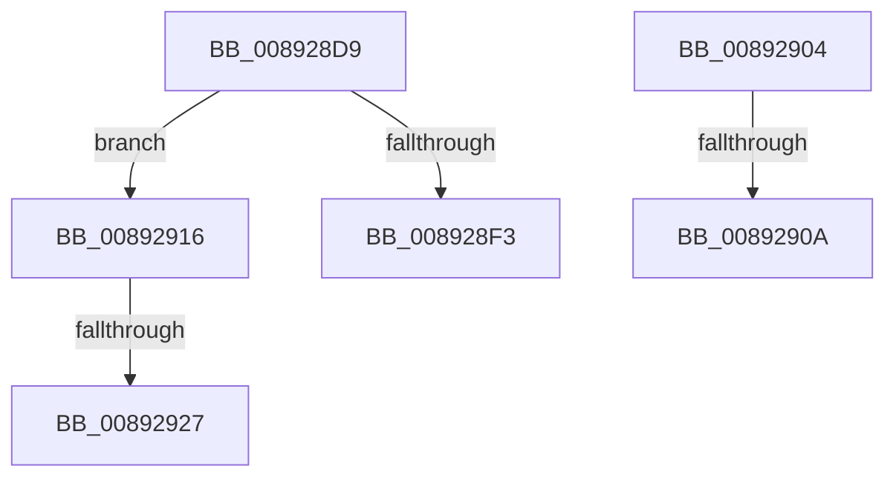

# sub_008928D9

- RVA: `0x008928D9`–`0x00892933` (길이 `90` bytes)
- VA: `0x00000001408928D9`
- 실행 섹션: `PAGE`
- PDB 이름 있음: `아니요`; PDB Function 태그: `아니요`
- unwind 정보 RVA: `0x0007DC50`
- 디코드: `21`개 명령, `90/90` bytes 표시
- 미해석 바이트: `0` (있으면 어셈블리에 `.byte`로 보존)

> 이 문서는 커널 이미지의 기계어와 PDB 기호를 분석해 생성했습니다. 4번과 5번은 함수 원형과 자료형을 바이너리 사용 방식에서 추정한 C 해석이며 원본 소스 복구 결과는 아닙니다.

## 1. Dependencies

- 직접 호출 지점: **2**; 고유 호출 대상: **2**
- 직접 호출자로 확인된 함수: **0**
- RIP 상대 이미지 참조: **3**

### Outgoing calls
- `0x008928F8` → [AlpcpAllocateBuffer](AlpcpAllocateBuffer_function_00892BC0.md) (function, `0x00892BC0`)
- `0x00892927` → [AlpcpAllocateMessageFunction](AlpcpAllocateMessageFunction_function_00892FF0.md) (function, `0x00892FF0`)

### Direct callers
- 이 함수 시작 RVA로 연결되는 직접 call은 확인되지 않았습니다. 간접 호출은 완전히 역산할 수 없습니다.

### Static image references
- `0x008928DA` → RVA `0x00E271B0` (`.data`; read)
- `0x008928E1` → RVA `0x00892BC0` (`AlpcpAllocateBuffer`; read)
- `0x00892916` → RVA `0x00892FF0` (`AlpcpAllocateMessageFunction`; read)

## 2. Other-region calls and transfers

- 다른 실행 섹션으로 향하는 call: **0**
- call이 아닌 외부 분기/꼬리 이동: **5**
  - `0x008928FF` → [sub_008926FB](Unknown_function_008926FB.md) (`tail-transfer`)
  - `0x00892908` → [sub_0089297B](Unknown_function_0089297B.md) (`tail-transfer`)
  - `0x00892911` → [AlpcpAllocateMessage + 0x17](AlpcpAllocateMessage_function_008926C0.md) (`tail-transfer`)
  - `0x00892925` → [sub_0089297B + 0xD](Unknown_function_0089297B.md) (`tail-transfer`)
  - `0x0089292E` → [sub_008926FB](Unknown_function_008926FB.md) (`tail-transfer`)

## 3. Assembly (complete function range)

```asm
008928D9  CC                              int3
008928DA  48 8B 05 CF 48 59 00            mov rax, qword ptr [rip + 0x5948cf]
008928E1  48 8D 0D D8 02 00 00            lea rcx, [rip + 0x2d8]
008928E8  41 B8 41 6C 4D 73               mov r8d, 0x734d6c41
008928EE  48 3B C1                        cmp rax, rcx
008928F1  75 23                           jne 0x140892916
008928F3  B9 01 00 00 00                  mov ecx, 1
008928F8  E8 C3 02 00 00                  call 0x140892bc0
008928FD  32 D2                           xor dl, dl
008928FF  E9 F7 FD FF FF                  jmp 0x1408926fb
00892904  48 83 FA 28                     cmp rdx, 0x28
00892908  72 71                           jb 0x14089297b
0089290A  48 81 C2 20 01 00 00            add rdx, 0x120
00892911  E9 C1 FD FF FF                  jmp 0x1408926d7
00892916  48 8D 0D D3 06 00 00            lea rcx, [rip + 0x6d3]
0089291D  48 3B C1                        cmp rax, rcx
00892920  B9 01 00 00 00                  mov ecx, 1
00892925  75 61                           jne 0x140892988
00892927  E8 C4 06 00 00                  call 0x140892ff0
0089292C  32 D2                           xor dl, dl
0089292E  E9 C8 FD FF FF                  jmp 0x1408926fb
```

## 4. C-style interpretation (structured pseudocode)

```c
__int64 __fastcall sub_008928D9(__int64 a1, unsigned __int8 a2)
{
    __int64 result;

    if ((*(unsigned __int64 *)(v_rip + 5851343)) != (v_rip + 728)) goto loc_00892916;
    result = AlpcpAllocateBuffer(1, a2, (unsigned int)(0x734D6C41ULL), a4);
    a2 = 0;
loc_00892916:
    result = AlpcpAllocateMessageFunction(1, a2, (unsigned int)(0x734D6C41ULL), a4);
    a2 = 0;
}
```

## 5. (Beta) C Style

```c
int64_t sub_008928D9(int64_t Arg1, uint8_t Arg2)
{
    int64_t result;

    if ((*(uint64_t *)(v_rip + 0x5948CF)) != (v_rip + 728)) goto loc_00892916;
    result = AlpcpAllocateBuffer(1, Arg2, (uint32_t)(0x734D6C41ULL), a4);
    Arg2 = 0;
loc_00892916:
    result = AlpcpAllocateMessageFunction(1, Arg2, (uint32_t)(0x734D6C41ULL), a4);
    Arg2 = 0;
}
```

## 6. Execution-region graph

[열기: 2D/3D 그래프와 함수 탐색 컨트롤 패널](../../../control-panel.html?section=page&rva=0x008928D9&view=graph)

- 2D 그래프는 위에서 아래로 흐르고, 3D 그래프는 빈 공간을 드래그해 회전합니다. Shift+드래그는 이동, 휠은 확대·축소, 함수 노드 선택은 대상 보고서 이동입니다.

### Static fallback


