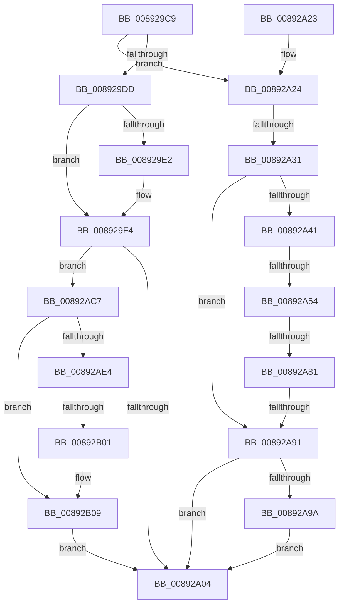

# sub_008929C9

- RVA: `0x008929C9`–`0x00892B15` (길이 `332` bytes)
- VA: `0x00000001408929C9`
- 실행 섹션: `PAGE`
- PDB 이름 있음: `아니요`; PDB Function 태그: `아니요`
- unwind 정보 RVA: `0x0007DD10`
- 디코드: `75`개 명령, `332/332` bytes 표시
- 미해석 바이트: `0` (있으면 어셈블리에 `.byte`로 보존)

> 이 문서는 커널 이미지의 기계어와 PDB 기호를 분석해 생성했습니다. 4번과 5번은 함수 원형과 자료형을 바이너리 사용 방식에서 추정한 C 해석이며 원본 소스 복구 결과는 아닙니다.

## 1. Dependencies

- 직접 호출 지점: **5**; 고유 호출 대상: **3**
- 직접 호출자로 확인된 함수: **0**
- RIP 상대 이미지 참조: **0**

### Outgoing calls
- `0x008929EF` → [memcpy](../../text/6C/memcpy_function_006C6840.md) (function, `0x006C6840`)
- `0x00892A68` → [ExAllocatePool2](../../poolcode/B8/ExAllocatePool2_function_00B820F0.md) (function, `0x00B820F0`)
- `0x00892AA7` → [memcpy](../../text/6C/memcpy_function_006C6840.md) (function, `0x006C6840`)
- `0x00892ABD` → [memcpy](../../text/6C/memcpy_function_006C6840.md) (function, `0x006C6840`)
- `0x00892ACC` → [ExFreePoolWithTag](../../poolcode/B8/ExFreePoolWithTag_function_00B82870.md) (function, `0x00B82870`)

### Direct callers
- 이 함수 시작 RVA로 연결되는 직접 call은 확인되지 않았습니다. 간접 호출은 완전히 역산할 수 없습니다.

### Static image references
- 디코드된 RIP-relative 메모리 참조가 없습니다.

## 2. Other-region calls and transfers

- 다른 실행 섹션으로 향하는 call: **5**
  - `0x008929EF` → [memcpy](../../text/6C/memcpy_function_006C6840.md) (`PAGE` → `.text`)
  - `0x00892A68` → [ExAllocatePool2](../../poolcode/B8/ExAllocatePool2_function_00B820F0.md) (`PAGE` → `POOLCODE`)
  - `0x00892AA7` → [memcpy](../../text/6C/memcpy_function_006C6840.md) (`PAGE` → `.text`)
  - `0x00892ABD` → [memcpy](../../text/6C/memcpy_function_006C6840.md) (`PAGE` → `.text`)
  - `0x00892ACC` → [ExFreePoolWithTag](../../poolcode/B8/ExFreePoolWithTag_function_00B82870.md) (`PAGE` → `POOLCODE`)
- call이 아닌 외부 분기/꼬리 이동: **5**
  - `0x00892A2B` → [sub_00892B22 + 0x6C](Unknown_function_00892B22.md) (`tail-transfer`)
  - `0x00892A4E` → [sub_00892B22 + 0xF](Unknown_function_00892B22.md) (`tail-transfer`)
  - `0x00892A7B` → [sub_00892B22](Unknown_function_00892B22.md) (`tail-transfer`)
  - `0x00892A8B` → [sub_00892B22 + 0x25](Unknown_function_00892B22.md) (`tail-transfer`)
  - `0x00892AFB` → [sub_00892B22 + 0x80](Unknown_function_00892B22.md) (`tail-transfer`)

## 3. Assembly (complete function range)

```asm
008929C9  48 89 6C 24 40                  mov qword ptr [rsp + 0x40], rbp
008929CE  4C 89 64 24 48                  mov qword ptr [rsp + 0x48], r12
008929D3  4C 89 7C 24 50                  mov qword ptr [rsp + 0x50], r15
008929D8  49 3B FE                        cmp rdi, r14
008929DB  77 47                           ja 0x140892a24
008929DD  48 85 F6                        test rsi, rsi
008929E0  74 12                           je 0x1408929f4
008929E2  48 81 C1 18 01 00 00            add rcx, 0x118
008929E9  4C 8B C7                        mov r8, rdi
008929EC  48 8B D6                        mov rdx, rsi
008929EF  E8 4C 3E E3 FF                  call 0x1406c6840
008929F4  48 8B 8B E0 00 00 00            mov rcx, qword ptr [rbx + 0xe0]
008929FB  48 85 C9                        test rcx, rcx
008929FE  0F 85 C3 00 00 00               jne 0x140892ac7
00892A04  33 C0                           xor eax, eax
00892A06  4C 8B 7C 24 50                  mov r15, qword ptr [rsp + 0x50]
00892A0B  4C 8B 64 24 48                  mov r12, qword ptr [rsp + 0x48]
00892A10  48 8B 6C 24 40                  mov rbp, qword ptr [rsp + 0x40]
00892A15  48 8B 5C 24 58                  mov rbx, qword ptr [rsp + 0x58]
00892A1A  48 83 C4 20                     add rsp, 0x20
00892A1E  41 5E                           pop r14
00892A20  5F                              pop rdi
00892A21  5E                              pop rsi
00892A22  C3                              ret
00892A23  CC                              int3
00892A24  48 81 FF D7 FF 00 00            cmp rdi, 0xffd7
00892A2B  0F 87 5D 01 00 00               ja 0x140892b8e
00892A31  4C 8B B9 E8 00 00 00            mov r15, qword ptr [rcx + 0xe8]
00892A38  4B 8D 04 37                     lea rax, [r15 + r14]
00892A3C  48 3B F8                        cmp rdi, rax
00892A3F  76 50                           jbe 0x140892a91
00892A41  48 8B 89 E0 00 00 00            mov rcx, qword ptr [rcx + 0xe0]
00892A48  45 33 E4                        xor r12d, r12d
00892A4B  48 85 C9                        test rcx, rcx
00892A4E  0F 85 DD 00 00 00               jne 0x140892b31
00892A54  48 8B EF                        mov rbp, rdi
00892A57  41 B8 41 6C 45 42               mov r8d, 0x42456c41
00892A5D  49 2B EE                        sub rbp, r14
00892A60  B9 00 01 00 00                  mov ecx, 0x100
00892A65  48 8B D5                        mov rdx, rbp
00892A68  E8 83 F6 2E 00                  call 0x140b820f0
00892A6D  48 8B 4B 30                     mov rcx, qword ptr [rbx + 0x30]
00892A71  48 89 83 E0 00 00 00            mov qword ptr [rbx + 0xe0], rax
00892A78  48 85 C0                        test rax, rax
00892A7B  0F 84 A1 00 00 00               je 0x140892b22
00892A81  48 89 AB E8 00 00 00            mov qword ptr [rbx + 0xe8], rbp
00892A88  48 85 C9                        test rcx, rcx
00892A8B  0F 85 B6 00 00 00               jne 0x140892b47
00892A91  48 85 F6                        test rsi, rsi
00892A94  0F 84 6A FF FF FF               je 0x140892a04
00892A9A  48 8D 8B 18 01 00 00            lea rcx, [rbx + 0x118]
00892AA1  4D 8B C6                        mov r8, r14
00892AA4  48 8B D6                        mov rdx, rsi
00892AA7  E8 94 3D E3 FF                  call 0x1406c6840
00892AAC  48 8B 8B E0 00 00 00            mov rcx, qword ptr [rbx + 0xe0]
00892AB3  49 8D 14 36                     lea rdx, [r14 + rsi]
00892AB7  49 2B FE                        sub rdi, r14
00892ABA  4C 8B C7                        mov r8, rdi
00892ABD  E8 7E 3D E3 FF                  call 0x1406c6840
00892AC2  E9 3D FF FF FF                  jmp 0x140892a04
00892AC7  BA 41 6C 45 42                  mov edx, 0x42456c41
00892ACC  E8 9F FD 2E 00                  call 0x140b82870
00892AD1  48 8B 4B 30                     mov rcx, qword ptr [rbx + 0x30]
00892AD5  45 33 E4                        xor r12d, r12d
00892AD8  4C 89 A3 E0 00 00 00            mov qword ptr [rbx + 0xe0], r12
00892ADF  48 85 C9                        test rcx, rcx
00892AE2  74 25                           je 0x140892b09
00892AE4  48 8B 93 E8 00 00 00            mov rdx, qword ptr [rbx + 0xe8]
00892AEB  48 8B 81 98 05 00 00            mov rax, qword ptr [rcx + 0x598]
00892AF2  48 03 C2                        add rax, rdx
00892AF5  48 3D 00 10 00 00               cmp rax, 0x1000
00892AFB  0F 83 A1 00 00 00               jae 0x140892ba2
00892B01  F0 48 01 91 98 05 00 00         lock add qword ptr [rcx + 0x598], rdx
00892B09  4C 89 A3 E8 00 00 00            mov qword ptr [rbx + 0xe8], r12
00892B10  E9 EF FE FF FF                  jmp 0x140892a04
```

## 4. C-style interpretation (structured pseudocode)

```c
__int64 __fastcall sub_008929C9(__int64 a1, __int64 a2, __int64 a3, __int64 a4, __int64 a5, __int64 a6, __int64 a7, __int64 a8, __int64 a9, __int64 a10, __int64 a11)
{
    __int64 result;
    __int64 v_r12;
    __int64 v_rbp;
    __int64 v_rdi;
    __int64 v_rsp;
    unsigned __int64 v_stack_p40;
    unsigned __int64 v_stack_p48;
    unsigned __int64 v_stack_p50;

    v_stack_p40 = v_rbp;
    v_stack_p48 = v_r12;
    v_stack_p50 = v_r15;
    if (v_rdi > v_r14) goto loc_00892A24;
    if (v_rsi != 0) {
        a1 = (a1) + (280);
        a3 = v_rdi;
        a2 = v_rsi;
        result = memcpy(a1, a2, a3, a4);
    }
    if (*(unsigned __int64 *)(v_rbx + 224) != 0) goto loc_00892AC7;
loc_00892A04:
    result = 0;
    v_rsp = (v_rsp) + (32);
    return result;
loc_00892A24:
    if (v_rdi <= (*(unsigned __int64 *)(*(unsigned __int64 *)(v_rbx + 224) + 232) + v_r14 * 1)) goto loc_00892A91;
    v_r12 = 0;
    v_rbp = (v_rdi) - (v_r14);
    result = ExAllocatePool2(256, v_rbp, (unsigned int)(0x42456C41ULL), a4);
    *(unsigned __int64 *)(a11 + 224) = result;
    *(unsigned __int64 *)(a11 + 232) = v_rbp;
loc_00892A91:
    if (v_rsi == 0) goto loc_00892A04;
    result = memcpy(a11 + 280, v_rsi, v_r14, a4);
    v_rdi = (v_rdi) - (v_r14);
    result = memcpy(*(unsigned __int64 *)(a11 + 224), v_r14 + v_rsi * 1, v_rdi, a4);
    goto loc_00892A04;
loc_00892AC7:
    result = ExFreePoolWithTag(*(unsigned __int64 *)(a11 + 224), (unsigned int)(0x42456C41ULL), v_rdi, a4);
    v_r12 = 0;
    *(unsigned __int64 *)(a11 + 224) = 0;
    if (*(unsigned __int64 *)(a11 + 48) == 0) goto loc_00892B09;
    result = (*(unsigned __int64 *)(*(unsigned __int64 *)(a11 + 48) + 1432)) + (*(unsigned __int64 *)(a11 + 232));
loc_00892B09:
    *(unsigned __int64 *)(a11 + 232) = 0;
    goto loc_00892A04;
}
```

## 5. (Beta) C Style

```c
int64_t sub_008929C9(void *Arg1, int64_t Arg2, int64_t Arg3, int64_t Arg4, uint64_t Arg5, uint64_t Arg6, uint64_t Arg7, int64_t Arg8, int64_t Arg9, int64_t Arg10, int64_t Arg11)
{
    uint8_t *arg1 = (uint8_t *)Arg1;

    int64_t result;
    int64_t local_r12;
    int64_t local_rbp;
    int64_t local_rdi;
    int64_t local_rsp;
    uint64_t v_stack_p40;
    uint64_t v_stack_p48;
    uint64_t v_stack_p50;

    v_stack_p40 = local_rbp;
    v_stack_p48 = local_r12;
    v_stack_p50 = local_r15;
    if (local_rdi > local_r14) goto loc_00892A24;
    if (local_rsi != 0) {
        Arg1 = (Arg1) + (280);
        Arg3 = local_rdi;
        Arg2 = local_rsi;
        result = memcpy(Arg1, Arg2, Arg3, Arg4);
    }
    if (*(uint64_t *)(local_rbx + 0xE0) != 0) goto loc_00892AC7;
loc_00892A04:
    result = 0;
    local_rsp = (local_rsp) + (32);
    return result;
loc_00892A24:
    if (local_rdi <= (*(uint64_t *)(*(uint64_t *)(local_rbx + 0xE0) + 0xE8) + local_r14 * 1)) goto loc_00892A91;
    local_r12 = 0;
    local_rbp = (local_rdi) - (local_r14);
    result = ExAllocatePool2(256, local_rbp, (uint32_t)(0x42456C41ULL), Arg4);
    *(uint64_t *)(Arg11 + 0xE0) = result;
    *(uint64_t *)(Arg11 + 0xE8) = local_rbp;
loc_00892A91:
    if (local_rsi == 0) goto loc_00892A04;
    result = memcpy(Arg11 + 280, local_rsi, local_r14, Arg4);
    local_rdi = (local_rdi) - (local_r14);
    result = memcpy(*(uint64_t *)(Arg11 + 0xE0), local_r14 + local_rsi * 1, local_rdi, Arg4);
    goto loc_00892A04;
loc_00892AC7:
    result = ExFreePoolWithTag(*(uint64_t *)(Arg11 + 0xE0), (uint32_t)(0x42456C41ULL), local_rdi, Arg4);
    local_r12 = 0;
    *(uint64_t *)(Arg11 + 0xE0) = 0;
    if (*(uint64_t *)(Arg11 + 0x30) == 0) goto loc_00892B09;
    result = (*(uint64_t *)(*(uint64_t *)(Arg11 + 0x30) + 0x598)) + (*(uint64_t *)(Arg11 + 0xE8));
loc_00892B09:
    *(uint64_t *)(Arg11 + 0xE8) = 0;
    goto loc_00892A04;
}
```

### 관측된 메모리 오프셋

구조체 형식이 확인되지 않은 접근은 인자 기준의 오프셋으로만 기록했습니다.

| 기준 인자 | 오프셋 표현 | 폭 (bit) | 접근 |
|---|---:|---:|---|
| `Arg1` | `+ 0xE0` | `64` | `R` |
| `Arg1` | `+ 0xE8` | `64` | `R` |

## 6. Execution-region graph

[열기: 2D/3D 그래프와 함수 탐색 컨트롤 패널](../../../control-panel.html?section=page&rva=0x008929C9&view=graph)

- 2D 그래프는 위에서 아래로 흐르고, 3D 그래프는 빈 공간을 드래그해 회전합니다. Shift+드래그는 이동, 휠은 확대·축소, 함수 노드 선택은 대상 보고서 이동입니다.

### Static fallback


