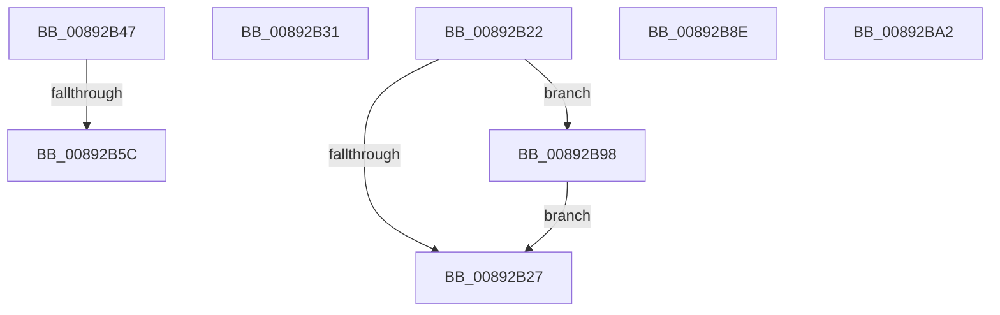

# sub_00892B22

- RVA: `0x00892B22`–`0x00892BAC` (길이 `138` bytes)
- VA: `0x0000000140892B22`
- 실행 섹션: `PAGE`
- PDB 이름 있음: `아니요`; PDB Function 태그: `아니요`
- unwind 정보 RVA: `0x0007DD40`
- 디코드: `31`개 명령, `138/138` bytes 표시
- 미해석 바이트: `0` (있으면 어셈블리에 `.byte`로 보존)

> 이 문서는 커널 이미지의 기계어와 PDB 기호를 분석해 생성했습니다. 4번과 5번은 함수 원형과 자료형을 바이너리 사용 방식에서 추정한 C 해석이며 원본 소스 복구 결과는 아닙니다.

## 1. Dependencies

- 직접 호출 지점: **6**; 고유 호출 대상: **4**
- 직접 호출자로 확인된 함수: **0**
- RIP 상대 이미지 참조: **0**

### Outgoing calls
- `0x00892B36` → [ExFreePoolWithTag](../../poolcode/B8/ExFreePoolWithTag_function_00B82870.md) (function, `0x00B82870`)
- `0x00892B4D` → [AlpcpChargePagedPoolQuota](../92/AlpcpChargePagedPoolQuota_function_00922EA4.md) (function, `0x00922EA4`)
- `0x00892B68` → [ExFreePoolWithTag](../../poolcode/B8/ExFreePoolWithTag_function_00B82870.md) (function, `0x00B82870`)
- `0x00892B82` → [AlpcpReleasePagedPoolQuota](../92/AlpcpReleasePagedPoolQuota_function_00922EE8.md) (function, `0x00922EE8`)
- `0x00892B9B` → [AlpcpReleasePagedPoolQuota](../92/AlpcpReleasePagedPoolQuota_function_00922EE8.md) (function, `0x00922EE8`)
- `0x00892BA2` → [PsReturnProcessPagedPoolQuota](../../text/2A/PsReturnProcessPagedPoolQuota_function_002A6860.md) (function, `0x002A6860`)

### Direct callers
- 이 함수 시작 RVA로 연결되는 직접 call은 확인되지 않았습니다. 간접 호출은 완전히 역산할 수 없습니다.

### Static image references
- 디코드된 RIP-relative 메모리 참조가 없습니다.

## 2. Other-region calls and transfers

- 다른 실행 섹션으로 향하는 call: **3**
  - `0x00892B36` → [ExFreePoolWithTag](../../poolcode/B8/ExFreePoolWithTag_function_00B82870.md) (`PAGE` → `POOLCODE`)
  - `0x00892B68` → [ExFreePoolWithTag](../../poolcode/B8/ExFreePoolWithTag_function_00B82870.md) (`PAGE` → `POOLCODE`)
  - `0x00892BA2` → [PsReturnProcessPagedPoolQuota](../../text/2A/PsReturnProcessPagedPoolQuota_function_002A6860.md) (`PAGE` → `.text`)
- call이 아닌 외부 분기/꼬리 이동: **6**
  - `0x00892B2C` → [sub_008929C9 + 0x3D](Unknown_function_008929C9.md) (`tail-transfer`)
  - `0x00892B42` → [sub_008929C9 + 0x8B](Unknown_function_008929C9.md) (`tail-transfer`)
  - `0x00892B56` → [sub_008929C9 + 0xC8](Unknown_function_008929C9.md) (`tail-transfer`)
  - `0x00892B89` → [sub_008929C9 + 0x3D](Unknown_function_008929C9.md) (`tail-transfer`)
  - `0x00892B93` → [sub_008929C9 + 0x3D](Unknown_function_008929C9.md) (`tail-transfer`)
  - `0x00892BA7` → [sub_008929C9 + 0x140](Unknown_function_008929C9.md) (`tail-transfer`)

## 3. Assembly (complete function range)

```asm
00892B22  48 85 C9                        test rcx, rcx
00892B25  75 71                           jne 0x140892b98
00892B27  B8 9A 00 00 C0                  mov eax, 0xc000009a
00892B2C  E9 D5 FE FF FF                  jmp 0x140892a06
00892B31  BA 41 6C 45 42                  mov edx, 0x42456c41
00892B36  E8 35 FD 2E 00                  call 0x140b82870
00892B3B  4C 89 A3 E8 00 00 00            mov qword ptr [rbx + 0xe8], r12
00892B42  E9 0D FF FF FF                  jmp 0x140892a54
00892B47  49 2B EF                        sub rbp, r15
00892B4A  48 8B D5                        mov rdx, rbp
00892B4D  E8 52 03 09 00                  call 0x140922ea4
00892B52  8B E8                           mov ebp, eax
00892B54  85 C0                           test eax, eax
00892B56  0F 89 35 FF FF FF               jns 0x140892a91
00892B5C  48 8B 8B E0 00 00 00            mov rcx, qword ptr [rbx + 0xe0]
00892B63  BA 41 6C 45 42                  mov edx, 0x42456c41
00892B68  E8 03 FD 2E 00                  call 0x140b82870
00892B6D  48 8B 4B 30                     mov rcx, qword ptr [rbx + 0x30]
00892B71  49 8B D7                        mov rdx, r15
00892B74  4C 89 A3 E0 00 00 00            mov qword ptr [rbx + 0xe0], r12
00892B7B  4C 89 A3 E8 00 00 00            mov qword ptr [rbx + 0xe8], r12
00892B82  E8 61 03 09 00                  call 0x140922ee8
00892B87  8B C5                           mov eax, ebp
00892B89  E9 78 FE FF FF                  jmp 0x140892a06
00892B8E  B8 05 00 00 80                  mov eax, 0x80000005
00892B93  E9 6E FE FF FF                  jmp 0x140892a06
00892B98  49 8B D7                        mov rdx, r15
00892B9B  E8 48 03 09 00                  call 0x140922ee8
00892BA0  EB 85                           jmp 0x140892b27
00892BA2  E8 B9 3C A1 FF                  call 0x1402a6860
00892BA7  E9 5D FF FF FF                  jmp 0x140892b09
```

## 4. C-style interpretation (structured pseudocode)

```c
__int64 __fastcall sub_00892B22(__int64 a1)
{
    __int64 result;

    if (a1 != 0) goto loc_00892B98;
loc_00892B27:
loc_00892B98:
    result = AlpcpReleasePagedPoolQuota(a1, v_r15, a3, a4);
    goto loc_00892B27;
}
```

## 5. (Beta) C Style

```c
int64_t sub_00892B22(int64_t Arg1)
{
    int64_t result;

    if (Arg1 != 0) goto loc_00892B98;
loc_00892B27:
loc_00892B98:
    result = AlpcpReleasePagedPoolQuota(Arg1, local_r15, a3, a4);
    goto loc_00892B27;
}
```

## 6. Execution-region graph

[열기: 2D/3D 그래프와 함수 탐색 컨트롤 패널](../../../control-panel.html?section=page&rva=0x00892B22&view=graph)

- 2D 그래프는 위에서 아래로 흐르고, 3D 그래프는 빈 공간을 드래그해 회전합니다. Shift+드래그는 이동, 휠은 확대·축소, 함수 노드 선택은 대상 보고서 이동입니다.

### Static fallback


