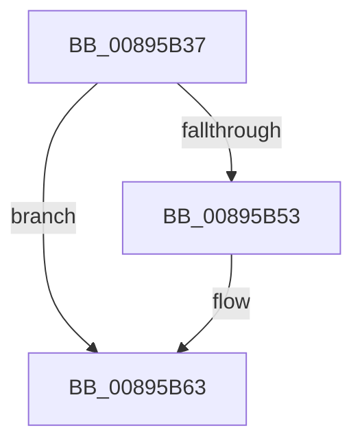

# sub_00895B37

- RVA: `0x00895B37`–`0x00895B6D` (길이 `54` bytes)
- VA: `0x0000000140895B37`
- 실행 섹션: `PAGE`
- PDB 이름 있음: `아니요`; PDB Function 태그: `아니요`
- unwind 정보 RVA: `0x0007E12C`
- 디코드: `14`개 명령, `54/54` bytes 표시
- 미해석 바이트: `0` (있으면 어셈블리에 `.byte`로 보존)

> 이 문서는 커널 이미지의 기계어와 PDB 기호를 분석해 생성했습니다. 4번과 5번은 함수 원형과 자료형을 바이너리 사용 방식에서 추정한 C 해석이며 원본 소스 복구 결과는 아닙니다.

## 1. Dependencies

- 직접 호출 지점: **2**; 고유 호출 대상: **2**
- 직접 호출자로 확인된 함수: **0**
- RIP 상대 이미지 참조: **0**

### Outgoing calls
- `0x00895B42` → [KeAbPreAcquire](../../text/21/KeAbPreAcquire_function_00210230.md) (function, `0x00210230`)
- `0x00895B5E` → [ExfAcquirePushLockExclusiveEx](../../text/20/ExfAcquirePushLockExclusiveEx_function_0020FC90.md) (function, `0x0020FC90`)

### Direct callers
- 이 함수 시작 RVA로 연결되는 직접 call은 확인되지 않았습니다. 간접 호출은 완전히 역산할 수 없습니다.

### Static image references
- 디코드된 RIP-relative 메모리 참조가 없습니다.

## 2. Other-region calls and transfers

- 다른 실행 섹션으로 향하는 call: **2**
  - `0x00895B42` → [KeAbPreAcquire](../../text/21/KeAbPreAcquire_function_00210230.md) (`PAGE` → `.text`)
  - `0x00895B5E` → [ExfAcquirePushLockExclusiveEx](../../text/20/ExfAcquirePushLockExclusiveEx_function_0020FC90.md) (`PAGE` → `.text`)
- call이 아닌 외부 분기/꼬리 이동: **1**
  - `0x00895B6B` → [sub_00895B6D + 0x4](Unknown_function_00895B6D.md) (`tail-transfer`)

## 3. Assembly (complete function range)

```asm
00895B37  4C 89 7C 24 60                  mov qword ptr [rsp + 0x60], r15
00895B3C  33 D2                           xor edx, edx
00895B3E  48 8D 4B F0                     lea rcx, [rbx - 0x10]
00895B42  E8 E9 A6 97 FF                  call 0x140210230
00895B47  F0 48 0F BA 6B F0 00            lock bts qword ptr [rbx - 0x10], 0
00895B4E  48 8B E8                        mov rbp, rax
00895B51  73 10                           jae 0x140895b63
00895B53  4C 8D 43 F0                     lea r8, [rbx - 0x10]
00895B57  48 8B D0                        mov rdx, rax
00895B5A  48 8D 4B F0                     lea rcx, [rbx - 0x10]
00895B5E  E8 2D A1 97 FF                  call 0x14020fc90
00895B63  4C 8B 7C 24 60                  mov r15, qword ptr [rsp + 0x60]
00895B68  48 85 ED                        test rbp, rbp
00895B6B  74 04                           je 0x140895b71
```

## 4. C-style interpretation (structured pseudocode)

```c
__int64 __fastcall sub_00895B37(__int64 a1, int a2, __int64 a3, __int64 a4, __int64 a5, __int64 a6, __int64 a7, __int64 a8, __int64 a9, __int64 a10, __int64 a11, __int64 a12)
{
    __int64 result;
    unsigned __int64 v_stack_p60;

    v_stack_p60 = v_r15;
    a2 = 0;
    result = KeAbPreAcquire(v_rbx - 16, a2, a3, a4);
    if (!(condition_is_above_or_equal)) {
        a3 = v_rbx - 16;
        a2 = result;
        a1 = v_rbx - 16;
        result = ExfAcquirePushLockExclusiveEx(a1, a2, a3, a4);
    }
}
```

## 5. (Beta) C Style

```c
int64_t sub_00895B37(int64_t Arg1, int32_t Arg2, int64_t Arg3, int64_t Arg4, uint64_t Arg5, uint64_t Arg6, uint64_t Arg7, uint64_t Arg8, uint64_t Arg9, uint64_t Arg10, uint64_t Arg11, int64_t Arg12)
{
    int64_t result;
    uint64_t v_stack_p60;

    v_stack_p60 = local_r15;
    Arg2 = 0;
    result = KeAbPreAcquire(local_rbx - 16, Arg2, Arg3, Arg4);
    if (!(condition_is_above_or_equal)) {
        Arg3 = local_rbx - 16;
        Arg2 = result;
        Arg1 = local_rbx - 16;
        result = ExfAcquirePushLockExclusiveEx(Arg1, Arg2, Arg3, Arg4);
    }
}
```

## 6. Execution-region graph

[열기: 2D/3D 그래프와 함수 탐색 컨트롤 패널](../../../control-panel.html?section=page&rva=0x00895B37&view=graph)

- 2D 그래프는 위에서 아래로 흐르고, 3D 그래프는 빈 공간을 드래그해 회전합니다. Shift+드래그는 이동, 휠은 확대·축소, 함수 노드 선택은 대상 보고서 이동입니다.

### Static fallback


