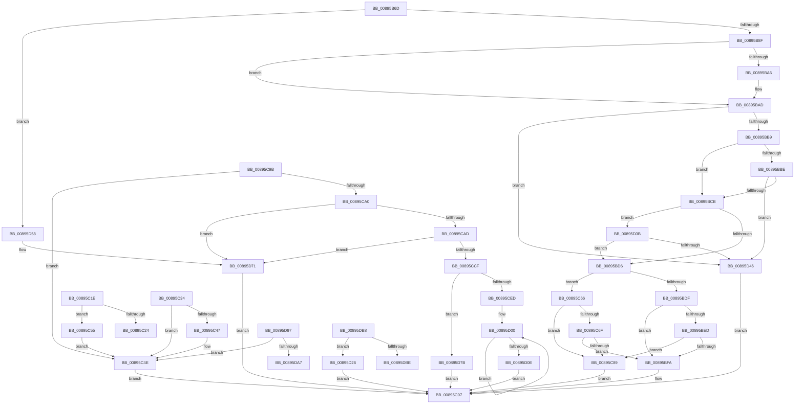

# sub_00895B6D

- RVA: `0x00895B6D`–`0x00895DD7` (길이 `618` bytes)
- VA: `0x0000000140895B6D`
- 실행 섹션: `PAGE`
- PDB 이름 있음: `아니요`; PDB Function 태그: `아니요`
- unwind 정보 RVA: `0x0007E140`
- 디코드: `147`개 명령, `618/618` bytes 표시
- 미해석 바이트: `0` (있으면 어셈블리에 `.byte`로 보존)

> 이 문서는 커널 이미지의 기계어와 PDB 기호를 분석해 생성했습니다. 4번과 5번은 함수 원형과 자료형을 바이너리 사용 방식에서 추정한 C 해석이며 원본 소스 복구 결과는 아닙니다.

## 1. Dependencies

- 직접 호출 지점: **13**; 고유 호출 대상: **9**
- 직접 호출자로 확인된 함수: **0**
- RIP 상대 이미지 참조: **3**

### Outgoing calls
- `0x00895BA8` → [ExfUnblockPushLock](../../text/2A/ExfUnblockPushLock_function_002A3FE0.md) (function, `0x002A3FE0`)
- `0x00895C2A` → [ExpBlockOnLockedHandleEntry](../86/ExpBlockOnLockedHandleEntry_function_00868838.md) (function, `0x00868838`)
- `0x00895C49` → [ExfUnblockPushLock](../../text/2A/ExfUnblockPushLock_function_002A3FE0.md) (function, `0x002A3FE0`)
- `0x00895C5F` → [ExHandleLogBadReference](../../text/44/ExHandleLogBadReference_function_00440580.md) (function, `0x00440580`)
- `0x00895C8C` → [AlpcpUnlockMessage](AlpcpUnlockMessage_function_00897AE0.md) (function, `0x00897AE0`)
- `0x00895CBE` → [AlpcReferenceBlobByHandle](../88/AlpcReferenceBlobByHandle_function_00889F00.md) (function, `0x00889F00`)
- `0x00895CD6` → [AlpcpLockForCachedReferenceBlob](../88/AlpcpLockForCachedReferenceBlob_function_0088A8B0.md) (function, `0x0088A8B0`)
- `0x00895D2C` → [ExUnlockHandleTableEntry](../94/ExUnlockHandleTableEntry_function_0094D2D0.md) (function, `0x0094D2D0`)
- `0x00895D49` → [AlpcpUnlockMessage](AlpcpUnlockMessage_function_00897AE0.md) (function, `0x00897AE0`)
- `0x00895D6B` → [KeBugCheckEx](../../text/4F/KeBugCheckEx_function_004FD660.md) (function, `0x004FD660`)
- `0x00895D7E` → [AlpcpUnlockMessage](AlpcpUnlockMessage_function_00897AE0.md) (function, `0x00897AE0`)
- `0x00895D88` → [AlpcpDereferenceBlobEx](../88/AlpcpDereferenceBlobEx_function_0088AF00.md) (function, `0x0088AF00`)
- `0x00895DD1` → [KeBugCheckEx](../../text/4F/KeBugCheckEx_function_004FD660.md) (function, `0x004FD660`)

### Direct callers
- 이 함수 시작 RVA로 연결되는 직접 call은 확인되지 않았습니다. 간접 호출은 완전히 역산할 수 없습니다.

### Static image references
- `0x00895CAF` → RVA `0x000014D8` (`.rdata`; read)
- `0x00895D02` → RVA `0x00FCF300` (`CACHEALI`; read/write)
- `0x00895D97` → RVA `0x00FC5130` (`ALMOSTRO`; read)

## 2. Other-region calls and transfers

- 다른 실행 섹션으로 향하는 call: **5**
  - `0x00895BA8` → [ExfUnblockPushLock](../../text/2A/ExfUnblockPushLock_function_002A3FE0.md) (`PAGE` → `.text`)
  - `0x00895C49` → [ExfUnblockPushLock](../../text/2A/ExfUnblockPushLock_function_002A3FE0.md) (`PAGE` → `.text`)
  - `0x00895C5F` → [ExHandleLogBadReference](../../text/44/ExHandleLogBadReference_function_00440580.md) (`PAGE` → `.text`)
  - `0x00895D6B` → [KeBugCheckEx](../../text/4F/KeBugCheckEx_function_004FD660.md) (`PAGE` → `.text`)
  - `0x00895DD1` → [KeBugCheckEx](../../text/4F/KeBugCheckEx_function_004FD660.md) (`PAGE` → `.text`)
- call이 아닌 외부 분기/꼬리 이동: **2**
  - `0x00895C2F` → [AlpcpLookupMessage + 0x80](AlpcpLookupMessage_function_00895A40.md) (`tail-transfer`)
  - `0x00895DB3` → [AlpcpLookupMessage + 0x39](AlpcpLookupMessage_function_00895A40.md) (`tail-transfer`)

## 3. Assembly (complete function range)

```asm
00895B6D  C6 45 0A 01                     mov byte ptr [rbp + 0xa], 1
00895B71  80 4B E0 01                     or byte ptr [rbx - 0x20], 1
00895B75  B8 00 00 01 00                  mov eax, 0x10000
00895B7A  F0 48 0F C1 43 E8               lock xadd qword ptr [rbx - 0x18], rax
00895B80  48 05 00 00 01 00               add rax, 0x10000
00895B86  48 85 C0                        test rax, rax
00895B89  0F 8E C9 01 00 00               jle 0x140895d58
00895B8F  66 FF 4B E2                     dec word ptr [rbx - 0x1e]
00895B93  F0 48 FF 07                     lock inc qword ptr [rdi]
00895B97  49 8D 4D 30                     lea rcx, [r13 + 0x30]
00895B9B  F0 83 0C 24 00                  lock or dword ptr [rsp], 0
00895BA0  48 83 39 00                     cmp qword ptr [rcx], 0
00895BA4  74 07                           je 0x140895bad
00895BA6  33 D2                           xor edx, edx
00895BA8  E8 33 E4 A0 FF                  call 0x1402a3fe0
00895BAD  39 B3 08 01 00 00               cmp dword ptr [rbx + 0x108], esi
00895BB3  0F 85 8D 01 00 00               jne 0x140895d46
00895BB9  45 85 F6                        test r14d, r14d
00895BBC  74 0D                           je 0x140895bcb
00895BBE  44 39 B3 10 01 00 00            cmp dword ptr [rbx + 0x110], r14d
00895BC5  0F 85 7B 01 00 00               jne 0x140895d46
00895BCB  48 83 7B 18 00                  cmp qword ptr [rbx + 0x18], 0
00895BD0  0F 84 65 01 00 00               je 0x140895d3b
00895BD6  4D 85 E4                        test r12, r12
00895BD9  0F 84 87 00 00 00               je 0x140895c66
00895BDF  49 8B 44 24 10                  mov rax, qword ptr [r12 + 0x10]
00895BE4  48 39 83 B8 00 00 00            cmp qword ptr [rbx + 0xb8], rax
00895BEB  74 0D                           je 0x140895bfa
00895BED  4C 39 A3 C0 00 00 00            cmp qword ptr [rbx + 0xc0], r12
00895BF4  0F 85 8F 00 00 00               jne 0x140895c89
00895BFA  48 8B 84 24 80 00 00 00         mov rax, qword ptr [rsp + 0x80]
00895C02  48 89 18                        mov qword ptr [rax], rbx
00895C05  33 C0                           xor eax, eax
00895C07  48 8B 5C 24 68                  mov rbx, qword ptr [rsp + 0x68]
00895C0C  48 8B 6C 24 70                  mov rbp, qword ptr [rsp + 0x70]
00895C11  48 83 C4 30                     add rsp, 0x30
00895C15  41 5E                           pop r14
00895C17  41 5D                           pop r13
00895C19  41 5C                           pop r12
00895C1B  5F                              pop rdi
00895C1C  5E                              pop rsi
00895C1D  C3                              ret
00895C1E  CC                              int3
00895C1F  4D 85 C0                        test r8, r8
00895C22  74 31                           je 0x140895c55
00895C24  48 8B D7                        mov rdx, rdi
00895C27  49 8B CD                        mov rcx, r13
00895C2A  E8 09 2C FD FF                  call 0x140868838
00895C2F  E9 8C FE FF FF                  jmp 0x140895ac0
00895C34  F0 48 FF 07                     lock inc qword ptr [rdi]
00895C38  49 8D 4D 30                     lea rcx, [r13 + 0x30]
00895C3C  F0 83 0C 24 00                  lock or dword ptr [rsp], 0
00895C41  48 83 39 00                     cmp qword ptr [rcx], 0
00895C45  74 07                           je 0x140895c4e
00895C47  33 D2                           xor edx, edx
00895C49  E8 92 E3 A0 FF                  call 0x1402a3fe0
00895C4E  B8 02 07 00 C0                  mov eax, 0xc0000702
00895C53  EB B2                           jmp 0x140895c07
00895C55  44 0F B6 C5                     movzx r8d, bpl
00895C59  48 8B D3                        mov rdx, rbx
00895C5C  49 8B CD                        mov rcx, r13
00895C5F  E8 1C A9 BA FF                  call 0x140440580
00895C64  EB E8                           jmp 0x140895c4e
00895C66  48 8B 53 10                     mov rdx, qword ptr [rbx + 0x10]
00895C6A  48 85 D2                        test rdx, rdx
00895C6D  74 1A                           je 0x140895c89
00895C6F  65 48 8B 04 25 88 01 00 00      mov rax, qword ptr gs:[0x188]
00895C78  48 8B 88 B8 00 00 00            mov rcx, qword ptr [rax + 0xb8]
00895C7F  48 39 4A 18                     cmp qword ptr [rdx + 0x18], rcx
00895C83  0F 84 71 FF FF FF               je 0x140895bfa
00895C89  48 8B CB                        mov rcx, rbx
00895C8C  E8 4F 1E 00 00                  call 0x140897ae0
00895C91  B8 22 00 00 C0                  mov eax, 0xc0000022
00895C96  E9 6C FF FF FF                  jmp 0x140895c07
00895C9B  4D 85 E4                        test r12, r12
00895C9E  74 AE                           je 0x140895c4e
00895CA0  48 8B 49 10                     mov rcx, qword ptr [rcx + 0x10]
00895CA4  48 85 C9                        test rcx, rcx
00895CA7  0F 84 C4 00 00 00               je 0x140895d71
00895CAD  8B D6                           mov edx, esi
00895CAF  4C 8D 05 22 B8 76 FF            lea r8, [rip - 0x8947de]
00895CB6  0F BA F2 1F                     btr edx, 0x1f
00895CBA  48 83 C1 28                     add rcx, 0x28
00895CBE  E8 3D 42 FF FF                  call 0x140889f00
00895CC3  48 8B D8                        mov rbx, rax
00895CC6  48 85 C0                        test rax, rax
00895CC9  0F 84 A2 00 00 00               je 0x140895d71
00895CCF  48 8B 78 18                     mov rdi, qword ptr [rax + 0x18]
00895CD3  48 8B CF                        mov rcx, rdi
00895CD6  E8 D5 4B FF FF                  call 0x14088a8b0
00895CDB  33 C0                           xor eax, eax
00895CDD  BE 01 00 00 00                  mov esi, 1
00895CE2  F0 0F B1 73 28                  lock cmpxchg dword ptr [rbx + 0x28], esi
00895CE7  0F 85 8E 00 00 00               jne 0x140895d7b
00895CED  81 A7 08 01 00 00 FF FF FF 7F   and dword ptr [rdi + 0x108], 0x7fffffff
00895CF7  66 0F 1F 84 00 00 00 00 00      nop word ptr [rax + rax]
00895D00  8B C6                           mov eax, esi
00895D02  F0 0F C1 05 F6 95 73 00         lock xadd dword ptr [rip + 0x7395f6], eax
00895D0A  03 C6                           add eax, esi
00895D0C  74 F2                           je 0x140895d00
00895D0E  89 87 10 01 00 00               mov dword ptr [rdi + 0x110], eax
00895D14  48 8B 84 24 80 00 00 00         mov rax, qword ptr [rsp + 0x80]
00895D1C  48 89 38                        mov qword ptr [rax], rdi
00895D1F  33 C0                           xor eax, eax
00895D21  E9 E1 FE FF FF                  jmp 0x140895c07
00895D26  48 8B D7                        mov rdx, rdi
00895D29  49 8B CD                        mov rcx, r13
00895D2C  E8 9F 75 0B 00                  call 0x14094d2d0
00895D31  B8 02 07 00 C0                  mov eax, 0xc0000702
00895D36  E9 CC FE FF FF                  jmp 0x140895c07
00895D3B  48 83 7B 10 00                  cmp qword ptr [rbx + 0x10], 0
00895D40  0F 85 90 FE FF FF               jne 0x140895bd6
00895D46  48 8B CB                        mov rcx, rbx
00895D49  E8 92 1D 00 00                  call 0x140897ae0
00895D4E  B8 02 07 00 C0                  mov eax, 0xc0000702
00895D53  E9 AF FE FF FF                  jmp 0x140895c07
00895D58  33 D2                           xor edx, edx
00895D5A  48 89 44 24 20                  mov qword ptr [rsp + 0x20], rax
00895D5F  41 B9 26 00 00 00               mov r9d, 0x26
00895D65  4C 8B C3                        mov r8, rbx
00895D68  8D 4A 18                        lea ecx, [rdx + 0x18]
00895D6B  E8 F0 78 C6 FF                  call 0x1404fd660
00895D70  CC                              int3
00895D71  B8 F0 02 00 C0                  mov eax, 0xc00002f0
00895D76  E9 8C FE FF FF                  jmp 0x140895c07
00895D7B  48 8B CF                        mov rcx, rdi
00895D7E  E8 5D 1D 00 00                  call 0x140897ae0
00895D83  8B D6                           mov edx, esi
00895D85  48 8B CB                        mov rcx, rbx
00895D88  E8 73 51 FF FF                  call 0x14088af00
00895D8D  B8 08 07 00 C0                  mov eax, 0xc0000708
00895D92  E9 70 FE FF FF                  jmp 0x140895c07
00895D97  4C 8B 2D 92 F3 72 00            mov r13, qword ptr [rip + 0x72f392]
00895D9E  4D 85 ED                        test r13, r13
00895DA1  0F 84 A7 FE FF FF               je 0x140895c4e
00895DA7  48 8B C6                        mov rax, rsi
00895DAA  48 C1 E8 1A                     shr rax, 0x1a
00895DAE  4D 8B 6C C5 00                  mov r13, qword ptr [r13 + rax*8]
00895DB3  E9 C1 FC FF FF                  jmp 0x140895a79
00895DB8  0F 84 68 FF FF FF               je 0x140895d26
00895DBE  33 D2                           xor edx, edx
00895DC0  48 89 44 24 20                  mov qword ptr [rsp + 0x20], rax
00895DC5  41 B9 20 00 00 00               mov r9d, 0x20
00895DCB  4C 8B C3                        mov r8, rbx
00895DCE  8D 4A 18                        lea ecx, [rdx + 0x18]
00895DD1  E8 8A 78 C6 FF                  call 0x1404fd660
00895DD6  CC                              int3
```

## 4. C-style interpretation (structured pseudocode)

```c
__int64 __fastcall sub_00895B6D(__int64 a1, int a2, __int64 a3, __int64 a4, __int64 a5, __int64 a6, __int64 a7, __int64 a8, __int64 a9, __int64 a10, __int64 a11, __int64 a12, __int64 a13, __int64 a14, __int64 a15, __int64 a16)
{
    __int64 result;
    __int64 v_rsp;
    unsigned int v_stack_p0;
    unsigned int v_stack_p58;
    unsigned __int64 v_stack_p78;
    unsigned __int64 v_stack_pD8;

    *(unsigned __int8 *)(v_rbp + 10) = 1;
    result = ((unsigned int)(0x10000ULL)) + (0x10000ULL);
    if (condition_is_less_or_equal) goto loc_00895D58;
    if ((*(unsigned __int64 *)(v_r13 + 48)) != 0) {
        a2 = 0;
        result = ExfUnblockPushLock(v_r13 + 48, a2, a3, a4);
    }
    if ((*(unsigned int *)(v_rbx + 264)) != ((unsigned int)(v_rsi))) goto loc_00895D46;
    if ((unsigned int)(v_r14) == 0) goto loc_00895BCB;
    if ((*(unsigned int *)(v_rbx + 272)) != ((unsigned int)(v_r14))) goto loc_00895D46;
loc_00895BCB:
    if ((*(unsigned __int64 *)(v_rbx + 24)) == 0) goto loc_00895D3B;
loc_00895BD6:
    if (v_r12 == 0) goto loc_00895C66;
    if ((*(unsigned __int64 *)(v_rbx + 184)) == (*(unsigned __int64 *)(v_r12 + 16))) goto loc_00895BFA;
    if ((*(unsigned __int64 *)(v_rbx + 192)) != v_r12) goto loc_00895C89;
loc_00895BFA:
    *(unsigned __int64 *)(a16) = v_rbx;
    result = 0;
loc_00895C07:
    v_rsp = (v_rsp) + (48);
    return result;
loc_00895C66:
    if (*(unsigned __int64 *)(a13 + 16) == 0) goto loc_00895C89;
    if ((*(unsigned __int64 *)(*(unsigned __int64 *)(a13 + 16) + 24)) == (*(unsigned __int64 *)(*(unsigned __int64 *)(gs_base + (0 + 392)) + 184))) goto loc_00895BFA;
loc_00895C89:
    result = AlpcpUnlockMessage(a13, *(unsigned __int64 *)(a13 + 16), a3, a4);
    goto loc_00895C07;
loc_00895D3B:
    if ((*(unsigned __int64 *)(a13 + 16)) != 0) goto loc_00895BD6;
loc_00895D46:
    result = AlpcpUnlockMessage(a13, *(unsigned __int64 *)(a13 + 16), a3, a4);
    goto loc_00895C07;
loc_00895D58:
    a2 = 0;
    v_stack_p78 = (unsigned int)(0xC0000702ULL);
    result = KeBugCheckEx(a2 + 24, a2, a13, 38);
loc_00895D71:
    goto loc_00895C07;
}
```

## 5. (Beta) C Style

```c
int64_t sub_00895B6D(int64_t Arg1, int32_t Arg2, int64_t Arg3, int64_t Arg4, uint64_t Arg5, uint64_t Arg6, uint64_t Arg7, uint64_t Arg8, uint64_t Arg9, uint64_t Arg10, uint64_t Arg11, uint64_t Arg12, int64_t Arg13, int64_t Arg14, uint64_t Arg15, void *Arg16)
{
    uint8_t *arg16 = (uint8_t *)Arg16;

    int64_t result;
    int64_t local_rsp;
    uint32_t v_stack_p0;
    uint32_t v_stack_p58;
    uint64_t v_stack_p78;
    uint64_t v_stack_pD8;

    *(uint8_t *)(local_rbp + 0xA) = 1;
    result = ((uint32_t)(0x10000ULL)) + (0x10000ULL);
    if (condition_is_less_or_equal) goto loc_00895D58;
    if ((*(uint64_t *)(local_r13 + 0x30)) != 0) {
        Arg2 = 0;
        result = ExfUnblockPushLock(local_r13 + 48, Arg2, Arg3, Arg4);
    }
    if ((*(uint32_t *)(local_rbx + 0x108)) != ((uint32_t)(local_rsi))) goto loc_00895D46;
    if ((uint32_t)(local_r14) == 0) goto loc_00895BCB;
    if ((*(uint32_t *)(local_rbx + 0x110)) != ((uint32_t)(local_r14))) goto loc_00895D46;
loc_00895BCB:
    if ((*(uint64_t *)(local_rbx + 0x18)) == 0) goto loc_00895D3B;
loc_00895BD6:
    if (local_r12 == 0) goto loc_00895C66;
    if ((*(uint64_t *)(local_rbx + 0xB8)) == (*(uint64_t *)(local_r12 + 0x10))) goto loc_00895BFA;
    if ((*(uint64_t *)(local_rbx + 0xC0)) != local_r12) goto loc_00895C89;
loc_00895BFA:
    *(uint64_t *)(arg16) = local_rbx;
    result = 0;
loc_00895C07:
    local_rsp = (local_rsp) + (48);
    return result;
loc_00895C66:
    if (*(uint64_t *)(Arg13 + 0x10) == 0) goto loc_00895C89;
    if ((*(uint64_t *)(*(uint64_t *)(Arg13 + 0x10) + 0x18)) == (*(uint64_t *)(*(uint64_t *)(gs_base + (0 + 0x188)) + 0xB8))) goto loc_00895BFA;
loc_00895C89:
    result = AlpcpUnlockMessage(Arg13, *(uint64_t *)(Arg13 + 0x10), Arg3, Arg4);
    goto loc_00895C07;
loc_00895D3B:
    if ((*(uint64_t *)(Arg13 + 0x10)) != 0) goto loc_00895BD6;
loc_00895D46:
    result = AlpcpUnlockMessage(Arg13, *(uint64_t *)(Arg13 + 0x10), Arg3, Arg4);
    goto loc_00895C07;
loc_00895D58:
    Arg2 = 0;
    v_stack_p78 = (uint32_t)(0xC0000702ULL);
    result = KeBugCheckEx(Arg2 + 24, Arg2, Arg13, 38);
loc_00895D71:
    goto loc_00895C07;
}
```

### 관측된 메모리 오프셋

구조체 형식이 확인되지 않은 접근은 인자 기준의 오프셋으로만 기록했습니다.

| 기준 인자 | 오프셋 표현 | 폭 (bit) | 접근 |
|---|---:|---:|---|
| `Arg16` | `+ 0x0` | `64` | `W` |

## 6. Execution-region graph

[열기: 2D/3D 그래프와 함수 탐색 컨트롤 패널](../../../control-panel.html?section=page&rva=0x00895B6D&view=graph)

- 2D 그래프는 위에서 아래로 흐르고, 3D 그래프는 빈 공간을 드래그해 회전합니다. Shift+드래그는 이동, 휠은 확대·축소, 함수 노드 선택은 대상 보고서 이동입니다.

### Static fallback


