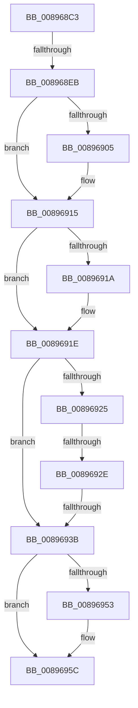

# sub_008968C3

- RVA: `0x008968C3`–`0x00896977` (길이 `180` bytes)
- VA: `0x00000001408968C3`
- 실행 섹션: `PAGE`
- PDB 이름 있음: `아니요`; PDB Function 태그: `아니요`
- unwind 정보 RVA: `0x0007E20C`
- 디코드: `43`개 명령, `180/180` bytes 표시
- 미해석 바이트: `0` (있으면 어셈블리에 `.byte`로 보존)

> 이 문서는 커널 이미지의 기계어와 PDB 기호를 분석해 생성했습니다. 4번과 5번은 함수 원형과 자료형을 바이너리 사용 방식에서 추정한 C 해석이며 원본 소스 복구 결과는 아닙니다.

## 1. Dependencies

- 직접 호출 지점: **6**; 고유 호출 대상: **6**
- 직접 호출자로 확인된 함수: **0**
- RIP 상대 이미지 참조: **0**

### Outgoing calls
- `0x008968F4` → [KeAbPreAcquire](../../text/21/KeAbPreAcquire_function_00210230.md) (function, `0x00210230`)
- `0x00896910` → [ExfAcquirePushLockExclusiveEx](../../text/20/ExfAcquirePushLockExclusiveEx_function_0020FC90.md) (function, `0x0020FC90`)
- `0x00896925` → [Feature_679186747__private_IsEnabledDeviceUsageNoInline](../../text/5C/Feature_679186747__private_IsEnabledDeviceUsageNoInline_function_005CD818.md) (function, `0x005CD818`)
- `0x00896931` → [AlpcpReferenceBlob](AlpcpReferenceBlob_function_00890110.md) (function, `0x00890110`)
- `0x00896957` → [ExfTryToWakePushLock](../../text/26/ExfTryToWakePushLock_function_00265DD0.md) (function, `0x00265DD0`)
- `0x00896960` → [KeAbPostRelease](../../text/2E/KeAbPostRelease_function_002E1600.md) (function, `0x002E1600`)

### Direct callers
- 이 함수 시작 RVA로 연결되는 직접 call은 확인되지 않았습니다. 간접 호출은 완전히 역산할 수 없습니다.

### Static image references
- 디코드된 RIP-relative 메모리 참조가 없습니다.

## 2. Other-region calls and transfers

- 다른 실행 섹션으로 향하는 call: **5**
  - `0x008968F4` → [KeAbPreAcquire](../../text/21/KeAbPreAcquire_function_00210230.md) (`PAGE` → `.text`)
  - `0x00896910` → [ExfAcquirePushLockExclusiveEx](../../text/20/ExfAcquirePushLockExclusiveEx_function_0020FC90.md) (`PAGE` → `.text`)
  - `0x00896925` → [Feature_679186747__private_IsEnabledDeviceUsageNoInline](../../text/5C/Feature_679186747__private_IsEnabledDeviceUsageNoInline_function_005CD818.md) (`PAGE` → `.text`)
  - `0x00896957` → [ExfTryToWakePushLock](../../text/26/ExfTryToWakePushLock_function_00265DD0.md) (`PAGE` → `.text`)
  - `0x00896960` → [KeAbPostRelease](../../text/2E/KeAbPostRelease_function_002E1600.md) (`PAGE` → `.text`)
- call이 아닌 외부 분기/꼬리 이동: **3**
  - `0x008968E5` → [sub_00896999 + 0x38](Unknown_function_00896999.md) (`tail-transfer`)
  - `0x0089692C` → [sub_00896999 + 0x6](Unknown_function_00896999.md) (`tail-transfer`)
  - `0x00896939` → [sub_00896999](Unknown_function_00896999.md) (`tail-transfer`)

## 3. Assembly (complete function range)

```asm
008968C3  48 89 AC 24 40 01 00 00         mov qword ptr [rsp + 0x140], rbp
008968CB  48 8B AB 88 00 00 00            mov rbp, qword ptr [rbx + 0x88]
008968D2  4C 89 B4 24 F0 00 00 00         mov qword ptr [rsp + 0xf0], r14
008968DA  44 8B B4 24 50 01 00 00         mov r14d, dword ptr [rsp + 0x150]
008968E2  48 85 ED                        test rbp, rbp
008968E5  0F 84 E6 00 00 00               je 0x1408969d1
008968EB  45 33 C0                        xor r8d, r8d
008968EE  48 8D 4D F0                     lea rcx, [rbp - 0x10]
008968F2  33 D2                           xor edx, edx
008968F4  E8 37 99 97 FF                  call 0x140210230
008968F9  F0 48 0F BA 6D F0 00            lock bts qword ptr [rbp - 0x10], 0
00896900  48 8B D8                        mov rbx, rax
00896903  73 10                           jae 0x140896915
00896905  4C 8D 45 F0                     lea r8, [rbp - 0x10]
00896909  48 8B D0                        mov rdx, rax
0089690C  48 8D 4D F0                     lea rcx, [rbp - 0x10]
00896910  E8 7B 93 97 FF                  call 0x14020fc90
00896915  48 85 DB                        test rbx, rbx
00896918  74 04                           je 0x14089691e
0089691A  C6 43 0A 01                     mov byte ptr [rbx + 0xa], 1
0089691E  8B 45 68                        mov eax, dword ptr [rbp + 0x68]
00896921  A8 01                           test al, 1
00896923  75 16                           jne 0x14089693b
00896925  E8 EE 6E D3 FF                  call 0x1405cd818
0089692A  85 C0                           test eax, eax
0089692C  74 71                           je 0x14089699f
0089692E  48 8B CD                        mov rcx, rbp
00896931  E8 DA 97 FF FF                  call 0x140890110
00896936  48 85 C0                        test rax, rax
00896939  75 5E                           jne 0x140896999
0089693B  BB 22 00 00 C0                  mov ebx, 0xc0000022
00896940  48 C7 C0 FF FF FF FF            mov rax, 0xffffffffffffffff
00896947  F0 48 0F C1 45 F0               lock xadd qword ptr [rbp - 0x10], rax
0089694D  24 06                           and al, 6
0089694F  3C 02                           cmp al, 2
00896951  75 09                           jne 0x14089695c
00896953  48 8D 4D F0                     lea rcx, [rbp - 0x10]
00896957  E8 74 F4 9C FF                  call 0x140265dd0
0089695C  48 8D 4D F0                     lea rcx, [rbp - 0x10]
00896960  E8 9B AC A4 FF                  call 0x1402e1600
00896965  8B C3                           mov eax, ebx
00896967  48 8B AC 24 40 01 00 00         mov rbp, qword ptr [rsp + 0x140]
0089696F  4C 8B B4 24 F0 00 00 00         mov r14, qword ptr [rsp + 0xf0]
```

## 4. C-style interpretation (structured pseudocode)

```c
__int64 __fastcall sub_008968C3(__int64 a1, int a2, int a3, __int64 a4, __int64 a5, __int64 a6, __int64 a7, __int64 a8, __int64 a9, __int64 a10, __int64 a11, __int64 a12, __int64 a13, __int64 a14, __int64 a15, __int64 a16, __int64 a17, __int64 a18, __int64 a19, __int64 a20, __int64 a21, __int64 a22, __int64 a23, __int64 a24, __int64 a25, __int64 a26, __int64 a27, __int64 a28, __int64 a29, __int64 a30, __int64 a31, __int64 a32, __int64 a33, __int64 a34, __int64 a35, __int64 a36, __int64 a37, __int64 a38, __int64 a39, __int64 a40, __int64 a41, unsigned int a42)
{
    __int64 result;
    unsigned __int64 v_stack_p140;
    unsigned __int64 v_stack_pF0;

    v_stack_p140 = v_rbp;
    v_stack_pF0 = v_r14;
    a3 = 0;
    a2 = 0;
    result = KeAbPreAcquire(*(unsigned __int64 *)(v_rbx + 136) - 16, a2, a3, a4);
    if (!(condition_is_above_or_equal)) {
        a3 = *(unsigned __int64 *)(v_rbx + 136) - 16;
        a2 = result;
        a1 = *(unsigned __int64 *)(v_rbx + 136) - 16;
        result = ExfAcquirePushLockExclusiveEx(a1, a2, a3, a4);
    }
    if (result != 0) {
        *(unsigned __int8 *)(result + 10) = 1;
    }
    if ((((unsigned __int8)((unsigned int)(*(unsigned int *)(*(unsigned __int64 *)(v_rbx + 136) + 104)))) & (1)) != 0) goto loc_0089693B;
    result = Feature_679186747__private_IsEnabledDeviceUsageNoInline(a1, a2, a3, a4);
    result = AlpcpReferenceBlob(*(unsigned __int64 *)(v_rbx + 136), a2, a3, a4);
loc_0089693B:
    result = (unsigned __int8)((-1) & (6));
    if (((unsigned __int8)(result)) == 2) {
        a1 = *(unsigned __int64 *)(v_rbx + 136) - 16;
        result = ExfTryToWakePushLock(a1, a2, a3, a4);
    }
    result = KeAbPostRelease(*(unsigned __int64 *)(v_rbx + 136) - 16, a2, a3, a4);
    return (unsigned int)((unsigned int)((unsigned int)(0xC0000022ULL)));
}
```

## 5. (Beta) C Style

```c
int64_t sub_008968C3(int64_t Arg1, int32_t Arg2, int32_t Arg3, int64_t Arg4, uint64_t Arg5, uint64_t Arg6, uint64_t Arg7, uint64_t Arg8, uint64_t Arg9, uint64_t Arg10, uint64_t Arg11, uint64_t Arg12, uint64_t Arg13, uint64_t Arg14, uint64_t Arg15, uint64_t Arg16, uint64_t Arg17, uint64_t Arg18, uint64_t Arg19, uint64_t Arg20, uint64_t Arg21, uint64_t Arg22, uint64_t Arg23, uint64_t Arg24, uint64_t Arg25, uint64_t Arg26, uint64_t Arg27, uint64_t Arg28, uint64_t Arg29, int64_t Arg30, uint64_t Arg31, uint64_t Arg32, uint64_t Arg33, uint64_t Arg34, uint64_t Arg35, uint64_t Arg36, uint64_t Arg37, uint64_t Arg38, uint64_t Arg39, int64_t Arg40, uint64_t Arg41, uint32_t Arg42)
{
    int64_t result;
    uint64_t v_stack_p140;
    uint64_t v_stack_pF0;

    v_stack_p140 = local_rbp;
    v_stack_pF0 = local_r14;
    Arg3 = 0;
    Arg2 = 0;
    result = KeAbPreAcquire(*(uint64_t *)(local_rbx + 0x88) - 16, Arg2, Arg3, Arg4);
    if (!(condition_is_above_or_equal)) {
        Arg3 = *(uint64_t *)(local_rbx + 0x88) - 16;
        Arg2 = result;
        Arg1 = *(uint64_t *)(local_rbx + 0x88) - 16;
        result = ExfAcquirePushLockExclusiveEx(Arg1, Arg2, Arg3, Arg4);
    }
    if (result != 0) {
        *(uint8_t *)(result + 0xA) = 1;
    }
    if ((((uint8_t)((uint32_t)(*(uint32_t *)(*(uint64_t *)(local_rbx + 0x88) + 0x68)))) & (1)) != 0) goto loc_0089693B;
    result = Feature_679186747__private_IsEnabledDeviceUsageNoInline(Arg1, Arg2, Arg3, Arg4);
    result = AlpcpReferenceBlob(*(uint64_t *)(local_rbx + 0x88), Arg2, Arg3, Arg4);
loc_0089693B:
    result = (uint8_t)((-1) & (6));
    if (((uint8_t)(result)) == 2) {
        Arg1 = *(uint64_t *)(local_rbx + 0x88) - 16;
        result = ExfTryToWakePushLock(Arg1, Arg2, Arg3, Arg4);
    }
    result = KeAbPostRelease(*(uint64_t *)(local_rbx + 0x88) - 16, Arg2, Arg3, Arg4);
    return (uint32_t)((uint32_t)((uint32_t)(0xC0000022ULL)));
}
```

## 6. Execution-region graph

[열기: 2D/3D 그래프와 함수 탐색 컨트롤 패널](../../../control-panel.html?section=page&rva=0x008968C3&view=graph)

- 2D 그래프는 위에서 아래로 흐르고, 3D 그래프는 빈 공간을 드래그해 회전합니다. Shift+드래그는 이동, 휠은 확대·축소, 함수 노드 선택은 대상 보고서 이동입니다.

### Static fallback


