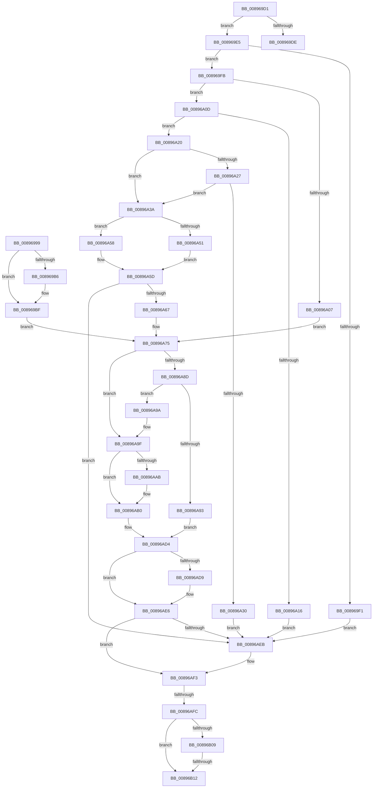

# sub_00896999

- RVA: `0x00896999`–`0x00896B21` (길이 `392` bytes)
- VA: `0x0000000140896999`
- 실행 섹션: `PAGE`
- PDB 이름 있음: `아니요`; PDB Function 태그: `아니요`
- unwind 정보 RVA: `0x0007E238`
- 디코드: `93`개 명령, `392/392` bytes 표시
- 미해석 바이트: `0` (있으면 어셈블리에 `.byte`로 보존)

> 이 문서는 커널 이미지의 기계어와 PDB 기호를 분석해 생성했습니다. 4번과 5번은 함수 원형과 자료형을 바이너리 사용 방식에서 추정한 C 해석이며 원본 소스 복구 결과는 아닙니다.

## 1. Dependencies

- 직접 호출 지점: **9**; 고유 호출 대상: **9**
- 직접 호출자로 확인된 함수: **0**
- RIP 상대 이미지 참조: **0**

### Outgoing calls
- `0x008969BA` → [ExfTryToWakePushLock](../../text/26/ExfTryToWakePushLock_function_00265DD0.md) (function, `0x00265DD0`)
- `0x008969C3` → [KeAbPostRelease](../../text/2E/KeAbPostRelease_function_002E1600.md) (function, `0x002E1600`)
- `0x008969D1` → [AlpcpReferenceConnectedPort](../9C/AlpcpReferenceConnectedPort_function_009CB030.md) (function, `0x009CB030`)
- `0x00896A51` → [SeCreateClientSecurityEx](SeCreateClientSecurityEx_function_00891760.md) (function, `0x00891760`)
- `0x00896A58` → [SeCreateClientSecurity](SeCreateClientSecurity_function_008911B0.md) (function, `0x008911B0`)
- `0x00896ACD` → [PsImpersonateClient](../8C/PsImpersonateClient_function_008CBE10.md) (function, `0x008CBE10`)
- `0x00896AE1` → [AlpcpDereferenceBlobEx](../88/AlpcpDereferenceBlobEx_function_0088AF00.md) (function, `0x0088AF00`)
- `0x00896AEE` → [ObfDereferenceObject](../../text/2F/ObfDereferenceObject_function_002F9350.md) (function, `0x002F9350`)
- `0x00896B17` → [ObfDereferenceObjectWithTag](../../text/2F/ObfDereferenceObjectWithTag_function_002F78E0.md) (function, `0x002F78E0`)

### Direct callers
- 이 함수 시작 RVA로 연결되는 직접 call은 확인되지 않았습니다. 간접 호출은 완전히 역산할 수 없습니다.

### Static image references
- 디코드된 RIP-relative 메모리 참조가 없습니다.

## 2. Other-region calls and transfers

- 다른 실행 섹션으로 향하는 call: **4**
  - `0x008969BA` → [ExfTryToWakePushLock](../../text/26/ExfTryToWakePushLock_function_00265DD0.md) (`PAGE` → `.text`)
  - `0x008969C3` → [KeAbPostRelease](../../text/2E/KeAbPostRelease_function_002E1600.md) (`PAGE` → `.text`)
  - `0x00896AEE` → [ObfDereferenceObject](../../text/2F/ObfDereferenceObject_function_002F9350.md) (`PAGE` → `.text`)
  - `0x00896B17` → [ObfDereferenceObjectWithTag](../../text/2F/ObfDereferenceObjectWithTag_function_002F78E0.md) (`PAGE` → `.text`)
- call이 아닌 외부 분기/꼬리 이동: **4**
  - `0x008969E3` → [sub_008968C3 + 0xA4](Unknown_function_008968C3.md) (`tail-transfer`)
  - `0x00896AF6` → [sub_008968C3 + 0xA2](Unknown_function_008968C3.md) (`tail-transfer`)
  - `0x00896B0C` → [sub_008968C3 + 0xA2](Unknown_function_008968C3.md) (`tail-transfer`)
  - `0x00896B1C` → [sub_008968C3 + 0xA2](Unknown_function_008968C3.md) (`tail-transfer`)

## 3. Assembly (complete function range)

```asm
00896999  41 BD 01 00 00 00               mov r13d, 1
0089699F  83 4D 68 02                     or dword ptr [rbp + 0x68], 2
008969A3  48 C7 C0 FF FF FF FF            mov rax, 0xffffffffffffffff
008969AA  F0 48 0F C1 45 F0               lock xadd qword ptr [rbp - 0x10], rax
008969B0  24 06                           and al, 6
008969B2  3C 02                           cmp al, 2
008969B4  75 09                           jne 0x1408969bf
008969B6  48 8D 4D F0                     lea rcx, [rbp - 0x10]
008969BA  E8 11 F4 9C FF                  call 0x140265dd0
008969BF  48 8D 4D F0                     lea rcx, [rbp - 0x10]
008969C3  E8 38 AC A4 FF                  call 0x1402e1600
008969C8  48 8D 7D 20                     lea rdi, [rbp + 0x20]
008969CC  E9 A4 00 00 00                  jmp 0x140896a75
008969D1  E8 5A 46 13 00                  call 0x1409cb030
008969D6  48 8B F0                        mov rsi, rax
008969D9  48 85 C0                        test rax, rax
008969DC  75 07                           jne 0x1408969e5
008969DE  B8 22 00 00 C0                  mov eax, 0xc0000022
008969E3  EB 82                           jmp 0x140896967
008969E5  F7 80 00 01 00 00 00 00 01 00   test dword ptr [rax + 0x100], 0x10000
008969EF  75 0A                           jne 0x1408969fb
008969F1  BB 22 00 00 C0                  mov ebx, 0xc0000022
008969F6  E9 F0 00 00 00                  jmp 0x140896aeb
008969FB  F7 80 A0 01 00 00 00 04 00 00   test dword ptr [rax + 0x1a0], 0x400
00896A05  75 06                           jne 0x140896a0d
00896A07  48 8D 78 40                     lea rdi, [rax + 0x40]
00896A0B  EB 68                           jmp 0x140896a75
00896A0D  48 8B 4B 20                     mov rcx, qword ptr [rbx + 0x20]
00896A11  48 85 C9                        test rcx, rcx
00896A14  75 0A                           jne 0x140896a20
00896A16  BB 22 00 00 C0                  mov ebx, 0xc0000022
00896A1B  E9 CB 00 00 00                  jmp 0x140896aeb
00896A20  44 39 64 24 30                  cmp dword ptr [rsp + 0x30], r12d
00896A25  74 13                           je 0x140896a3a
00896A27  44 39 B0 08 01 00 00            cmp dword ptr [rax + 0x108], r14d
00896A2E  7D 0A                           jge 0x140896a3a
00896A30  BB 22 00 00 C0                  mov ebx, 0xc0000022
00896A35  E9 B1 00 00 00                  jmp 0x140896aeb
00896A3A  45 33 C0                        xor r8d, r8d
00896A3D  48 8D 90 04 01 00 00            lea rdx, [rax + 0x104]
00896A44  4C 8D 8C 24 90 00 00 00         lea r9, [rsp + 0x90]
00896A4C  45 85 FF                        test r15d, r15d
00896A4F  74 07                           je 0x140896a58
00896A51  E8 0A AD FF FF                  call 0x140891760
00896A56  EB 05                           jmp 0x140896a5d
00896A58  E8 53 A7 FF FF                  call 0x1408911b0
00896A5D  8B D8                           mov ebx, eax
00896A5F  85 C0                           test eax, eax
00896A61  0F 88 84 00 00 00               js 0x140896aeb
00896A67  48 8D BC 24 90 00 00 00         lea rdi, [rsp + 0x90]
00896A6F  41 BC 01 00 00 00               mov r12d, 1
00896A75  83 7C 24 30 00                  cmp dword ptr [rsp + 0x30], 0
00896A7A  0F 10 07                        movups xmm0, xmmword ptr [rdi]
00896A7D  0F 10 4F 10                     movups xmm1, xmmword ptr [rdi + 0x10]
00896A81  0F 29 44 24 40                  movaps xmmword ptr [rsp + 0x40], xmm0
00896A86  0F 29 4C 24 50                  movaps xmmword ptr [rsp + 0x50], xmm1
00896A8B  74 12                           je 0x140896a9f
00896A8D  44 3B 77 04                     cmp r14d, dword ptr [rdi + 4]
00896A91  7E 07                           jle 0x140896a9a
00896A93  BB 22 00 00 C0                  mov ebx, 0xc0000022
00896A98  EB 3A                           jmp 0x140896ad4
00896A9A  44 89 74 24 44                  mov dword ptr [rsp + 0x44], r14d
00896A9F  80 7C 24 58 00                  cmp byte ptr [rsp + 0x58], 0
00896AA4  4C 8B 4C 24 58                  mov r9, qword ptr [rsp + 0x58]
00896AA9  75 05                           jne 0x140896ab0
00896AAB  4C 8B 4C 24 48                  mov r9, qword ptr [rsp + 0x48]
00896AB0  65 48 8B 0C 25 88 01 00 00      mov rcx, qword ptr gs:[0x188]
00896AB9  41 B0 01                        mov r8b, 1
00896ABC  8B 44 24 44                     mov eax, dword ptr [rsp + 0x44]
00896AC0  48 8B 54 24 50                  mov rdx, qword ptr [rsp + 0x50]
00896AC5  49 C1 E9 08                     shr r9, 8
00896AC9  89 44 24 20                     mov dword ptr [rsp + 0x20], eax
00896ACD  E8 3E 53 03 00                  call 0x1408cbe10
00896AD2  8B D8                           mov ebx, eax
00896AD4  45 85 ED                        test r13d, r13d
00896AD7  74 0D                           je 0x140896ae6
00896AD9  BA 01 00 00 00                  mov edx, 1
00896ADE  48 8B CD                        mov rcx, rbp
00896AE1  E8 1A 44 FF FF                  call 0x14088af00
00896AE6  48 85 F6                        test rsi, rsi
00896AE9  74 08                           je 0x140896af3
00896AEB  48 8B CE                        mov rcx, rsi
00896AEE  E8 5D 28 A6 FF                  call 0x1402f9350
00896AF3  45 85 E4                        test r12d, r12d
00896AF6  0F 84 69 FE FF FF               je 0x140896965
00896AFC  48 8B 4F 10                     mov rcx, qword ptr [rdi + 0x10]
00896B00  83 B9 C0 00 00 00 01            cmp dword ptr [rcx + 0xc0], 1
00896B07  74 09                           je 0x140896b12
00896B09  48 85 C9                        test rcx, rcx
00896B0C  0F 84 53 FE FF FF               je 0x140896965
00896B12  BA 53 65 43 63                  mov edx, 0x63436553
00896B17  E8 C4 0D A6 FF                  call 0x1402f78e0
00896B1C  E9 44 FE FF FF                  jmp 0x140896965
```

## 4. C-style interpretation (structured pseudocode)

```c
__int64 __fastcall sub_00896999(__int64 a1, __int64 a2, int a3, __int64 a4, __int64 a5, unsigned int a6, __int64 a7, __int64 a8, __int64 a9, __int64 a10, unsigned __int8 a11)
{
    __int64 result;
    unsigned int v_stack_p20;
    unsigned int v_stack_p30;
    unsigned __int64 v_stack_p40;
    unsigned int v_stack_p44;
    unsigned __int64 v_stack_p50;
    unsigned __int64 v_stack_p90;

    result = (unsigned __int8)((-1) & (6));
    if (((unsigned __int8)(result)) == 2) {
        a1 = v_rbp - 16;
        result = ExfTryToWakePushLock(a1, a2, a3, a4);
    }
    result = KeAbPostRelease(v_rbp - 16, a2, a3, a4);
    goto loc_00896A75;
loc_00896A75:
    v_stack_p40 = v_xmm0;
    v_stack_p50 = v_xmm1;
    if (a6 == 0) goto loc_00896A9F;
    if (((unsigned int)(v_r14)) <= (*(unsigned int *)(v_rbp + 32 + 4))) goto loc_00896A9A;
    goto loc_00896AD4;
loc_00896A9A:
    v_stack_p44 = (unsigned int)(v_r14);
loc_00896A9F:
    if (a11 == 0) {
        a4 = a9;
    }
    a4 = (a4) >> (8);
    v_stack_p20 = (unsigned int)((unsigned int)(v_stack_p44));
    result = PsImpersonateClient(*(unsigned __int64 *)(gs_base + (0 + 392)), a10, 1, a4);
loc_00896AD4:
    if (1 != 0) {
        a2 = 1;
        a1 = v_rbp;
        result = AlpcpDereferenceBlobEx(a1, a2, 1, a4);
    }
    if (v_rsi != 0) {
        a1 = v_rsi;
        result = ObfDereferenceObject(a1, a2, 1, a4);
    }
    if ((*(unsigned int *)(*(unsigned __int64 *)(v_rbp + 32 + 16) + 192)) == 1) goto loc_00896B12;
loc_00896B12:
    result = ObfDereferenceObjectWithTag(*(unsigned __int64 *)(v_rbp + 32 + 16), (unsigned int)(0x63436553ULL), 1, a4);
}
```

## 5. (Beta) C Style

```c
int64_t sub_00896999(int64_t Arg1, int64_t Arg2, int32_t Arg3, int64_t Arg4, uint64_t Arg5, uint32_t Arg6, uint64_t Arg7, uint64_t Arg8, int64_t Arg9, int64_t Arg10, uint8_t Arg11)
{
    int64_t result;
    uint32_t v_stack_p20;
    uint32_t v_stack_p30;
    uint64_t v_stack_p40;
    uint32_t v_stack_p44;
    uint64_t v_stack_p50;
    uint64_t v_stack_p90;

    result = (uint8_t)((-1) & (6));
    if (((uint8_t)(result)) == 2) {
        Arg1 = local_rbp - 16;
        result = ExfTryToWakePushLock(Arg1, Arg2, Arg3, Arg4);
    }
    result = KeAbPostRelease(local_rbp - 16, Arg2, Arg3, Arg4);
    goto loc_00896A75;
loc_00896A75:
    v_stack_p40 = v_xmm0;
    v_stack_p50 = v_xmm1;
    if (Arg6 == 0) goto loc_00896A9F;
    if (((uint32_t)(local_r14)) <= (*(uint32_t *)(local_rbp + 0x20 + 0x4))) goto loc_00896A9A;
    goto loc_00896AD4;
loc_00896A9A:
    v_stack_p44 = (uint32_t)(local_r14);
loc_00896A9F:
    if (Arg11 == 0) {
        Arg4 = Arg9;
    }
    Arg4 = (Arg4) >> (8);
    v_stack_p20 = (uint32_t)((uint32_t)(v_stack_p44));
    result = PsImpersonateClient(*(uint64_t *)(gs_base + (0 + 0x188)), Arg10, 1, Arg4);
loc_00896AD4:
    if (1 != 0) {
        Arg2 = 1;
        Arg1 = local_rbp;
        result = AlpcpDereferenceBlobEx(Arg1, Arg2, 1, Arg4);
    }
    if (local_rsi != 0) {
        Arg1 = local_rsi;
        result = ObfDereferenceObject(Arg1, Arg2, 1, Arg4);
    }
    if ((*(uint32_t *)(*(uint64_t *)(local_rbp + 0x20 + 0x10) + 0xC0)) == 1) goto loc_00896B12;
loc_00896B12:
    result = ObfDereferenceObjectWithTag(*(uint64_t *)(local_rbp + 0x20 + 0x10), (uint32_t)(0x63436553ULL), 1, Arg4);
}
```

## 6. Execution-region graph

[열기: 2D/3D 그래프와 함수 탐색 컨트롤 패널](../../../control-panel.html?section=page&rva=0x00896999&view=graph)

- 2D 그래프는 위에서 아래로 흐르고, 3D 그래프는 빈 공간을 드래그해 회전합니다. Shift+드래그는 이동, 휠은 확대·축소, 함수 노드 선택은 대상 보고서 이동입니다.

### Static fallback


