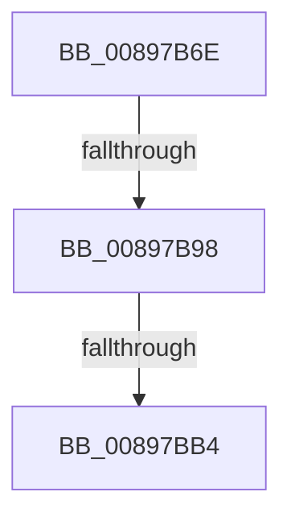

# sub_00897B6E

- RVA: `0x00897B6E`–`0x00897BD2` (길이 `100` bytes)
- VA: `0x0000000140897B6E`
- 실행 섹션: `PAGE`
- PDB 이름 있음: `아니요`; PDB Function 태그: `아니요`
- unwind 정보 RVA: `0x0007E2E8`
- 디코드: `22`개 명령, `100/100` bytes 표시
- 미해석 바이트: `0` (있으면 어셈블리에 `.byte`로 보존)

> 이 문서는 커널 이미지의 기계어와 PDB 기호를 분석해 생성했습니다. 4번과 5번은 함수 원형과 자료형을 바이너리 사용 방식에서 추정한 C 해석이며 원본 소스 복구 결과는 아닙니다.

## 1. Dependencies

- 직접 호출 지점: **2**; 고유 호출 대상: **2**
- 직접 호출자로 확인된 함수: **0**
- RIP 상대 이미지 참조: **2**

### Outgoing calls
- `0x00897B98` → [AlpcMessageCleanupProcedure](../88/AlpcMessageCleanupProcedure_function_0088BBA0.md) (function, `0x0088BBA0`)
- `0x00897BB8` → [KeAbPostRelease](../../text/2E/KeAbPostRelease_function_002E1600.md) (function, `0x002E1600`)

### Direct callers
- 이 함수 시작 RVA로 연결되는 직접 call은 확인되지 않았습니다. 간접 호출은 완전히 역산할 수 없습니다.

### Static image references
- `0x00897B78` → RVA `0x00001450` (`.rdata`; read)
- `0x00897BC1` → RVA `0x0088B500` (`AlpcMessageDestroyProcedure`; read)

## 2. Other-region calls and transfers

- 다른 실행 섹션으로 향하는 call: **1**
  - `0x00897BB8` → [KeAbPostRelease](../../text/2E/KeAbPostRelease_function_002E1600.md) (`PAGE` → `.text`)
- call이 아닌 외부 분기/꼬리 이동: **3**
  - `0x00897B92` → [sub_00897CA0](Unknown_function_00897CA0.md) (`tail-transfer`)
  - `0x00897BAE` → [sub_00897CB4](Unknown_function_00897CB4.md) (`tail-transfer`)
  - `0x00897BD0` → [sub_00897BD2 + 0x16](Unknown_function_00897BD2.md) (`tail-transfer`)

## 3. Assembly (complete function range)

```asm
00897B6E  48 89 6C 24 40                  mov qword ptr [rsp + 0x40], rbp
00897B73  48 89 74 24 48                  mov qword ptr [rsp + 0x48], rsi
00897B78  48 8D 35 D1 98 76 FF            lea rsi, [rip - 0x89672f]
00897B7F  48 89 7C 24 50                  mov qword ptr [rsp + 0x50], rdi
00897B84  48 8B 34 C6                     mov rsi, qword ptr [rsi + rax*8]
00897B88  48 8B 46 18                     mov rax, qword ptr [rsi + 0x18]
00897B8C  48 3B C1                        cmp rax, rcx
00897B8F  48 8B CB                        mov rcx, rbx
00897B92  0F 85 08 01 00 00               jne 0x140897ca0
00897B98  E8 03 40 FF FF                  call 0x14088bba0
00897B9D  48 C7 C0 FF FF FF FF            mov rax, 0xffffffffffffffff
00897BA4  F0 48 0F C1 43 F0               lock xadd qword ptr [rbx - 0x10], rax
00897BAA  24 06                           and al, 6
00897BAC  3C 02                           cmp al, 2
00897BAE  0F 84 00 01 00 00               je 0x140897cb4
00897BB4  48 8D 4B F0                     lea rcx, [rbx - 0x10]
00897BB8  E8 43 9A A4 FF                  call 0x1402e1600
00897BBD  48 8B 46 28                     mov rax, qword ptr [rsi + 0x28]
00897BC1  48 8D 0D 38 39 FF FF            lea rcx, [rip - 0xc6c8]
00897BC8  48 8B 6C 24 40                  mov rbp, qword ptr [rsp + 0x40]
00897BCD  48 3B C1                        cmp rax, rcx
00897BD0  74 16                           je 0x140897be8
```

## 4. C-style interpretation (structured pseudocode)

```c
__int64 __fastcall sub_00897B6E(__int64 a1, __int64 a2, __int64 a3, __int64 a4, __int64 a5, __int64 a6, __int64 a7, __int64 a8)
{
    __int64 result;
    unsigned __int64 v_stack_p40;
    unsigned __int64 v_stack_p48;
    unsigned __int64 v_stack_p50;

    v_stack_p40 = v_rbp;
    v_stack_p48 = v_rsi;
    v_stack_p50 = v_rdi;
    result = AlpcMessageCleanupProcedure(v_rbx, a2, a3, a4);
    result = (unsigned __int8)((-1) & (6));
    result = KeAbPostRelease(v_rbx - 16, a2, a3, a4);
}
```

## 5. (Beta) C Style

```c
int64_t sub_00897B6E(int64_t Arg1, int64_t Arg2, int64_t Arg3, int64_t Arg4, uint64_t Arg5, uint64_t Arg6, uint64_t Arg7, int64_t Arg8)
{
    int64_t result;
    uint64_t v_stack_p40;
    uint64_t v_stack_p48;
    uint64_t v_stack_p50;

    v_stack_p40 = local_rbp;
    v_stack_p48 = local_rsi;
    v_stack_p50 = local_rdi;
    result = AlpcMessageCleanupProcedure(local_rbx, Arg2, Arg3, Arg4);
    result = (uint8_t)((-1) & (6));
    result = KeAbPostRelease(local_rbx - 16, Arg2, Arg3, Arg4);
}
```

## 6. Execution-region graph

[열기: 2D/3D 그래프와 함수 탐색 컨트롤 패널](../../../control-panel.html?section=page&rva=0x00897B6E&view=graph)

- 2D 그래프는 위에서 아래로 흐르고, 3D 그래프는 빈 공간을 드래그해 회전합니다. Shift+드래그는 이동, 휠은 확대·축소, 함수 노드 선택은 대상 보고서 이동입니다.

### Static fallback


