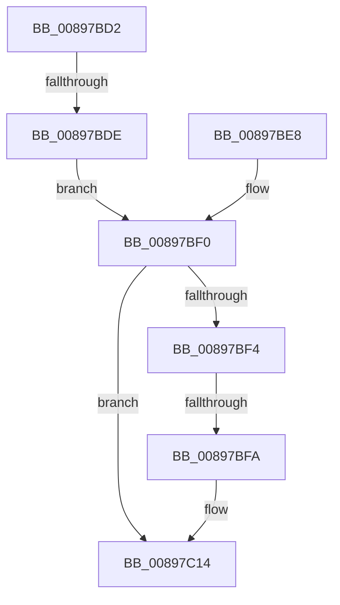

# sub_00897BD2

- RVA: `0x00897BD2`–`0x00897C23` (길이 `81` bytes)
- VA: `0x0000000140897BD2`
- 실행 섹션: `PAGE`
- PDB 이름 있음: `아니요`; PDB Function 태그: `아니요`
- unwind 정보 RVA: `0x0007E304`
- 디코드: `21`개 명령, `81/81` bytes 표시
- 미해석 바이트: `0` (있으면 어셈블리에 `.byte`로 보존)

> 이 문서는 커널 이미지의 기계어와 PDB 기호를 분석해 생성했습니다. 4번과 5번은 함수 원형과 자료형을 바이너리 사용 방식에서 추정한 C 해석이며 원본 소스 복구 결과는 아닙니다.

## 1. Dependencies

- 직접 호출 지점: **3**; 고유 호출 대상: **3**
- 직접 호출자로 확인된 함수: **0**
- RIP 상대 이미지 참조: **2**

### Outgoing calls
- `0x00897BE1` → [AlpcSecurityDestroyProcedure](../88/AlpcSecurityDestroyProcedure_function_0088B330.md) (function, `0x0088B330`)
- `0x00897BEB` → [AlpcMessageDestroyProcedure](../88/AlpcMessageDestroyProcedure_function_0088B500.md) (function, `0x0088B500`)
- `0x00897C0F` → [ExFreeToPagedLookasideList](../../text/38/ExFreeToPagedLookasideList_function_00387D30.md) (function, `0x00387D30`)

### Direct callers
- 이 함수 시작 RVA로 연결되는 직접 call은 확인되지 않았습니다. 간접 호출은 완전히 역산할 수 없습니다.

### Static image references
- `0x00897BD2` → RVA `0x0088B330` (`AlpcSecurityDestroyProcedure`; read)
- `0x00897BFD` → RVA `0x00E27180` (`.data`; read)

## 2. Other-region calls and transfers

- 다른 실행 섹션으로 향하는 call: **1**
  - `0x00897C0F` → [ExFreeToPagedLookasideList](../../text/38/ExFreeToPagedLookasideList_function_00387D30.md) (`PAGE` → `.text`)
- call이 아닌 외부 분기/꼬리 이동: **3**
  - `0x00897BDC` → [sub_00897C45](Unknown_function_00897C45.md) (`tail-transfer`)
  - `0x00897BF8` → [sub_00897C23](Unknown_function_00897C23.md) (`tail-transfer`)
  - `0x00897C1E` → [AlpcpUnlockMessage + 0x76](AlpcpUnlockMessage_function_00897AE0.md) (`tail-transfer`)

## 3. Assembly (complete function range)

```asm
00897BD2  48 8D 0D 57 37 FF FF            lea rcx, [rip - 0xc8a9]
00897BD9  48 3B C1                        cmp rax, rcx
00897BDC  75 67                           jne 0x140897c45
00897BDE  48 8B CB                        mov rcx, rbx
00897BE1  E8 4A 37 FF FF                  call 0x14088b330
00897BE6  EB 08                           jmp 0x140897bf0
00897BE8  48 8B CB                        mov rcx, rbx
00897BEB  E8 10 39 FF FF                  call 0x14088b500
00897BF0  85 C0                           test eax, eax
00897BF2  78 20                           js 0x140897c14
00897BF4  F6 43 E0 02                     test byte ptr [rbx - 0x20], 2
00897BF8  74 29                           je 0x140897c23
00897BFA  8B 4E 08                        mov ecx, dword ptr [rsi + 8]
00897BFD  48 8D 15 7C F5 58 00            lea rdx, [rip + 0x58f57c]
00897C04  48 C1 E1 07                     shl rcx, 7
00897C08  48 03 CA                        add rcx, rdx
00897C0B  48 8D 53 D0                     lea rdx, [rbx - 0x30]
00897C0F  E8 1C 01 AF FF                  call 0x140387d30
00897C14  48 8B 74 24 48                  mov rsi, qword ptr [rsp + 0x48]
00897C19  48 8B 7C 24 50                  mov rdi, qword ptr [rsp + 0x50]
00897C1E  E9 33 FF FF FF                  jmp 0x140897b56
```

## 4. C-style interpretation (structured pseudocode)

```c
__int64 __fastcall sub_00897BD2(__int64 a1, __int64 a2, __int64 a3, __int64 a4, __int64 a5, __int64 a6, __int64 a7, __int64 a8, __int64 a9, __int64 a10)
{
    __int64 result;

    result = AlpcSecurityDestroyProcedure(v_rbx, a2, a3, a4);
    goto loc_00897BF0;
loc_00897BF0:
    if (sign_flag) goto loc_00897C14;
    a1 = ((unsigned int)(*(unsigned int *)(v_rsi + 8))) << (7);
    a1 = (a1) + (v_rip + 5830012);
    result = ExFreeToPagedLookasideList(a1, v_rbx - 48, a3, a4);
loc_00897C14:
}
```

## 5. (Beta) C Style

```c
int64_t sub_00897BD2(int64_t Arg1, int64_t Arg2, int64_t Arg3, int64_t Arg4, uint64_t Arg5, uint64_t Arg6, uint64_t Arg7, uint64_t Arg8, int64_t Arg9, int64_t Arg10)
{
    int64_t result;

    result = AlpcSecurityDestroyProcedure(local_rbx, Arg2, Arg3, Arg4);
    goto loc_00897BF0;
loc_00897BF0:
    if (sign_flag) goto loc_00897C14;
    Arg1 = ((uint32_t)(*(uint32_t *)(local_rsi + 0x8))) << (7);
    Arg1 = (Arg1) + (v_rip + 5830012);
    result = ExFreeToPagedLookasideList(Arg1, local_rbx - 48, Arg3, Arg4);
loc_00897C14:
}
```

## 6. Execution-region graph

[열기: 2D/3D 그래프와 함수 탐색 컨트롤 패널](../../../control-panel.html?section=page&rva=0x00897BD2&view=graph)

- 2D 그래프는 위에서 아래로 흐르고, 3D 그래프는 빈 공간을 드래그해 회전합니다. Shift+드래그는 이동, 휠은 확대·축소, 함수 노드 선택은 대상 보고서 이동입니다.

### Static fallback


