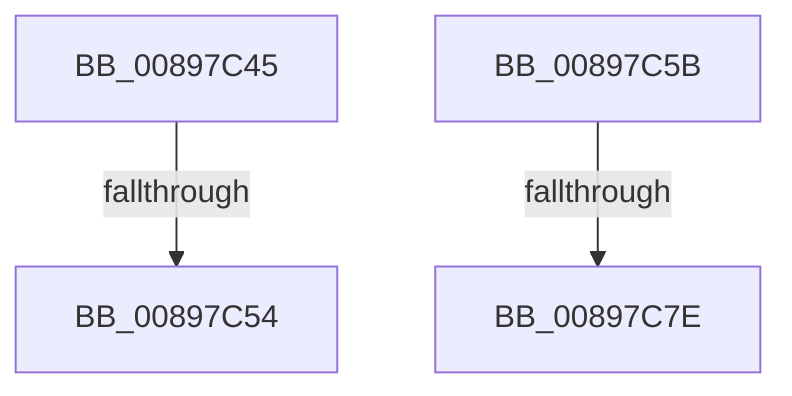

# sub_00897C45

- RVA: `0x00897C45`–`0x00897C92` (길이 `77` bytes)
- VA: `0x0000000140897C45`
- 실행 섹션: `PAGE`
- PDB 이름 있음: `아니요`; PDB Function 태그: `아니요`
- unwind 정보 RVA: `0x0007E334`
- 디코드: `18`개 명령, `77/77` bytes 표시
- 미해석 바이트: `0` (있으면 어셈블리에 `.byte`로 보존)

> 이 문서는 커널 이미지의 기계어와 PDB 기호를 분석해 생성했습니다. 4번과 5번은 함수 원형과 자료형을 바이너리 사용 방식에서 추정한 C 해석이며 원본 소스 복구 결과는 아닙니다.

## 1. Dependencies

- 직접 호출 지점: **2**; 고유 호출 대상: **2**
- 직접 호출자로 확인된 함수: **0**
- RIP 상대 이미지 참조: **3**

### Outgoing calls
- `0x00897C54` → [AlpcViewDestroyProcedure](../88/AlpcViewDestroyProcedure_function_0088B080.md) (function, `0x0088B080`)
- `0x00897C7E` → [AlpcpFreeMessageFunction](../88/AlpcpFreeMessageFunction_function_0088A060.md) (function, `0x0088A060`)

### Direct callers
- 이 함수 시작 RVA로 연결되는 직접 call은 확인되지 않았습니다. 간접 호출은 완전히 역산할 수 없습니다.

### Static image references
- `0x00897C45` → RVA `0x0088B080` (`AlpcViewDestroyProcedure`; read)
- `0x00897C5E` → RVA `0x0088A060` (`AlpcpFreeMessageFunction`; read)
- `0x00897C69` → RVA `0x00E27180` (`.data`; read)

## 2. Other-region calls and transfers

- 다른 실행 섹션으로 향하는 call: **0**
- call이 아닌 외부 분기/꼬리 이동: **4**
  - `0x00897C52` → [sub_00897CAA](Unknown_function_00897CAA.md) (`tail-transfer`)
  - `0x00897C59` → [sub_00897BD2 + 0x1E](Unknown_function_00897BD2.md) (`tail-transfer`)
  - `0x00897C7C` → [sub_00897CC2](Unknown_function_00897CC2.md) (`tail-transfer`)
  - `0x00897C8D` → [AlpcpUnlockMessage + 0x76](AlpcpUnlockMessage_function_00897AE0.md) (`tail-transfer`)

## 3. Assembly (complete function range)

```asm
00897C45  48 8D 0D 34 34 FF FF            lea rcx, [rip - 0xcbcc]
00897C4C  48 3B C1                        cmp rax, rcx
00897C4F  48 8B CB                        mov rcx, rbx
00897C52  75 56                           jne 0x140897caa
00897C54  E8 27 34 FF FF                  call 0x14088b080
00897C59  EB 95                           jmp 0x140897bf0
00897C5B  8B 46 08                        mov eax, dword ptr [rsi + 8]
00897C5E  48 8D 0D FB 23 FF FF            lea rcx, [rip - 0xdc05]
00897C65  48 C1 E0 07                     shl rax, 7
00897C69  48 8D 15 10 F5 58 00            lea rdx, [rip + 0x58f510]
00897C70  48 8B 44 10 38                  mov rax, qword ptr [rax + rdx + 0x38]
00897C75  48 3B C1                        cmp rax, rcx
00897C78  48 8D 4B D0                     lea rcx, [rbx - 0x30]
00897C7C  75 44                           jne 0x140897cc2
00897C7E  E8 DD 23 FF FF                  call 0x14088a060
00897C83  48 8B 74 24 48                  mov rsi, qword ptr [rsp + 0x48]
00897C88  48 8B 7C 24 50                  mov rdi, qword ptr [rsp + 0x50]
00897C8D  E9 C4 FE FF FF                  jmp 0x140897b56
```

## 4. C-style interpretation (structured pseudocode)

```c
__int64 __fastcall sub_00897C45(void)
{
    __int64 result;
    unsigned __int64 v_stack_p48;
    unsigned __int64 v_stack_p50;

    result = AlpcViewDestroyProcedure(v_rbx, a2, a3, a4);
}
```

## 5. (Beta) C Style

```c
void sub_00897C45(void)
{
    int64_t result;
    uint64_t v_stack_p48;
    uint64_t v_stack_p50;

    result = AlpcViewDestroyProcedure(local_rbx, a2, a3, a4);
}
```

## 6. Execution-region graph

[열기: 2D/3D 그래프와 함수 탐색 컨트롤 패널](../../../control-panel.html?section=page&rva=0x00897C45&view=graph)

- 2D 그래프는 위에서 아래로 흐르고, 3D 그래프는 빈 공간을 드래그해 회전합니다. Shift+드래그는 이동, 휠은 확대·축소, 함수 노드 선택은 대상 보고서 이동입니다.

### Static fallback


