# sub_0089A0DA

- RVA: `0x0089A0DA`–`0x0089A336` (길이 `604` bytes)
- VA: `0x000000014089A0DA`
- 실행 섹션: `PAGE`
- PDB 이름 있음: `아니요`; PDB Function 태그: `아니요`
- unwind 정보 RVA: `0x0007E590`
- 디코드: `156`개 명령, `604/604` bytes 표시
- 미해석 바이트: `0` (있으면 어셈블리에 `.byte`로 보존)

> 이 문서는 커널 이미지의 기계어와 PDB 기호를 분석해 생성했습니다. 4번과 5번은 함수 원형과 자료형을 바이너리 사용 방식에서 추정한 C 해석이며 원본 소스 복구 결과는 아닙니다.

## 1. Dependencies

- 직접 호출 지점: **1**; 고유 호출 대상: **1**
- 직접 호출자로 확인된 함수: **0**
- RIP 상대 이미지 참조: **1**

### Outgoing calls
- `0x0089A187` → [ExAllocatePoolWithTag](../../poolcode/B8/ExAllocatePoolWithTag_function_00B82010.md) (function, `0x00B82010`)

### Direct callers
- 이 함수 시작 RVA로 연결되는 직접 call은 확인되지 않았습니다. 간접 호출은 완전히 역산할 수 없습니다.

### Static image references
- `0x0089A2C4` → RVA `0x00FC6E4C` (`ALMOSTRO`; read)

## 2. Other-region calls and transfers

- 다른 실행 섹션으로 향하는 call: **1**
  - `0x0089A187` → [ExAllocatePoolWithTag](../../poolcode/B8/ExAllocatePoolWithTag_function_00B82010.md) (`PAGE` → `POOLCODE`)
- call이 아닌 외부 분기/꼬리 이동: **5**
  - `0x0089A120` → [sub_0089A337](Unknown_function_0089A337.md) (`tail-transfer`)
  - `0x0089A171` → [sub_0089A36F + 0x25](Unknown_function_0089A36F.md) (`tail-transfer`)
  - `0x0089A18F` → [sub_0089A36F](Unknown_function_0089A36F.md) (`tail-transfer`)
  - `0x0089A198` → [sub_0089A3AE](Unknown_function_0089A3AE.md) (`tail-transfer`)
  - `0x0089A2D5` → [sub_0089A36F + 0x7](Unknown_function_0089A36F.md) (`tail-transfer`)

## 3. Assembly (complete function range)

```asm
0089A0DA  4C 89 64 24 40                  mov qword ptr [rsp + 0x40], r12
0089A0DF  41 B8 30 00 00 00               mov r8d, 0x30
0089A0E5  0F B6 C9                        movzx ecx, cl
0089A0E8  44 0F B6 E5                     movzx r12d, bpl
0089A0EC  41 C0 FC 07                     sar r12b, 7
0089A0F0  0F B6 C1                        movzx eax, cl
0089A0F3  0C 01                           or al, 1
0089A0F5  4C 89 6C 24 38                  mov qword ptr [rsp + 0x38], r13
0089A0FA  44 0F B6 E8                     movzx r13d, al
0089A0FE  41 80 E4 30                     and r12b, 0x30
0089A102  40 80 E5 20                     and bpl, 0x20
0089A106  40 0F B6 C5                     movzx eax, bpl
0089A10A  44 0F 44 E9                     cmove r13d, ecx
0089A10E  F6 D8                           neg al
0089A110  48 8B 84 24 B0 00 00 00         mov rax, qword ptr [rsp + 0xb0]
0089A118  1B C9                           sbb ecx, ecx
0089A11A  83 E1 20                        and ecx, 0x20
0089A11D  48 85 C0                        test rax, rax
0089A120  0F 85 11 02 00 00               jne 0x14089a337
0089A126  45 33 C0                        xor r8d, r8d
0089A129  44 89 84 24 90 00 00 00         mov dword ptr [rsp + 0x90], r8d
0089A131  45 84 DB                        test r11b, r11b
0089A134  B8 30 00 00 00                  mov eax, 0x30
0089A139  41 BE 40 00 00 00               mov r14d, 0x40
0089A13F  44 0F 44 F0                     cmove r14d, eax
0089A143  8B 84 24 A0 00 00 00            mov eax, dword ptr [rsp + 0xa0]
0089A14A  44 03 F1                        add r14d, ecx
0089A14D  41 0F B6 CC                     movzx ecx, r12b
0089A151  44 03 F2                        add r14d, edx
0089A154  45 03 F2                        add r14d, r10d
0089A157  44 03 74 24 20                  add r14d, dword ptr [rsp + 0x20]
0089A15C  45 03 F1                        add r14d, r9d
0089A15F  44 03 B4 24 90 00 00 00         add r14d, dword ptr [rsp + 0x90]
0089A167  41 03 CE                        add ecx, r14d
0089A16A  41 03 C8                        add ecx, r8d
0089A16D  03 C1                           add eax, ecx
0089A16F  3B C1                           cmp eax, ecx
0089A171  0F 82 1D 02 00 00               jb 0x14089a394
0089A177  8B 4B 64                        mov ecx, dword ptr [rbx + 0x64]
0089A17A  44 8B 83 C0 00 00 00            mov r8d, dword ptr [rbx + 0xc0]
0089A181  0F BA E9 0A                     bts ecx, 0xa
0089A185  8B D0                           mov edx, eax
0089A187  E8 84 7E 2E 00                  call 0x140b82010
0089A18C  48 85 C0                        test rax, rax
0089A18F  0F 84 DA 01 00 00               je 0x14089a36f
0089A195  45 84 E4                        test r12b, r12b
0089A198  0F 85 10 02 00 00               jne 0x14089a3ae
0089A19E  83 BC 24 90 00 00 00 00         cmp dword ptr [rsp + 0x90], 0
0089A1A6  74 3A                           je 0x14089a1e2
0089A1A8  44 8B 84 24 A0 00 00 00         mov r8d, dword ptr [rsp + 0xa0]
0089A1B0  0F 57 C0                        xorps xmm0, xmm0
0089A1B3  41 8B CE                        mov ecx, r14d
0089A1B6  48 03 C8                        add rcx, rax
0089A1B9  4C 03 C1                        add r8, rcx
0089A1BC  48 8B 8C 24 B0 00 00 00         mov rcx, qword ptr [rsp + 0xb0]
0089A1C4  4C 89 00                        mov qword ptr [rax], r8
0089A1C7  41 0F 11 00                     movups xmmword ptr [r8], xmm0
0089A1CB  41 0F 11 40 10                  movups xmmword ptr [r8 + 0x10], xmm0
0089A1D0  41 0F 11 40 20                  movups xmmword ptr [r8 + 0x20], xmm0
0089A1D5  48 8B 10                        mov rdx, qword ptr [rax]
0089A1D8  48 83 C0 10                     add rax, 0x10
0089A1DC  0F B6 09                        movzx ecx, byte ptr [rcx]
0089A1DF  88 4A 18                        mov byte ptr [rdx + 0x18], cl
0089A1E2  45 33 C9                        xor r9d, r9d
0089A1E5  44 38 8C 24 80 00 00 00         cmp byte ptr [rsp + 0x80], r9b
0089A1ED  74 0B                           je 0x14089a1fa
0089A1EF  4C 89 08                        mov qword ptr [rax], r9
0089A1F2  4C 89 48 08                     mov qword ptr [rax + 8], r9
0089A1F6  48 83 C0 10                     add rax, 0x10
0089A1FA  85 F6                           test esi, esi
0089A1FC  74 07                           je 0x14089a205
0089A1FE  4C 89 08                        mov qword ptr [rax], r9
0089A201  48 83 C0 10                     add rax, 0x10
0089A205  83 7C 24 20 00                  cmp dword ptr [rsp + 0x20], 0
0089A20A  74 1C                           je 0x14089a228
0089A20C  41 8B 4F 14                     mov ecx, dword ptr [r15 + 0x14]
0089A210  89 08                           mov dword ptr [rax], ecx
0089A212  41 8B 4F 18                     mov ecx, dword ptr [r15 + 0x18]
0089A216  89 48 04                        mov dword ptr [rax + 4], ecx
0089A219  41 8B 4F 1C                     mov ecx, dword ptr [r15 + 0x1c]
0089A21D  89 48 08                        mov dword ptr [rax + 8], ecx
0089A220  4C 89 48 10                     mov qword ptr [rax + 0x10], r9
0089A224  48 83 C0 20                     add rax, 0x20
0089A228  40 84 FF                        test dil, dil
0089A22B  74 12                           je 0x14089a23f
0089A22D  81 60 08 00 00 00 FF            and dword ptr [rax + 8], 0xff000000
0089A234  C6 40 0B 00                     mov byte ptr [rax + 0xb], 0
0089A238  4C 89 08                        mov qword ptr [rax], r9
0089A23B  48 83 C0 10                     add rax, 0x10
0089A23F  83 7C 24 24 00                  cmp dword ptr [rsp + 0x24], 0
0089A244  74 1A                           je 0x14089a260
0089A246  48 8B 8C 24 98 00 00 00         mov rcx, qword ptr [rsp + 0x98]
0089A24E  0F 10 01                        movups xmm0, xmmword ptr [rcx]
0089A251  4C 89 08                        mov qword ptr [rax], r9
0089A254  44 89 48 18                     mov dword ptr [rax + 0x18], r9d
0089A258  0F 11 40 08                     movups xmmword ptr [rax + 8], xmm0
0089A25C  48 83 C0 20                     add rax, 0x20
0089A260  40 84 ED                        test bpl, bpl
0089A263  74 2B                           je 0x14089a290
0089A265  66 44 89 48 18                  mov word ptr [rax + 0x18], r9w
0089A26A  65 48 8B 0C 25 88 01 00 00      mov rcx, qword ptr gs:[0x188]
0089A273  48 8B 91 B8 00 00 00            mov rdx, qword ptr [rcx + 0xb8]
0089A27A  48 8B 8A D0 01 00 00            mov rcx, qword ptr [rdx + 0x1d0]
0089A281  48 89 48 10                     mov qword ptr [rax + 0x10], rcx
0089A285  48 89 40 08                     mov qword ptr [rax + 8], rax
0089A289  48 89 00                        mov qword ptr [rax], rax
0089A28C  48 83 C0 20                     add rax, 0x20
0089A290  44 88 68 1A                     mov byte ptr [rax + 0x1a], r13b
0089A294  B2 01                           mov dl, 1
0089A296  C6 40 19 00                     mov byte ptr [rax + 0x19], 0
0089A29A  C6 40 1B 01                     mov byte ptr [rax + 0x1b], 1
0089A29E  40 84 FF                        test dil, dil
0089A2A1  74 06                           je 0x14089a2a9
0089A2A3  C6 40 1B 41                     mov byte ptr [rax + 0x1b], 0x41
0089A2A7  B2 41                           mov dl, 0x41
0089A2A9  48 8B C8                        mov rcx, rax
0089A2AC  4C 89 48 08                     mov qword ptr [rax + 8], r9
0089A2B0  48 C1 E9 08                     shr rcx, 8
0089A2B4  41 B8 01 00 00 00               mov r8d, 1
0089A2BA  4C 89 00                        mov qword ptr [rax], r8
0089A2BD  4C 89 48 10                     mov qword ptr [rax + 0x10], r9
0089A2C1  32 4B 28                        xor cl, byte ptr [rbx + 0x28]
0089A2C4  32 0D 82 CB 72 00               xor cl, byte ptr [rip + 0x72cb82]
0089A2CA  80 BC 24 88 00 00 00 00         cmp byte ptr [rsp + 0x88], 0
0089A2D2  88 48 18                        mov byte ptr [rax + 0x18], cl
0089A2D5  0F 84 9B 00 00 00               je 0x14089a376
0089A2DB  41 8B 0F                        mov ecx, dword ptr [r15]
0089A2DE  F6 C1 10                        test cl, 0x10
0089A2E1  74 06                           je 0x14089a2e9
0089A2E3  80 CA 10                        or dl, 0x10
0089A2E6  88 50 1B                        mov byte ptr [rax + 0x1b], dl
0089A2E9  41 8B 0F                        mov ecx, dword ptr [r15]
0089A2EC  F6 C1 20                        test cl, 0x20
0089A2EF  74 06                           je 0x14089a2f7
0089A2F1  80 CA 08                        or dl, 8
0089A2F4  88 50 1B                        mov byte ptr [rax + 0x1b], dl
0089A2F7  4C 89 78 20                     mov qword ptr [rax + 0x20], r15
0089A2FB  4C 89 48 28                     mov qword ptr [rax + 0x28], r9
0089A2FF  F0 44 0F C1 43 2C               lock xadd dword ptr [rbx + 0x2c], r8d
0089A305  41 FF C0                        inc r8d
0089A308  44 3B 43 34                     cmp r8d, dword ptr [rbx + 0x34]
0089A30C  76 04                           jbe 0x14089a312
0089A30E  44 89 43 34                     mov dword ptr [rbx + 0x34], r8d
0089A312  48 8B 8C 24 A8 00 00 00         mov rcx, qword ptr [rsp + 0xa8]
0089A31A  48 89 01                        mov qword ptr [rcx], rax
0089A31D  33 C0                           xor eax, eax
0089A31F  4C 8B 64 24 40                  mov r12, qword ptr [rsp + 0x40]
0089A324  4C 8B 6C 24 38                  mov r13, qword ptr [rsp + 0x38]
0089A329  48 83 C4 48                     add rsp, 0x48
0089A32D  41 5F                           pop r15
0089A32F  41 5E                           pop r14
0089A331  5F                              pop rdi
0089A332  5E                              pop rsi
0089A333  5D                              pop rbp
0089A334  5B                              pop rbx
0089A335  C3                              ret
```

## 4. C-style interpretation (structured pseudocode)

```c
__int64 __fastcall sub_0089A0DA(unsigned __int8 a1, int a2, __int64 a3, int a4, __int64 a5, __int64 a6, __int64 a7, __int64 a8, __int64 a9, __int64 a10, __int64 a11, __int64 a12, __int64 a13, __int64 a14, __int64 a15, unsigned __int8 a16, unsigned __int8 a17, unsigned int a18, __int64 a19, unsigned int a20, __int64 a21, __int64 a22)
{
    __int64 result;
    __int64 v_r12;
    __int64 v_r13;
    __int64 v_r14;
    __int64 v_rbp;
    __int64 v_rsp;
    unsigned int v_stack_p20;
    unsigned int v_stack_p24;
    unsigned __int64 v_stack_p38;
    unsigned __int64 v_stack_p40;
    unsigned int v_stack_p90;

    v_stack_p40 = v_r12;
    v_r12 = (unsigned __int8)(((unsigned __int8)(v_rbp)) >> (7));
    result = (unsigned __int8)((a1) | (1));
    v_stack_p38 = v_r13;
    v_r12 = (unsigned __int8)((v_r12) & (48));
    v_rbp = (unsigned __int8)((v_rbp) & (32));
    v_r13 = (unsigned __int8)(result);
    if (condition_is_equal) { v_r13 = a1; }
    result = (unsigned __int8)(-((unsigned __int8)(v_rbp)));
    a1 = (unsigned int)((a1) & (32));
    a3 = 0;
    v_stack_p90 = 0;
    v_r14 = 64;
    if ((unsigned __int8)(v_r11) == 0) { v_r14 = 48; }
    v_r14 = (unsigned int)((v_r14) + (a1));
    v_r14 = (unsigned int)((v_r14) + (a2));
    v_r14 = (unsigned int)((v_r14) + ((unsigned int)(v_r10)));
    v_r14 = (unsigned int)((v_r14) + (v_stack_p20));
    v_r14 = (unsigned int)((v_r14) + (a4));
    v_r14 = (unsigned int)((v_r14) + (a18));
    a1 = (unsigned int)(((unsigned __int8)(v_r12)) + ((unsigned int)(v_r14)));
    a1 = (unsigned int)((a1) + (0));
    result = (unsigned int)(((unsigned int)(a20)) + (a1));
    result = ExAllocatePoolWithTag((unsigned int)(*(unsigned int *)(v_rbx + 100)), (unsigned int)((unsigned int)(result)), (unsigned int)(*(unsigned int *)(v_rbx + 192)), a4);
    if (a18 != 0) {
        a3 = a20;
        a1 = (unsigned int)(v_r14);
        a1 = (a1) + (result);
        a3 = (a3) + (a1);
        a1 = a22;
        *(unsigned __int64 *)(result) = a3;
        *(unsigned __int64 *)(a3) = v_xmm0;
        *(unsigned __int64 *)(a3 + 16) = v_xmm0;
        *(unsigned __int64 *)(a3 + 32) = v_xmm0;
        a2 = *(unsigned __int64 *)(result);
        result = (result) + (16);
        a1 = *(unsigned __int8 *)(a1);
        *(unsigned __int8 *)(a2 + 24) = a1;
    }
    a4 = 0;
    if (a16 != 0) {
        *(unsigned __int64 *)(result) = 0;
        *(unsigned __int64 *)(result + 8) = 0;
        result = (result) + (16);
    }
    if ((unsigned int)(v_rsi) != 0) {
        *(unsigned __int64 *)(result) = 0;
        result = (result) + (16);
    }
    if (v_stack_p20 != 0) {
        a1 = *(unsigned int *)(v_r15 + 20);
        *(unsigned int *)(result) = a1;
        a1 = *(unsigned int *)(v_r15 + 24);
        *(unsigned int *)(result + 4) = a1;
        a1 = *(unsigned int *)(v_r15 + 28);
        *(unsigned int *)(result + 8) = a1;
        *(unsigned __int64 *)(result + 16) = 0;
        result = (result) + (32);
    }
    if ((unsigned __int8)(v_rdi) != 0) {
        *(unsigned __int8 *)(result + 11) = 0;
        *(unsigned __int64 *)(result) = 0;
        result = (result) + (16);
    }
    if (v_stack_p24 != 0) {
        a1 = a19;
        *(unsigned __int64 *)(result) = 0;
        *(unsigned int *)(result + 24) = 0;
        *(unsigned __int64 *)(result + 8) = v_xmm0;
        result = (result) + (32);
    }
    if ((unsigned __int8)(v_rbp) != 0) {
        *(unsigned __int16 *)(result + 24) = 0;
        a1 = *(unsigned __int64 *)(gs_base + (0 + 392));
        a2 = *(unsigned __int64 *)(a1 + 184);
        a1 = *(unsigned __int64 *)(a2 + 464);
        *(unsigned __int64 *)(result + 16) = a1;
        *(unsigned __int64 *)(result + 8) = result;
        *(unsigned __int64 *)(result) = result;
        result = (result) + (32);
    }
    *(unsigned __int8 *)(result + 26) = (unsigned __int8)(v_r13);
    *(unsigned __int8 *)(result + 25) = 0;
    *(unsigned __int8 *)(result + 27) = 1;
    if ((unsigned __int8)(v_rdi) != 0) {
        *(unsigned __int8 *)(result + 27) = 65;
        a2 = 65;
    }
    *(unsigned __int64 *)(result + 8) = 0;
    a1 = (result) >> (8);
    *(unsigned __int64 *)(result) = 1;
    *(unsigned __int64 *)(result + 16) = 0;
    a1 = (unsigned __int8)((a1) ^ (*(unsigned __int8 *)(v_rbx + 40)));
    a1 = (unsigned __int8)((a1) ^ (*(unsigned __int8 *)(v_rip + 7523202)));
    *(unsigned __int8 *)(result + 24) = a1;
    if ((((unsigned __int8)((unsigned int)(*(unsigned int *)(v_r15)))) & (16)) != 0) {
        a2 = (unsigned __int8)((a2) | (16));
        *(unsigned __int8 *)(result + 27) = (unsigned __int8)(a2);
    }
    if ((((unsigned __int8)((unsigned int)(*(unsigned int *)(v_r15)))) & (32)) != 0) {
        a2 = (unsigned __int8)((a2) | (8));
        *(unsigned __int8 *)(result + 27) = (unsigned __int8)(a2);
    }
    *(unsigned __int64 *)(result + 32) = v_r15;
    *(unsigned __int64 *)(result + 40) = 0;
    a3 = (unsigned int)((1) + 1);
    if (((unsigned int)(a3)) >= = (*(unsigned int *)(v_rbx + 52))) {
        *(unsigned int *)(v_rbx + 52) = (unsigned int)(a3);
    }
    *(unsigned __int64 *)(a21) = result;
    result = 0;
    v_rsp = (v_rsp) + (72);
    return result;
}
```

## 5. (Beta) C Style

```c
int64_t sub_0089A0DA(uint8_t Arg1, int32_t Arg2, int64_t Arg3, int32_t Arg4, uint64_t Arg5, uint64_t Arg6, int64_t Arg7, int64_t Arg8, uint64_t Arg9, uint64_t Arg10, uint64_t Arg11, uint64_t Arg12, uint64_t Arg13, uint64_t Arg14, uint64_t Arg15, uint8_t Arg16, uint8_t Arg17, uint32_t Arg18, void *Arg19, void *Arg20, void *Arg21, void *Arg22)
{
    uint8_t *arg19 = (uint8_t *)Arg19;
    uint8_t *arg20 = (uint8_t *)Arg20;
    uint8_t *arg21 = (uint8_t *)Arg21;
    uint8_t *arg22 = (uint8_t *)Arg22;

    int64_t result;
    int64_t local_r12;
    int64_t local_r13;
    int64_t local_r14;
    int64_t local_rbp;
    int64_t local_rsp;
    uint32_t v_stack_p20;
    uint32_t v_stack_p24;
    uint64_t v_stack_p38;
    uint64_t v_stack_p40;
    uint32_t v_stack_p90;

    v_stack_p40 = local_r12;
    local_r12 = (uint8_t)(((uint8_t)(local_rbp)) >> (7));
    result = (uint8_t)((Arg1) | (1));
    v_stack_p38 = local_r13;
    local_r12 = (uint8_t)((local_r12) & (48));
    local_rbp = (uint8_t)((local_rbp) & (32));
    local_r13 = (uint8_t)(result);
    if (condition_is_equal) { local_r13 = Arg1; }
    result = (uint8_t)(-((uint8_t)(local_rbp)));
    Arg1 = (uint32_t)((Arg1) & (32));
    Arg3 = 0;
    v_stack_p90 = 0;
    local_r14 = 64;
    if ((uint8_t)(local_r11) == 0) { local_r14 = 48; }
    local_r14 = (uint32_t)((local_r14) + (Arg1));
    local_r14 = (uint32_t)((local_r14) + (Arg2));
    local_r14 = (uint32_t)((local_r14) + ((uint32_t)(local_r10)));
    local_r14 = (uint32_t)((local_r14) + (v_stack_p20));
    local_r14 = (uint32_t)((local_r14) + (Arg4));
    local_r14 = (uint32_t)((local_r14) + (Arg18));
    Arg1 = (uint32_t)(((uint8_t)(local_r12)) + ((uint32_t)(local_r14)));
    Arg1 = (uint32_t)((Arg1) + (0));
    result = (uint32_t)(((uint32_t)(Arg20)) + (Arg1));
    result = ExAllocatePoolWithTag((uint32_t)(*(uint32_t *)(local_rbx + 0x64)), (uint32_t)((uint32_t)(result)), (uint32_t)(*(uint32_t *)(local_rbx + 0xC0)), Arg4);
    if (Arg18 != 0) {
        Arg3 = Arg20;
        Arg1 = (uint32_t)(local_r14);
        Arg1 = (Arg1) + (result);
        Arg3 = (Arg3) + (Arg1);
        Arg1 = Arg22;
        *(uint64_t *)(result) = Arg3;
        *(uint64_t *)(Arg3) = v_xmm0;
        *(uint64_t *)(Arg3 + 0x10) = v_xmm0;
        *(uint64_t *)(Arg3 + 0x20) = v_xmm0;
        Arg2 = *(uint64_t *)(result);
        result = (result) + (16);
        Arg1 = *(uint8_t *)(Arg1);
        *(uint8_t *)(Arg2 + 0x18) = Arg1;
    }
    Arg4 = 0;
    if (Arg16 != 0) {
        *(uint64_t *)(result) = 0;
        *(uint64_t *)(result + 0x8) = 0;
        result = (result) + (16);
    }
    if ((uint32_t)(local_rsi) != 0) {
        *(uint64_t *)(result) = 0;
        result = (result) + (16);
    }
    if (v_stack_p20 != 0) {
        Arg1 = *(uint32_t *)(local_r15 + 0x14);
        *(uint32_t *)(result) = Arg1;
        Arg1 = *(uint32_t *)(local_r15 + 0x18);
        *(uint32_t *)(result + 0x4) = Arg1;
        Arg1 = *(uint32_t *)(local_r15 + 0x1C);
        *(uint32_t *)(result + 0x8) = Arg1;
        *(uint64_t *)(result + 0x10) = 0;
        result = (result) + (32);
    }
    if ((uint8_t)(local_rdi) != 0) {
        *(uint8_t *)(result + 0xB) = 0;
        *(uint64_t *)(result) = 0;
        result = (result) + (16);
    }
    if (v_stack_p24 != 0) {
        Arg1 = Arg19;
        *(uint64_t *)(result) = 0;
        *(uint32_t *)(result + 0x18) = 0;
        *(uint64_t *)(result + 0x8) = v_xmm0;
        result = (result) + (32);
    }
    if ((uint8_t)(local_rbp) != 0) {
        *(uint16_t *)(result + 0x18) = 0;
        Arg1 = *(uint64_t *)(gs_base + (0 + 0x188));
        Arg2 = *(uint64_t *)(Arg1 + 0xB8);
        Arg1 = *(uint64_t *)(Arg2 + 0x1D0);
        *(uint64_t *)(result + 0x10) = Arg1;
        *(uint64_t *)(result + 0x8) = result;
        *(uint64_t *)(result) = result;
        result = (result) + (32);
    }
    *(uint8_t *)(result + 0x1A) = (uint8_t)(local_r13);
    *(uint8_t *)(result + 0x19) = 0;
    *(uint8_t *)(result + 0x1B) = 1;
    if ((uint8_t)(local_rdi) != 0) {
        *(uint8_t *)(result + 0x1B) = 65;
        Arg2 = 65;
    }
    *(uint64_t *)(result + 0x8) = 0;
    Arg1 = (result) >> (8);
    *(uint64_t *)(result) = 1;
    *(uint64_t *)(result + 0x10) = 0;
    Arg1 = (uint8_t)((Arg1) ^ (*(uint8_t *)(local_rbx + 0x28)));
    Arg1 = (uint8_t)((Arg1) ^ (*(uint8_t *)(v_rip + 0x72CB82)));
    *(uint8_t *)(result + 0x18) = Arg1;
    if ((((uint8_t)((uint32_t)(*(uint32_t *)(local_r15)))) & (16)) != 0) {
        Arg2 = (uint8_t)((Arg2) | (16));
        *(uint8_t *)(result + 0x1B) = (uint8_t)(Arg2);
    }
    if ((((uint8_t)((uint32_t)(*(uint32_t *)(local_r15)))) & (32)) != 0) {
        Arg2 = (uint8_t)((Arg2) | (8));
        *(uint8_t *)(result + 0x1B) = (uint8_t)(Arg2);
    }
    *(uint64_t *)(result + 0x20) = local_r15;
    *(uint64_t *)(result + 0x28) = 0;
    Arg3 = (uint32_t)((1) + 1);
    if (((uint32_t)(Arg3)) >= = (*(uint32_t *)(local_rbx + 0x34))) {
        *(uint32_t *)(local_rbx + 0x34) = (uint32_t)(Arg3);
    }
    *(uint64_t *)(arg21) = result;
    result = 0;
    local_rsp = (local_rsp) + (72);
    return result;
}
```

### 관측된 메모리 오프셋

구조체 형식이 확인되지 않은 접근은 인자 기준의 오프셋으로만 기록했습니다.

| 기준 인자 | 오프셋 표현 | 폭 (bit) | 접근 |
|---|---:|---:|---|
| `Arg19` | `+ 0x0` | `128` | `R` |
| `Arg20` | `+ 0x0` | `128` | `R` |
| `Arg20` | `+ 0x10` | `128` | `R` |
| `Arg20` | `+ 0x20` | `128` | `R` |
| `Arg21` | `+ 0x0` | `64` | `W` |
| `Arg22` | `+ 0x0` | `8` | `R` |

## 6. Execution-region graph

[열기: 2D/3D 그래프와 함수 탐색 컨트롤 패널](../../../control-panel.html?section=page&rva=0x0089A0DA&view=graph)

- 2D 그래프는 위에서 아래로 흐르고, 3D 그래프는 빈 공간을 드래그해 회전합니다. Shift+드래그는 이동, 휠은 확대·축소, 함수 노드 선택은 대상 보고서 이동입니다.

### Static fallback

```mermaid
flowchart TD
  bb_0089A0DA[BB_0089A0DA]
  bb_0089A126[BB_0089A126]
  bb_0089A177[BB_0089A177]
  bb_0089A195[BB_0089A195]
  bb_0089A19E[BB_0089A19E]
  bb_0089A1A8[BB_0089A1A8]
  bb_0089A1E2[BB_0089A1E2]
  bb_0089A1EF[BB_0089A1EF]
  bb_0089A1FA[BB_0089A1FA]
  bb_0089A1FE[BB_0089A1FE]
  bb_0089A205[BB_0089A205]
  bb_0089A20C[BB_0089A20C]
  bb_0089A228[BB_0089A228]
  bb_0089A22D[BB_0089A22D]
  bb_0089A23F[BB_0089A23F]
  bb_0089A246[BB_0089A246]
  bb_0089A260[BB_0089A260]
  bb_0089A265[BB_0089A265]
  bb_0089A290[BB_0089A290]
  bb_0089A2A3[BB_0089A2A3]
  bb_0089A2A9[BB_0089A2A9]
  bb_0089A2DB[BB_0089A2DB]
  bb_0089A2E3[BB_0089A2E3]
  bb_0089A2E9[BB_0089A2E9]
  bb_0089A2F1[BB_0089A2F1]
  bb_0089A2F7[BB_0089A2F7]
  bb_0089A30E[BB_0089A30E]
  bb_0089A312[BB_0089A312]
  bb_0089A0DA -->|fallthrough| bb_0089A126
  bb_0089A126 -->|fallthrough| bb_0089A177
  bb_0089A177 -->|fallthrough| bb_0089A195
  bb_0089A195 -->|fallthrough| bb_0089A19E
  bb_0089A19E -->|branch| bb_0089A1E2
  bb_0089A19E -->|fallthrough| bb_0089A1A8
  bb_0089A1A8 -->|flow| bb_0089A1E2
  bb_0089A1E2 -->|branch| bb_0089A1FA
  bb_0089A1E2 -->|fallthrough| bb_0089A1EF
  bb_0089A1EF -->|flow| bb_0089A1FA
  bb_0089A1FA -->|branch| bb_0089A205
  bb_0089A1FA -->|fallthrough| bb_0089A1FE
  bb_0089A1FE -->|flow| bb_0089A205
  bb_0089A205 -->|branch| bb_0089A228
  bb_0089A205 -->|fallthrough| bb_0089A20C
  bb_0089A20C -->|flow| bb_0089A228
  bb_0089A228 -->|branch| bb_0089A23F
  bb_0089A228 -->|fallthrough| bb_0089A22D
  bb_0089A22D -->|flow| bb_0089A23F
  bb_0089A23F -->|branch| bb_0089A260
  bb_0089A23F -->|fallthrough| bb_0089A246
  bb_0089A246 -->|flow| bb_0089A260
  bb_0089A260 -->|branch| bb_0089A290
  bb_0089A260 -->|fallthrough| bb_0089A265
  bb_0089A265 -->|flow| bb_0089A290
  bb_0089A290 -->|branch| bb_0089A2A9
  bb_0089A290 -->|fallthrough| bb_0089A2A3
  bb_0089A2A3 -->|flow| bb_0089A2A9
  bb_0089A2A9 -->|fallthrough| bb_0089A2DB
  bb_0089A2DB -->|branch| bb_0089A2E9
  bb_0089A2DB -->|fallthrough| bb_0089A2E3
  bb_0089A2E3 -->|flow| bb_0089A2E9
  bb_0089A2E9 -->|branch| bb_0089A2F7
  bb_0089A2E9 -->|fallthrough| bb_0089A2F1
  bb_0089A2F1 -->|flow| bb_0089A2F7
  bb_0089A2F7 -->|branch| bb_0089A312
  bb_0089A2F7 -->|fallthrough| bb_0089A30E
  bb_0089A30E -->|flow| bb_0089A312
```


