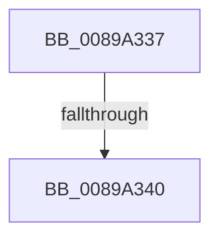

# sub_0089A337

- RVA: `0x0089A337`–`0x0089A354` (길이 `29` bytes)
- VA: `0x000000014089A337`
- 실행 섹션: `PAGE`
- PDB 이름 있음: `아니요`; PDB Function 태그: `아니요`
- unwind 정보 RVA: `0x0007E5BC`
- 디코드: `5`개 명령, `29/29` bytes 표시
- 미해석 바이트: `0` (있으면 어셈블리에 `.byte`로 보존)

> 이 문서는 커널 이미지의 기계어와 PDB 기호를 분석해 생성했습니다. 4번과 5번은 함수 원형과 자료형을 바이너리 사용 방식에서 추정한 C 해석이며 원본 소스 복구 결과는 아닙니다.

## 1. Dependencies

- 직접 호출 지점: **0**; 고유 호출 대상: **0**
- 직접 호출자로 확인된 함수: **0**
- RIP 상대 이미지 참조: **0**

### Outgoing calls
- 직접 디코드된 call 명령이 없습니다.

### Direct callers
- 이 함수 시작 RVA로 연결되는 직접 call은 확인되지 않았습니다. 간접 호출은 완전히 역산할 수 없습니다.

### Static image references
- 디코드된 RIP-relative 메모리 참조가 없습니다.

## 2. Other-region calls and transfers

- 다른 실행 섹션으로 향하는 call: **0**
- call이 아닌 외부 분기/꼬리 이동: **2**
  - `0x0089A33A` → [sub_0089A3AE + 0x24](Unknown_function_0089A3AE.md) (`tail-transfer`)
  - `0x0089A34F` → [sub_0089A0DA + 0x57](Unknown_function_0089A0DA.md) (`tail-transfer`)

## 3. Assembly (complete function range)

```asm
0089A337  80 38 00                        cmp byte ptr [rax], 0
0089A33A  0F 84 92 00 00 00               je 0x14089a3d2
0089A340  41 80 CD 40                     or r13b, 0x40
0089A344  C7 84 24 90 00 00 00 10 00 00 00  mov dword ptr [rsp + 0x90], 0x10
0089A34F  E9 DD FD FF FF                  jmp 0x14089a131
```

## 4. C-style interpretation (structured pseudocode)

```c
void __fastcall sub_0089A337(void)
{
    __int64 v_r13;
    unsigned int v_stack_p90;

    v_r13 = (unsigned __int8)((v_r13) | (64));
    v_stack_p90 = 16;
}
```

## 5. (Beta) C Style

```c
void sub_0089A337(void)
{
    int64_t local_r13;
    uint32_t v_stack_p90;

    local_r13 = (uint8_t)((local_r13) | (64));
    v_stack_p90 = 16;
}
```

## 6. Execution-region graph

[열기: 2D/3D 그래프와 함수 탐색 컨트롤 패널](../../../control-panel.html?section=page&rva=0x0089A337&view=graph)

- 2D 그래프는 위에서 아래로 흐르고, 3D 그래프는 빈 공간을 드래그해 회전합니다. Shift+드래그는 이동, 휠은 확대·축소, 함수 노드 선택은 대상 보고서 이동입니다.

### Static fallback


