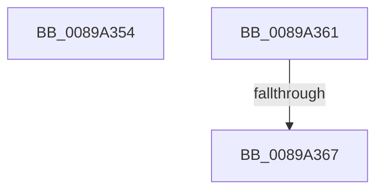

# sub_0089A354

- RVA: `0x0089A354`–`0x0089A36F` (길이 `27` bytes)
- VA: `0x000000014089A354`
- 실행 섹션: `PAGE`
- PDB 이름 있음: `아니요`; PDB Function 태그: `아니요`
- unwind 정보 RVA: `0x0007E5D4`
- 디코드: `6`개 명령, `27/27` bytes 표시
- 미해석 바이트: `0` (있으면 어셈블리에 `.byte`로 보존)

> 이 문서는 커널 이미지의 기계어와 PDB 기호를 분석해 생성했습니다. 4번과 5번은 함수 원형과 자료형을 바이너리 사용 방식에서 추정한 C 해석이며 원본 소스 복구 결과는 아닙니다.

## 1. Dependencies

- 직접 호출 지점: **0**; 고유 호출 대상: **0**
- 직접 호출자로 확인된 함수: **0**
- RIP 상대 이미지 참조: **0**

### Outgoing calls
- 직접 디코드된 call 명령이 없습니다.

### Direct callers
- 이 함수 시작 RVA로 연결되는 직접 call은 확인되지 않았습니다. 간접 호출은 완전히 역산할 수 없습니다.

### Static image references
- 디코드된 RIP-relative 메모리 참조가 없습니다.

## 2. Other-region calls and transfers

- 다른 실행 섹션으로 향하는 call: **0**
- call이 아닌 외부 분기/꼬리 이동: **3**
  - `0x0089A35C` → [ObpAllocateObject + 0xB0](ObpAllocateObject_function_00899FF0.md) (`tail-transfer`)
  - `0x0089A365` → [sub_0089A39B](Unknown_function_0089A39B.md) (`tail-transfer`)
  - `0x0089A36A` → [sub_0089A0DA](Unknown_function_0089A0DA.md) (`tail-transfer`)

## 3. Assembly (complete function range)

```asm
0089A354  C7 44 24 20 00 00 00 00         mov dword ptr [rsp + 0x20], 0
0089A35C  E9 3F FD FF FF                  jmp 0x14089a0a0
0089A361  40 F6 C5 02                     test bpl, 2
0089A365  75 34                           jne 0x14089a39b
0089A367  80 C9 02                        or cl, 2
0089A36A  E9 6B FD FF FF                  jmp 0x14089a0da
```

## 4. C-style interpretation (structured pseudocode)

```c
void __fastcall sub_0089A354(unsigned __int8 a1)
{
    unsigned int v_stack_p20;

    v_stack_p20 = 0;
}
```

## 5. (Beta) C Style

```c
void sub_0089A354(uint8_t Arg1)
{
    uint32_t v_stack_p20;

    v_stack_p20 = 0;
}
```

## 6. Execution-region graph

[열기: 2D/3D 그래프와 함수 탐색 컨트롤 패널](../../../control-panel.html?section=page&rva=0x0089A354&view=graph)

- 2D 그래프는 위에서 아래로 흐르고, 3D 그래프는 빈 공간을 드래그해 회전합니다. Shift+드래그는 이동, 휠은 확대·축소, 함수 노드 선택은 대상 보고서 이동입니다.

### Static fallback


