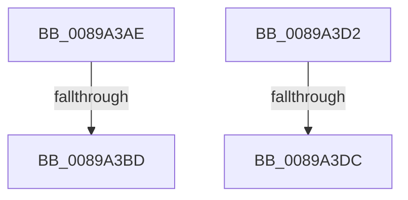

# sub_0089A3AE

- RVA: `0x0089A3AE`–`0x0089A3E1` (길이 `51` bytes)
- VA: `0x000000014089A3AE`
- 실행 섹션: `PAGE`
- PDB 이름 있음: `아니요`; PDB Function 태그: `아니요`
- unwind 정보 RVA: `0x0007E610`
- 디코드: `13`개 명령, `51/51` bytes 표시
- 미해석 바이트: `0` (있으면 어셈블리에 `.byte`로 보존)

> 이 문서는 커널 이미지의 기계어와 PDB 기호를 분석해 생성했습니다. 4번과 5번은 함수 원형과 자료형을 바이너리 사용 방식에서 추정한 C 해석이며 원본 소스 복구 결과는 아닙니다.

## 1. Dependencies

- 직접 호출 지점: **0**; 고유 호출 대상: **0**
- 직접 호출자로 확인된 함수: **0**
- RIP 상대 이미지 참조: **0**

### Outgoing calls
- 직접 디코드된 call 명령이 없습니다.

### Direct callers
- 이 함수 시작 RVA로 연결되는 직접 call은 확인되지 않았습니다. 간접 호출은 완전히 역산할 수 없습니다.

### Static image references
- 디코드된 RIP-relative 메모리 참조가 없습니다.

## 2. Other-region calls and transfers

- 다른 실행 섹션으로 향하는 call: **0**
- call이 아닌 외부 분기/꼬리 이동: **4**
  - `0x0089A3B7` → [sub_0089A0DA + 0xC4](Unknown_function_0089A0DA.md) (`tail-transfer`)
  - `0x0089A3CD` → [sub_0089A0DA + 0xC4](Unknown_function_0089A0DA.md) (`tail-transfer`)
  - `0x0089A3D6` → [sub_0089A0DA + 0x4C](Unknown_function_0089A0DA.md) (`tail-transfer`)
  - `0x0089A3DC` → [sub_0089A337 + 0x9](Unknown_function_0089A337.md) (`tail-transfer`)

## 3. Assembly (complete function range)

```asm
0089A3AE  42 8D 14 30                     lea edx, [rax + r14]
0089A3B2  F6 DA                           neg dl
0089A3B4  80 E2 3F                        and dl, 0x3f
0089A3B7  0F 84 E1 FD FF FF               je 0x14089a19e
0089A3BD  0F B6 CA                        movzx ecx, dl
0089A3C0  48 03 C1                        add rax, rcx
0089A3C3  0F B6 CA                        movzx ecx, dl
0089A3C6  41 80 CD 80                     or r13b, 0x80
0089A3CA  89 48 FC                        mov dword ptr [rax - 4], ecx
0089A3CD  E9 CC FD FF FF                  jmp 0x14089a19e
0089A3D2  80 78 01 00                     cmp byte ptr [rax + 1], 0
0089A3D6  0F 84 4A FD FF FF               je 0x14089a126
0089A3DC  E9 5F FF FF FF                  jmp 0x14089a340
```

## 4. C-style interpretation (structured pseudocode)

```c
__int64 __fastcall sub_0089A3AE(void)
{
    __int64 result;
    __int64 v_r13;

    a2 = (unsigned __int8)(-(result + v_r14 * 1));
    a2 = (unsigned __int8)((a2) & (63));
    result = (result) + ((unsigned __int8)(a2));
    v_r13 = (unsigned __int8)((v_r13) | (128));
    *(unsigned int *)(result - 4) = (unsigned int)((unsigned __int8)(a2));
}
```

## 5. (Beta) C Style

```c
void sub_0089A3AE(void)
{
    int64_t result;
    int64_t local_r13;

    a2 = (uint8_t)(-(result + local_r14 * 1));
    a2 = (uint8_t)((a2) & (63));
    result = (result) + ((uint8_t)(a2));
    local_r13 = (uint8_t)((local_r13) | (128));
    *(uint32_t *)(result - 0x4) = (uint32_t)((uint8_t)(a2));
}
```

## 6. Execution-region graph

[열기: 2D/3D 그래프와 함수 탐색 컨트롤 패널](../../../control-panel.html?section=page&rva=0x0089A3AE&view=graph)

- 2D 그래프는 위에서 아래로 흐르고, 3D 그래프는 빈 공간을 드래그해 회전합니다. Shift+드래그는 이동, 휠은 확대·축소, 함수 노드 선택은 대상 보고서 이동입니다.

### Static fallback


