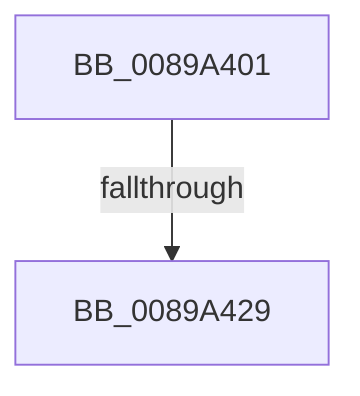

# sub_0089A401

- RVA: `0x0089A401`–`0x0089A436` (길이 `53` bytes)
- VA: `0x000000014089A401`
- 실행 섹션: `PAGE`
- PDB 이름 있음: `아니요`; PDB Function 태그: `아니요`
- unwind 정보 RVA: `0x0007E630`
- 디코드: `10`개 명령, `53/53` bytes 표시
- 미해석 바이트: `0` (있으면 어셈블리에 `.byte`로 보존)

> 이 문서는 커널 이미지의 기계어와 PDB 기호를 분석해 생성했습니다. 4번과 5번은 함수 원형과 자료형을 바이너리 사용 방식에서 추정한 C 해석이며 원본 소스 복구 결과는 아닙니다.

## 1. Dependencies

- 직접 호출 지점: **0**; 고유 호출 대상: **0**
- 직접 호출자로 확인된 함수: **0**
- RIP 상대 이미지 참조: **1**

### Outgoing calls
- 직접 디코드된 call 명령이 없습니다.

### Direct callers
- 이 함수 시작 RVA로 연결되는 직접 call은 확인되지 않았습니다. 간접 호출은 완전히 역산할 수 없습니다.

### Static image references
- `0x0089A414` → RVA `0x00000000` (`image boundary/outside`; read)

## 2. Other-region calls and transfers

- 다른 실행 섹션으로 향하는 call: **0**
- call이 아닌 외부 분기/꼬리 이동: **1**
  - `0x0089A427` → [sub_0089A43D](Unknown_function_0089A43D.md) (`tail-transfer`)

## 3. Assembly (complete function range)

```asm
0089A401  48 89 BC 24 80 00 00 00         mov qword ptr [rsp + 0x80], rdi
0089A409  83 E0 03                        and eax, 3
0089A40C  4C 89 64 24 58                  mov qword ptr [rsp + 0x58], r12
0089A411  48 8B F9                        mov rdi, rcx
0089A414  4C 8D 25 E5 5B 76 FF            lea r12, [rip - 0x89a41b]
0089A41B  42 0F B6 94 20 80 FF F0 00      movzx edx, byte ptr [rax + r12 + 0xf0ff80]
0089A424  48 2B FA                        sub rdi, rdx
0089A427  75 14                           jne 0x14089a43d
0089A429  48 8B BC 24 80 00 00 00         mov rdi, qword ptr [rsp + 0x80]
0089A431  4C 8B 64 24 58                  mov r12, qword ptr [rsp + 0x58]
```

## 4. C-style interpretation (structured pseudocode)

```c
__int64 __fastcall sub_0089A401(__int64 a1, __int64 a2, __int64 a3, __int64 a4, __int64 a5, __int64 a6, __int64 a7, __int64 a8, __int64 a9, __int64 a10, __int64 a11, __int64 a12, __int64 a13, __int64 a14, __int64 a15, __int64 a16)
{
    __int64 result;
    __int64 v_rdi;
    unsigned __int64 v_stack_p58;
    unsigned __int64 v_stack_p80;

    v_stack_p80 = v_rdi;
    result = (unsigned int)((result) & (3));
    v_stack_p58 = v_r12;
    v_rdi = (a1) - (*(unsigned __int8 *)(result + v_rip - 9020443 * 1 + 15794048));
    return result;
}
```

## 5. (Beta) C Style

```c
int64_t sub_0089A401(int64_t Arg1, int64_t Arg2, int64_t Arg3, int64_t Arg4, uint64_t Arg5, uint64_t Arg6, uint64_t Arg7, uint64_t Arg8, uint64_t Arg9, uint64_t Arg10, int64_t Arg11, uint64_t Arg12, uint64_t Arg13, uint64_t Arg14, uint64_t Arg15, int64_t Arg16)
{
    int64_t result;
    int64_t local_rdi;
    uint64_t v_stack_p58;
    uint64_t v_stack_p80;

    v_stack_p80 = local_rdi;
    result = (uint32_t)((result) & (3));
    v_stack_p58 = local_r12;
    local_rdi = (Arg1) - (*(uint8_t *)(result + v_rip - 0x89A41B * 1 + 0xF0FF80));
    return result;
}
```

## 6. Execution-region graph

[열기: 2D/3D 그래프와 함수 탐색 컨트롤 패널](../../../control-panel.html?section=page&rva=0x0089A401&view=graph)

- 2D 그래프는 위에서 아래로 흐르고, 3D 그래프는 빈 공간을 드래그해 회전합니다. Shift+드래그는 이동, 휠은 확대·축소, 함수 노드 선택은 대상 보고서 이동입니다.

### Static fallback


