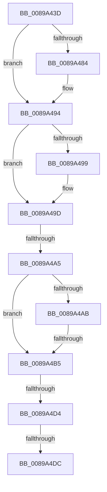

# sub_0089A43D

- RVA: `0x0089A43D`–`0x0089A511` (길이 `212` bytes)
- VA: `0x000000014089A43D`
- 실행 섹션: `PAGE`
- PDB 이름 있음: `아니요`; PDB Function 태그: `아니요`
- unwind 정보 RVA: `0x0007E65C`
- 디코드: `51`개 명령, `212/212` bytes 표시
- 미해석 바이트: `0` (있으면 어셈블리에 `.byte`로 보존)

> 이 문서는 커널 이미지의 기계어와 PDB 기호를 분석해 생성했습니다. 4번과 5번은 함수 원형과 자료형을 바이너리 사용 방식에서 추정한 C 해석이며 원본 소스 복구 결과는 아닙니다.

## 1. Dependencies

- 직접 호출 지점: **4**; 고유 호출 대상: **4**
- 직접 호출자로 확인된 함수: **0**
- RIP 상대 이미지 참조: **0**

### Outgoing calls
- `0x0089A473` → [KeAbPreAcquire](../../text/21/KeAbPreAcquire_function_00210230.md) (function, `0x00210230`)
- `0x0089A48F` → [ExfAcquirePushLockExclusiveEx](../../text/20/ExfAcquirePushLockExclusiveEx_function_0020FC90.md) (function, `0x0020FC90`)
- `0x0089A4E0` → [KeAbPostRelease](../../text/2E/KeAbPostRelease_function_002E1600.md) (function, `0x002E1600`)
- `0x0089A4EE` → [KeLeaveCriticalRegionThread](../../text/25/KeLeaveCriticalRegionThread_function_0025EFF0.md) (function, `0x0025EFF0`)

### Direct callers
- 이 함수 시작 RVA로 연결되는 직접 call은 확인되지 않았습니다. 간접 호출은 완전히 역산할 수 없습니다.

### Static image references
- 디코드된 RIP-relative 메모리 참조가 없습니다.

## 2. Other-region calls and transfers

- 다른 실행 섹션으로 향하는 call: **4**
  - `0x0089A473` → [KeAbPreAcquire](../../text/21/KeAbPreAcquire_function_00210230.md) (`PAGE` → `.text`)
  - `0x0089A48F` → [ExfAcquirePushLockExclusiveEx](../../text/20/ExfAcquirePushLockExclusiveEx_function_0020FC90.md) (`PAGE` → `.text`)
  - `0x0089A4E0` → [KeAbPostRelease](../../text/2E/KeAbPostRelease_function_002E1600.md) (`PAGE` → `.text`)
  - `0x0089A4EE` → [KeLeaveCriticalRegionThread](../../text/25/KeLeaveCriticalRegionThread_function_0025EFF0.md) (`PAGE` → `.text`)
- call이 아닌 외부 분기/꼬리 이동: **5**
  - `0x0089A4A3` → [sub_0089A511](Unknown_function_0089A511.md) (`tail-transfer`)
  - `0x0089A4AF` → [sub_0089A511 + 0x32](Unknown_function_0089A511.md) (`tail-transfer`)
  - `0x0089A4D2` → [sub_0089A511 + 0x27](Unknown_function_0089A511.md) (`tail-transfer`)
  - `0x0089A4DA` → [sub_0089A511 + 0x27](Unknown_function_0089A511.md) (`tail-transfer`)
  - `0x0089A50C` → [sub_0089A401 + 0x28](Unknown_function_0089A401.md) (`tail-transfer`)

## 3. Assembly (complete function range)

```asm
0089A43D  48 89 6C 24 70                  mov qword ptr [rsp + 0x70], rbp
0089A442  48 89 74 24 78                  mov qword ptr [rsp + 0x78], rsi
0089A447  4C 89 6C 24 50                  mov qword ptr [rsp + 0x50], r13
0089A44C  45 33 ED                        xor r13d, r13d
0089A44F  4C 89 74 24 48                  mov qword ptr [rsp + 0x48], r14
0089A454  4C 89 7C 24 40                  mov qword ptr [rsp + 0x40], r15
0089A459  65 48 8B 04 25 88 01 00 00      mov rax, qword ptr gs:[0x188]
0089A462  48 8D 4B 10                     lea rcx, [rbx + 0x10]
0089A466  45 33 C0                        xor r8d, r8d
0089A469  33 D2                           xor edx, edx
0089A46B  66 FF 88 E4 01 00 00            dec word ptr [rax + 0x1e4]
0089A472  90                              nop
0089A473  E8 B8 5D 97 FF                  call 0x140210230
0089A478  F0 48 0F BA 6B 10 00            lock bts qword ptr [rbx + 0x10], 0
0089A47F  48 8B E8                        mov rbp, rax
0089A482  73 10                           jae 0x14089a494
0089A484  4C 8D 43 10                     lea r8, [rbx + 0x10]
0089A488  48 8B D0                        mov rdx, rax
0089A48B  48 8D 4B 10                     lea rcx, [rbx + 0x10]
0089A48F  E8 FC 57 97 FF                  call 0x14020fc90
0089A494  48 85 ED                        test rbp, rbp
0089A497  74 04                           je 0x14089a49d
0089A499  C6 45 0A 01                     mov byte ptr [rbp + 0xa], 1
0089A49D  48 8B 2F                        mov rbp, qword ptr [rdi]
0089A4A0  48 85 ED                        test rbp, rbp
0089A4A3  74 6C                           je 0x14089a511
0089A4A5  F6 43 1B 10                     test byte ptr [rbx + 0x1b], 0x10
0089A4A9  75 0A                           jne 0x14089a4b5
0089A4AB  4C 39 6B 08                     cmp qword ptr [rbx + 8], r13
0089A4AF  0F 84 8E 00 00 00               je 0x14089a543
0089A4B5  0F 0D 4B 10                     prefetchw byte ptr [rbx + 0x10]
0089A4B9  48 8B 43 10                     mov rax, qword ptr [rbx + 0x10]
0089A4BD  48 8B C8                        mov rcx, rax
0089A4C0  48 83 E1 F0                     and rcx, 0xfffffffffffffff0
0089A4C4  48 83 F9 10                     cmp rcx, 0x10
0089A4C8  48 8D 50 F0                     lea rdx, [rax - 0x10]
0089A4CC  49 0F 46 D5                     cmovbe rdx, r13
0089A4D0  A8 02                           test al, 2
0089A4D2  75 64                           jne 0x14089a538
0089A4D4  F0 48 0F B1 53 10               lock cmpxchg qword ptr [rbx + 0x10], rdx
0089A4DA  75 5C                           jne 0x14089a538
0089A4DC  48 8D 4B 10                     lea rcx, [rbx + 0x10]
0089A4E0  E8 1B 71 A4 FF                  call 0x1402e1600
0089A4E5  65 48 8B 0C 25 88 01 00 00      mov rcx, qword ptr gs:[0x188]
0089A4EE  E8 FD 4A 9C FF                  call 0x14025eff0
0089A4F3  4C 8B 7C 24 40                  mov r15, qword ptr [rsp + 0x40]
0089A4F8  4C 8B 6C 24 50                  mov r13, qword ptr [rsp + 0x50]
0089A4FD  48 8B 6C 24 70                  mov rbp, qword ptr [rsp + 0x70]
0089A502  48 8B 74 24 78                  mov rsi, qword ptr [rsp + 0x78]
0089A507  4C 8B 74 24 48                  mov r14, qword ptr [rsp + 0x48]
0089A50C  E9 18 FF FF FF                  jmp 0x14089a429
```

## 4. C-style interpretation (structured pseudocode)

```c
__int64 __fastcall sub_0089A43D(__int64 a1, int a2, int a3, __int64 a4, __int64 a5, __int64 a6, __int64 a7, __int64 a8, __int64 a9, __int64 a10, __int64 a11, __int64 a12, __int64 a13, __int64 a14, __int64 a15)
{
    __int64 result;
    __int64 v_r13;
    unsigned __int64 v_stack_p40;
    unsigned __int64 v_stack_p48;
    unsigned __int64 v_stack_p50;
    unsigned __int64 v_stack_p70;
    unsigned __int64 v_stack_p78;

    v_stack_p70 = v_rbp;
    v_stack_p78 = v_rsi;
    v_stack_p50 = v_r13;
    v_r13 = 0;
    v_stack_p48 = v_r14;
    v_stack_p40 = v_r15;
    a3 = 0;
    a2 = 0;
    result = KeAbPreAcquire(v_rbx + 16, a2, a3, a4);
    if (!(condition_is_above_or_equal)) {
        a3 = v_rbx + 16;
        a2 = result;
        a1 = v_rbx + 16;
        result = ExfAcquirePushLockExclusiveEx(a1, a2, a3, a4);
    }
    if (result != 0) {
        *(unsigned __int8 *)(result + 10) = 1;
    }
    if (((*(unsigned __int8 *)(v_rbx + 27)) & (16)) != 0) goto loc_0089A4B5;
loc_0089A4B5:
    a1 = (*(unsigned __int64 *)(v_rbx + 16)) & (-16);
    a2 = *(unsigned __int64 *)(v_rbx + 16) - 16;
    if (a1 <= 16) { a2 = 0; }
    result = KeAbPostRelease(v_rbx + 16, a2, a3, a4);
    result = KeLeaveCriticalRegionThread(*(unsigned __int64 *)(gs_base + (0 + 392)), a2, a3, a4);
}
```

## 5. (Beta) C Style

```c
int64_t sub_0089A43D(int64_t Arg1, int32_t Arg2, int32_t Arg3, int64_t Arg4, uint64_t Arg5, uint64_t Arg6, uint64_t Arg7, int64_t Arg8, int64_t Arg9, int64_t Arg10, uint64_t Arg11, uint64_t Arg12, uint64_t Arg13, int64_t Arg14, int64_t Arg15)
{
    int64_t result;
    int64_t local_r13;
    uint64_t v_stack_p40;
    uint64_t v_stack_p48;
    uint64_t v_stack_p50;
    uint64_t v_stack_p70;
    uint64_t v_stack_p78;

    v_stack_p70 = local_rbp;
    v_stack_p78 = local_rsi;
    v_stack_p50 = local_r13;
    local_r13 = 0;
    v_stack_p48 = local_r14;
    v_stack_p40 = local_r15;
    Arg3 = 0;
    Arg2 = 0;
    result = KeAbPreAcquire(local_rbx + 16, Arg2, Arg3, Arg4);
    if (!(condition_is_above_or_equal)) {
        Arg3 = local_rbx + 16;
        Arg2 = result;
        Arg1 = local_rbx + 16;
        result = ExfAcquirePushLockExclusiveEx(Arg1, Arg2, Arg3, Arg4);
    }
    if (result != 0) {
        *(uint8_t *)(result + 0xA) = 1;
    }
    if (((*(uint8_t *)(local_rbx + 0x1B)) & (16)) != 0) goto loc_0089A4B5;
loc_0089A4B5:
    Arg1 = (*(uint64_t *)(local_rbx + 0x10)) & (-16);
    Arg2 = *(uint64_t *)(local_rbx + 0x10) - 16;
    if (Arg1 <= 16) { Arg2 = 0; }
    result = KeAbPostRelease(local_rbx + 16, Arg2, Arg3, Arg4);
    result = KeLeaveCriticalRegionThread(*(uint64_t *)(gs_base + (0 + 0x188)), Arg2, Arg3, Arg4);
}
```

## 6. Execution-region graph

[열기: 2D/3D 그래프와 함수 탐색 컨트롤 패널](../../../control-panel.html?section=page&rva=0x0089A43D&view=graph)

- 2D 그래프는 위에서 아래로 흐르고, 3D 그래프는 빈 공간을 드래그해 회전합니다. Shift+드래그는 이동, 휠은 확대·축소, 함수 노드 선택은 대상 보고서 이동입니다.

### Static fallback


