# sub_0089A511

- RVA: `0x0089A511`–`0x0089A88D` (길이 `892` bytes)
- VA: `0x000000014089A511`
- 실행 섹션: `PAGE`
- PDB 이름 있음: `아니요`; PDB Function 태그: `아니요`
- unwind 정보 RVA: `0x0007E688`
- 디코드: `205`개 명령, `892/892` bytes 표시
- 미해석 바이트: `0` (있으면 어셈블리에 `.byte`로 보존)

> 이 문서는 커널 이미지의 기계어와 PDB 기호를 분석해 생성했습니다. 4번과 5번은 함수 원형과 자료형을 바이너리 사용 방식에서 추정한 C 해석이며 원본 소스 복구 결과는 아닙니다.

## 1. Dependencies

- 직접 호출 지점: **30**; 고유 호출 대상: **15**
- 직접 호출자로 확인된 함수: **0**
- RIP 상대 이미지 참조: **3**

### Outgoing calls
- `0x0089A53C` → [ExfReleasePushLock](../../text/26/ExfReleasePushLock_function_002638D0.md) (function, `0x002638D0`)
- `0x0089A57A` → [KeAbPreAcquire](../../text/21/KeAbPreAcquire_function_00210230.md) (function, `0x00210230`)
- `0x0089A5D2` → [ObpDeleteSymbolicLinkName](../A7/ObpDeleteSymbolicLinkName_function_00A7BC80.md) (function, `0x00A7BC80`)
- `0x0089A5E2` → [ObpLookupDirectoryEntry](../85/ObpLookupDirectoryEntry_function_0085D5B0.md) (function, `0x0085D5B0`)
- `0x0089A649` → [KeAbPostRelease](../../text/2E/KeAbPostRelease_function_002E1600.md) (function, `0x002E1600`)
- `0x0089A657` → [KeLeaveCriticalRegionThread](../../text/25/KeLeaveCriticalRegionThread_function_0025EFF0.md) (function, `0x0025EFF0`)
- `0x0089A66F` → [ObpUnlockDirectory](../99/ObpUnlockDirectory_function_0099F8A0.md) (function, `0x0099F8A0`)
- `0x0089A679` → [ExFreePoolWithTag](../../poolcode/B8/ExFreePoolWithTag_function_00B82870.md) (function, `0x00B82870`)
- `0x0089A686` → [ObfDereferenceObjectWithTag](../../text/2F/ObfDereferenceObjectWithTag_function_002F78E0.md) (function, `0x002F78E0`)
- `0x0089A6B4` → [ObfDereferenceObjectWithTag](../../text/2F/ObfDereferenceObjectWithTag_function_002F78E0.md) (function, `0x002F78E0`)
- `0x0089A6BE` → [ObpReleaseLookupContext](../../text/26/ObpReleaseLookupContext_function_00263D30.md) (function, `0x00263D30`)
- `0x0089A6CC` → [ExfReleasePushLock](../../text/26/ExfReleasePushLock_function_002638D0.md) (function, `0x002638D0`)
- `0x0089A6ED` → [KeAbPostReleaseEx](../../text/26/KeAbPostReleaseEx_function_00262210.md) (function, `0x00262210`)
- `0x0089A6FB` → [KeLeaveCriticalRegionThread](../../text/25/KeLeaveCriticalRegionThread_function_0025EFF0.md) (function, `0x0025EFF0`)
- `0x0089A703` → [ObfReferenceObject](../../text/20/ObfReferenceObject_function_0020FA20.md) (function, `0x0020FA20`)
- `0x0089A73B` → [KeAbPostRelease](../../text/2E/KeAbPostRelease_function_002E1600.md) (function, `0x002E1600`)
- `0x0089A749` → [KeLeaveCriticalRegionThread](../../text/25/KeLeaveCriticalRegionThread_function_0025EFF0.md) (function, `0x0025EFF0`)
- `0x0089A76B` → [KeAbPreAcquire](../../text/21/KeAbPreAcquire_function_00210230.md) (function, `0x00210230`)
- `0x0089A790` → [ExfAcquirePushLockExclusiveEx](../../text/20/ExfAcquirePushLockExclusiveEx_function_0020FC90.md) (function, `0x0020FC90`)
- `0x0089A7B9` → [KeAbPreAcquire](../../text/21/KeAbPreAcquire_function_00210230.md) (function, `0x00210230`)
- `0x0089A7D5` → [ExfAcquirePushLockExclusiveEx](../../text/20/ExfAcquirePushLockExclusiveEx_function_0020FC90.md) (function, `0x0020FC90`)
- `0x0089A7EE` → [ObpReleaseLookupContext](../../text/26/ObpReleaseLookupContext_function_00263D30.md) (function, `0x00263D30`)
- `0x0089A81E` → [KeAbPostRelease](../../text/2E/KeAbPostRelease_function_002E1600.md) (function, `0x002E1600`)
- `0x0089A82C` → [KeLeaveCriticalRegionThread](../../text/25/KeLeaveCriticalRegionThread_function_0025EFF0.md) (function, `0x0025EFF0`)
- `0x0089A834` → [HalPutDmaAdapter](../../text/48/HalPutDmaAdapter_function_0048E530.md) (function, `0x0048E530`)
- `0x0089A842` → [ExfReleasePushLock](../../text/26/ExfReleasePushLock_function_002638D0.md) (function, `0x002638D0`)
- `0x0089A850` → [ExfReleasePushLock](../../text/26/ExfReleasePushLock_function_002638D0.md) (function, `0x002638D0`)
- `0x0089A866` → [HalPutDmaAdapter](../../text/48/HalPutDmaAdapter_function_0048E530.md) (function, `0x0048E530`)
- `0x0089A870` → [ObpDeleteDirectoryName](../99/ObpDeleteDirectoryName_function_0099EF94.md) (function, `0x0099EF94`)
- `0x0089A87A` → [ObpReleaseLookupContext](../../text/26/ObpReleaseLookupContext_function_00263D30.md) (function, `0x00263D30`)

### Direct callers
- 이 함수 시작 RVA로 연결되는 직접 call은 확인되지 않았습니다. 간접 호출은 완전히 역산할 수 없습니다.

### Static image references
- `0x0089A5B3` → RVA `0x00FC6E4C` (`ALMOSTRO`; read)
- `0x0089A5BD` → RVA `0x00F0F658` (`.data`; read)
- `0x0089A68B` → RVA `0x00F0F650` (`.data`; read)

## 2. Other-region calls and transfers

- 다른 실행 섹션으로 향하는 call: **26**
  - `0x0089A53C` → [ExfReleasePushLock](../../text/26/ExfReleasePushLock_function_002638D0.md) (`PAGE` → `.text`)
  - `0x0089A57A` → [KeAbPreAcquire](../../text/21/KeAbPreAcquire_function_00210230.md) (`PAGE` → `.text`)
  - `0x0089A649` → [KeAbPostRelease](../../text/2E/KeAbPostRelease_function_002E1600.md) (`PAGE` → `.text`)
  - `0x0089A657` → [KeLeaveCriticalRegionThread](../../text/25/KeLeaveCriticalRegionThread_function_0025EFF0.md) (`PAGE` → `.text`)
  - `0x0089A679` → [ExFreePoolWithTag](../../poolcode/B8/ExFreePoolWithTag_function_00B82870.md) (`PAGE` → `POOLCODE`)
  - `0x0089A686` → [ObfDereferenceObjectWithTag](../../text/2F/ObfDereferenceObjectWithTag_function_002F78E0.md) (`PAGE` → `.text`)
  - `0x0089A6B4` → [ObfDereferenceObjectWithTag](../../text/2F/ObfDereferenceObjectWithTag_function_002F78E0.md) (`PAGE` → `.text`)
  - `0x0089A6BE` → [ObpReleaseLookupContext](../../text/26/ObpReleaseLookupContext_function_00263D30.md) (`PAGE` → `.text`)
  - `0x0089A6CC` → [ExfReleasePushLock](../../text/26/ExfReleasePushLock_function_002638D0.md) (`PAGE` → `.text`)
  - `0x0089A6ED` → [KeAbPostReleaseEx](../../text/26/KeAbPostReleaseEx_function_00262210.md) (`PAGE` → `.text`)
  - `0x0089A6FB` → [KeLeaveCriticalRegionThread](../../text/25/KeLeaveCriticalRegionThread_function_0025EFF0.md) (`PAGE` → `.text`)
  - `0x0089A703` → [ObfReferenceObject](../../text/20/ObfReferenceObject_function_0020FA20.md) (`PAGE` → `.text`)
  - `0x0089A73B` → [KeAbPostRelease](../../text/2E/KeAbPostRelease_function_002E1600.md) (`PAGE` → `.text`)
  - `0x0089A749` → [KeLeaveCriticalRegionThread](../../text/25/KeLeaveCriticalRegionThread_function_0025EFF0.md) (`PAGE` → `.text`)
  - `0x0089A76B` → [KeAbPreAcquire](../../text/21/KeAbPreAcquire_function_00210230.md) (`PAGE` → `.text`)
  - `0x0089A790` → [ExfAcquirePushLockExclusiveEx](../../text/20/ExfAcquirePushLockExclusiveEx_function_0020FC90.md) (`PAGE` → `.text`)
  - `0x0089A7B9` → [KeAbPreAcquire](../../text/21/KeAbPreAcquire_function_00210230.md) (`PAGE` → `.text`)
  - `0x0089A7D5` → [ExfAcquirePushLockExclusiveEx](../../text/20/ExfAcquirePushLockExclusiveEx_function_0020FC90.md) (`PAGE` → `.text`)
  - `0x0089A7EE` → [ObpReleaseLookupContext](../../text/26/ObpReleaseLookupContext_function_00263D30.md) (`PAGE` → `.text`)
  - `0x0089A81E` → [KeAbPostRelease](../../text/2E/KeAbPostRelease_function_002E1600.md) (`PAGE` → `.text`)
  - `0x0089A82C` → [KeLeaveCriticalRegionThread](../../text/25/KeLeaveCriticalRegionThread_function_0025EFF0.md) (`PAGE` → `.text`)
  - `0x0089A834` → [HalPutDmaAdapter](../../text/48/HalPutDmaAdapter_function_0048E530.md) (`PAGE` → `.text`)
  - `0x0089A842` → [ExfReleasePushLock](../../text/26/ExfReleasePushLock_function_002638D0.md) (`PAGE` → `.text`)
  - `0x0089A850` → [ExfReleasePushLock](../../text/26/ExfReleasePushLock_function_002638D0.md) (`PAGE` → `.text`)
  - `0x0089A866` → [HalPutDmaAdapter](../../text/48/HalPutDmaAdapter_function_0048E530.md) (`PAGE` → `.text`)
  - `0x0089A87A` → [ObpReleaseLookupContext](../../text/26/ObpReleaseLookupContext_function_00263D30.md) (`PAGE` → `.text`)
- call이 아닌 외부 분기/꼬리 이동: **5**
  - `0x0089A536` → [sub_0089A43D + 0x9F](Unknown_function_0089A43D.md) (`tail-transfer`)
  - `0x0089A541` → [sub_0089A43D + 0x9F](Unknown_function_0089A43D.md) (`tail-transfer`)
  - `0x0089A6C3` → [sub_0089A43D + 0xB6](Unknown_function_0089A43D.md) (`tail-transfer`)
  - `0x0089A839` → [sub_0089A43D + 0x1C](Unknown_function_0089A43D.md) (`tail-transfer`)
  - `0x0089A87F` → [sub_0089A43D + 0xB6](Unknown_function_0089A43D.md) (`tail-transfer`)

## 3. Assembly (complete function range)

```asm
0089A511  0F 0D 4B 10                     prefetchw byte ptr [rbx + 0x10]
0089A515  48 8B 43 10                     mov rax, qword ptr [rbx + 0x10]
0089A519  48 8B C8                        mov rcx, rax
0089A51C  48 83 E1 F0                     and rcx, 0xfffffffffffffff0
0089A520  48 83 F9 10                     cmp rcx, 0x10
0089A524  48 8D 50 F0                     lea rdx, [rax - 0x10]
0089A528  49 0F 46 D5                     cmovbe rdx, r13
0089A52C  A8 02                           test al, 2
0089A52E  75 08                           jne 0x14089a538
0089A530  F0 48 0F B1 53 10               lock cmpxchg qword ptr [rbx + 0x10], rdx
0089A536  74 A4                           je 0x14089a4dc
0089A538  48 8D 4B 10                     lea rcx, [rbx + 0x10]
0089A53C  E8 8F 93 9C FF                  call 0x1402638d0
0089A541  EB 99                           jmp 0x14089a4dc
0089A543  33 C0                           xor eax, eax
0089A545  48 8D 8D 28 01 00 00            lea rcx, [rbp + 0x128]
0089A54C  48 89 44 24 30                  mov qword ptr [rsp + 0x30], rax
0089A551  33 D2                           xor edx, edx
0089A553  65 48 8B 04 25 88 01 00 00      mov rax, qword ptr gs:[0x188]
0089A55C  0F 57 C0                        xorps xmm0, xmm0
0089A55F  0F 11 44 24 20                  movups xmmword ptr [rsp + 0x20], xmm0
0089A564  48 89 6C 24 20                  mov qword ptr [rsp + 0x20], rbp
0089A569  44 8D 42 01                     lea r8d, [rdx + 1]
0089A56D  C6 44 24 35 01                  mov byte ptr [rsp + 0x35], 1
0089A572  66 FF 88 E4 01 00 00            dec word ptr [rax + 0x1e4]
0089A579  90                              nop
0089A57A  E8 B1 5C 97 FF                  call 0x140210230
0089A57F  F0 48 0F BA AD 28 01 00 00 00   lock bts qword ptr [rbp + 0x128], 0
0089A589  0F 82 4F 01 00 00               jb 0x14089a6de
0089A58F  48 85 C0                        test rax, rax
0089A592  0F 85 EC 02 00 00               jne 0x14089a884
0089A598  44 39 6F 18                     cmp dword ptr [rdi + 0x18], r13d
0089A59C  0F 85 34 01 00 00               jne 0x14089a6d6
0089A5A2  48 8B C3                        mov rax, rbx
0089A5A5  48 C1 E8 08                     shr rax, 8
0089A5A9  0F B6 C8                        movzx ecx, al
0089A5AC  0F B6 43 18                     movzx eax, byte ptr [rbx + 0x18]
0089A5B0  48 33 C8                        xor rcx, rax
0089A5B3  0F B6 05 92 C8 72 00            movzx eax, byte ptr [rip + 0x72c892]
0089A5BA  48 33 C8                        xor rcx, rax
0089A5BD  48 8B 05 94 50 67 00            mov rax, qword ptr [rip + 0x675094]
0089A5C4  49 39 84 CC 00 78 FC 00         cmp qword ptr [r12 + rcx*8 + 0xfc7800], rax
0089A5CC  75 09                           jne 0x14089a5d7
0089A5CE  48 8D 4B 30                     lea rcx, [rbx + 0x30]
0089A5D2  E8 A9 16 1E 00                  call 0x140a7bc80
0089A5D7  48 8D 4F 08                     lea rcx, [rdi + 8]
0089A5DB  33 D2                           xor edx, edx
0089A5DD  4C 8D 44 24 20                  lea r8, [rsp + 0x20]
0089A5E2  E8 C9 2F FC FF                  call 0x14085d5b0
0089A5E7  48 8B 54 24 28                  mov rdx, qword ptr [rsp + 0x28]
0089A5EC  48 8B 3A                        mov rdi, qword ptr [rdx]
0089A5EF  48 8B 4F 08                     mov rcx, qword ptr [rdi + 8]
0089A5F3  48 83 E9 30                     sub rcx, 0x30
0089A5F7  0F B6 41 1A                     movzx eax, byte ptr [rcx + 0x1a]
0089A5FB  83 E0 03                        and eax, 3
0089A5FE  42 0F B6 84 20 80 FF F0 00      movzx eax, byte ptr [rax + r12 + 0xf0ff80]
0089A607  48 2B C8                        sub rcx, rax
0089A60A  4C 89 29                        mov qword ptr [rcx], r13
0089A60D  48 8B 07                        mov rax, qword ptr [rdi]
0089A610  48 89 02                        mov qword ptr [rdx], rax
0089A613  4C 89 2F                        mov qword ptr [rdi], r13
0089A616  0F 0D 4B 10                     prefetchw byte ptr [rbx + 0x10]
0089A61A  48 8B 43 10                     mov rax, qword ptr [rbx + 0x10]
0089A61E  48 8B C8                        mov rcx, rax
0089A621  48 83 E1 F0                     and rcx, 0xfffffffffffffff0
0089A625  48 83 F9 10                     cmp rcx, 0x10
0089A629  48 8D 50 F0                     lea rdx, [rax - 0x10]
0089A62D  49 0F 46 D5                     cmovbe rdx, r13
0089A631  A8 02                           test al, 2
0089A633  0F 85 8F 00 00 00               jne 0x14089a6c8
0089A639  F0 48 0F B1 53 10               lock cmpxchg qword ptr [rbx + 0x10], rdx
0089A63F  0F 85 83 00 00 00               jne 0x14089a6c8
0089A645  48 8D 4B 10                     lea rcx, [rbx + 0x10]
0089A649  E8 B2 6F A4 FF                  call 0x1402e1600
0089A64E  65 48 8B 0C 25 88 01 00 00      mov rcx, qword ptr gs:[0x188]
0089A657  E8 94 49 9C FF                  call 0x14025eff0
0089A65C  48 85 FF                        test rdi, rdi
0089A65F  74 58                           je 0x14089a6b9
0089A661  48 8B 77 08                     mov rsi, qword ptr [rdi + 8]
0089A665  48 8D 4C 24 20                  lea rcx, [rsp + 0x20]
0089A66A  48 8B 5C 24 20                  mov rbx, qword ptr [rsp + 0x20]
0089A66F  E8 2C 52 10 00                  call 0x14099f8a0
0089A674  33 D2                           xor edx, edx
0089A676  48 8B CF                        mov rcx, rdi
0089A679  E8 F2 81 2E 00                  call 0x140b82870
0089A67E  BA 4F 62 44 69                  mov edx, 0x6944624f
0089A683  48 8B CB                        mov rcx, rbx
0089A686  E8 55 D2 A5 FF                  call 0x1402f78e0
0089A68B  48 8B 05 BE 4F 67 00            mov rax, qword ptr [rip + 0x674fbe]
0089A692  48 8D 56 D0                     lea rdx, [rsi - 0x30]
0089A696  48 C1 EA 08                     shr rdx, 8
0089A69A  48 8B CE                        mov rcx, rsi
0089A69D  32 56 E8                        xor dl, byte ptr [rsi - 0x18]
0089A6A0  32 15 A6 C7 72 00               xor dl, byte ptr [rip + 0x72c7a6]
0089A6A6  3A 50 28                        cmp dl, byte ptr [rax + 0x28]
0089A6A9  0F 84 C1 01 00 00               je 0x14089a870
0089A6AF  BA 4F 62 44 69                  mov edx, 0x6944624f
0089A6B4  E8 27 D2 A5 FF                  call 0x1402f78e0
0089A6B9  48 8D 4C 24 20                  lea rcx, [rsp + 0x20]
0089A6BE  E8 6D 96 9C FF                  call 0x140263d30
0089A6C3  E9 2B FE FF FF                  jmp 0x14089a4f3
0089A6C8  48 8D 4B 10                     lea rcx, [rbx + 0x10]
0089A6CC  E8 FF 91 9C FF                  call 0x1402638d0
0089A6D1  E9 6F FF FF FF                  jmp 0x14089a645
0089A6D6  49 8B FD                        mov rdi, r13
0089A6D9  E9 38 FF FF FF                  jmp 0x14089a616
0089A6DE  48 85 C0                        test rax, rax
0089A6E1  74 0F                           je 0x14089a6f2
0089A6E3  48 8B D0                        mov rdx, rax
0089A6E6  48 8D 8D 28 01 00 00            lea rcx, [rbp + 0x128]
0089A6ED  E8 1E 7B 9C FF                  call 0x140262210
0089A6F2  65 48 8B 0C 25 88 01 00 00      mov rcx, qword ptr gs:[0x188]
0089A6FB  E8 F0 48 9C FF                  call 0x14025eff0
0089A700  48 8B CD                        mov rcx, rbp
0089A703  E8 18 53 97 FF                  call 0x14020fa20
0089A708  0F 0D 4B 10                     prefetchw byte ptr [rbx + 0x10]
0089A70C  48 8B 43 10                     mov rax, qword ptr [rbx + 0x10]
0089A710  48 8B C8                        mov rcx, rax
0089A713  48 83 E1 F0                     and rcx, 0xfffffffffffffff0
0089A717  48 83 F9 10                     cmp rcx, 0x10
0089A71B  48 8D 50 F0                     lea rdx, [rax - 0x10]
0089A71F  49 0F 46 D5                     cmovbe rdx, r13
0089A723  A8 02                           test al, 2
0089A725  0F 85 13 01 00 00               jne 0x14089a83e
0089A72B  F0 48 0F B1 53 10               lock cmpxchg qword ptr [rbx + 0x10], rdx
0089A731  0F 85 07 01 00 00               jne 0x14089a83e
0089A737  48 8D 4B 10                     lea rcx, [rbx + 0x10]
0089A73B  E8 C0 6E A4 FF                  call 0x1402e1600
0089A740  65 48 8B 0C 25 88 01 00 00      mov rcx, qword ptr gs:[0x188]
0089A749  E8 A2 48 9C FF                  call 0x14025eff0
0089A74E  65 48 8B 04 25 88 01 00 00      mov rax, qword ptr gs:[0x188]
0089A757  48 8D 8D 28 01 00 00            lea rcx, [rbp + 0x128]
0089A75E  45 33 C0                        xor r8d, r8d
0089A761  33 D2                           xor edx, edx
0089A763  66 FF 88 E4 01 00 00            dec word ptr [rax + 0x1e4]
0089A76A  90                              nop
0089A76B  E8 C0 5A 97 FF                  call 0x140210230
0089A770  F0 48 0F BA AD 28 01 00 00 00   lock bts qword ptr [rbp + 0x128], 0
0089A77A  4C 8B F0                        mov r14, rax
0089A77D  73 16                           jae 0x14089a795
0089A77F  4C 8D 85 28 01 00 00            lea r8, [rbp + 0x128]
0089A786  48 8B D0                        mov rdx, rax
0089A789  48 8D 8D 28 01 00 00            lea rcx, [rbp + 0x128]
0089A790  E8 FB 54 97 FF                  call 0x14020fc90
0089A795  4D 85 F6                        test r14, r14
0089A798  74 05                           je 0x14089a79f
0089A79A  41 C6 46 0A 01                  mov byte ptr [r14 + 0xa], 1
0089A79F  65 48 8B 04 25 88 01 00 00      mov rax, qword ptr gs:[0x188]
0089A7A8  48 8D 4B 10                     lea rcx, [rbx + 0x10]
0089A7AC  45 33 C0                        xor r8d, r8d
0089A7AF  33 D2                           xor edx, edx
0089A7B1  66 FF 88 E4 01 00 00            dec word ptr [rax + 0x1e4]
0089A7B8  90                              nop
0089A7B9  E8 72 5A 97 FF                  call 0x140210230
0089A7BE  F0 48 0F BA 6B 10 00            lock bts qword ptr [rbx + 0x10], 0
0089A7C5  4C 8B F0                        mov r14, rax
0089A7C8  73 10                           jae 0x14089a7da
0089A7CA  4C 8D 43 10                     lea r8, [rbx + 0x10]
0089A7CE  48 8B D0                        mov rdx, rax
0089A7D1  48 8D 4B 10                     lea rcx, [rbx + 0x10]
0089A7D5  E8 B6 54 97 FF                  call 0x14020fc90
0089A7DA  4D 85 F6                        test r14, r14
0089A7DD  74 05                           je 0x14089a7e4
0089A7DF  41 C6 46 0A 01                  mov byte ptr [r14 + 0xa], 1
0089A7E4  48 39 2F                        cmp qword ptr [rdi], rbp
0089A7E7  74 6E                           je 0x14089a857
0089A7E9  48 8D 4C 24 20                  lea rcx, [rsp + 0x20]
0089A7EE  E8 3D 95 9C FF                  call 0x140263d30
0089A7F3  0F 0D 4B 10                     prefetchw byte ptr [rbx + 0x10]
0089A7F7  48 8B 43 10                     mov rax, qword ptr [rbx + 0x10]
0089A7FB  48 8B C8                        mov rcx, rax
0089A7FE  48 83 E1 F0                     and rcx, 0xfffffffffffffff0
0089A802  48 83 F9 10                     cmp rcx, 0x10
0089A806  48 8D 50 F0                     lea rdx, [rax - 0x10]
0089A80A  49 0F 46 D5                     cmovbe rdx, r13
0089A80E  A8 02                           test al, 2
0089A810  75 3A                           jne 0x14089a84c
0089A812  F0 48 0F B1 53 10               lock cmpxchg qword ptr [rbx + 0x10], rdx
0089A818  75 32                           jne 0x14089a84c
0089A81A  48 8D 4B 10                     lea rcx, [rbx + 0x10]
0089A81E  E8 DD 6D A4 FF                  call 0x1402e1600
0089A823  65 48 8B 0C 25 88 01 00 00      mov rcx, qword ptr gs:[0x188]
0089A82C  E8 BF 47 9C FF                  call 0x14025eff0
0089A831  48 8B CD                        mov rcx, rbp
0089A834  E8 F7 3C BF FF                  call 0x14048e530
0089A839  E9 1B FC FF FF                  jmp 0x14089a459
0089A83E  48 8D 4B 10                     lea rcx, [rbx + 0x10]
0089A842  E8 89 90 9C FF                  call 0x1402638d0
0089A847  E9 EB FE FF FF                  jmp 0x14089a737
0089A84C  48 8D 4B 10                     lea rcx, [rbx + 0x10]
0089A850  E8 7B 90 9C FF                  call 0x1402638d0
0089A855  EB C3                           jmp 0x14089a81a
0089A857  F6 43 1B 10                     test byte ptr [rbx + 0x1b], 0x10
0089A85B  75 8C                           jne 0x14089a7e9
0089A85D  4C 39 6B 08                     cmp qword ptr [rbx + 8], r13
0089A861  75 86                           jne 0x14089a7e9
0089A863  48 8B CD                        mov rcx, rbp
0089A866  E8 C5 3C BF FF                  call 0x14048e530
0089A86B  E9 28 FD FF FF                  jmp 0x14089a598
0089A870  E8 1F 47 10 00                  call 0x14099ef94
0089A875  48 8D 4C 24 20                  lea rcx, [rsp + 0x20]
0089A87A  E8 B1 94 9C FF                  call 0x140263d30
0089A87F  E9 6F FC FF FF                  jmp 0x14089a4f3
0089A884  C6 40 0A 01                     mov byte ptr [rax + 0xa], 1
0089A888  E9 0B FD FF FF                  jmp 0x14089a598
```

## 4. C-style interpretation (structured pseudocode)

```c
__int64 __fastcall sub_0089A511(void)
{
    __int64 result;
    unsigned __int64 v_stack_p20;
    unsigned __int64 v_stack_p28;
    unsigned __int64 v_stack_p30;
    unsigned __int8 v_stack_p35;

    a1 = (*(unsigned __int64 *)(v_rbx + 16)) & (-16);
    a2 = *(unsigned __int64 *)(v_rbx + 16) - 16;
    if (a1 <= 16) { a2 = v_r13; }
    if ((((unsigned __int8)(*(unsigned __int64 *)(v_rbx + 16))) & (2)) != 0) goto loc_0089A538;
loc_0089A538:
    result = ExfReleasePushLock(v_rbx + 16, a2, a3, a4);
}
```

## 5. (Beta) C Style

```c
void sub_0089A511(void)
{
    int64_t result;
    uint64_t v_stack_p20;
    uint64_t v_stack_p28;
    uint64_t v_stack_p30;
    uint8_t v_stack_p35;

    a1 = (*(uint64_t *)(local_rbx + 0x10)) & (-16);
    a2 = *(uint64_t *)(local_rbx + 0x10) - 16;
    if (a1 <= 16) { a2 = local_r13; }
    if ((((uint8_t)(*(uint64_t *)(local_rbx + 0x10))) & (2)) != 0) goto loc_0089A538;
loc_0089A538:
    result = ExfReleasePushLock(local_rbx + 16, a2, a3, a4);
}
```

## 6. Execution-region graph

[열기: 2D/3D 그래프와 함수 탐색 컨트롤 패널](../../../control-panel.html?section=page&rva=0x0089A511&view=graph)

- 2D 그래프는 위에서 아래로 흐르고, 3D 그래프는 빈 공간을 드래그해 회전합니다. Shift+드래그는 이동, 휠은 확대·축소, 함수 노드 선택은 대상 보고서 이동입니다.

### Static fallback

```mermaid
flowchart TD
  bb_0089A511[BB_0089A511]
  bb_0089A530[BB_0089A530]
  bb_0089A538[BB_0089A538]
  bb_0089A543[BB_0089A543]
  bb_0089A58F[BB_0089A58F]
  bb_0089A598[BB_0089A598]
  bb_0089A5A2[BB_0089A5A2]
  bb_0089A5CE[BB_0089A5CE]
  bb_0089A5D7[BB_0089A5D7]
  bb_0089A616[BB_0089A616]
  bb_0089A639[BB_0089A639]
  bb_0089A645[BB_0089A645]
  bb_0089A661[BB_0089A661]
  bb_0089A6AF[BB_0089A6AF]
  bb_0089A6B9[BB_0089A6B9]
  bb_0089A6C8[BB_0089A6C8]
  bb_0089A6D6[BB_0089A6D6]
  bb_0089A6DE[BB_0089A6DE]
  bb_0089A6E3[BB_0089A6E3]
  bb_0089A6F2[BB_0089A6F2]
  bb_0089A72B[BB_0089A72B]
  bb_0089A737[BB_0089A737]
  bb_0089A77F[BB_0089A77F]
  bb_0089A795[BB_0089A795]
  bb_0089A79A[BB_0089A79A]
  bb_0089A79F[BB_0089A79F]
  bb_0089A7CA[BB_0089A7CA]
  bb_0089A7DA[BB_0089A7DA]
  bb_0089A7DF[BB_0089A7DF]
  bb_0089A7E4[BB_0089A7E4]
  bb_0089A7E9[BB_0089A7E9]
  bb_0089A812[BB_0089A812]
  bb_0089A81A[BB_0089A81A]
  bb_0089A83E[BB_0089A83E]
  bb_0089A84C[BB_0089A84C]
  bb_0089A857[BB_0089A857]
  bb_0089A85D[BB_0089A85D]
  bb_0089A863[BB_0089A863]
  bb_0089A870[BB_0089A870]
  bb_0089A884[BB_0089A884]
  bb_0089A511 -->|branch| bb_0089A538
  bb_0089A511 -->|fallthrough| bb_0089A530
  bb_0089A530 -->|fallthrough| bb_0089A538
  bb_0089A543 -->|branch| bb_0089A6DE
  bb_0089A543 -->|fallthrough| bb_0089A58F
  bb_0089A58F -->|branch| bb_0089A884
  bb_0089A58F -->|fallthrough| bb_0089A598
  bb_0089A598 -->|branch| bb_0089A6D6
  bb_0089A598 -->|fallthrough| bb_0089A5A2
  bb_0089A5A2 -->|branch| bb_0089A5D7
  bb_0089A5A2 -->|fallthrough| bb_0089A5CE
  bb_0089A5CE -->|flow| bb_0089A5D7
  bb_0089A5D7 -->|flow| bb_0089A616
  bb_0089A616 -->|branch| bb_0089A6C8
  bb_0089A616 -->|fallthrough| bb_0089A639
  bb_0089A639 -->|branch| bb_0089A6C8
  bb_0089A639 -->|fallthrough| bb_0089A645
  bb_0089A645 -->|branch| bb_0089A6B9
  bb_0089A645 -->|fallthrough| bb_0089A661
  bb_0089A661 -->|branch| bb_0089A870
  bb_0089A661 -->|fallthrough| bb_0089A6AF
  bb_0089A6AF -->|flow| bb_0089A6B9
  bb_0089A6C8 -->|branch| bb_0089A645
  bb_0089A6D6 -->|branch| bb_0089A616
  bb_0089A6DE -->|branch| bb_0089A6F2
  bb_0089A6DE -->|fallthrough| bb_0089A6E3
  bb_0089A6E3 -->|flow| bb_0089A6F2
  bb_0089A6F2 -->|branch| bb_0089A83E
  bb_0089A6F2 -->|fallthrough| bb_0089A72B
  bb_0089A72B -->|branch| bb_0089A83E
  bb_0089A72B -->|fallthrough| bb_0089A737
  bb_0089A737 -->|branch| bb_0089A795
  bb_0089A737 -->|fallthrough| bb_0089A77F
  bb_0089A77F -->|flow| bb_0089A795
  bb_0089A795 -->|branch| bb_0089A79F
  bb_0089A795 -->|fallthrough| bb_0089A79A
  bb_0089A79A -->|flow| bb_0089A79F
  bb_0089A79F -->|branch| bb_0089A7DA
  bb_0089A79F -->|fallthrough| bb_0089A7CA
  bb_0089A7CA -->|flow| bb_0089A7DA
  bb_0089A7DA -->|branch| bb_0089A7E4
  bb_0089A7DA -->|fallthrough| bb_0089A7DF
  bb_0089A7DF -->|flow| bb_0089A7E4
  bb_0089A7E4 -->|branch| bb_0089A857
  bb_0089A7E4 -->|fallthrough| bb_0089A7E9
  bb_0089A7E9 -->|branch| bb_0089A84C
  bb_0089A7E9 -->|fallthrough| bb_0089A812
  bb_0089A812 -->|branch| bb_0089A84C
  bb_0089A812 -->|fallthrough| bb_0089A81A
  bb_0089A83E -->|branch| bb_0089A737
  bb_0089A84C -->|branch| bb_0089A81A
  bb_0089A857 -->|branch| bb_0089A7E9
  bb_0089A857 -->|fallthrough| bb_0089A85D
  bb_0089A85D -->|branch| bb_0089A7E9
  bb_0089A85D -->|fallthrough| bb_0089A863
  bb_0089A863 -->|branch| bb_0089A598
  bb_0089A884 -->|branch| bb_0089A598
```


