# sub_0089A903

- RVA: `0x0089A903`–`0x0089AE5B` (길이 `1,368` bytes)
- VA: `0x000000014089A903`
- 실행 섹션: `PAGE`
- PDB 이름 있음: `아니요`; PDB Function 태그: `아니요`
- unwind 정보 RVA: `0x0007E6C8`
- 디코드: `315`개 명령, `1,368/1,368` bytes 표시
- 미해석 바이트: `0` (있으면 어셈블리에 `.byte`로 보존)

> 이 문서는 커널 이미지의 기계어와 PDB 기호를 분석해 생성했습니다. 4번과 5번은 함수 원형과 자료형을 바이너리 사용 방식에서 추정한 C 해석이며 원본 소스 복구 결과는 아닙니다.

## 1. Dependencies

- 직접 호출 지점: **23**; 고유 호출 대상: **19**
- 직접 호출자로 확인된 함수: **0**
- RIP 상대 이미지 참조: **6**

### Outgoing calls
- `0x0089A925` → [ExpInterlockedPopEntrySList](../../text/6B/ExpInterlockedPopEntrySList_function_006BA570.md) (function, `0x006BA570`)
- `0x0089A942` → [ExpInterlockedPopEntrySList](../../text/6B/ExpInterlockedPopEntrySList_function_006BA570.md) (function, `0x006BA570`)
- `0x0089A960` → [guard_dispatch_icall](../../text/6B/guard_dispatch_icall_function_006BAAD0.md) (function, `0x006BAAD0`)
- `0x0089A99E` → [ObpCaptureObjectCreateInformation](ObpCaptureObjectCreateInformation_function_0089B930.md) (function, `0x0089B930`)
- `0x0089AA00` → [PsReferencePrimaryTokenWithTag](../../text/20/PsReferencePrimaryTokenWithTag_function_0020FF80.md) (function, `0x0020FF80`)
- `0x0089AA2D` → [SepCreateAccessStateFromSubjectContext](../../text/3E/SepCreateAccessStateFromSubjectContext_function_003EBF40.md) (function, `0x003EBF40`)
- `0x0089AABF` → [ObpLookupObjectName](ObpLookupObjectName_function_0089BE90.md) (function, `0x0089BE90`)
- `0x0089AAEA` → [ObfReferenceObject](../../text/20/ObfReferenceObject_function_0020FA20.md) (function, `0x0020FA20`)
- `0x0089AB51` → [KeAbPostRelease](../../text/2E/KeAbPostRelease_function_002E1600.md) (function, `0x002E1600`)
- `0x0089AB64` → [ObDereferenceObjectDeferDeleteWithTag](../../text/26/ObDereferenceObjectDeferDeleteWithTag_function_00263EA0.md) (function, `0x00263EA0`)
- `0x0089AB80` → [KeLeaveCriticalRegionThread](../../text/25/KeLeaveCriticalRegionThread_function_0025EFF0.md) (function, `0x0025EFF0`)
- `0x0089ABB1` → [ExFreePoolWithTag](../../poolcode/B8/ExFreePoolWithTag_function_00B82870.md) (function, `0x00B82870`)
- `0x0089ABE4` → [ExpInterlockedPushEntrySList](../../text/6B/ExpInterlockedPushEntrySList_function_006BA5B0.md) (function, `0x006BA5B0`)
- `0x0089AC54` → [SeSetLearningModeObjectInformation](../../text/4C/SeSetLearningModeObjectInformation_function_004C7098.md) (function, `0x004C7098`)
- `0x0089ACA5` → [ObpCreateHandle](../86/ObpCreateHandle_function_0086B950.md) (function, `0x0086B950`)
- `0x0089ACF6` → [ObpDeleteNameCheck](ObpDeleteNameCheck_function_0089A3F0.md) (function, `0x0089A3F0`)
- `0x0089ACFF` → [ObfDereferenceObject](../../text/2F/ObfDereferenceObject_function_002F9350.md) (function, `0x002F9350`)
- `0x0089AD12` → [SepDeleteAccessState](../../text/3F/SepDeleteAccessState_function_003FFF20.md) (function, `0x003FFF20`)
- `0x0089AD7E` → [ObpPushStackInfo](../../text/21/ObpPushStackInfo_function_002109E4.md) (function, `0x002109E4`)
- `0x0089ADAF` → [ExFreePoolWithTag](../../poolcode/B8/ExFreePoolWithTag_function_00B82870.md) (function, `0x00B82870`)
- `0x0089ADF6` → [ExpInterlockedPushEntrySList](../../text/6B/ExpInterlockedPushEntrySList_function_006BA5B0.md) (function, `0x006BA5B0`)
- `0x0089AE02` → [SeClearLearningModeObjectInformation](../../text/40/SeClearLearningModeObjectInformation_function_0040D470.md) (function, `0x0040D470`)
- `0x0089AE2A` → [ExpInterlockedPushEntrySList](../../text/6B/ExpInterlockedPushEntrySList_function_006BA5B0.md) (function, `0x006BA5B0`)

### Direct callers
- 이 함수 시작 RVA로 연결되는 직접 call은 확인되지 않았습니다. 간접 호출은 완전히 역산할 수 없습니다.

### Static image references
- `0x0089AA05` → RVA `0x00FD8010` (`PAGEDATA`; read)
- `0x0089AAD2` → RVA `0x00000000` (`image boundary/outside`; read)
- `0x0089AC0B` → RVA `0x00FC6E4C` (`ALMOSTRO`; read)
- `0x0089AC2C` → RVA `0x00FD9AD8` (`PAGEDATA`; read)
- `0x0089AC5D` → RVA `0x00FC5010` (`ALMOSTRO`; read)
- `0x0089ADFB` → RVA `0x00B82850` (`ExFreePool`; read)

## 2. Other-region calls and transfers

- 다른 실행 섹션으로 향하는 call: **19**
  - `0x0089A925` → [ExpInterlockedPopEntrySList](../../text/6B/ExpInterlockedPopEntrySList_function_006BA570.md) (`PAGE` → `.text`)
  - `0x0089A942` → [ExpInterlockedPopEntrySList](../../text/6B/ExpInterlockedPopEntrySList_function_006BA570.md) (`PAGE` → `.text`)
  - `0x0089A960` → [guard_dispatch_icall](../../text/6B/guard_dispatch_icall_function_006BAAD0.md) (`PAGE` → `.text`)
  - `0x0089AA00` → [PsReferencePrimaryTokenWithTag](../../text/20/PsReferencePrimaryTokenWithTag_function_0020FF80.md) (`PAGE` → `.text`)
  - `0x0089AA2D` → [SepCreateAccessStateFromSubjectContext](../../text/3E/SepCreateAccessStateFromSubjectContext_function_003EBF40.md) (`PAGE` → `.text`)
  - `0x0089AAEA` → [ObfReferenceObject](../../text/20/ObfReferenceObject_function_0020FA20.md) (`PAGE` → `.text`)
  - `0x0089AB51` → [KeAbPostRelease](../../text/2E/KeAbPostRelease_function_002E1600.md) (`PAGE` → `.text`)
  - `0x0089AB64` → [ObDereferenceObjectDeferDeleteWithTag](../../text/26/ObDereferenceObjectDeferDeleteWithTag_function_00263EA0.md) (`PAGE` → `.text`)
  - `0x0089AB80` → [KeLeaveCriticalRegionThread](../../text/25/KeLeaveCriticalRegionThread_function_0025EFF0.md) (`PAGE` → `.text`)
  - `0x0089ABB1` → [ExFreePoolWithTag](../../poolcode/B8/ExFreePoolWithTag_function_00B82870.md) (`PAGE` → `POOLCODE`)
  - `0x0089ABE4` → [ExpInterlockedPushEntrySList](../../text/6B/ExpInterlockedPushEntrySList_function_006BA5B0.md) (`PAGE` → `.text`)
  - `0x0089AC54` → [SeSetLearningModeObjectInformation](../../text/4C/SeSetLearningModeObjectInformation_function_004C7098.md) (`PAGE` → `.text`)
  - `0x0089ACFF` → [ObfDereferenceObject](../../text/2F/ObfDereferenceObject_function_002F9350.md) (`PAGE` → `.text`)
  - `0x0089AD12` → [SepDeleteAccessState](../../text/3F/SepDeleteAccessState_function_003FFF20.md) (`PAGE` → `.text`)
  - `0x0089AD7E` → [ObpPushStackInfo](../../text/21/ObpPushStackInfo_function_002109E4.md) (`PAGE` → `.text`)
  - `0x0089ADAF` → [ExFreePoolWithTag](../../poolcode/B8/ExFreePoolWithTag_function_00B82870.md) (`PAGE` → `POOLCODE`)
  - `0x0089ADF6` → [ExpInterlockedPushEntrySList](../../text/6B/ExpInterlockedPushEntrySList_function_006BA5B0.md) (`PAGE` → `.text`)
  - `0x0089AE02` → [SeClearLearningModeObjectInformation](../../text/40/SeClearLearningModeObjectInformation_function_0040D470.md) (`PAGE` → `.text`)
  - `0x0089AE2A` → [ExpInterlockedPushEntrySList](../../text/6B/ExpInterlockedPushEntrySList_function_006BA5B0.md) (`PAGE` → `.text`)
- call이 아닌 외부 분기/꼬리 이동: **19**
  - `0x0089A975` → [sub_0089AEE3 + 0x205](Unknown_function_0089AEE3.md) (`tail-transfer`)
  - `0x0089A9A7` → [sub_0089AEE3 + 0xF](Unknown_function_0089AEE3.md) (`tail-transfer`)
  - `0x0089A9E9` → [sub_0089AE5C](Unknown_function_0089AE5C.md) (`tail-transfer`)
  - `0x0089AA10` → [sub_0089AEE3 + 0x266](Unknown_function_0089AEE3.md) (`tail-transfer`)
  - `0x0089AA57` → [sub_0089AEE3 + 0x5E](Unknown_function_0089AEE3.md) (`tail-transfer`)
  - `0x0089AB0F` → [sub_0089AEE3 + 0x1EE](Unknown_function_0089AEE3.md) (`tail-transfer`)
  - `0x0089AB3D` → [sub_0089AEE3 + 0x97](Unknown_function_0089AEE3.md) (`tail-transfer`)
  - `0x0089AB48` → [sub_0089AEE3 + 0x97](Unknown_function_0089AEE3.md) (`tail-transfer`)
  - `0x0089AB91` → [sub_0089AEE3 + 0x44](Unknown_function_0089AEE3.md) (`tail-transfer`)
  - `0x0089ABDE` → [sub_0089AEE3 + 0x129](Unknown_function_0089AEE3.md) (`tail-transfer`)
  - `0x0089AC26` → [sub_0089AEE3 + 0xA4](Unknown_function_0089AEE3.md) (`tail-transfer`)
  - `0x0089AC64` → [sub_0089AEE3 + 0x1B5](Unknown_function_0089AEE3.md) (`tail-transfer`)
  - `0x0089ACAE` → [sub_0089AE5C + 0x5A](Unknown_function_0089AE5C.md) (`tail-transfer`)
  - `0x0089AD1E` → [sub_0089AEE3 + 0x20F](Unknown_function_0089AEE3.md) (`tail-transfer`)
  - `0x0089AD50` → [sub_0089AEE3 + 0x1F3](Unknown_function_0089AEE3.md) (`tail-transfer`)
  - `0x0089AD8E` → [sub_0089AEE3 + 0x4F](Unknown_function_0089AEE3.md) (`tail-transfer`)
  - `0x0089ADCD` → [sub_0089AEE3](Unknown_function_0089AEE3.md) (`tail-transfer`)
  - `0x0089ADED` → [sub_0089AEE3 + 0xEB](Unknown_function_0089AEE3.md) (`tail-transfer`)
  - `0x0089AE21` → [sub_0089AEE3 + 0xB4](Unknown_function_0089AEE3.md) (`tail-transfer`)

## 3. Assembly (complete function range)

```asm
0089A903  49 89 5B 10                     mov qword ptr [r11 + 0x10], rbx
0089A907  49 89 73 18                     mov qword ptr [r11 + 0x18], rsi
0089A90B  65 48 8B 34 25 20 00 00 00      mov rsi, qword ptr gs:[0x20]
0089A914  49 89 7B 20                     mov qword ptr [r11 + 0x20], rdi
0089A918  48 8B BE 80 08 00 00            mov rdi, qword ptr [rsi + 0x880]
0089A91F  48 8B CF                        mov rcx, rdi
0089A922  FF 47 14                        inc dword ptr [rdi + 0x14]
0089A925  E8 46 FC E1 FF                  call 0x1406ba570
0089A92A  48 8B D8                        mov rbx, rax
0089A92D  48 85 C0                        test rax, rax
0089A930  75 3B                           jne 0x14089a96d
0089A932  FF 47 18                        inc dword ptr [rdi + 0x18]
0089A935  48 8B BE 88 08 00 00            mov rdi, qword ptr [rsi + 0x888]
0089A93C  48 8B CF                        mov rcx, rdi
0089A93F  FF 47 14                        inc dword ptr [rdi + 0x14]
0089A942  E8 29 FC E1 FF                  call 0x1406ba570
0089A947  48 8B D8                        mov rbx, rax
0089A94A  48 85 C0                        test rax, rax
0089A94D  75 1E                           jne 0x14089a96d
0089A94F  8B 57 2C                        mov edx, dword ptr [rdi + 0x2c]
0089A952  48 8B 47 30                     mov rax, qword ptr [rdi + 0x30]
0089A956  44 8B 47 28                     mov r8d, dword ptr [rdi + 0x28]
0089A95A  8B 4F 24                        mov ecx, dword ptr [rdi + 0x24]
0089A95D  FF 47 18                        inc dword ptr [rdi + 0x18]
0089A960  E8 6B 01 E2 FF                  call 0x1406baad0
0089A965  48 8B D8                        mov rbx, rax
0089A968  48 85 C0                        test rax, rax
0089A96B  74 05                           je 0x14089a972
0089A96D  8B 46 24                        mov eax, dword ptr [rsi + 0x24]
0089A970  89 03                           mov dword ptr [rbx], eax
0089A972  48 85 DB                        test rbx, rbx
0089A975  0F 84 6D 07 00 00               je 0x14089b0e8
0089A97B  48 8D 83 A0 00 00 00            lea rax, [rbx + 0xa0]
0089A982  C7 44 24 28 01 00 00 00         mov dword ptr [rsp + 0x28], 1
0089A98A  4C 8D 4D 9F                     lea r9, [rbp - 0x61]
0089A98E  48 89 44 24 20                  mov qword ptr [rsp + 0x20], rax
0089A993  4D 8B C6                        mov r8, r14
0089A996  41 0F B6 D4                     movzx edx, r12b
0089A99A  41 0F B6 CC                     movzx ecx, r12b
0089A99E  E8 8D 0F 00 00                  call 0x14089b930
0089A9A3  8B F8                           mov edi, eax
0089A9A5  85 C0                           test eax, eax
0089A9A7  0F 88 45 05 00 00               js 0x14089aef2
0089A9AD  4D 85 FF                        test r15, r15
0089A9B0  0F 85 8A 00 00 00               jne 0x14089aa40
0089A9B6  65 48 8B 3C 25 88 01 00 00      mov rdi, qword ptr gs:[0x188]
0089A9BF  4D 8D 75 4C                     lea r14, [r13 + 0x4c]
0089A9C3  0F 57 C0                        xorps xmm0, xmm0
0089A9C6  F3 0F 7F 45 B7                  movdqu xmmword ptr [rbp - 0x49], xmm0
0089A9CB  48 8B 87 B8 00 00 00            mov rax, qword ptr [rdi + 0xb8]
0089A9D2  48 89 45 8F                     mov qword ptr [rbp - 0x71], rax
0089A9D6  48 8B 80 D0 01 00 00            mov rax, qword ptr [rax + 0x1d0]
0089A9DD  48 89 45 C7                     mov qword ptr [rbp - 0x39], rax
0089A9E1  8B 87 A0 05 00 00               mov eax, dword ptr [rdi + 0x5a0]
0089A9E7  A8 08                           test al, 8
0089A9E9  0F 85 6D 04 00 00               jne 0x14089ae5c
0089A9EF  33 C9                           xor ecx, ecx
0089A9F1  8B F1                           mov esi, ecx
0089A9F3  48 8B 4D 8F                     mov rcx, qword ptr [rbp - 0x71]
0089A9F7  BA 53 65 53 75                  mov edx, 0x75536553
0089A9FC  48 89 75 AF                     mov qword ptr [rbp - 0x51], rsi
0089AA00  E8 7B 55 97 FF                  call 0x14020ff80
0089AA05  83 3D 04 D6 73 00 00            cmp dword ptr [rip + 0x73d604], 0
0089AA0C  48 89 45 BF                     mov qword ptr [rbp - 0x41], rax
0089AA10  0F 85 33 07 00 00               jne 0x14089b149
0089AA16  44 8B 4D 67                     mov r9d, dword ptr [rbp + 0x67]
0089AA1A  4C 8D 83 E0 00 00 00            lea r8, [rbx + 0xe0]
0089AA21  48 8B D3                        mov rdx, rbx
0089AA24  4C 89 74 24 20                  mov qword ptr [rsp + 0x20], r14
0089AA29  48 8D 4D AF                     lea rcx, [rbp - 0x51]
0089AA2D  E8 0E 15 B5 FF                  call 0x1403ebf40
0089AA32  44 8B F0                        mov r14d, eax
0089AA35  85 C0                           test eax, eax
0089AA37  0F 88 C7 02 00 00               js 0x14089ad04
0089AA3D  4C 8B FB                        mov r15, rbx
0089AA40  48 8B 8B C0 00 00 00            mov rcx, qword ptr [rbx + 0xc0]
0089AA47  48 85 C9                        test rcx, rcx
0089AA4A  74 04                           je 0x14089aa50
0089AA4C  49 89 4F 40                     mov qword ptr [r15 + 0x40], rcx
0089AA50  49 8B 7F 40                     mov rdi, qword ptr [r15 + 0x40]
0089AA54  48 85 FF                        test rdi, rdi
0089AA57  0F 85 E4 04 00 00               jne 0x14089af41
0089AA5D  44 8B 83 A0 00 00 00            mov r8d, dword ptr [rbx + 0xa0]
0089AA64  48 8D 45 87                     lea rax, [rbp - 0x79]
0089AA68  48 8B 8B A8 00 00 00            mov rcx, qword ptr [rbx + 0xa8]
0089AA6F  48 8D BB C0 01 00 00            lea rdi, [rbx + 0x1c0]
0089AA76  48 89 44 24 60                  mov qword ptr [rsp + 0x60], rax
0089AA7B  48 8D 55 9F                     lea rdx, [rbp - 0x61]
0089AA7F  48 8D 45 47                     lea rax, [rbp + 0x47]
0089AA83  33 F6                           xor esi, esi
0089AA85  48 89 44 24 58                  mov qword ptr [rsp + 0x58], rax
0089AA8A  4D 8B CD                        mov r9, r13
0089AA8D  48 8B 45 77                     mov rax, qword ptr [rbp + 0x77]
0089AA91  48 89 7C 24 50                  mov qword ptr [rsp + 0x50], rdi
0089AA96  4C 89 7C 24 48                  mov qword ptr [rsp + 0x48], r15
0089AA9B  48 89 44 24 40                  mov qword ptr [rsp + 0x40], rax
0089AAA0  48 8B 83 C8 00 00 00            mov rax, qword ptr [rbx + 0xc8]
0089AAA7  48 89 74 24 38                  mov qword ptr [rsp + 0x38], rsi
0089AAAC  48 89 44 24 30                  mov qword ptr [rsp + 0x30], rax
0089AAB1  48 8B 45 6F                     mov rax, qword ptr [rbp + 0x6f]
0089AAB5  48 89 44 24 28                  mov qword ptr [rsp + 0x28], rax
0089AABA  44 88 64 24 20                  mov byte ptr [rsp + 0x20], r12b
0089AABF  E8 CC 13 00 00                  call 0x14089be90
0089AAC4  89 45 8F                        mov dword ptr [rbp - 0x71], eax
0089AAC7  44 8B F0                        mov r14d, eax
0089AACA  85 C0                           test eax, eax
0089AACC  0F 88 34 02 00 00               js 0x14089ad06
0089AAD2  4C 8D 35 27 55 76 FF            lea r14, [rip - 0x89aad9]
0089AAD9  48 39 37                        cmp qword ptr [rdi], rsi
0089AADC  74 2B                           je 0x14089ab09
0089AADE  48 8B 75 87                     mov rsi, qword ptr [rbp - 0x79]
0089AAE2  48 83 C6 D0                     add rsi, -0x30
0089AAE6  48 8D 4E 30                     lea rcx, [rsi + 0x30]
0089AAEA  E8 31 4F 97 FF                  call 0x14020fa20
0089AAEF  0F B6 46 1A                     movzx eax, byte ptr [rsi + 0x1a]
0089AAF3  48 8B CE                        mov rcx, rsi
0089AAF6  83 E0 03                        and eax, 3
0089AAF9  42 0F B6 84 30 80 FF F0 00      movzx eax, byte ptr [rax + r14 + 0xf0ff80]
0089AB02  48 2B C8                        sub rcx, rax
0089AB05  F0 FF 41 18                     lock inc dword ptr [rcx + 0x18]
0089AB09  4C 8B 37                        mov r14, qword ptr [rdi]
0089AB0C  4D 85 F6                        test r14, r14
0089AB0F  0F 84 BC 05 00 00               je 0x14089b0d1
0089AB15  49 81 C6 28 01 00 00            add r14, 0x128
0089AB1C  41 0F 0D 0E                     prefetchw byte ptr [r14]
0089AB20  49 8B 06                        mov rax, qword ptr [r14]
0089AB23  48 8B C8                        mov rcx, rax
0089AB26  48 83 E1 F0                     and rcx, 0xfffffffffffffff0
0089AB2A  48 83 F9 10                     cmp rcx, 0x10
0089AB2E  B9 00 00 00 00                  mov ecx, 0
0089AB33  48 8D 50 F0                     lea rdx, [rax - 0x10]
0089AB37  48 0F 46 D1                     cmovbe rdx, rcx
0089AB3B  A8 02                           test al, 2
0089AB3D  0F 85 37 04 00 00               jne 0x14089af7a
0089AB43  F0 49 0F B1 16                  lock cmpxchg qword ptr [r14], rdx
0089AB48  0F 85 2C 04 00 00               jne 0x14089af7a
0089AB4E  49 8B CE                        mov rcx, r14
0089AB51  E8 AA 6A A4 FF                  call 0x1402e1600
0089AB56  80 7F 16 00                     cmp byte ptr [rdi + 0x16], 0
0089AB5A  74 11                           je 0x14089ab6d
0089AB5C  48 8B 0F                        mov rcx, qword ptr [rdi]
0089AB5F  BA 4F 62 4C 55                  mov edx, 0x554c624f
0089AB64  E8 37 93 9C FF                  call 0x140263ea0
0089AB69  C6 47 16 00                     mov byte ptr [rdi + 0x16], 0
0089AB6D  45 33 F6                        xor r14d, r14d
0089AB70  4C 89 37                        mov qword ptr [rdi], r14
0089AB73  44 88 77 15                     mov byte ptr [rdi + 0x15], r14b
0089AB77  65 48 8B 0C 25 88 01 00 00      mov rcx, qword ptr gs:[0x188]
0089AB80  E8 6B 44 9C FF                  call 0x14025eff0
0089AB85  48 8B 4D 87                     mov rcx, qword ptr [rbp - 0x79]
0089AB89  F6 41 EB 01                     test byte ptr [rcx - 0x15], 1
0089AB8D  48 8D 79 D0                     lea rdi, [rcx - 0x30]
0089AB91  0F 84 90 03 00 00               je 0x14089af27
0089AB97  48 8B 47 20                     mov rax, qword ptr [rdi + 0x20]
0089AB9B  48 85 C0                        test rax, rax
0089AB9E  74 53                           je 0x14089abf3
0089ABA0  48 8B 48 20                     mov rcx, qword ptr [rax + 0x20]
0089ABA4  48 85 C9                        test rcx, rcx
0089ABA7  74 17                           je 0x14089abc0
0089ABA9  80 78 10 01                     cmp byte ptr [rax + 0x10], 1
0089ABAD  77 07                           ja 0x14089abb6
0089ABAF  33 D2                           xor edx, edx
0089ABB1  E8 BA 7C 2E 00                  call 0x140b82870
0089ABB6  48 8B 47 20                     mov rax, qword ptr [rdi + 0x20]
0089ABBA  33 C9                           xor ecx, ecx
0089ABBC  48 89 48 20                     mov qword ptr [rax + 0x20], rcx
0089ABC0  65 4C 8B 04 25 20 00 00 00      mov r8, qword ptr gs:[0x20]
0089ABC9  48 8B 57 20                     mov rdx, qword ptr [rdi + 0x20]
0089ABCD  49 8B 88 40 08 00 00            mov rcx, qword ptr [r8 + 0x840]
0089ABD4  FF 41 1C                        inc dword ptr [rcx + 0x1c]
0089ABD7  0F B7 41 10                     movzx eax, word ptr [rcx + 0x10]
0089ABDB  66 39 01                        cmp word ptr [rcx], ax
0089ABDE  0F 83 28 04 00 00               jae 0x14089b00c
0089ABE4  E8 C7 F9 E1 FF                  call 0x1406ba5b0
0089ABE9  33 C0                           xor eax, eax
0089ABEB  48 89 47 20                     mov qword ptr [rdi + 0x20], rax
0089ABEF  48 8B 4D 87                     mov rcx, qword ptr [rbp - 0x79]
0089ABF3  48 8B C7                        mov rax, rdi
0089ABF6  48 C1 E8 08                     shr rax, 8
0089ABFA  0F B6 D0                        movzx edx, al
0089ABFD  0F B6 47 18                     movzx eax, byte ptr [rdi + 0x18]
0089AC01  48 8D 3D F8 53 76 FF            lea rdi, [rip - 0x89ac08]
0089AC08  48 33 D0                        xor rdx, rax
0089AC0B  0F B6 05 3A C2 72 00            movzx eax, byte ptr [rip + 0x72c23a]
0089AC12  48 33 D0                        xor rdx, rax
0089AC15  48 8B 84 D7 00 78 FC 00         mov rax, qword ptr [rdi + rdx*8 + 0xfc7800]
0089AC1D  8B 50 48                        mov edx, dword ptr [rax + 0x48]
0089AC20  85 93 A0 00 00 00               test dword ptr [rbx + 0xa0], edx
0089AC26  0F 85 5B 03 00 00               jne 0x14089af87
0089AC2C  83 3D A5 EE 73 00 00            cmp dword ptr [rip + 0x73eea5], 0
0089AC33  74 28                           je 0x14089ac5d
0089AC35  48 8D 45 9F                     lea rax, [rbp - 0x61]
0089AC39  48 89 45 EF                     mov qword ptr [rbp - 0x11], rax
0089AC3D  48 8D 4D D7                     lea rcx, [rbp - 0x29]
0089AC41  49 8D 45 10                     lea rax, [r13 + 0x10]
0089AC45  48 89 45 E7                     mov qword ptr [rbp - 0x19], rax
0089AC49  48 8B 83 A8 00 00 00            mov rax, qword ptr [rbx + 0xa8]
0089AC50  48 89 45 F7                     mov qword ptr [rbp - 9], rax
0089AC54  E8 3F C4 C2 FF                  call 0x1404c7098
0089AC59  48 8B 4D 87                     mov rcx, qword ptr [rbp - 0x79]
0089AC5D  83 3D AC A3 72 00 00            cmp dword ptr [rip + 0x72a3ac], 0
0089AC64  0F 85 2E 04 00 00               jne 0x14089b098
0089AC6A  33 D2                           xor edx, edx
0089AC6C  48 8D 45 97                     lea rax, [rbp - 0x69]
0089AC70  48 89 44 24 50                  mov qword ptr [rsp + 0x50], rax
0089AC75  4D 8B CF                        mov r9, r15
0089AC78  8B 45 47                        mov eax, dword ptr [rbp + 0x47]
0089AC7B  45 33 C0                        xor r8d, r8d
0089AC7E  48 89 54 24 48                  mov qword ptr [rsp + 0x48], rdx
0089AC83  89 44 24 40                     mov dword ptr [rsp + 0x40], eax
0089AC87  8B 83 A0 00 00 00               mov eax, dword ptr [rbx + 0xa0]
0089AC8D  48 89 54 24 38                  mov qword ptr [rsp + 0x38], rdx
0089AC92  44 88 64 24 30                  mov byte ptr [rsp + 0x30], r12b
0089AC97  89 44 24 28                     mov dword ptr [rsp + 0x28], eax
0089AC9B  89 54 24 20                     mov dword ptr [rsp + 0x20], edx
0089AC9F  48 8B D1                        mov rdx, rcx
0089ACA2  41 8B CE                        mov ecx, r14d
0089ACA5  E8 A6 0C FD FF                  call 0x14086b950
0089ACAA  8B F8                           mov edi, eax
0089ACAC  85 C0                           test eax, eax
0089ACAE  0F 88 02 02 00 00               js 0x14089aeb6
0089ACB4  48 8B 4D 7F                     mov rcx, qword ptr [rbp + 0x7f]
0089ACB8  48 8B 45 97                     mov rax, qword ptr [rbp - 0x69]
0089ACBC  44 8B 75 8F                     mov r14d, dword ptr [rbp - 0x71]
0089ACC0  48 89 01                        mov qword ptr [rcx], rax
0089ACC3  48 8D 3D 36 53 76 FF            lea rdi, [rip - 0x89acca]
0089ACCA  48 85 F6                        test rsi, rsi
0089ACCD  74 35                           je 0x14089ad04
0089ACCF  0F B6 46 1A                     movzx eax, byte ptr [rsi + 0x1a]
0089ACD3  48 8B CE                        mov rcx, rsi
0089ACD6  83 E0 03                        and eax, 3
0089ACD9  0F B6 84 38 80 FF F0 00         movzx eax, byte ptr [rax + rdi + 0xf0ff80]
0089ACE1  48 2B C8                        sub rcx, rax
0089ACE4  B8 FF FF FF FF                  mov eax, 0xffffffff
0089ACE9  F0 0F C1 41 18                  lock xadd dword ptr [rcx + 0x18], eax
0089ACEE  83 F8 01                        cmp eax, 1
0089ACF1  75 08                           jne 0x14089acfb
0089ACF3  48 8B CE                        mov rcx, rsi
0089ACF6  E8 F5 F6 FF FF                  call 0x14089a3f0
0089ACFB  48 8D 4E 30                     lea rcx, [rsi + 0x30]
0089ACFF  E8 4C E6 A5 FF                  call 0x1402f9350
0089AD04  33 F6                           xor esi, esi
0089AD06  4C 3B FB                        cmp r15, rbx
0089AD09  0F 85 89 00 00 00               jne 0x14089ad98
0089AD0F  49 8B CF                        mov rcx, r15
0089AD12  E8 09 52 B6 FF                  call 0x1403fff20
0089AD17  83 3D F2 D2 73 00 00            cmp dword ptr [rip + 0x73d2f2], 0
0089AD1E  0F 85 CE 03 00 00               jne 0x14089b0f2
0089AD24  65 48 8B 04 25 88 01 00 00      mov rax, qword ptr gs:[0x188]
0089AD2D  4D 8B 47 30                     mov r8, qword ptr [r15 + 0x30]
0089AD31  48 8B 90 B8 00 00 00            mov rdx, qword ptr [rax + 0xb8]
0089AD38  0F 0D 8A 48 02 00 00            prefetchw byte ptr [rdx + 0x248]
0089AD3F  48 8B 82 48 02 00 00            mov rax, qword ptr [rdx + 0x248]
0089AD46  48 8B C8                        mov rcx, rax
0089AD49  49 33 C8                        xor rcx, r8
0089AD4C  48 83 F9 0F                     cmp rcx, 0xf
0089AD50  0F 83 80 03 00 00               jae 0x14089b0d6
0089AD56  48 8D 48 01                     lea rcx, [rax + 1]
0089AD5A  F0 48 0F B1 8A 48 02 00 00      lock cmpxchg qword ptr [rdx + 0x248], rcx
0089AD63  75 E1                           jne 0x14089ad46
0089AD65  83 3D A4 A2 72 00 00            cmp dword ptr [rip + 0x72a2a4], 0
0089AD6C  74 15                           je 0x14089ad83
0089AD6E  33 D2                           xor edx, edx
0089AD70  49 8D 48 D0                     lea rcx, [r8 - 0x30]
0089AD74  41 B9 53 65 53 75               mov r9d, 0x75536553
0089AD7A  44 8D 42 01                     lea r8d, [rdx + 1]
0089AD7E  E8 61 5C 97 FF                  call 0x1402109e4
0089AD83  49 8B 4F 20                     mov rcx, qword ptr [r15 + 0x20]
0089AD87  49 89 77 30                     mov qword ptr [r15 + 0x30], rsi
0089AD8B  48 85 C9                        test rcx, rcx
0089AD8E  0F 85 9E 01 00 00               jne 0x14089af32
0089AD94  49 89 77 20                     mov qword ptr [r15 + 0x20], rsi
0089AD98  48 8B 8B C0 00 00 00            mov rcx, qword ptr [rbx + 0xc0]
0089AD9F  48 85 C9                        test rcx, rcx
0089ADA2  74 17                           je 0x14089adbb
0089ADA4  80 BB B0 00 00 00 01            cmp byte ptr [rbx + 0xb0], 1
0089ADAB  77 07                           ja 0x14089adb4
0089ADAD  33 D2                           xor edx, edx
0089ADAF  E8 BC 7A 2E 00                  call 0x140b82870
0089ADB4  48 89 B3 C0 00 00 00            mov qword ptr [rbx + 0xc0], rsi
0089ADBB  4C 8B 45 A7                     mov r8, qword ptr [rbp - 0x59]
0089ADBF  4D 85 C0                        test r8, r8
0089ADC2  74 37                           je 0x14089adfb
0089ADC4  B8 F8 00 00 00                  mov eax, 0xf8
0089ADC9  66 39 45 A1                     cmp word ptr [rbp - 0x5f], ax
0089ADCD  0F 85 10 01 00 00               jne 0x14089aee3
0089ADD3  65 48 8B 14 25 20 00 00 00      mov rdx, qword ptr gs:[0x20]
0089ADDC  48 8B 8A 50 08 00 00            mov rcx, qword ptr [rdx + 0x850]
0089ADE3  FF 41 1C                        inc dword ptr [rcx + 0x1c]
0089ADE6  0F B7 41 10                     movzx eax, word ptr [rcx + 0x10]
0089ADEA  66 39 01                        cmp word ptr [rcx], ax
0089ADED  0F 83 DB 01 00 00               jae 0x14089afce
0089ADF3  49 8B D0                        mov rdx, r8
0089ADF6  E8 B5 F7 E1 FF                  call 0x1406ba5b0
0089ADFB  48 8D 3D 4E 7A 2E 00            lea rdi, [rip + 0x2e7a4e]
0089AE02  E8 69 26 B7 FF                  call 0x14040d470
0089AE07  65 48 8B 14 25 20 00 00 00      mov rdx, qword ptr gs:[0x20]
0089AE10  48 8B 8A 80 08 00 00            mov rcx, qword ptr [rdx + 0x880]
0089AE17  FF 41 1C                        inc dword ptr [rcx + 0x1c]
0089AE1A  0F B7 41 10                     movzx eax, word ptr [rcx + 0x10]
0089AE1E  66 39 01                        cmp word ptr [rcx], ax
0089AE21  0F 83 70 01 00 00               jae 0x14089af97
0089AE27  48 8B D3                        mov rdx, rbx
0089AE2A  E8 81 F7 E1 FF                  call 0x1406ba5b0
0089AE2F  41 8B C6                        mov eax, r14d
0089AE32  48 8B B4 24 40 01 00 00         mov rsi, qword ptr [rsp + 0x140]
0089AE3A  48 8B 9C 24 38 01 00 00         mov rbx, qword ptr [rsp + 0x138]
0089AE42  48 8B BC 24 48 01 00 00         mov rdi, qword ptr [rsp + 0x148]
0089AE4A  48 81 C4 00 01 00 00            add rsp, 0x100
0089AE51  41 5F                           pop r15
0089AE53  41 5E                           pop r14
0089AE55  41 5D                           pop r13
0089AE57  41 5C                           pop r12
0089AE59  5D                              pop rbp
0089AE5A  C3                              ret
```

## 4. C-style interpretation (structured pseudocode)

```c
__int64 __fastcall sub_0089A903(__int64 a1, __int64 a2, __int64 a3, __int64 a4, __int64 a5, __int64 a6, __int64 a7, __int64 a8, __int64 a9, __int64 a10, __int64 a11, __int64 a12, __int64 a13, __int64 a14, __int64 a15, __int64 a16, __int64 a17, __int64 a18, __int64 a19, __int64 a20, __int64 a21, __int64 a22, __int64 a23, __int64 a24, __int64 a25, __int64 a26, __int64 a27, __int64 a28, __int64 a29, __int64 a30, __int64 a31, __int64 a32, __int64 a33, __int64 a34, __int64 a35, __int64 a36, __int64 a37, __int64 a38, __int64 a39, __int64 a40, __int64 a41)
{
    __int64 result;
    __int64 v_r14;
    __int64 v_rsi;
    __int64 v_rsp;
    unsigned __int64 v_stack_p20;
    unsigned int v_stack_p28;
    unsigned __int64 v_stack_p30;
    unsigned __int64 v_stack_p38;
    unsigned __int64 v_stack_p40;
    unsigned __int64 v_stack_p48;
    unsigned __int64 v_stack_p50;
    unsigned __int64 v_stack_p58;
    unsigned __int64 v_stack_p60;

    *(unsigned __int64 *)(v_r11 + 16) = v_rbx;
    *(unsigned __int64 *)(v_r11 + 24) = v_rsi;
    *(unsigned __int64 *)(v_r11 + 32) = v_rdi;
    result = ExpInterlockedPopEntrySList(*(unsigned __int64 *)(*(unsigned __int64 *)(gs_base + (0 + 32)) + 2176), a2, a3, a4);
    if (result != 0) goto loc_0089A96D;
    result = ExpInterlockedPopEntrySList(*(unsigned __int64 *)(*(unsigned __int64 *)(gs_base + (0 + 32)) + 2184), a2, a3, a4);
    if (result != 0) goto loc_0089A96D;
    result = guard_dispatch_icall((unsigned int)(*(unsigned int *)(*(unsigned __int64 *)(*(unsigned __int64 *)(gs_base + (0 + 32)) + 2184) + 36)), (unsigned int)(*(unsigned int *)(*(unsigned __int64 *)(*(unsigned __int64 *)(gs_base + (0 + 32)) + 2184) + 44)), (unsigned int)(*(unsigned int *)(*(unsigned __int64 *)(*(unsigned __int64 *)(gs_base + (0 + 32)) + 2184) + 40)), a4);
    if (result != 0) {
        result = *(unsigned int *)(*(unsigned __int64 *)(gs_base + (0 + 32)) + 36);
        *(unsigned int *)(result) = (unsigned int)(result);
    }
    v_stack_p28 = 1;
    v_stack_p20 = result + 160;
    result = ObpCaptureObjectCreateInformation((unsigned __int8)(v_r12), (unsigned __int8)(v_r12), v_r14, v_rbp - 97);
    if (v_r15 != 0) goto loc_0089AA40;
    *(unsigned __int64 *)(v_rbp - 73) = v_xmm0;
    *(unsigned __int64 *)(v_rbp - 113) = *(unsigned __int64 *)(*(unsigned __int64 *)(gs_base + (0 + 392)) + 184);
    *(unsigned __int64 *)(v_rbp - 57) = *(unsigned __int64 *)(*(unsigned __int64 *)(*(unsigned __int64 *)(gs_base + (0 + 392)) + 184) + 464);
    a1 = 0;
    *(unsigned __int64 *)(v_rbp - 81) = 0;
    result = PsReferencePrimaryTokenWithTag(*(unsigned __int64 *)(v_rbp - 113), (unsigned int)(0x75536553ULL), v_r14, v_rbp - 97);
    *(unsigned __int64 *)(v_rbp - 65) = result;
    v_stack_p20 = v_r13 + 76;
    result = SepCreateAccessStateFromSubjectContext(v_rbp - 81, result, result + 224, (unsigned int)(*(unsigned int *)(v_rbp + 103)));
    if (sign_flag) goto loc_0089AD04;
loc_0089AA40:
    if (*(unsigned __int64 *)(result + 192) != 0) {
        *(unsigned __int64 *)(result + 64) = *(unsigned __int64 *)(result + 192);
    }
    v_stack_p60 = v_rbp - 121;
    v_rsi = 0;
    v_stack_p58 = v_rbp + 71;
    v_stack_p50 = result + 448;
    v_stack_p48 = result;
    v_stack_p40 = *(unsigned __int64 *)(v_rbp + 119);
    v_stack_p38 = 0;
    v_stack_p30 = *(unsigned __int64 *)(result + 200);
    v_stack_p28 = *(unsigned __int64 *)(v_rbp + 111);
    v_stack_p20 = (unsigned __int8)(v_r12);
    result = ObpLookupObjectName(*(unsigned __int64 *)(result + 168), v_rbp - 97, (unsigned int)(*(unsigned int *)(result + 160)), v_r13);
    *(unsigned int *)(v_rbp - 113) = (unsigned int)(result);
    if (sign_flag) goto loc_0089AD06;
    if ((*(unsigned __int64 *)(result + 448)) != 0) {
        v_rsi = *(unsigned __int64 *)(v_rbp - 121);
        v_rsi = (v_rsi) + (-48);
        a1 = v_rsi + 48;
        result = ObfReferenceObject(a1, v_rbp - 97, (unsigned int)(*(unsigned int *)(result + 160)), v_r13);
        result = *(unsigned __int8 *)(v_rsi + 26);
        a1 = v_rsi;
        result = (unsigned int)((result) & (3));
        result = *(unsigned __int8 *)(result + v_rip - 9022169 * 1 + 15794048);
        a1 = (a1) - (result);
    }
    v_r14 = (*(unsigned __int64 *)(result + 448)) + (296);
    a1 = (*(unsigned __int64 *)(v_r14)) & (-16);
    a2 = *(unsigned __int64 *)(v_r14) - 16;
    if (a1 <= 16) { a2 = 0; }
    result = KeAbPostRelease(v_r14, a2, (unsigned int)(*(unsigned int *)(result + 160)), v_r13);
    if ((*(unsigned __int8 *)(result + 448 + 22)) != 0) {
        a1 = *(unsigned __int64 *)(result + 448);
        a2 = 0x554C624FULL;
        result = ObDereferenceObjectDeferDeleteWithTag(a1, a2, (unsigned int)(*(unsigned int *)(result + 160)), v_r13);
        *(unsigned __int8 *)(result + 448 + 22) = 0;
    }
    v_r14 = 0;
    *(unsigned __int64 *)(result + 448) = 0;
    *(unsigned __int8 *)(result + 448 + 21) = 0;
    result = KeLeaveCriticalRegionThread(*(unsigned __int64 *)(gs_base + (0 + 392)), a2, (unsigned int)(*(unsigned int *)(result + 160)), v_r13);
    if (*(unsigned __int64 *)(*(unsigned __int64 *)(v_rbp - 121) - 48 + 32) == 0) goto loc_0089ABF3;
    if (*(unsigned __int64 *)(*(unsigned __int64 *)(*(unsigned __int64 *)(v_rbp - 121) - 48 + 32) + 32) == 0) goto loc_0089ABC0;
    result = *(unsigned __int64 *)(*(unsigned __int64 *)(v_rbp - 121) - 48 + 32);
    if ((*(unsigned __int8 *)(*(unsigned __int64 *)(*(unsigned __int64 *)(v_rbp - 121) - 48 + 32) + 16)) <= 1) {
        a2 = 0;
        result = ExFreePoolWithTag(*(unsigned __int64 *)(*(unsigned __int64 *)(*(unsigned __int64 *)(v_rbp - 121) - 48 + 32) + 32), a2, (unsigned int)(*(unsigned int *)(result + 160)), v_r13);
    }
    a1 = 0;
    *(unsigned __int64 *)(*(unsigned __int64 *)(*(unsigned __int64 *)(v_rbp - 121) - 48 + 32) + 32) = 0;
loc_0089ABC0:
    result = ExpInterlockedPushEntrySList(*(unsigned __int64 *)(*(unsigned __int64 *)(gs_base + (0 + 32)) + 2112), *(unsigned __int64 *)(*(unsigned __int64 *)(v_rbp - 121) - 48 + 32), *(unsigned __int64 *)(gs_base + (0 + 32)), v_r13);
    result = 0;
    *(unsigned __int64 *)(*(unsigned __int64 *)(v_rbp - 121) - 48 + 32) = 0;
loc_0089ABF3:
    result = (*(unsigned __int64 *)(v_rbp - 121) - 48) >> (8);
    a2 = ((unsigned __int8)(result)) ^ (*(unsigned __int8 *)(*(unsigned __int64 *)(v_rbp - 121) - 48 + 24));
    a2 = (a2) ^ (*(unsigned __int8 *)(v_rip + 7520826));
    result = *(unsigned __int64 *)(v_rip - 9022472 + a2 * 8 + 16545792);
    if ((*(unsigned int *)(v_rip + 7597733)) != 0) {
        result = v_rbp - 97;
        *(unsigned __int64 *)(v_rbp - 17) = result;
        a1 = v_rbp - 41;
        result = v_r13 + 16;
        *(unsigned __int64 *)(v_rbp - 25) = result;
        result = *(unsigned __int64 *)(result + 168);
        *(unsigned __int64 *)(v_rbp - 9) = result;
        result = SeSetLearningModeObjectInformation(a1, (unsigned int)(*(unsigned int *)(*(unsigned __int64 *)(v_rip - 9022472 + a2 * 8 + 16545792) + 72)), *(unsigned __int64 *)(gs_base + (0 + 32)), v_r13);
        a1 = *(unsigned __int64 *)(v_rbp - 121);
    }
    a2 = 0;
    v_stack_p50 = v_rbp - 105;
    a3 = 0;
    v_stack_p48 = 0;
    v_stack_p40 = (unsigned int)((unsigned int)(*(unsigned int *)(v_rbp + 71)));
    v_stack_p38 = 0;
    v_stack_p30 = (unsigned __int8)(v_r12);
    v_stack_p28 = (unsigned int)((unsigned int)(*(unsigned int *)(result + 160)));
    v_stack_p20 = 0;
    result = ObpCreateHandle(0, a1, a3, result);
    *(unsigned __int64 *)(*(unsigned __int64 *)(v_rbp + 127)) = *(unsigned __int64 *)(v_rbp - 105);
    if (v_rsi == 0) goto loc_0089AD04;
    result = (unsigned int)((*(unsigned __int8 *)(v_rsi + 26)) & (3));
    a1 = (v_rsi) - (*(unsigned __int8 *)(result + v_rip - 9022666 * 1 + 15794048));
    result = (unsigned int)(0xFFFFFFFFULL);
    if (((unsigned int)((unsigned int)(0xFFFFFFFFULL))) == 1) {
        a1 = v_rsi;
        result = ObpDeleteNameCheck(a1, a1, a3, result);
    }
    result = ObfDereferenceObject(v_rsi + 48, a1, a3, result);
loc_0089AD04:
    v_rsi = 0;
loc_0089AD06:
    if (result != result) goto loc_0089AD98;
    result = SepDeleteAccessState(result, a1, a3, result);
loc_0089AD46:
    a1 = (*(unsigned __int64 *)(*(unsigned __int64 *)(*(unsigned __int64 *)(gs_base + (0 + 392)) + 184) + 584)) ^ (*(unsigned __int64 *)(result + 48));
    if (a1 != 15) goto loc_0089AD46;
    result = *(unsigned __int64 *)(*(unsigned __int64 *)(*(unsigned __int64 *)(gs_base + (0 + 392)) + 184) + 584);
    if ((*(unsigned int *)(v_rip + 7512740)) != 0) {
        a2 = 0;
        a1 = *(unsigned __int64 *)(result + 48) - 48;
        a4 = 0x75536553ULL;
        a3 = a2 + 1;
        result = ObpPushStackInfo(a1, a2, a3, a4);
    }
    *(unsigned __int64 *)(result + 48) = 0;
    *(unsigned __int64 *)(result + 32) = 0;
loc_0089AD98:
    if (*(unsigned __int64 *)(result + 192) == 0) goto loc_0089ADBB;
    if ((*(unsigned __int8 *)(result + 176)) <= 1) {
        a2 = 0;
        result = ExFreePoolWithTag(*(unsigned __int64 *)(result + 192), a2, a3, a4);
    }
    *(unsigned __int64 *)(result + 192) = 0;
loc_0089ADBB:
    if (*(unsigned __int64 *)(v_rbp - 89) == 0) goto loc_0089ADFB;
    result = ExpInterlockedPushEntrySList(*(unsigned __int64 *)(*(unsigned __int64 *)(gs_base + (0 + 32)) + 2128), *(unsigned __int64 *)(v_rbp - 89), *(unsigned __int64 *)(v_rbp - 89), a4);
loc_0089ADFB:
    result = SeClearLearningModeObjectInformation(*(unsigned __int64 *)(*(unsigned __int64 *)(gs_base + (0 + 32)) + 2128), *(unsigned __int64 *)(v_rbp - 89), *(unsigned __int64 *)(v_rbp - 89), a4);
    result = ExpInterlockedPushEntrySList(*(unsigned __int64 *)(*(unsigned __int64 *)(gs_base + (0 + 32)) + 2176), result, *(unsigned __int64 *)(v_rbp - 89), a4);
    v_rsp = (v_rsp) + (256);
    return (unsigned int)((unsigned int)((unsigned int)(*(unsigned int *)(v_rbp - 113))));
}
```

## 5. (Beta) C Style

```c
int64_t sub_0089A903(int64_t Arg1, int64_t Arg2, int64_t Arg3, int64_t Arg4, uint64_t Arg5, uint64_t Arg6, uint64_t Arg7, uint64_t Arg8, uint64_t Arg9, uint64_t Arg10, uint64_t Arg11, uint64_t Arg12, uint64_t Arg13, uint64_t Arg14, uint64_t Arg15, uint64_t Arg16, uint64_t Arg17, uint64_t Arg18, uint64_t Arg19, uint64_t Arg20, uint64_t Arg21, uint64_t Arg22, uint64_t Arg23, uint64_t Arg24, uint64_t Arg25, uint64_t Arg26, uint64_t Arg27, uint64_t Arg28, uint64_t Arg29, uint64_t Arg30, uint64_t Arg31, uint64_t Arg32, uint64_t Arg33, uint64_t Arg34, uint64_t Arg35, uint64_t Arg36, uint64_t Arg37, uint64_t Arg38, int64_t Arg39, int64_t Arg40, int64_t Arg41)
{
    int64_t result;
    int64_t local_r14;
    int64_t local_rsi;
    int64_t local_rsp;
    uint64_t v_stack_p20;
    uint32_t v_stack_p28;
    uint64_t v_stack_p30;
    uint64_t v_stack_p38;
    uint64_t v_stack_p40;
    uint64_t v_stack_p48;
    uint64_t v_stack_p50;
    uint64_t v_stack_p58;
    uint64_t v_stack_p60;

    *(uint64_t *)(local_r11 + 0x10) = local_rbx;
    *(uint64_t *)(local_r11 + 0x18) = local_rsi;
    *(uint64_t *)(local_r11 + 0x20) = local_rdi;
    result = ExpInterlockedPopEntrySList(*(uint64_t *)(*(uint64_t *)(gs_base + (0 + 0x20)) + 0x880), Arg2, Arg3, Arg4);
    if (result != 0) goto loc_0089A96D;
    result = ExpInterlockedPopEntrySList(*(uint64_t *)(*(uint64_t *)(gs_base + (0 + 0x20)) + 0x888), Arg2, Arg3, Arg4);
    if (result != 0) goto loc_0089A96D;
    result = guard_dispatch_icall((uint32_t)(*(uint32_t *)(*(uint64_t *)(*(uint64_t *)(gs_base + (0 + 0x20)) + 0x888) + 0x24)), (uint32_t)(*(uint32_t *)(*(uint64_t *)(*(uint64_t *)(gs_base + (0 + 0x20)) + 0x888) + 0x2C)), (uint32_t)(*(uint32_t *)(*(uint64_t *)(*(uint64_t *)(gs_base + (0 + 0x20)) + 0x888) + 0x28)), Arg4);
    if (result != 0) {
        result = *(uint32_t *)(*(uint64_t *)(gs_base + (0 + 0x20)) + 0x24);
        *(uint32_t *)(result) = (uint32_t)(result);
    }
    v_stack_p28 = 1;
    v_stack_p20 = result + 160;
    result = ObpCaptureObjectCreateInformation((uint8_t)(local_r12), (uint8_t)(local_r12), local_r14, local_rbp - 97);
    if (local_r15 != 0) goto loc_0089AA40;
    *(uint64_t *)(local_rbp - 0x49) = v_xmm0;
    *(uint64_t *)(local_rbp - 0x71) = *(uint64_t *)(*(uint64_t *)(gs_base + (0 + 0x188)) + 0xB8);
    *(uint64_t *)(local_rbp - 0x39) = *(uint64_t *)(*(uint64_t *)(*(uint64_t *)(gs_base + (0 + 0x188)) + 0xB8) + 0x1D0);
    Arg1 = 0;
    *(uint64_t *)(local_rbp - 0x51) = 0;
    result = PsReferencePrimaryTokenWithTag(*(uint64_t *)(local_rbp - 0x71), (uint32_t)(0x75536553ULL), local_r14, local_rbp - 97);
    *(uint64_t *)(local_rbp - 0x41) = result;
    v_stack_p20 = local_r13 + 76;
    result = SepCreateAccessStateFromSubjectContext(local_rbp - 81, result, result + 224, (uint32_t)(*(uint32_t *)(local_rbp + 0x67)));
    if (sign_flag) goto loc_0089AD04;
loc_0089AA40:
    if (*(uint64_t *)(result + 0xC0) != 0) {
        *(uint64_t *)(result + 0x40) = *(uint64_t *)(result + 0xC0);
    }
    v_stack_p60 = local_rbp - 121;
    local_rsi = 0;
    v_stack_p58 = local_rbp + 71;
    v_stack_p50 = result + 448;
    v_stack_p48 = result;
    v_stack_p40 = *(uint64_t *)(local_rbp + 0x77);
    v_stack_p38 = 0;
    v_stack_p30 = *(uint64_t *)(result + 0xC8);
    v_stack_p28 = *(uint64_t *)(local_rbp + 0x6F);
    v_stack_p20 = (uint8_t)(local_r12);
    result = ObpLookupObjectName(*(uint64_t *)(result + 0xA8), local_rbp - 97, (uint32_t)(*(uint32_t *)(result + 0xA0)), local_r13);
    *(uint32_t *)(local_rbp - 0x71) = (uint32_t)(result);
    if (sign_flag) goto loc_0089AD06;
    if ((*(uint64_t *)(result + 0x1C0)) != 0) {
        local_rsi = *(uint64_t *)(local_rbp - 0x79);
        local_rsi = (local_rsi) + (-48);
        Arg1 = local_rsi + 48;
        result = ObfReferenceObject(Arg1, local_rbp - 97, (uint32_t)(*(uint32_t *)(result + 0xA0)), local_r13);
        result = *(uint8_t *)(local_rsi + 0x1A);
        Arg1 = local_rsi;
        result = (uint32_t)((result) & (3));
        result = *(uint8_t *)(result + v_rip - 0x89AAD9 * 1 + 0xF0FF80);
        Arg1 = (Arg1) - (result);
    }
    local_r14 = (*(uint64_t *)(result + 0x1C0)) + (296);
    Arg1 = (*(uint64_t *)(local_r14)) & (-16);
    Arg2 = *(uint64_t *)(local_r14) - 16;
    if (Arg1 <= 16) { Arg2 = 0; }
    result = KeAbPostRelease(local_r14, Arg2, (uint32_t)(*(uint32_t *)(result + 0xA0)), local_r13);
    if ((*(uint8_t *)(result + 0x1C0 + 0x16)) != 0) {
        Arg1 = *(uint64_t *)(result + 0x1C0);
        Arg2 = 0x554C624FULL;
        result = ObDereferenceObjectDeferDeleteWithTag(Arg1, Arg2, (uint32_t)(*(uint32_t *)(result + 0xA0)), local_r13);
        *(uint8_t *)(result + 0x1C0 + 0x16) = 0;
    }
    local_r14 = 0;
    *(uint64_t *)(result + 0x1C0) = 0;
    *(uint8_t *)(result + 0x1C0 + 0x15) = 0;
    result = KeLeaveCriticalRegionThread(*(uint64_t *)(gs_base + (0 + 0x188)), Arg2, (uint32_t)(*(uint32_t *)(result + 0xA0)), local_r13);
    if (*(uint64_t *)(*(uint64_t *)(local_rbp - 0x79) - 0x30 + 0x20) == 0) goto loc_0089ABF3;
    if (*(uint64_t *)(*(uint64_t *)(*(uint64_t *)(local_rbp - 0x79) - 0x30 + 0x20) + 0x20) == 0) goto loc_0089ABC0;
    result = *(uint64_t *)(*(uint64_t *)(local_rbp - 0x79) - 0x30 + 0x20);
    if ((*(uint8_t *)(*(uint64_t *)(*(uint64_t *)(local_rbp - 0x79) - 0x30 + 0x20) + 0x10)) <= 1) {
        Arg2 = 0;
        result = ExFreePoolWithTag(*(uint64_t *)(*(uint64_t *)(*(uint64_t *)(local_rbp - 0x79) - 0x30 + 0x20) + 0x20), Arg2, (uint32_t)(*(uint32_t *)(result + 0xA0)), local_r13);
    }
    Arg1 = 0;
    *(uint64_t *)(*(uint64_t *)(*(uint64_t *)(local_rbp - 0x79) - 0x30 + 0x20) + 0x20) = 0;
loc_0089ABC0:
    result = ExpInterlockedPushEntrySList(*(uint64_t *)(*(uint64_t *)(gs_base + (0 + 0x20)) + 0x840), *(uint64_t *)(*(uint64_t *)(local_rbp - 0x79) - 0x30 + 0x20), *(uint64_t *)(gs_base + (0 + 0x20)), local_r13);
    result = 0;
    *(uint64_t *)(*(uint64_t *)(local_rbp - 0x79) - 0x30 + 0x20) = 0;
loc_0089ABF3:
    result = (*(uint64_t *)(local_rbp - 0x79) - 48) >> (8);
    Arg2 = ((uint8_t)(result)) ^ (*(uint8_t *)(*(uint64_t *)(local_rbp - 0x79) - 0x30 + 0x18));
    Arg2 = (Arg2) ^ (*(uint8_t *)(v_rip + 0x72C23A));
    result = *(uint64_t *)(v_rip - 0x89AC08 + Arg2 * 8 + 0xFC7800);
    if ((*(uint32_t *)(v_rip + 0x73EEA5)) != 0) {
        result = local_rbp - 97;
        *(uint64_t *)(local_rbp - 0x11) = result;
        Arg1 = local_rbp - 41;
        result = local_r13 + 16;
        *(uint64_t *)(local_rbp - 0x19) = result;
        result = *(uint64_t *)(result + 0xA8);
        *(uint64_t *)(local_rbp - 0x9) = result;
        result = SeSetLearningModeObjectInformation(Arg1, (uint32_t)(*(uint32_t *)(*(uint64_t *)(v_rip - 0x89AC08 + Arg2 * 8 + 0xFC7800) + 0x48)), *(uint64_t *)(gs_base + (0 + 0x20)), local_r13);
        Arg1 = *(uint64_t *)(local_rbp - 0x79);
    }
    Arg2 = 0;
    v_stack_p50 = local_rbp - 105;
    Arg3 = 0;
    v_stack_p48 = 0;
    v_stack_p40 = (uint32_t)((uint32_t)(*(uint32_t *)(local_rbp + 0x47)));
    v_stack_p38 = 0;
    v_stack_p30 = (uint8_t)(local_r12);
    v_stack_p28 = (uint32_t)((uint32_t)(*(uint32_t *)(result + 0xA0)));
    v_stack_p20 = 0;
    result = ObpCreateHandle(0, Arg1, Arg3, result);
    *(uint64_t *)(*(uint64_t *)(local_rbp + 0x7F)) = *(uint64_t *)(local_rbp - 0x69);
    if (local_rsi == 0) goto loc_0089AD04;
    result = (uint32_t)((*(uint8_t *)(local_rsi + 0x1A)) & (3));
    Arg1 = (local_rsi) - (*(uint8_t *)(result + v_rip - 0x89ACCA * 1 + 0xF0FF80));
    result = (uint32_t)(0xFFFFFFFFULL);
    if (((uint32_t)((uint32_t)(0xFFFFFFFFULL))) == 1) {
        Arg1 = local_rsi;
        result = ObpDeleteNameCheck(Arg1, Arg1, Arg3, result);
    }
    result = ObfDereferenceObject(local_rsi + 48, Arg1, Arg3, result);
loc_0089AD04:
    local_rsi = 0;
loc_0089AD06:
    if (result != result) goto loc_0089AD98;
    result = SepDeleteAccessState(result, Arg1, Arg3, result);
loc_0089AD46:
    Arg1 = (*(uint64_t *)(*(uint64_t *)(*(uint64_t *)(gs_base + (0 + 0x188)) + 0xB8) + 0x248)) ^ (*(uint64_t *)(result + 0x30));
    if (Arg1 != 15) goto loc_0089AD46;
    result = *(uint64_t *)(*(uint64_t *)(*(uint64_t *)(gs_base + (0 + 0x188)) + 0xB8) + 0x248);
    if ((*(uint32_t *)(v_rip + 0x72A2A4)) != 0) {
        Arg2 = 0;
        Arg1 = *(uint64_t *)(result + 0x30) - 48;
        Arg4 = 0x75536553ULL;
        Arg3 = Arg2 + 1;
        result = ObpPushStackInfo(Arg1, Arg2, Arg3, Arg4);
    }
    *(uint64_t *)(result + 0x30) = 0;
    *(uint64_t *)(result + 0x20) = 0;
loc_0089AD98:
    if (*(uint64_t *)(result + 0xC0) == 0) goto loc_0089ADBB;
    if ((*(uint8_t *)(result + 0xB0)) <= 1) {
        Arg2 = 0;
        result = ExFreePoolWithTag(*(uint64_t *)(result + 0xC0), Arg2, Arg3, Arg4);
    }
    *(uint64_t *)(result + 0xC0) = 0;
loc_0089ADBB:
    if (*(uint64_t *)(local_rbp - 0x59) == 0) goto loc_0089ADFB;
    result = ExpInterlockedPushEntrySList(*(uint64_t *)(*(uint64_t *)(gs_base + (0 + 0x20)) + 0x850), *(uint64_t *)(local_rbp - 0x59), *(uint64_t *)(local_rbp - 0x59), Arg4);
loc_0089ADFB:
    result = SeClearLearningModeObjectInformation(*(uint64_t *)(*(uint64_t *)(gs_base + (0 + 0x20)) + 0x850), *(uint64_t *)(local_rbp - 0x59), *(uint64_t *)(local_rbp - 0x59), Arg4);
    result = ExpInterlockedPushEntrySList(*(uint64_t *)(*(uint64_t *)(gs_base + (0 + 0x20)) + 0x880), result, *(uint64_t *)(local_rbp - 0x59), Arg4);
    local_rsp = (local_rsp) + (256);
    return (uint32_t)((uint32_t)((uint32_t)(*(uint32_t *)(local_rbp - 0x71))));
}
```

## 6. Execution-region graph

[열기: 2D/3D 그래프와 함수 탐색 컨트롤 패널](../../../control-panel.html?section=page&rva=0x0089A903&view=graph)

- 2D 그래프는 위에서 아래로 흐르고, 3D 그래프는 빈 공간을 드래그해 회전합니다. Shift+드래그는 이동, 휠은 확대·축소, 함수 노드 선택은 대상 보고서 이동입니다.

### Static fallback

```mermaid
flowchart TD
  bb_0089A903[BB_0089A903]
  bb_0089A932[BB_0089A932]
  bb_0089A94F[BB_0089A94F]
  bb_0089A96D[BB_0089A96D]
  bb_0089A972[BB_0089A972]
  bb_0089A97B[BB_0089A97B]
  bb_0089A9AD[BB_0089A9AD]
  bb_0089A9B6[BB_0089A9B6]
  bb_0089A9EF[BB_0089A9EF]
  bb_0089AA16[BB_0089AA16]
  bb_0089AA3D[BB_0089AA3D]
  bb_0089AA40[BB_0089AA40]
  bb_0089AA4C[BB_0089AA4C]
  bb_0089AA50[BB_0089AA50]
  bb_0089AA5D[BB_0089AA5D]
  bb_0089AAD2[BB_0089AAD2]
  bb_0089AADE[BB_0089AADE]
  bb_0089AB09[BB_0089AB09]
  bb_0089AB15[BB_0089AB15]
  bb_0089AB43[BB_0089AB43]
  bb_0089AB4E[BB_0089AB4E]
  bb_0089AB5C[BB_0089AB5C]
  bb_0089AB6D[BB_0089AB6D]
  bb_0089AB97[BB_0089AB97]
  bb_0089ABA0[BB_0089ABA0]
  bb_0089ABA9[BB_0089ABA9]
  bb_0089ABAF[BB_0089ABAF]
  bb_0089ABB6[BB_0089ABB6]
  bb_0089ABC0[BB_0089ABC0]
  bb_0089ABE4[BB_0089ABE4]
  bb_0089ABF3[BB_0089ABF3]
  bb_0089AC2C[BB_0089AC2C]
  bb_0089AC35[BB_0089AC35]
  bb_0089AC5D[BB_0089AC5D]
  bb_0089AC6A[BB_0089AC6A]
  bb_0089ACB4[BB_0089ACB4]
  bb_0089ACCF[BB_0089ACCF]
  bb_0089ACF3[BB_0089ACF3]
  bb_0089ACFB[BB_0089ACFB]
  bb_0089AD04[BB_0089AD04]
  bb_0089AD06[BB_0089AD06]
  bb_0089AD0F[BB_0089AD0F]
  bb_0089AD24[BB_0089AD24]
  bb_0089AD46[BB_0089AD46]
  bb_0089AD56[BB_0089AD56]
  bb_0089AD65[BB_0089AD65]
  bb_0089AD6E[BB_0089AD6E]
  bb_0089AD83[BB_0089AD83]
  bb_0089AD94[BB_0089AD94]
  bb_0089AD98[BB_0089AD98]
  bb_0089ADA4[BB_0089ADA4]
  bb_0089ADAD[BB_0089ADAD]
  bb_0089ADB4[BB_0089ADB4]
  bb_0089ADBB[BB_0089ADBB]
  bb_0089ADC4[BB_0089ADC4]
  bb_0089ADD3[BB_0089ADD3]
  bb_0089ADF3[BB_0089ADF3]
  bb_0089ADFB[BB_0089ADFB]
  bb_0089AE27[BB_0089AE27]
  bb_0089A903 -->|branch| bb_0089A96D
  bb_0089A903 -->|fallthrough| bb_0089A932
  bb_0089A932 -->|branch| bb_0089A96D
  bb_0089A932 -->|fallthrough| bb_0089A94F
  bb_0089A94F -->|branch| bb_0089A972
  bb_0089A94F -->|fallthrough| bb_0089A96D
  bb_0089A96D -->|flow| bb_0089A972
  bb_0089A972 -->|fallthrough| bb_0089A97B
  bb_0089A97B -->|fallthrough| bb_0089A9AD
  bb_0089A9AD -->|branch| bb_0089AA40
  bb_0089A9AD -->|fallthrough| bb_0089A9B6
  bb_0089A9B6 -->|fallthrough| bb_0089A9EF
  bb_0089A9EF -->|fallthrough| bb_0089AA16
  bb_0089AA16 -->|branch| bb_0089AD04
  bb_0089AA16 -->|fallthrough| bb_0089AA3D
  bb_0089AA3D -->|flow| bb_0089AA40
  bb_0089AA40 -->|branch| bb_0089AA50
  bb_0089AA40 -->|fallthrough| bb_0089AA4C
  bb_0089AA4C -->|flow| bb_0089AA50
  bb_0089AA50 -->|fallthrough| bb_0089AA5D
  bb_0089AA5D -->|branch| bb_0089AD06
  bb_0089AA5D -->|fallthrough| bb_0089AAD2
  bb_0089AAD2 -->|branch| bb_0089AB09
  bb_0089AAD2 -->|fallthrough| bb_0089AADE
  bb_0089AADE -->|flow| bb_0089AB09
  bb_0089AB09 -->|fallthrough| bb_0089AB15
  bb_0089AB15 -->|fallthrough| bb_0089AB43
  bb_0089AB43 -->|fallthrough| bb_0089AB4E
  bb_0089AB4E -->|branch| bb_0089AB6D
  bb_0089AB4E -->|fallthrough| bb_0089AB5C
  bb_0089AB5C -->|flow| bb_0089AB6D
  bb_0089AB6D -->|fallthrough| bb_0089AB97
  bb_0089AB97 -->|branch| bb_0089ABF3
  bb_0089AB97 -->|fallthrough| bb_0089ABA0
  bb_0089ABA0 -->|branch| bb_0089ABC0
  bb_0089ABA0 -->|fallthrough| bb_0089ABA9
  bb_0089ABA9 -->|branch| bb_0089ABB6
  bb_0089ABA9 -->|fallthrough| bb_0089ABAF
  bb_0089ABAF -->|flow| bb_0089ABB6
  bb_0089ABB6 -->|flow| bb_0089ABC0
  bb_0089ABC0 -->|fallthrough| bb_0089ABE4
  bb_0089ABE4 -->|flow| bb_0089ABF3
  bb_0089ABF3 -->|fallthrough| bb_0089AC2C
  bb_0089AC2C -->|branch| bb_0089AC5D
  bb_0089AC2C -->|fallthrough| bb_0089AC35
  bb_0089AC35 -->|flow| bb_0089AC5D
  bb_0089AC5D -->|fallthrough| bb_0089AC6A
  bb_0089AC6A -->|fallthrough| bb_0089ACB4
  bb_0089ACB4 -->|branch| bb_0089AD04
  bb_0089ACB4 -->|fallthrough| bb_0089ACCF
  bb_0089ACCF -->|branch| bb_0089ACFB
  bb_0089ACCF -->|fallthrough| bb_0089ACF3
  bb_0089ACF3 -->|flow| bb_0089ACFB
  bb_0089ACFB -->|flow| bb_0089AD04
  bb_0089AD04 -->|flow| bb_0089AD06
  bb_0089AD06 -->|branch| bb_0089AD98
  bb_0089AD06 -->|fallthrough| bb_0089AD0F
  bb_0089AD0F -->|fallthrough| bb_0089AD24
  bb_0089AD24 -->|flow| bb_0089AD46
  bb_0089AD46 -->|fallthrough| bb_0089AD56
  bb_0089AD56 -->|branch| bb_0089AD46
  bb_0089AD56 -->|fallthrough| bb_0089AD65
  bb_0089AD65 -->|branch| bb_0089AD83
  bb_0089AD65 -->|fallthrough| bb_0089AD6E
  bb_0089AD6E -->|flow| bb_0089AD83
  bb_0089AD83 -->|fallthrough| bb_0089AD94
  bb_0089AD94 -->|flow| bb_0089AD98
  bb_0089AD98 -->|branch| bb_0089ADBB
  bb_0089AD98 -->|fallthrough| bb_0089ADA4
  bb_0089ADA4 -->|branch| bb_0089ADB4
  bb_0089ADA4 -->|fallthrough| bb_0089ADAD
  bb_0089ADAD -->|flow| bb_0089ADB4
  bb_0089ADB4 -->|flow| bb_0089ADBB
  bb_0089ADBB -->|branch| bb_0089ADFB
  bb_0089ADBB -->|fallthrough| bb_0089ADC4
  bb_0089ADC4 -->|fallthrough| bb_0089ADD3
  bb_0089ADD3 -->|fallthrough| bb_0089ADF3
  bb_0089ADF3 -->|flow| bb_0089ADFB
  bb_0089ADFB -->|fallthrough| bb_0089AE27
```


