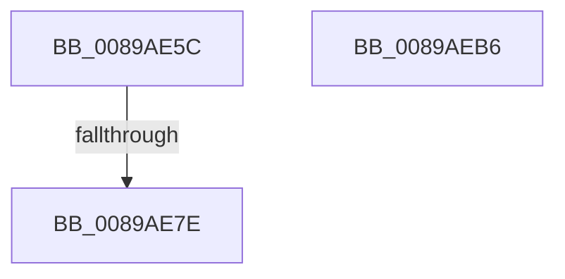

# sub_0089AE5C

- RVA: `0x0089AE5C`–`0x0089AECC` (길이 `112` bytes)
- VA: `0x000000014089AE5C`
- 실행 섹션: `PAGE`
- PDB 이름 있음: `아니요`; PDB Function 태그: `아니요`
- unwind 정보 RVA: `0x0007E6F8`
- 디코드: `25`개 명령, `112/112` bytes 표시
- 미해석 바이트: `0` (있으면 어셈블리에 `.byte`로 보존)

> 이 문서는 커널 이미지의 기계어와 PDB 기호를 분석해 생성했습니다. 4번과 5번은 함수 원형과 자료형을 바이너리 사용 방식에서 추정한 C 해석이며 원본 소스 복구 결과는 아닙니다.

## 1. Dependencies

- 직접 호출 지점: **4**; 고유 호출 대상: **4**
- 직접 호출자로 확인된 함수: **0**
- RIP 상대 이미지 참조: **0**

### Outgoing calls
- `0x0089AE6B` → [PspLockThreadSecurityShared](../../text/3C/PspLockThreadSecurityShared_function_003C4720.md) (function, `0x003C4720`)
- `0x0089AE91` → [ObfReferenceObjectWithTag](../../text/21/ObfReferenceObjectWithTag_function_00210710.md) (function, `0x00210710`)
- `0x0089AEA8` → [PspUnlockThreadSecurityShared](../../text/3C/PspUnlockThreadSecurityShared_function_003C2E40.md) (function, `0x003C2E40`)
- `0x0089AEBF` → [ObfDereferenceObjectWithTag](../../text/2F/ObfDereferenceObjectWithTag_function_002F78E0.md) (function, `0x002F78E0`)

### Direct callers
- 이 함수 시작 RVA로 연결되는 직접 call은 확인되지 않았습니다. 간접 호출은 완전히 역산할 수 없습니다.

### Static image references
- 디코드된 RIP-relative 메모리 참조가 없습니다.

## 2. Other-region calls and transfers

- 다른 실행 섹션으로 향하는 call: **4**
  - `0x0089AE6B` → [PspLockThreadSecurityShared](../../text/3C/PspLockThreadSecurityShared_function_003C4720.md) (`PAGE` → `.text`)
  - `0x0089AE91` → [ObfReferenceObjectWithTag](../../text/21/ObfReferenceObjectWithTag_function_00210710.md) (`PAGE` → `.text`)
  - `0x0089AEA8` → [PspUnlockThreadSecurityShared](../../text/3C/PspUnlockThreadSecurityShared_function_003C2E40.md) (`PAGE` → `.text`)
  - `0x0089AEBF` → [ObfDereferenceObjectWithTag](../../text/2F/ObfDereferenceObjectWithTag_function_002F78E0.md) (`PAGE` → `.text`)
- call이 아닌 외부 분기/꼬리 이동: **3**
  - `0x0089AE78` → [sub_0089AEE3 + 0x167](Unknown_function_0089AEE3.md) (`tail-transfer`)
  - `0x0089AEB1` → [sub_0089A903 + 0xF0](Unknown_function_0089A903.md) (`tail-transfer`)
  - `0x0089AEC7` → [sub_0089A903 + 0x3C0](Unknown_function_0089A903.md) (`tail-transfer`)

## 3. Assembly (complete function range)

```asm
0089AE5C  65 4C 8B 34 25 88 01 00 00      mov r14, qword ptr gs:[0x188]
0089AE65  48 8B CF                        mov rcx, rdi
0089AE68  49 8B D6                        mov rdx, r14
0089AE6B  E8 B0 98 B2 FF                  call 0x1403c4720
0089AE70  8B 87 A0 05 00 00               mov eax, dword ptr [rdi + 0x5a0]
0089AE76  A8 08                           test al, 8
0089AE78  0F 84 CC 01 00 00               je 0x14089b04a
0089AE7E  48 8B B7 38 05 00 00            mov rsi, qword ptr [rdi + 0x538]
0089AE85  BA 53 65 53 75                  mov edx, 0x75536553
0089AE8A  48 83 E6 F8                     and rsi, 0xfffffffffffffff8
0089AE8E  48 8B CE                        mov rcx, rsi
0089AE91  E8 7A 58 97 FF                  call 0x140210710
0089AE96  8B 87 38 05 00 00               mov eax, dword ptr [rdi + 0x538]
0089AE9C  83 E0 03                        and eax, 3
0089AE9F  89 45 B7                        mov dword ptr [rbp - 0x49], eax
0089AEA2  49 8B D6                        mov rdx, r14
0089AEA5  48 8B CF                        mov rcx, rdi
0089AEA8  E8 93 7F B2 FF                  call 0x1403c2e40
0089AEAD  4D 8D 75 4C                     lea r14, [r13 + 0x4c]
0089AEB1  E9 3D FB FF FF                  jmp 0x14089a9f3
0089AEB6  48 8B 4D 87                     mov rcx, qword ptr [rbp - 0x79]
0089AEBA  BA 4F 62 48 6E                  mov edx, 0x6e48624f
0089AEBF  E8 1C CA A5 FF                  call 0x1402f78e0
0089AEC4  44 8B F7                        mov r14d, edi
0089AEC7  E9 F7 FD FF FF                  jmp 0x14089acc3
```

## 4. C-style interpretation (structured pseudocode)

```c
__int64 __fastcall sub_0089AE5C(void)
{
    __int64 result;
    __int64 v_rsi;

    result = PspLockThreadSecurityShared(v_rdi, *(unsigned __int64 *)(gs_base + (0 + 392)), a3, a4);
    v_rsi = (*(unsigned __int64 *)(v_rdi + 1336)) & (-8);
    result = ObfReferenceObjectWithTag(v_rsi, (unsigned int)(0x75536553ULL), a3, a4);
    result = (unsigned int)(((unsigned int)(*(unsigned int *)(v_rdi + 1336))) & (3));
    *(unsigned int *)(v_rbp - 73) = (unsigned int)(result);
    result = PspUnlockThreadSecurityShared(v_rdi, *(unsigned __int64 *)(gs_base + (0 + 392)), a3, a4);
}
```

## 5. (Beta) C Style

```c
void sub_0089AE5C(void)
{
    int64_t result;
    int64_t local_rsi;

    result = PspLockThreadSecurityShared(local_rdi, *(uint64_t *)(gs_base + (0 + 0x188)), a3, a4);
    local_rsi = (*(uint64_t *)(local_rdi + 0x538)) & (-8);
    result = ObfReferenceObjectWithTag(local_rsi, (uint32_t)(0x75536553ULL), a3, a4);
    result = (uint32_t)(((uint32_t)(*(uint32_t *)(local_rdi + 0x538))) & (3));
    *(uint32_t *)(local_rbp - 0x49) = (uint32_t)(result);
    result = PspUnlockThreadSecurityShared(local_rdi, *(uint64_t *)(gs_base + (0 + 0x188)), a3, a4);
}
```

## 6. Execution-region graph

[열기: 2D/3D 그래프와 함수 탐색 컨트롤 패널](../../../control-panel.html?section=page&rva=0x0089AE5C&view=graph)

- 2D 그래프는 위에서 아래로 흐르고, 3D 그래프는 빈 공간을 드래그해 회전합니다. Shift+드래그는 이동, 휠은 확대·축소, 함수 노드 선택은 대상 보고서 이동입니다.

### Static fallback


