# sub_0089AEE3

- RVA: `0x0089AEE3`–`0x0089B1CB` (길이 `744` bytes)
- VA: `0x000000014089AEE3`
- 실행 섹션: `PAGE`
- PDB 이름 있음: `아니요`; PDB Function 태그: `아니요`
- unwind 정보 RVA: `0x0007E728`
- 디코드: `163`개 명령, `744/744` bytes 표시
- 미해석 바이트: `0` (있으면 어셈블리에 `.byte`로 보존)

> 이 문서는 커널 이미지의 기계어와 PDB 기호를 분석해 생성했습니다. 4번과 5번은 함수 원형과 자료형을 바이너리 사용 방식에서 추정한 C 해석이며 원본 소스 복구 결과는 아닙니다.

## 1. Dependencies

- 직접 호출 지점: **18**; 고유 호출 대상: **10**
- 직접 호출자로 확인된 함수: **0**
- RIP 상대 이미지 참조: **2**

### Outgoing calls
- `0x0089AEE8` → [ExFreePoolWithTag](../../poolcode/B8/ExFreePoolWithTag_function_00B82870.md) (function, `0x00B82870`)
- `0x0089AF1B` → [ExpInterlockedPushEntrySList](../../text/6B/ExpInterlockedPushEntrySList_function_006BA5B0.md) (function, `0x006BA5B0`)
- `0x0089AF37` → [ObfDereferenceObjectWithTag](../../text/2F/ObfDereferenceObjectWithTag_function_002F78E0.md) (function, `0x002F78E0`)
- `0x0089AF44` → [RtlValidSecurityDescriptor](../8B/RtlValidSecurityDescriptor_function_008BD3F0.md) (function, `0x008BD3F0`)
- `0x0089AF6C` → [SeObjectCreateSaclAccessBits](../8B/SeObjectCreateSaclAccessBits_function_008BD8AC.md) (function, `0x008BD8AC`)
- `0x0089AF7D` → [ExfReleasePushLock](../../text/26/ExfReleasePushLock_function_002638D0.md) (function, `0x002638D0`)
- `0x0089AF87` → [HalPutDmaAdapter](../../text/48/HalPutDmaAdapter_function_0048E530.md) (function, `0x0048E530`)
- `0x0089AFC4` → [ExFreePool](../../poolcode/B8/ExFreePool_function_00B82850.md) (function, `0x00B82850`)
- `0x0089B002` → [ExFreePool](../../poolcode/B8/ExFreePool_function_00B82850.md) (function, `0x00B82850`)
- `0x0089B040` → [ExFreePool](../../poolcode/B8/ExFreePool_function_00B82850.md) (function, `0x00B82850`)
- `0x0089B08C` → [ExFreePool](../../poolcode/B8/ExFreePool_function_00B82850.md) (function, `0x00B82850`)
- `0x0089B0AB` → [ObpPushStackInfo](../../text/21/ObpPushStackInfo_function_002109E4.md) (function, `0x002109E4`)
- `0x0089B0C3` → [ObpPushStackInfo](../../text/21/ObpPushStackInfo_function_002109E4.md) (function, `0x002109E4`)
- `0x0089B0DE` → [ObfDereferenceObjectWithTag](../../text/2F/ObfDereferenceObjectWithTag_function_002F78E0.md) (function, `0x002F78E0`)
- `0x0089B198` → [guard_dispatch_icall](../../text/6B/guard_dispatch_icall_function_006BAAD0.md) (function, `0x006BAAD0`)
- `0x0089B1AD` → [guard_dispatch_icall](../../text/6B/guard_dispatch_icall_function_006BAAD0.md) (function, `0x006BAAD0`)
- `0x0089B1B7` → [guard_dispatch_icall](../../text/6B/guard_dispatch_icall_function_006BAAD0.md) (function, `0x006BAAD0`)
- `0x0089B1C1` → [guard_dispatch_icall](../../text/6B/guard_dispatch_icall_function_006BAAD0.md) (function, `0x006BAAD0`)

### Direct callers
- 이 함수 시작 RVA로 연결되는 직접 call은 확인되지 않았습니다. 간접 호출은 완전히 역산할 수 없습니다.

### Static image references
- `0x0089AFEB` → RVA `0x00B82850` (`ExFreePool`; read)
- `0x0089B109` → RVA `0x00E67B90` (`.data`; read)

## 2. Other-region calls and transfers

- 다른 실행 섹션으로 향하는 call: **16**
  - `0x0089AEE8` → [ExFreePoolWithTag](../../poolcode/B8/ExFreePoolWithTag_function_00B82870.md) (`PAGE` → `POOLCODE`)
  - `0x0089AF1B` → [ExpInterlockedPushEntrySList](../../text/6B/ExpInterlockedPushEntrySList_function_006BA5B0.md) (`PAGE` → `.text`)
  - `0x0089AF37` → [ObfDereferenceObjectWithTag](../../text/2F/ObfDereferenceObjectWithTag_function_002F78E0.md) (`PAGE` → `.text`)
  - `0x0089AF7D` → [ExfReleasePushLock](../../text/26/ExfReleasePushLock_function_002638D0.md) (`PAGE` → `.text`)
  - `0x0089AF87` → [HalPutDmaAdapter](../../text/48/HalPutDmaAdapter_function_0048E530.md) (`PAGE` → `.text`)
  - `0x0089AFC4` → [ExFreePool](../../poolcode/B8/ExFreePool_function_00B82850.md) (`PAGE` → `POOLCODE`)
  - `0x0089B002` → [ExFreePool](../../poolcode/B8/ExFreePool_function_00B82850.md) (`PAGE` → `POOLCODE`)
  - `0x0089B040` → [ExFreePool](../../poolcode/B8/ExFreePool_function_00B82850.md) (`PAGE` → `POOLCODE`)
  - `0x0089B08C` → [ExFreePool](../../poolcode/B8/ExFreePool_function_00B82850.md) (`PAGE` → `POOLCODE`)
  - `0x0089B0AB` → [ObpPushStackInfo](../../text/21/ObpPushStackInfo_function_002109E4.md) (`PAGE` → `.text`)
  - `0x0089B0C3` → [ObpPushStackInfo](../../text/21/ObpPushStackInfo_function_002109E4.md) (`PAGE` → `.text`)
  - `0x0089B0DE` → [ObfDereferenceObjectWithTag](../../text/2F/ObfDereferenceObjectWithTag_function_002F78E0.md) (`PAGE` → `.text`)
  - `0x0089B198` → [guard_dispatch_icall](../../text/6B/guard_dispatch_icall_function_006BAAD0.md) (`PAGE` → `.text`)
  - `0x0089B1AD` → [guard_dispatch_icall](../../text/6B/guard_dispatch_icall_function_006BAAD0.md) (`PAGE` → `.text`)
  - `0x0089B1B7` → [guard_dispatch_icall](../../text/6B/guard_dispatch_icall_function_006BAAD0.md) (`PAGE` → `.text`)
  - `0x0089B1C1` → [guard_dispatch_icall](../../text/6B/guard_dispatch_icall_function_006BAAD0.md) (`PAGE` → `.text`)
- call이 아닌 외부 분기/꼬리 이동: **31**
  - `0x0089AEED` → [sub_0089A903 + 0x4F8](Unknown_function_0089A903.md) (`tail-transfer`)
  - `0x0089AF22` → [sub_0089A903 + 0x52F](Unknown_function_0089A903.md) (`tail-transfer`)
  - `0x0089AF2D` → [sub_0089A903 + 0x2F0](Unknown_function_0089A903.md) (`tail-transfer`)
  - `0x0089AF3C` → [sub_0089A903 + 0x491](Unknown_function_0089A903.md) (`tail-transfer`)
  - `0x0089AF55` → [sub_0089A903 + 0x15A](Unknown_function_0089A903.md) (`tail-transfer`)
  - `0x0089AF63` → [sub_0089A903 + 0x15A](Unknown_function_0089A903.md) (`tail-transfer`)
  - `0x0089AF75` → [sub_0089A903 + 0x15A](Unknown_function_0089A903.md) (`tail-transfer`)
  - `0x0089AF82` → [sub_0089A903 + 0x24B](Unknown_function_0089A903.md) (`tail-transfer`)
  - `0x0089AF92` → [sub_0089A903 + 0x3C7](Unknown_function_0089A903.md) (`tail-transfer`)
  - `0x0089AFAB` → [sub_0089A903 + 0x524](Unknown_function_0089A903.md) (`tail-transfer`)
  - `0x0089AFC9` → [sub_0089A903 + 0x52C](Unknown_function_0089A903.md) (`tail-transfer`)
  - `0x0089AFE2` → [sub_0089A903 + 0x4F0](Unknown_function_0089A903.md) (`tail-transfer`)
  - `0x0089B007` → [sub_0089A903 + 0x4FF](Unknown_function_0089A903.md) (`tail-transfer`)
  - `0x0089B020` → [sub_0089A903 + 0x2E1](Unknown_function_0089A903.md) (`tail-transfer`)
  - `0x0089B045` → [sub_0089A903 + 0x2E6](Unknown_function_0089A903.md) (`tail-transfer`)
  - `0x0089B04E` → [sub_0089AE5C + 0x46](Unknown_function_0089AE5C.md) (`tail-transfer`)
  - `0x0089B093` → [sub_0089A903 + 0x52F](Unknown_function_0089A903.md) (`tail-transfer`)
  - `0x0089B0CC` → [sub_0089A903 + 0x367](Unknown_function_0089A903.md) (`tail-transfer`)
  - `0x0089B0D1` → [sub_0089A903 + 0x282](Unknown_function_0089A903.md) (`tail-transfer`)
  - `0x0089B0E3` → [sub_0089A903 + 0x480](Unknown_function_0089A903.md) (`tail-transfer`)
  - `0x0089B0ED` → [sub_0089A903 + 0x52F](Unknown_function_0089A903.md) (`tail-transfer`)
  - `0x0089B11E` → [sub_0089A903 + 0x421](Unknown_function_0089A903.md) (`tail-transfer`)
  - `0x0089B13D` → [sub_0089A903 + 0x421](Unknown_function_0089A903.md) (`tail-transfer`)
  - `0x0089B144` → [sub_0089A903 + 0x421](Unknown_function_0089A903.md) (`tail-transfer`)
  - `0x0089B16D` → [sub_0089A903 + 0x113](Unknown_function_0089A903.md) (`tail-transfer`)
  - `0x0089B18C` → [sub_0089A903 + 0x113](Unknown_function_0089A903.md) (`tail-transfer`)
  - `0x0089B193` → [sub_0089A903 + 0x113](Unknown_function_0089A903.md) (`tail-transfer`)
  - `0x0089B1A8` → [sub_0089A903 + 0x401](Unknown_function_0089A903.md) (`tail-transfer`)
  - `0x0089B1B2` → [sub_0089A903 + 0x2E6](Unknown_function_0089A903.md) (`tail-transfer`)
  - `0x0089B1BC` → [sub_0089A903 + 0x4FF](Unknown_function_0089A903.md) (`tail-transfer`)
  - `0x0089B1C6` → [sub_0089A903 + 0x52C](Unknown_function_0089A903.md) (`tail-transfer`)

## 3. Assembly (complete function range)

```asm
0089AEE3  33 D2                           xor edx, edx
0089AEE5  49 8B C8                        mov rcx, r8
0089AEE8  E8 83 79 2E 00                  call 0x140b82870
0089AEED  E9 09 FF FF FF                  jmp 0x14089adfb
0089AEF2  65 48 8B 04 25 20 00 00 00      mov rax, qword ptr gs:[0x20]
0089AEFB  4C 8B 80 80 08 00 00            mov r8, qword ptr [rax + 0x880]
0089AF02  41 FF 40 1C                     inc dword ptr [r8 + 0x1c]
0089AF06  41 0F B7 48 10                  movzx ecx, word ptr [r8 + 0x10]
0089AF0B  66 41 39 08                     cmp word ptr [r8], cx
0089AF0F  0F 83 3E 01 00 00               jae 0x14089b053
0089AF15  48 8B D3                        mov rdx, rbx
0089AF18  49 8B C8                        mov rcx, r8
0089AF1B  E8 90 F6 E1 FF                  call 0x1406ba5b0
0089AF20  8B C7                           mov eax, edi
0089AF22  E9 0B FF FF FF                  jmp 0x14089ae32
0089AF27  41 BE 01 00 00 00               mov r14d, 1
0089AF2D  E9 C1 FC FF FF                  jmp 0x14089abf3
0089AF32  BA 53 65 53 75                  mov edx, 0x75536553
0089AF37  E8 A4 C9 A5 FF                  call 0x1402f78e0
0089AF3C  E9 53 FE FF FF                  jmp 0x14089ad94
0089AF41  48 8B CF                        mov rcx, rdi
0089AF44  E8 A7 24 02 00                  call 0x1408bd3f0
0089AF49  84 C0                           test al, al
0089AF4B  0F 84 51 02 00 00               je 0x14089b1a2
0089AF51  F6 47 02 10                     test byte ptr [rdi + 2], 0x10
0089AF55  0F 84 02 FB FF FF               je 0x14089aa5d
0089AF5B  41 F7 47 14 00 00 00 01         test dword ptr [r15 + 0x14], 0x1000000
0089AF63  0F 85 F4 FA FF FF               jne 0x14089aa5d
0089AF69  48 8B CF                        mov rcx, rdi
0089AF6C  E8 3B 29 02 00                  call 0x1408bd8ac
0089AF71  41 09 47 10                     or dword ptr [r15 + 0x10], eax
0089AF75  E9 E3 FA FF FF                  jmp 0x14089aa5d
0089AF7A  49 8B CE                        mov rcx, r14
0089AF7D  E8 4E 89 9C FF                  call 0x1402638d0
0089AF82  E9 C7 FB FF FF                  jmp 0x14089ab4e
0089AF87  E8 A4 35 BF FF                  call 0x14048e530
0089AF8C  41 BE 0D 00 00 C0               mov r14d, 0xc000000d
0089AF92  E9 33 FD FF FF                  jmp 0x14089acca
0089AF97  FF 41 20                        inc dword ptr [rcx + 0x20]
0089AF9A  48 8B 8A 88 08 00 00            mov rcx, qword ptr [rdx + 0x888]
0089AFA1  FF 41 1C                        inc dword ptr [rcx + 0x1c]
0089AFA4  0F B7 41 10                     movzx eax, word ptr [rcx + 0x10]
0089AFA8  66 39 01                        cmp word ptr [rcx], ax
0089AFAB  0F 82 76 FE FF FF               jb 0x14089ae27
0089AFB1  FF 41 20                        inc dword ptr [rcx + 0x20]
0089AFB4  48 8B 41 38                     mov rax, qword ptr [rcx + 0x38]
0089AFB8  48 8B CB                        mov rcx, rbx
0089AFBB  48 3B C7                        cmp rax, rdi
0089AFBE  0F 85 FD 01 00 00               jne 0x14089b1c1
0089AFC4  E8 87 78 2E 00                  call 0x140b82850
0089AFC9  E9 61 FE FF FF                  jmp 0x14089ae2f
0089AFCE  FF 41 20                        inc dword ptr [rcx + 0x20]
0089AFD1  48 8B 8A 58 08 00 00            mov rcx, qword ptr [rdx + 0x858]
0089AFD8  FF 41 1C                        inc dword ptr [rcx + 0x1c]
0089AFDB  0F B7 41 10                     movzx eax, word ptr [rcx + 0x10]
0089AFDF  66 39 01                        cmp word ptr [rcx], ax
0089AFE2  0F 82 0B FE FF FF               jb 0x14089adf3
0089AFE8  FF 41 20                        inc dword ptr [rcx + 0x20]
0089AFEB  48 8D 3D 5E 78 2E 00            lea rdi, [rip + 0x2e785e]
0089AFF2  48 8B 41 38                     mov rax, qword ptr [rcx + 0x38]
0089AFF6  49 8B C8                        mov rcx, r8
0089AFF9  48 3B C7                        cmp rax, rdi
0089AFFC  0F 85 B5 01 00 00               jne 0x14089b1b7
0089B002  E8 49 78 2E 00                  call 0x140b82850
0089B007  E9 F6 FD FF FF                  jmp 0x14089ae02
0089B00C  FF 41 20                        inc dword ptr [rcx + 0x20]
0089B00F  49 8B 88 48 08 00 00            mov rcx, qword ptr [r8 + 0x848]
0089B016  FF 41 1C                        inc dword ptr [rcx + 0x1c]
0089B019  0F B7 41 10                     movzx eax, word ptr [rcx + 0x10]
0089B01D  66 39 01                        cmp word ptr [rcx], ax
0089B020  0F 82 BE FB FF FF               jb 0x14089abe4
0089B026  FF 41 20                        inc dword ptr [rcx + 0x20]
0089B029  48 8B 41 38                     mov rax, qword ptr [rcx + 0x38]
0089B02D  48 8D 0D 1C 78 2E 00            lea rcx, [rip + 0x2e781c]
0089B034  48 3B C1                        cmp rax, rcx
0089B037  48 8B CA                        mov rcx, rdx
0089B03A  0F 85 6D 01 00 00               jne 0x14089b1ad
0089B040  E8 0B 78 2E 00                  call 0x140b82850
0089B045  E9 9F FB FF FF                  jmp 0x14089abe9
0089B04A  33 C9                           xor ecx, ecx
0089B04C  8B F1                           mov esi, ecx
0089B04E  E9 4F FE FF FF                  jmp 0x14089aea2
0089B053  41 FF 40 20                     inc dword ptr [r8 + 0x20]
0089B057  4C 8B 80 88 08 00 00            mov r8, qword ptr [rax + 0x888]
0089B05E  41 FF 40 1C                     inc dword ptr [r8 + 0x1c]
0089B062  41 0F B7 40 10                  movzx eax, word ptr [r8 + 0x10]
0089B067  66 41 39 00                     cmp word ptr [r8], ax
0089B06B  0F 82 A4 FE FF FF               jb 0x14089af15
0089B071  41 FF 40 20                     inc dword ptr [r8 + 0x20]
0089B075  48 8D 0D D4 77 2E 00            lea rcx, [rip + 0x2e77d4]
0089B07C  49 8B 40 38                     mov rax, qword ptr [r8 + 0x38]
0089B080  48 3B C1                        cmp rax, rcx
0089B083  48 8B CB                        mov rcx, rbx
0089B086  0F 85 0C 01 00 00               jne 0x14089b198
0089B08C  E8 BF 77 2E 00                  call 0x140b82850
0089B091  8B C7                           mov eax, edi
0089B093  E9 9A FD FF FF                  jmp 0x14089ae32
0089B098  33 D2                           xor edx, edx
0089B09A  48 8D 79 D0                     lea rdi, [rcx - 0x30]
0089B09E  41 B9 44 66 6C 74               mov r9d, 0x746c6644
0089B0A4  48 8B CF                        mov rcx, rdi
0089B0A7  44 8D 42 01                     lea r8d, [rdx + 1]
0089B0AB  E8 34 59 97 FF                  call 0x1402109e4
0089B0B0  41 B8 01 00 00 00               mov r8d, 1
0089B0B6  41 B9 4F 62 48 6E               mov r9d, 0x6e48624f
0089B0BC  41 0F B6 D0                     movzx edx, r8b
0089B0C0  48 8B CF                        mov rcx, rdi
0089B0C3  E8 1C 59 97 FF                  call 0x1402109e4
0089B0C8  48 8B 4D 87                     mov rcx, qword ptr [rbp - 0x79]
0089B0CC  E9 99 FB FF FF                  jmp 0x14089ac6a
0089B0D1  E9 AF FA FF FF                  jmp 0x14089ab85
0089B0D6  BA 53 65 53 75                  mov edx, 0x75536553
0089B0DB  49 8B C8                        mov rcx, r8
0089B0DE  E8 FD C7 A5 FF                  call 0x1402f78e0
0089B0E3  E9 9B FC FF FF                  jmp 0x14089ad83
0089B0E8  B8 9A 00 00 C0                  mov eax, 0xc000009a
0089B0ED  E9 40 FD FF FF                  jmp 0x14089ae32
0089B0F2  49 8B 47 30                     mov rax, qword ptr [r15 + 0x30]
0089B0F6  48 85 C0                        test rax, rax
0089B0F9  74 1C                           je 0x14089b117
0089B0FB  48 8B 80 78 04 00 00            mov rax, qword ptr [rax + 0x478]
0089B102  F0 FF 88 1C 01 00 00            lock dec dword ptr [rax + 0x11c]
0089B109  48 8B 05 80 CA 5C 00            mov rax, qword ptr [rip + 0x5cca80]
0089B110  49 39 47 30                     cmp qword ptr [r15 + 0x30], rax
0089B114  75 01                           jne 0x14089b117
0089B116  CC                              int3
0089B117  49 8B 47 20                     mov rax, qword ptr [r15 + 0x20]
0089B11B  48 85 C0                        test rax, rax
0089B11E  0F 84 00 FC FF FF               je 0x14089ad24
0089B124  48 8B 80 78 04 00 00            mov rax, qword ptr [rax + 0x478]
0089B12B  F0 FF 88 1C 01 00 00            lock dec dword ptr [rax + 0x11c]
0089B132  48 8B 05 57 CA 5C 00            mov rax, qword ptr [rip + 0x5cca57]
0089B139  49 39 47 20                     cmp qword ptr [r15 + 0x20], rax
0089B13D  0F 85 E1 FB FF FF               jne 0x14089ad24
0089B143  CC                              int3
0089B144  E9 DB FB FF FF                  jmp 0x14089ad24
0089B149  48 85 C0                        test rax, rax
0089B14C  74 1C                           je 0x14089b16a
0089B14E  48 8B 88 78 04 00 00            mov rcx, qword ptr [rax + 0x478]
0089B155  F0 FF 81 1C 01 00 00            lock inc dword ptr [rcx + 0x11c]
0089B15C  48 3B 05 2D CA 5C 00            cmp rax, qword ptr [rip + 0x5cca2d]
0089B163  75 01                           jne 0x14089b166
0089B165  CC                              int3
0089B166  48 8B 75 AF                     mov rsi, qword ptr [rbp - 0x51]
0089B16A  48 85 F6                        test rsi, rsi
0089B16D  0F 84 A3 F8 FF FF               je 0x14089aa16
0089B173  48 8B 86 78 04 00 00            mov rax, qword ptr [rsi + 0x478]
0089B17A  F0 FF 80 1C 01 00 00            lock inc dword ptr [rax + 0x11c]
0089B181  48 8B 05 08 CA 5C 00            mov rax, qword ptr [rip + 0x5cca08]
0089B188  48 39 45 AF                     cmp qword ptr [rbp - 0x51], rax
0089B18C  0F 85 84 F8 FF FF               jne 0x14089aa16
0089B192  CC                              int3
0089B193  E9 7E F8 FF FF                  jmp 0x14089aa16
0089B198  E8 33 F9 E1 FF                  call 0x1406baad0
0089B19D  E9 7E FD FF FF                  jmp 0x14089af20
0089B1A2  41 BE 79 00 00 C0               mov r14d, 0xc0000079
0089B1A8  E9 57 FB FF FF                  jmp 0x14089ad04
0089B1AD  E8 1E F9 E1 FF                  call 0x1406baad0
0089B1B2  E9 32 FA FF FF                  jmp 0x14089abe9
0089B1B7  E8 14 F9 E1 FF                  call 0x1406baad0
0089B1BC  E9 41 FC FF FF                  jmp 0x14089ae02
0089B1C1  E8 0A F9 E1 FF                  call 0x1406baad0
0089B1C6  E9 64 FC FF FF                  jmp 0x14089ae2f
```

## 4. C-style interpretation (structured pseudocode)

```c
__int64 __fastcall sub_0089AEE3(__int64 a1, int a2, __int64 a3)
{
    __int64 result;

    a2 = 0;
    result = ExFreePoolWithTag(a3, a2, a3, a4);
}
```

## 5. (Beta) C Style

```c
int64_t sub_0089AEE3(int64_t Arg1, int32_t Arg2, int64_t Arg3)
{
    int64_t result;

    Arg2 = 0;
    result = ExFreePoolWithTag(Arg3, Arg2, Arg3, a4);
}
```

## 6. Execution-region graph

[열기: 2D/3D 그래프와 함수 탐색 컨트롤 패널](../../../control-panel.html?section=page&rva=0x0089AEE3&view=graph)

- 2D 그래프는 위에서 아래로 흐르고, 3D 그래프는 빈 공간을 드래그해 회전합니다. Shift+드래그는 이동, 휠은 확대·축소, 함수 노드 선택은 대상 보고서 이동입니다.

### Static fallback

```mermaid
flowchart TD
  bb_0089AEE3[BB_0089AEE3]
  bb_0089AEF2[BB_0089AEF2]
  bb_0089AF15[BB_0089AF15]
  bb_0089AF20[BB_0089AF20]
  bb_0089AF27[BB_0089AF27]
  bb_0089AF32[BB_0089AF32]
  bb_0089AF41[BB_0089AF41]
  bb_0089AF51[BB_0089AF51]
  bb_0089AF5B[BB_0089AF5B]
  bb_0089AF69[BB_0089AF69]
  bb_0089AF7A[BB_0089AF7A]
  bb_0089AF87[BB_0089AF87]
  bb_0089AF97[BB_0089AF97]
  bb_0089AFB1[BB_0089AFB1]
  bb_0089AFC4[BB_0089AFC4]
  bb_0089AFCE[BB_0089AFCE]
  bb_0089AFE8[BB_0089AFE8]
  bb_0089B002[BB_0089B002]
  bb_0089B00C[BB_0089B00C]
  bb_0089B026[BB_0089B026]
  bb_0089B040[BB_0089B040]
  bb_0089B04A[BB_0089B04A]
  bb_0089B053[BB_0089B053]
  bb_0089B071[BB_0089B071]
  bb_0089B08C[BB_0089B08C]
  bb_0089B098[BB_0089B098]
  bb_0089B0D1[BB_0089B0D1]
  bb_0089B0D6[BB_0089B0D6]
  bb_0089B0E8[BB_0089B0E8]
  bb_0089B0F2[BB_0089B0F2]
  bb_0089B0FB[BB_0089B0FB]
  bb_0089B116[BB_0089B116]
  bb_0089B117[BB_0089B117]
  bb_0089B124[BB_0089B124]
  bb_0089B143[BB_0089B143]
  bb_0089B149[BB_0089B149]
  bb_0089B14E[BB_0089B14E]
  bb_0089B165[BB_0089B165]
  bb_0089B166[BB_0089B166]
  bb_0089B16A[BB_0089B16A]
  bb_0089B173[BB_0089B173]
  bb_0089B192[BB_0089B192]
  bb_0089B198[BB_0089B198]
  bb_0089B1A2[BB_0089B1A2]
  bb_0089B1AD[BB_0089B1AD]
  bb_0089B1B7[BB_0089B1B7]
  bb_0089B1C1[BB_0089B1C1]
  bb_0089AEF2 -->|branch| bb_0089B053
  bb_0089AEF2 -->|fallthrough| bb_0089AF15
  bb_0089AF15 -->|flow| bb_0089AF20
  bb_0089AF41 -->|branch| bb_0089B1A2
  bb_0089AF41 -->|fallthrough| bb_0089AF51
  bb_0089AF51 -->|fallthrough| bb_0089AF5B
  bb_0089AF5B -->|fallthrough| bb_0089AF69
  bb_0089AF97 -->|fallthrough| bb_0089AFB1
  bb_0089AFB1 -->|branch| bb_0089B1C1
  bb_0089AFB1 -->|fallthrough| bb_0089AFC4
  bb_0089AFCE -->|fallthrough| bb_0089AFE8
  bb_0089AFE8 -->|branch| bb_0089B1B7
  bb_0089AFE8 -->|fallthrough| bb_0089B002
  bb_0089B00C -->|fallthrough| bb_0089B026
  bb_0089B026 -->|branch| bb_0089B1AD
  bb_0089B026 -->|fallthrough| bb_0089B040
  bb_0089B053 -->|branch| bb_0089AF15
  bb_0089B053 -->|fallthrough| bb_0089B071
  bb_0089B071 -->|branch| bb_0089B198
  bb_0089B071 -->|fallthrough| bb_0089B08C
  bb_0089B0F2 -->|branch| bb_0089B117
  bb_0089B0F2 -->|fallthrough| bb_0089B0FB
  bb_0089B0FB -->|branch| bb_0089B117
  bb_0089B0FB -->|fallthrough| bb_0089B116
  bb_0089B116 -->|flow| bb_0089B117
  bb_0089B117 -->|fallthrough| bb_0089B124
  bb_0089B124 -->|fallthrough| bb_0089B143
  bb_0089B149 -->|branch| bb_0089B16A
  bb_0089B149 -->|fallthrough| bb_0089B14E
  bb_0089B14E -->|branch| bb_0089B166
  bb_0089B14E -->|fallthrough| bb_0089B165
  bb_0089B165 -->|flow| bb_0089B166
  bb_0089B166 -->|flow| bb_0089B16A
  bb_0089B16A -->|fallthrough| bb_0089B173
  bb_0089B173 -->|fallthrough| bb_0089B192
  bb_0089B198 -->|branch| bb_0089AF20
```


