# DbgkForwardException

- RVA: `0x008A2D60`–`0x008A31B8` (길이 `1,112` bytes)
- VA: `0x00000001408A2D60`
- 실행 섹션: `PAGE`
- PDB 이름 있음: `예`; PDB Function 태그: `예`
- unwind 정보 RVA: `0x0007EE0C`
- 디코드: `250`개 명령, `1,112/1,112` bytes 표시
- 미해석 바이트: `0` (있으면 어셈블리에 `.byte`로 보존)

> 이 문서는 커널 이미지의 기계어와 PDB 기호를 분석해 생성했습니다. 4번과 5번은 함수 원형과 자료형을 바이너리 사용 방식에서 추정한 C 해석이며 원본 소스 복구 결과는 아닙니다.

## 1. Dependencies

- 직접 호출 지점: **26**; 고유 호출 대상: **23**
- 직접 호출자로 확인된 함수: **4**
- RIP 상대 이미지 참조: **11**

### Outgoing calls
- `0x008A2DAB` → [memset](../../text/6C/memset_function_006C6C40.md) (function, `0x006C6C40`)
- `0x008A2E0C` → [PspRecordCrashedProcessIntoBlackbox](PspRecordCrashedProcessIntoBlackbox_function_008A3514.md) (function, `0x008A3514`)
- `0x008A2E19` → [PsSetProcessTelemetryAppState](PsSetProcessTelemetryAppState_function_008A35F0.md) (function, `0x008A35F0`)
- `0x008A2E45` → [PspLockProcessExclusive](../../text/46/PspLockProcessExclusive_function_00460164.md) (function, `0x00460164`)
- `0x008A2E57` → [PspUnlockProcessExclusive](../../text/46/PspUnlockProcessExclusive_function_004601C0.md) (function, `0x004601C0`)
- `0x008A2E63` → [ExGetExtensionTable](../../text/42/ExGetExtensionTable_function_00428814.md) (function, `0x00428814`)
- `0x008A2ED7` → [KeCopyExceptionRecord](../../text/43/KeCopyExceptionRecord_function_00439750.md) (function, `0x00439750`)
- `0x008A2F2B` → [DbgkpSuspendProcess](DbgkpSuspendProcess_function_008A34D4.md) (function, `0x008A34D4`)
- `0x008A2F4E` → [DbgkpQueueMessage](DbgkpQueueMessage_function_008A31C0.md) (function, `0x008A31C0`)
- `0x008A2F62` → [PsThawMultiProcess](../../text/45/PsThawMultiProcess_function_0045FFE0.md) (function, `0x0045FFE0`)
- `0x008A2F70` → [KeLeaveCriticalRegionThread](../../text/25/KeLeaveCriticalRegionThread_function_0025EFF0.md) (function, `0x0025EFF0`)
- `0x008A2FA6` → [_security_check_cookie](../../text/6A/_security_check_cookie_function_006AC640.md) (function, `0x006AC640`)
- `0x008A2FE4` → [PspLockProcessShared](../../text/40/PspLockProcessShared_function_004016D0.md) (function, `0x004016D0`)
- `0x008A2FF7` → [ObfReferenceObject](../../text/20/ObfReferenceObject_function_0020FA20.md) (function, `0x0020FA20`)
- `0x008A3002` → [PspUnlockProcessShared](../../text/26/PspUnlockProcessShared_function_00263950.md) (function, `0x00263950`)
- `0x008A3033` → [guard_dispatch_icall](../../text/6B/guard_dispatch_icall_function_006BAAD0.md) (function, `0x006BAAD0`)
- `0x008A303F` → [ExReleaseExtensionTable](../../text/45/ExReleaseExtensionTable_function_00456DC0.md) (function, `0x00456DC0`)
- `0x008A305D` → [PspLockProcessExclusive](../../text/46/PspLockProcessExclusive_function_00460164.md) (function, `0x00460164`)
- `0x008A307C` → [PspUnlockProcessExclusive](../../text/46/PspUnlockProcessExclusive_function_004601C0.md) (function, `0x004601C0`)
- `0x008A30B7` → [EtwTelemetryCoverageReport](../../text/46/EtwTelemetryCoverageReport_function_00460430.md) (function, `0x00460430`)
- `0x008A30D2` → [DbgkpSendApiMessageLpc](../92/DbgkpSendApiMessageLpc_function_00920E4C.md) (function, `0x00920E4C`)
- `0x008A30DC` → [ObfDereferenceObject](../../text/2F/ObfDereferenceObject_function_002F9350.md) (function, `0x002F9350`)
- `0x008A30FC` → [DbgkpSendErrorMessage](../92/DbgkpSendErrorMessage_function_009210A8.md) (function, `0x009210A8`)
- `0x008A3128` → [EtwTelemetryCoverageReport](../../text/46/EtwTelemetryCoverageReport_function_00460430.md) (function, `0x00460430`)
- `0x008A3171` → [TelemetryCoverageStringHashInternal](../../text/4D/TelemetryCoverageStringHashInternal_function_004D51A0.md) (function, `0x004D51A0`)
- `0x008A31AE` → [EtwTraceDebuggerEvent](../../text/4D/EtwTraceDebuggerEvent_function_004D2700.md) (function, `0x004D2700`)

### Direct callers
- [KiSchedulerApc](../../text/20/KiSchedulerApc_function_00202BC0.md) at `0x00202E9E`
- [KiSchedulerApc](../../text/20/KiSchedulerApc_function_00202BC0.md) at `0x00202EAD`
- [KiDispatchException](../../text/3D/KiDispatchException_function_003D7650.md) at `0x003D7A26`
- [KiDispatchException](../../text/3D/KiDispatchException_function_003D7650.md) at `0x003D7DFE`
- [KiDispatchException](../../text/3D/KiDispatchException_function_003D7650.md) at `0x003D7E13`
- [PsDispatchIumService](../../text/4A/PsDispatchIumService_function_004A2F0C.md) at `0x004A316C`
- [DbgkpSendErrorMessage](../92/DbgkpSendErrorMessage_function_009210A8.md) at `0x00921523`

### Static image references
- `0x008A2D79` → RVA `0x00E0A740` (`.data`; read)
- `0x008A2DFD` → RVA `0x00E08684` (`.data`; read)
- `0x008A2E5C` → RVA `0x00FC7040` (`ALMOSTRO`; read)
- `0x008A2EFE` → RVA `0x00FC6B00` (`ALMOSTRO`; read)
- `0x008A308A` → RVA `0x00E08680` (`.data`; read)
- `0x008A3093` → RVA `0x00E08678` (`.data`; read)
- `0x008A30AA` → RVA `0x00E08680` (`.data`; write)
- `0x008A314C` → RVA `0x00E0869C` (`.data`; read)
- `0x008A3158` → RVA `0x00E08698` (`.data`; read)
- `0x008A3165` → RVA `0x00E08690` (`.data`; read)
- `0x008A3176` → RVA `0x00E08698` (`.data`; write)

## 2. Other-region calls and transfers

- 다른 실행 섹션으로 향하는 call: **20**
  - `0x008A2DAB` → [memset](../../text/6C/memset_function_006C6C40.md) (`PAGE` → `.text`)
  - `0x008A2E45` → [PspLockProcessExclusive](../../text/46/PspLockProcessExclusive_function_00460164.md) (`PAGE` → `.text`)
  - `0x008A2E57` → [PspUnlockProcessExclusive](../../text/46/PspUnlockProcessExclusive_function_004601C0.md) (`PAGE` → `.text`)
  - `0x008A2E63` → [ExGetExtensionTable](../../text/42/ExGetExtensionTable_function_00428814.md) (`PAGE` → `.text`)
  - `0x008A2ED7` → [KeCopyExceptionRecord](../../text/43/KeCopyExceptionRecord_function_00439750.md) (`PAGE` → `.text`)
  - `0x008A2F62` → [PsThawMultiProcess](../../text/45/PsThawMultiProcess_function_0045FFE0.md) (`PAGE` → `.text`)
  - `0x008A2F70` → [KeLeaveCriticalRegionThread](../../text/25/KeLeaveCriticalRegionThread_function_0025EFF0.md) (`PAGE` → `.text`)
  - `0x008A2FA6` → [_security_check_cookie](../../text/6A/_security_check_cookie_function_006AC640.md) (`PAGE` → `.text`)
  - `0x008A2FE4` → [PspLockProcessShared](../../text/40/PspLockProcessShared_function_004016D0.md) (`PAGE` → `.text`)
  - `0x008A2FF7` → [ObfReferenceObject](../../text/20/ObfReferenceObject_function_0020FA20.md) (`PAGE` → `.text`)
  - `0x008A3002` → [PspUnlockProcessShared](../../text/26/PspUnlockProcessShared_function_00263950.md) (`PAGE` → `.text`)
  - `0x008A3033` → [guard_dispatch_icall](../../text/6B/guard_dispatch_icall_function_006BAAD0.md) (`PAGE` → `.text`)
  - `0x008A303F` → [ExReleaseExtensionTable](../../text/45/ExReleaseExtensionTable_function_00456DC0.md) (`PAGE` → `.text`)
  - `0x008A305D` → [PspLockProcessExclusive](../../text/46/PspLockProcessExclusive_function_00460164.md) (`PAGE` → `.text`)
  - `0x008A307C` → [PspUnlockProcessExclusive](../../text/46/PspUnlockProcessExclusive_function_004601C0.md) (`PAGE` → `.text`)
  - `0x008A30B7` → [EtwTelemetryCoverageReport](../../text/46/EtwTelemetryCoverageReport_function_00460430.md) (`PAGE` → `.text`)
  - `0x008A30DC` → [ObfDereferenceObject](../../text/2F/ObfDereferenceObject_function_002F9350.md) (`PAGE` → `.text`)
  - `0x008A3128` → [EtwTelemetryCoverageReport](../../text/46/EtwTelemetryCoverageReport_function_00460430.md) (`PAGE` → `.text`)
  - `0x008A3171` → [TelemetryCoverageStringHashInternal](../../text/4D/TelemetryCoverageStringHashInternal_function_004D51A0.md) (`PAGE` → `.text`)
  - `0x008A31AE` → [EtwTraceDebuggerEvent](../../text/4D/EtwTraceDebuggerEvent_function_004D2700.md) (`PAGE` → `.text`)
- call이 아닌 외부 분기/꼬리 이동: **3**
  - `0x008A3152` → [sub_00B19CFC + 0xC](../B1/Unknown_function_00B19CFC.md) (`tail-transfer`)
  - `0x008A315F` → [sub_00B19CFC](../B1/Unknown_function_00B19CFC.md) (`tail-transfer`)
  - `0x008A317C` → [sub_00B19CFC](../B1/Unknown_function_00B19CFC.md) (`tail-transfer`)

## 3. Assembly (complete function range)

```asm
008A2D60  48 89 5C 24 10                  mov qword ptr [rsp + 0x10], rbx
008A2D65  48 89 6C 24 18                  mov qword ptr [rsp + 0x18], rbp
008A2D6A  56                              push rsi
008A2D6B  57                              push rdi
008A2D6C  41 54                           push r12
008A2D6E  41 56                           push r14
008A2D70  41 57                           push r15
008A2D72  48 81 EC 60 01 00 00            sub rsp, 0x160
008A2D79  48 8B 05 C0 79 56 00            mov rax, qword ptr [rip + 0x5679c0]
008A2D80  48 33 C4                        xor rax, rsp
008A2D83  48 89 84 24 50 01 00 00         mov qword ptr [rsp + 0x150], rax
008A2D8B  41 0F B6 E8                     movzx ebp, r8b
008A2D8F  44 0F B6 F2                     movzx r14d, dl
008A2D93  4C 8B F9                        mov r15, rcx
008A2D96  45 33 E4                        xor r12d, r12d
008A2D99  33 D2                           xor edx, edx
008A2D9B  4C 89 64 24 30                  mov qword ptr [rsp + 0x30], r12
008A2DA0  41 B8 10 01 00 00               mov r8d, 0x110
008A2DA6  48 8D 4C 24 40                  lea rcx, [rsp + 0x40]
008A2DAB  E8 90 3E E2 FF                  call 0x1406c6c40
008A2DB0  40 84 ED                        test bpl, bpl
008A2DB3  0F 84 B8 00 00 00               je 0x1408a2e71
008A2DB9  C7 44 24 30 01 00 00 00         mov dword ptr [rsp + 0x30], 1
008A2DC1  65 48 8B 04 25 88 01 00 00      mov rax, qword ptr gs:[0x188]
008A2DCA  48 8B B8 B8 00 00 00            mov rdi, qword ptr [rax + 0xb8]
008A2DD1  0F 0D 8F FC 05 00 00            prefetchw byte ptr [rdi + 0x5fc]
008A2DD8  8B 87 FC 05 00 00               mov eax, dword ptr [rdi + 0x5fc]
008A2DDE  8B C8                           mov ecx, eax
008A2DE0  83 C9 04                        or ecx, 4
008A2DE3  F0 0F B1 8F FC 05 00 00         lock cmpxchg dword ptr [rdi + 0x5fc], ecx
008A2DEB  75 F1                           jne 0x1408a2dde
008A2DED  48 BB 7C 03 00 00 80 F7 FF FF   movabs rbx, 0xfffff7800000037c
008A2DF7  A8 04                           test al, 4
008A2DF9  75 23                           jne 0x1408a2e1e
008A2DFB  8B 03                           mov eax, dword ptr [rbx]
008A2DFD  39 05 81 58 56 00               cmp dword ptr [rip + 0x565881], eax
008A2E03  0F 82 81 02 00 00               jb 0x1408a308a
008A2E09  48 8B CF                        mov rcx, rdi
008A2E0C  E8 03 07 00 00                  call 0x1408a3514
008A2E11  BA 04 00 00 00                  mov edx, 4
008A2E16  48 8B CF                        mov rcx, rdi
008A2E19  E8 D2 07 00 00                  call 0x1408a35f0
008A2E1E  8B 44 24 30                     mov eax, dword ptr [rsp + 0x30]
008A2E22  A8 02                           test al, 2
008A2E24  0F 85 20 03 00 00               jne 0x1408a314a
008A2E2A  A8 04                           test al, 4
008A2E2C  0F 85 1C 02 00 00               jne 0x1408a304e
008A2E32  A8 08                           test al, 8
008A2E34  74 26                           je 0x1408a2e5c
008A2E36  65 48 8B 1C 25 88 01 00 00      mov rbx, qword ptr gs:[0x188]
008A2E3F  48 8B CF                        mov rcx, rdi
008A2E42  48 8B D3                        mov rdx, rbx
008A2E45  E8 1A D3 BB FF                  call 0x140460164
008A2E4A  80 8F FB 05 00 00 40            or byte ptr [rdi + 0x5fb], 0x40
008A2E51  48 8B D3                        mov rdx, rbx
008A2E54  48 8B CF                        mov rcx, rdi
008A2E57  E8 64 D3 BB FF                  call 0x1404601c0
008A2E5C  48 8B 0D DD 41 72 00            mov rcx, qword ptr [rip + 0x7241dd]
008A2E63  E8 AC 59 B8 FF                  call 0x140428814
008A2E68  48 85 C0                        test rax, rax
008A2E6B  0F 85 AE 01 00 00               jne 0x1408a301f
008A2E71  C7 44 24 40 A8 00 D0 00         mov dword ptr [rsp + 0x40], 0xd000a8
008A2E79  C7 44 24 44 08 00 00 00         mov dword ptr [rsp + 0x44], 8
008A2E81  44 89 64 24 68                  mov dword ptr [rsp + 0x68], r12d
008A2E86  65 48 8B 1C 25 88 01 00 00      mov rbx, qword ptr gs:[0x188]
008A2E8F  48 8B 9B B8 00 00 00            mov rbx, qword ptr [rbx + 0xb8]
008A2E96  45 84 F6                        test r14b, r14b
008A2E99  0F 84 2D 01 00 00               je 0x1408a2fcc
008A2E9F  65 48 8B 04 25 88 01 00 00      mov rax, qword ptr gs:[0x188]
008A2EA8  8B 88 A0 05 00 00               mov ecx, dword ptr [rax + 0x5a0]
008A2EAE  F6 C1 04                        test cl, 4
008A2EB1  0F 85 60 01 00 00               jne 0x1408a3017
008A2EB7  48 8B B3 08 03 00 00            mov rsi, qword ptr [rbx + 0x308]
008A2EBE  40 32 FF                        xor dil, dil
008A2EC1  48 85 F6                        test rsi, rsi
008A2EC4  75 09                           jne 0x1408a2ecf
008A2EC6  45 84 F6                        test r14b, r14b
008A2EC9  0F 85 F9 00 00 00               jne 0x1408a2fc8
008A2ECF  49 8B D7                        mov rdx, r15
008A2ED2  48 8D 4C 24 70                  lea rcx, [rsp + 0x70]
008A2ED7  E8 74 68 B9 FF                  call 0x140439750
008A2EDC  40 84 ED                        test bpl, bpl
008A2EDF  41 8B C4                        mov eax, r12d
008A2EE2  0F 94 C0                        sete al
008A2EE5  89 84 24 08 01 00 00            mov dword ptr [rsp + 0x108], eax
008A2EEC  40 84 FF                        test dil, dil
008A2EEF  0F 85 CC 01 00 00               jne 0x1408a30c1
008A2EF5  65 48 8B 2C 25 88 01 00 00      mov rbp, qword ptr gs:[0x188]
008A2EFE  F7 05 F8 3B 72 00 00 00 40 00   test dword ptr [rip + 0x723bf8], 0x400000
008A2F08  0F 85 87 02 00 00               jne 0x1408a3195
008A2F0E  65 48 8B 04 25 88 01 00 00      mov rax, qword ptr gs:[0x188]
008A2F17  41 8B F4                        mov esi, r12d
008A2F1A  48 3B 98 B8 00 00 00            cmp rbx, qword ptr [rax + 0xb8]
008A2F21  75 10                           jne 0x1408a2f33
008A2F23  45 84 F6                        test r14b, r14b
008A2F26  74 0B                           je 0x1408a2f33
008A2F28  48 8B CB                        mov rcx, rbx
008A2F2B  E8 A4 05 00 00                  call 0x1408a34d4
008A2F30  0F B6 F0                        movzx esi, al
008A2F33  45 33 C9                        xor r9d, r9d
008A2F36  C7 44 24 6C 03 01 00 00         mov dword ptr [rsp + 0x6c], 0x103
008A2F3E  4C 8D 44 24 40                  lea r8, [rsp + 0x40]
008A2F43  4C 89 64 24 20                  mov qword ptr [rsp + 0x20], r12
008A2F48  48 8B D5                        mov rdx, rbp
008A2F4B  48 8B CB                        mov rcx, rbx
008A2F4E  E8 6D 02 00 00                  call 0x1408a31c0
008A2F53  8B F8                           mov edi, eax
008A2F55  85 F6                           test esi, esi
008A2F57  74 1C                           je 0x1408a2f75
008A2F59  33 D2                           xor edx, edx
008A2F5B  48 8B CB                        mov rcx, rbx
008A2F5E  44 8D 42 01                     lea r8d, [rdx + 1]
008A2F62  E8 79 D0 BB FF                  call 0x14045ffe0
008A2F67  65 48 8B 0C 25 88 01 00 00      mov rcx, qword ptr gs:[0x188]
008A2F70  E8 7B C0 9B FF                  call 0x14025eff0
008A2F75  85 FF                           test edi, edi
008A2F77  78 4F                           js 0x1408a2fc8
008A2F79  81 7C 24 6C 01 00 01 40         cmp dword ptr [rsp + 0x6c], 0x40010001
008A2F81  74 8B                           je 0x1408a2f0e
008A2F83  85 FF                           test edi, edi
008A2F85  78 41                           js 0x1408a2fc8
008A2F87  8B 44 24 6C                     mov eax, dword ptr [rsp + 0x6c]
008A2F8B  3D 01 00 01 80                  cmp eax, 0x80010001
008A2F90  0F 84 50 01 00 00               je 0x1408a30e6
008A2F96  85 C0                           test eax, eax
008A2F98  0F 99 C0                        setns al
008A2F9B  48 8B 8C 24 50 01 00 00         mov rcx, qword ptr [rsp + 0x150]
008A2FA3  48 33 CC                        xor rcx, rsp
008A2FA6  E8 95 96 E0 FF                  call 0x1406ac640
008A2FAB  4C 8D 9C 24 60 01 00 00         lea r11, [rsp + 0x160]
008A2FB3  49 8B 5B 38                     mov rbx, qword ptr [r11 + 0x38]
008A2FB7  49 8B 6B 40                     mov rbp, qword ptr [r11 + 0x40]
008A2FBB  49 8B E3                        mov rsp, r11
008A2FBE  41 5F                           pop r15
008A2FC0  41 5E                           pop r14
008A2FC2  41 5C                           pop r12
008A2FC4  5F                              pop rdi
008A2FC5  5E                              pop rsi
008A2FC6  C3                              ret
008A2FC7  CC                              int3
008A2FC8  32 C0                           xor al, al
008A2FCA  EB CF                           jmp 0x1408a2f9b
008A2FCC  4C 39 A3 40 02 00 00            cmp qword ptr [rbx + 0x240], r12
008A2FD3  74 74                           je 0x1408a3049
008A2FD5  65 48 8B 3C 25 88 01 00 00      mov rdi, qword ptr gs:[0x188]
008A2FDE  48 8B CB                        mov rcx, rbx
008A2FE1  48 8B D7                        mov rdx, rdi
008A2FE4  E8 E7 E6 B5 FF                  call 0x1404016d0
008A2FE9  48 8B B3 40 02 00 00            mov rsi, qword ptr [rbx + 0x240]
008A2FF0  48 83 E6 F8                     and rsi, 0xfffffffffffffff8
008A2FF4  48 8B CE                        mov rcx, rsi
008A2FF7  E8 24 CA 96 FF                  call 0x14020fa20
008A2FFC  48 8B D7                        mov rdx, rdi
008A2FFF  48 8B CB                        mov rcx, rbx
008A3002  E8 49 09 9C FF                  call 0x140263950
008A3007  C7 44 24 44 07 00 00 00         mov dword ptr [rsp + 0x44], 7
008A300F  40 B7 01                        mov dil, 1
008A3012  E9 AA FE FF FF                  jmp 0x1408a2ec1
008A3017  49 8B F4                        mov rsi, r12
008A301A  E9 9F FE FF FF                  jmp 0x1408a2ebe
008A301F  65 48 8B 14 25 88 01 00 00      mov rdx, qword ptr gs:[0x188]
008A3028  4C 8D 44 24 30                  lea r8, [rsp + 0x30]
008A302D  48 8B 00                        mov rax, qword ptr [rax]
008A3030  48 8B CF                        mov rcx, rdi
008A3033  E8 98 7A E1 FF                  call 0x1406baad0
008A3038  48 8B 0D 01 40 72 00            mov rcx, qword ptr [rip + 0x724001]
008A303F  E8 7C 3D BB FF                  call 0x140456dc0
008A3044  E9 28 FE FF FF                  jmp 0x1408a2e71
008A3049  49 8B F4                        mov rsi, r12
008A304C  EB B9                           jmp 0x1408a3007
008A304E  65 48 8B 1C 25 88 01 00 00      mov rbx, qword ptr gs:[0x188]
008A3057  48 8B CF                        mov rcx, rdi
008A305A  48 8B D3                        mov rdx, rbx
008A305D  E8 02 D1 BB FF                  call 0x140460164
008A3062  0F B6 8F FB 05 00 00            movzx ecx, byte ptr [rdi + 0x5fb]
008A3069  0F B6 C1                        movzx eax, cl
008A306C  24 38                           and al, 0x38
008A306E  3C 38                           cmp al, 0x38
008A3070  0F 82 0B 01 00 00               jb 0x1408a3181
008A3076  48 8B D3                        mov rdx, rbx
008A3079  48 8B CF                        mov rcx, rdi
008A307C  E8 3F D1 BB FF                  call 0x1404601c0
008A3081  8B 44 24 30                     mov eax, dword ptr [rsp + 0x30]
008A3085  E9 A8 FD FF FF                  jmp 0x1408a2e32
008A308A  44 39 25 EF 55 56 00            cmp dword ptr [rip + 0x5655ef], r12d
008A3091  75 1D                           jne 0x1408a30b0
008A3093  48 8B 15 DE 55 56 00            mov rdx, qword ptr [rip + 0x5655de]
008A309A  B9 C5 9D 1C 81                  mov ecx, 0x811c9dc5
008A309F  0F B6 02                        movzx eax, byte ptr [rdx]
008A30A2  84 C0                           test al, al
008A30A4  0F 85 88 00 00 00               jne 0x1408a3132
008A30AA  89 0D D0 55 56 00               mov dword ptr [rip + 0x5655d0], ecx
008A30B0  48 8D 0D C1 55 56 00            lea rcx, [rip + 0x5655c1]
008A30B7  E8 74 D3 BB FF                  call 0x140460430
008A30BC  E9 48 FD FF FF                  jmp 0x1408a2e09
008A30C1  48 85 F6                        test rsi, rsi
008A30C4  74 40                           je 0x1408a3106
008A30C6  45 0F B6 C6                     movzx r8d, r14b
008A30CA  48 8D 4C 24 40                  lea rcx, [rsp + 0x40]
008A30CF  48 8B D6                        mov rdx, rsi
008A30D2  E8 75 DD 07 00                  call 0x140920e4c
008A30D7  48 8B CE                        mov rcx, rsi
008A30DA  8B F8                           mov edi, eax
008A30DC  E8 6F 62 A5 FF                  call 0x1402f9350
008A30E1  E9 9D FE FF FF                  jmp 0x1408a2f83
008A30E6  45 84 F6                        test r14b, r14b
008A30E9  0F 85 D9 FE FF FF               jne 0x1408a2fc8
008A30EF  4C 8D 44 24 40                  lea r8, [rsp + 0x40]
008A30F4  BA 02 00 00 00                  mov edx, 2
008A30F9  49 8B CF                        mov rcx, r15
008A30FC  E8 A7 DF 07 00                  call 0x1409210a8
008A3101  E9 90 FE FF FF                  jmp 0x1408a2f96
008A3106  C7 44 24 6C 01 00 01 80         mov dword ptr [rsp + 0x6c], 0x80010001
008A310E  E9 74 FE FF FF                  jmp 0x1408a2f87
008A3113  85 C9                           test ecx, ecx
008A3115  75 93                           jne 0x1408a30aa
008A3117  48 8D 0D 5A 55 56 00            lea rcx, [rip + 0x56555a]
008A311E  C7 05 58 55 56 00 01 00 00 00   mov dword ptr [rip + 0x565558], 1
008A3128  E8 03 D3 BB FF                  call 0x140460430
008A312D  E9 D7 FC FF FF                  jmp 0x1408a2e09
008A3132  69 C9 93 01 00 01               imul ecx, ecx, 0x1000193
008A3138  48 8D 52 01                     lea rdx, [rdx + 1]
008A313C  0F BE C0                        movsx eax, al
008A313F  03 C8                           add ecx, eax
008A3141  0F B6 02                        movzx eax, byte ptr [rdx]
008A3144  84 C0                           test al, al
008A3146  75 EA                           jne 0x1408a3132
008A3148  EB C9                           jmp 0x1408a3113
008A314A  8B 03                           mov eax, dword ptr [rbx]
008A314C  39 05 4A 55 56 00               cmp dword ptr [rip + 0x56554a], eax
008A3152  0F 83 B0 6B 27 00               jae 0x140b19d08
008A3158  44 39 25 39 55 56 00            cmp dword ptr [rip + 0x565539], r12d
008A315F  0F 85 97 6B 27 00               jne 0x140b19cfc
008A3165  48 8B 0D 24 55 56 00            mov rcx, qword ptr [rip + 0x565524]
008A316C  48 8D 54 24 38                  lea rdx, [rsp + 0x38]
008A3171  E8 2A 20 C3 FF                  call 0x1404d51a0
008A3176  89 05 1C 55 56 00               mov dword ptr [rip + 0x56551c], eax
008A317C  E9 7B 6B 27 00                  jmp 0x140b19cfc
008A3181  8D 41 08                        lea eax, [rcx + 8]
008A3184  32 C1                           xor al, cl
008A3186  24 38                           and al, 0x38
008A3188  32 C1                           xor al, cl
008A318A  88 87 FB 05 00 00               mov byte ptr [rdi + 0x5fb], al
008A3190  E9 E1 FE FF FF                  jmp 0x1408a3076
008A3195  65 48 8B 0C 25 88 01 00 00      mov rcx, qword ptr gs:[0x188]
008A319E  41 B8 01 00 00 00               mov r8d, 1
008A31A4  48 8B D5                        mov rdx, rbp
008A31A7  48 8B 89 B8 00 00 00            mov rcx, qword ptr [rcx + 0xb8]
008A31AE  E8 4D F5 C2 FF                  call 0x1404d2700
008A31B3  E9 56 FD FF FF                  jmp 0x1408a2f0e
```

## 4. C-style interpretation (structured pseudocode)

```c
__int64 __fastcall DbgkForwardException(__int64 a1, int a2, unsigned __int8 a3, int a4)
{
    __int64 result;
    __int64 v_r12;
    __int64 v_rbx;
    __int64 v_rdi;
    __int64 v_rsi;
    __int64 v_rsp;
    unsigned __int64 v_stack_m118;
    unsigned int v_stack_m11C;
    unsigned int v_stack_m120;
    unsigned __int64 v_stack_m128;
    unsigned __int64 v_stack_m130;
    unsigned int v_stack_m144;
    unsigned __int64 v_stack_m148;
    unsigned __int64 v_stack_m158;
    unsigned __int64 v_stack_m168;
    unsigned __int64 v_stack_m28;
    unsigned __int64 v_stack_m38;
    unsigned int v_stack_m80;
    unsigned int v_stack_mF4;
    unsigned __int64 v_stack_p10;
    unsigned __int64 v_stack_p18;

    v_stack_p10 = v_rbx;
    v_stack_p18 = v_rbp;
    v_rsp = (v_rsp) - (352);
    result = (*(unsigned __int64 *)(v_rip + 5667264)) ^ (v_rsp);
    v_stack_m38 = result;
    v_r12 = 0;
    a2 = 0;
    v_stack_m158 = 0;
    result = memset(v_stack_m148, a2, 272, a4);
    if (a3 == 0) goto loc_008A2E71;
    v_stack_m158 = 1;
loc_008A2DDE:
    a1 = (unsigned int)(((unsigned int)((unsigned int)((unsigned int)(*(unsigned int *)(*(unsigned __int64 *)(*(unsigned __int64 *)(gs_base + (0 + 392)) + 184) + 1532))))) | (4));
    if (condition_is_not_equal) goto loc_008A2DDE;
    if ((((unsigned __int8)((unsigned int)(*(unsigned int *)(*(unsigned __int64 *)(*(unsigned __int64 *)(gs_base + (0 + 392)) + 184) + 1532)))) & (4)) != 0) goto loc_008A2E1E;
    if ((*(unsigned int *)(v_rip + 5658753)) < ((unsigned int)((unsigned int)(*(unsigned int *)(v_rbx))))) goto loc_008A308A;
loc_008A2E09:
    result = PspRecordCrashedProcessIntoBlackbox(*(unsigned __int64 *)(*(unsigned __int64 *)(gs_base + (0 + 392)) + 184), a2, 272, a4);
    result = PsSetProcessTelemetryAppState(*(unsigned __int64 *)(*(unsigned __int64 *)(gs_base + (0 + 392)) + 184), 4, 272, a4);
loc_008A2E1E:
    if ((((unsigned __int8)((unsigned int)(v_stack_m158))) & (2)) != 0) goto loc_008A314A;
    if ((((unsigned __int8)((unsigned int)(v_stack_m158))) & (4)) != 0) goto loc_008A304E;
loc_008A2E32:
    result = (unsigned int)(v_stack_m158);
    if ((((unsigned __int8)((unsigned int)(v_stack_m158))) & (8)) != 0) {
        v_rbx = *(unsigned __int64 *)(gs_base + (0 + 392));
        a1 = *(unsigned __int64 *)(*(unsigned __int64 *)(gs_base + (0 + 392)) + 184);
        a2 = v_rbx;
        result = PspLockProcessExclusive(a1, a2, 272, a4);
        a2 = v_rbx;
        a1 = *(unsigned __int64 *)(*(unsigned __int64 *)(gs_base + (0 + 392)) + 184);
        result = PspUnlockProcessExclusive(a1, a2, 272, a4);
    }
    result = ExGetExtensionTable(*(unsigned __int64 *)(v_rip + 7487965), a2, 272, a4);
    if (result != 0) goto loc_008A301F;
loc_008A2E71:
    v_stack_m148 = 0xD000A8ULL;
    v_stack_m144 = 8;
    v_stack_m120 = 0;
    if ((unsigned __int8)((unsigned __int8)(a2)) == 0) goto loc_008A2FCC;
    if ((((unsigned __int8)((unsigned int)(*(unsigned int *)(*(unsigned __int64 *)(gs_base + (0 + 392)) + 1440)))) & (4)) != 0) goto loc_008A3017;
loc_008A2EBE:
    v_rdi = 0;
loc_008A2EC1:
    if (*(unsigned __int64 *)(*(unsigned __int64 *)(*(unsigned __int64 *)(gs_base + (0 + 392)) + 184) + 776) != 0) goto loc_008A2ECF;
    if ((unsigned __int8)((unsigned __int8)(a2)) != 0) goto loc_008A2FC8;
loc_008A2ECF:
    result = KeCopyExceptionRecord(v_stack_m118, a1, 272, a4);
    result = (a3 == 0) ? 1 : 0;
    v_stack_m80 = (unsigned int)(result);
    if (0 != 0) goto loc_008A30C1;
    if (((*(unsigned int *)(v_rip + 7486456)) & (0x400000ULL)) != 0) goto loc_008A3195;
loc_008A2F0E:
    if ((*(unsigned __int64 *)(*(unsigned __int64 *)(gs_base + (0 + 392)) + 184)) != (*(unsigned __int64 *)(*(unsigned __int64 *)(gs_base + (0 + 392)) + 184))) goto loc_008A2F33;
    result = *(unsigned __int64 *)(gs_base + (0 + 392));
    v_rsi = 0;
    if ((unsigned __int8)((unsigned __int8)(a2)) != 0) {
        a1 = *(unsigned __int64 *)(*(unsigned __int64 *)(gs_base + (0 + 392)) + 184);
        result = DbgkpSuspendProcess(a1, a1, 272, a4);
        v_rsi = (unsigned __int8)(result);
    }
    a4 = 0;
    v_stack_m11C = 259;
    v_stack_m168 = 0;
    result = DbgkpQueueMessage(*(unsigned __int64 *)(*(unsigned __int64 *)(gs_base + (0 + 392)) + 184), *(unsigned __int64 *)(gs_base + (0 + 392)), v_stack_m148, a4);
    if ((unsigned int)(v_rsi) != 0) {
        a2 = 0;
        a1 = *(unsigned __int64 *)(*(unsigned __int64 *)(gs_base + (0 + 392)) + 184);
        a3 = a2 + 1;
        result = PsThawMultiProcess(a1, a2, a3, a4);
        a1 = *(unsigned __int64 *)(gs_base + (0 + 392));
        result = KeLeaveCriticalRegionThread(a1, a2, a3, a4);
    }
    if (sign_flag) goto loc_008A2FC8;
    if (v_stack_m11C == 0x40010001ULL) goto loc_008A2F0E;
loc_008A2F83:
    if (sign_flag) goto loc_008A2FC8;
loc_008A2F87:
    if (((unsigned int)((unsigned int)(v_stack_m11C))) == 0x80010001ULL) goto loc_008A30E6;
loc_008A2F96:
    result = (!sign_flag) ? 1 : 0;
loc_008A2F9B:
    a1 = (v_stack_m38) ^ (v_rsp);
    result = _security_check_cookie(a1, a2, a3, a4);
    return result;
loc_008A2FC8:
    result = 0;
    goto loc_008A2F9B;
loc_008A2FCC:
    if ((*(unsigned __int64 *)(*(unsigned __int64 *)(v_stack_m28 + 56) + 576)) == 0) goto loc_008A3049;
    result = PspLockProcessShared(*(unsigned __int64 *)(v_stack_m28 + 56), *(unsigned __int64 *)(gs_base + (0 + 392)), a3, a4);
    v_rsi = (*(unsigned __int64 *)(*(unsigned __int64 *)(v_stack_m28 + 56) + 576)) & (-8);
    result = ObfReferenceObject(v_rsi, *(unsigned __int64 *)(gs_base + (0 + 392)), a3, a4);
    result = PspUnlockProcessShared(*(unsigned __int64 *)(v_stack_m28 + 56), *(unsigned __int64 *)(gs_base + (0 + 392)), a3, a4);
loc_008A3007:
    v_stack_m11C = 7;
    goto loc_008A2EC1;
loc_008A3017:
    goto loc_008A2EBE;
loc_008A301F:
    result = guard_dispatch_icall(1, *(unsigned __int64 *)(gs_base + (0 + 392)), v_stack_m130, a4);
    result = ExReleaseExtensionTable(*(unsigned __int64 *)(v_rip + 7487489), *(unsigned __int64 *)(gs_base + (0 + 392)), v_stack_m130, a4);
    goto loc_008A2E71;
loc_008A3049:
    goto loc_008A3007;
loc_008A304E:
    result = PspLockProcessExclusive(1, *(unsigned __int64 *)(gs_base + (0 + 392)), v_stack_m130, a4);
    result = (unsigned __int8)(((unsigned __int8)(*(unsigned __int8 *)(1 + 1531))) & (56));
    if (((unsigned __int8)(result)) < 56) goto loc_008A3181;
loc_008A3076:
    result = PspUnlockProcessExclusive(1, *(unsigned __int64 *)(gs_base + (0 + 392)), v_stack_m130, a4);
    goto loc_008A2E32;
loc_008A308A:
    if ((*(unsigned int *)(v_rip + 5658095)) != 0) goto loc_008A30B0;
    if ((unsigned __int8)(*(unsigned __int8 *)(*(unsigned __int64 *)(v_rip + 5658078))) != 0) goto loc_008A3132;
loc_008A30AA:
    *(unsigned int *)(v_rip + 5658064) = (unsigned int)((unsigned int)(0x811C9DC5ULL));
loc_008A30B0:
    result = EtwTelemetryCoverageReport(v_rip + 5658049, *(unsigned __int64 *)(v_rip + 5658078), v_stack_m130, a4);
    goto loc_008A2E09;
loc_008A30C1:
    if (0 == 0) goto loc_008A3106;
    result = DbgkpSendApiMessageLpc(v_stack_m120, 0, (unsigned __int8)((unsigned __int8)(a2)), a4);
    result = ObfDereferenceObject(0, 0, (unsigned __int8)((unsigned __int8)(a2)), a4);
    goto loc_008A2F83;
loc_008A30E6:
    if ((unsigned __int8)((unsigned __int8)(a2)) != 0) goto loc_008A2FC8;
    result = DbgkpSendErrorMessage(a1, 2, v_stack_m120, a4);
    goto loc_008A2F96;
loc_008A3106:
    v_stack_mF4 = 0x80010001ULL;
    goto loc_008A2F87;
loc_008A3113:
    if ((unsigned int)(a1) != 0) goto loc_008A30AA;
    *(unsigned int *)(v_rip + 5657944) = 1;
    result = EtwTelemetryCoverageReport(v_rip + 5657946, 2, v_stack_m120, a4);
    goto loc_008A2E09;
loc_008A3132:
    a1 = (unsigned int)((v_rip + 5657946) * ((unsigned int)(v_rip + 5657946)));
    a1 = (unsigned int)((a1) + ((unsigned int)((__int8)((unsigned __int8)(result)))));
    if ((unsigned __int8)(*(unsigned __int8 *)(2 + 1)) != 0) goto loc_008A3132;
    goto loc_008A3113;
loc_008A314A:
    result = TelemetryCoverageStringHashInternal(*(unsigned __int64 *)(v_rip + 5657892), v_stack_m128, v_stack_m120, a4);
    *(unsigned int *)(v_rip + 5657884) = (unsigned int)(result);
loc_008A3181:
    result = (unsigned __int8)((*(unsigned __int64 *)(v_rip + 5657892) + 8) ^ ((unsigned __int8)(*(unsigned __int64 *)(v_rip + 5657892))));
    result = (unsigned __int8)((result) & (56));
    result = (unsigned __int8)((result) ^ ((unsigned __int8)(*(unsigned __int64 *)(v_rip + 5657892))));
    *(unsigned __int8 *)((unsigned int)((unsigned int)(result)) + 1531) = (unsigned __int8)(result);
    goto loc_008A3076;
loc_008A3195:
    result = EtwTraceDebuggerEvent(*(unsigned __int64 *)(*(unsigned __int64 *)(gs_base + (0 + 392)) + 184), *(unsigned __int64 *)(v_stack_m28 + 64), 1, a4);
    goto loc_008A2F0E;
}
```

## 5. (Beta) C Style

```c
int64_t DbgkForwardException(int64_t Arg1, int32_t Arg2, uint8_t Arg3, int32_t Arg4)
{
    int64_t result;
    int64_t local_r12;
    int64_t local_rbx;
    int64_t local_rdi;
    int64_t local_rsi;
    int64_t local_rsp;
    uint64_t v_stack_m118;
    uint32_t v_stack_m11C;
    uint32_t v_stack_m120;
    uint64_t v_stack_m128;
    uint64_t v_stack_m130;
    uint32_t v_stack_m144;
    uint64_t v_stack_m148;
    uint64_t v_stack_m158;
    uint64_t v_stack_m168;
    uint64_t v_stack_m28;
    uint64_t v_stack_m38;
    uint32_t v_stack_m80;
    uint32_t v_stack_mF4;
    uint64_t v_stack_p10;
    uint64_t v_stack_p18;

    v_stack_p10 = local_rbx;
    v_stack_p18 = local_rbp;
    local_rsp = (local_rsp) - (352);
    result = (*(uint64_t *)(v_rip + 0x5679C0)) ^ (local_rsp);
    v_stack_m38 = result;
    local_r12 = 0;
    Arg2 = 0;
    v_stack_m158 = 0;
    result = memset(v_stack_m148, Arg2, 272, Arg4);
    if (Arg3 == 0) goto loc_008A2E71;
    v_stack_m158 = 1;
loc_008A2DDE:
    Arg1 = (uint32_t)(((uint32_t)((uint32_t)((uint32_t)(*(uint32_t *)(*(uint64_t *)(*(uint64_t *)(gs_base + (0 + 0x188)) + 0xB8) + 0x5FC))))) | (4));
    if (condition_is_not_equal) goto loc_008A2DDE;
    if ((((uint8_t)((uint32_t)(*(uint32_t *)(*(uint64_t *)(*(uint64_t *)(gs_base + (0 + 0x188)) + 0xB8) + 0x5FC)))) & (4)) != 0) goto loc_008A2E1E;
    if ((*(uint32_t *)(v_rip + 0x565881)) < ((uint32_t)((uint32_t)(*(uint32_t *)(local_rbx))))) goto loc_008A308A;
loc_008A2E09:
    result = PspRecordCrashedProcessIntoBlackbox(*(uint64_t *)(*(uint64_t *)(gs_base + (0 + 0x188)) + 0xB8), Arg2, 272, Arg4);
    result = PsSetProcessTelemetryAppState(*(uint64_t *)(*(uint64_t *)(gs_base + (0 + 0x188)) + 0xB8), 4, 272, Arg4);
loc_008A2E1E:
    if ((((uint8_t)((uint32_t)(v_stack_m158))) & (2)) != 0) goto loc_008A314A;
    if ((((uint8_t)((uint32_t)(v_stack_m158))) & (4)) != 0) goto loc_008A304E;
loc_008A2E32:
    result = (uint32_t)(v_stack_m158);
    if ((((uint8_t)((uint32_t)(v_stack_m158))) & (8)) != 0) {
        local_rbx = *(uint64_t *)(gs_base + (0 + 0x188));
        Arg1 = *(uint64_t *)(*(uint64_t *)(gs_base + (0 + 0x188)) + 0xB8);
        Arg2 = local_rbx;
        result = PspLockProcessExclusive(Arg1, Arg2, 272, Arg4);
        Arg2 = local_rbx;
        Arg1 = *(uint64_t *)(*(uint64_t *)(gs_base + (0 + 0x188)) + 0xB8);
        result = PspUnlockProcessExclusive(Arg1, Arg2, 272, Arg4);
    }
    result = ExGetExtensionTable(*(uint64_t *)(v_rip + 0x7241DD), Arg2, 272, Arg4);
    if (result != 0) goto loc_008A301F;
loc_008A2E71:
    v_stack_m148 = 0xD000A8ULL;
    v_stack_m144 = 8;
    v_stack_m120 = 0;
    if ((uint8_t)((uint8_t)(Arg2)) == 0) goto loc_008A2FCC;
    if ((((uint8_t)((uint32_t)(*(uint32_t *)(*(uint64_t *)(gs_base + (0 + 0x188)) + 0x5A0)))) & (4)) != 0) goto loc_008A3017;
loc_008A2EBE:
    local_rdi = 0;
loc_008A2EC1:
    if (*(uint64_t *)(*(uint64_t *)(*(uint64_t *)(gs_base + (0 + 0x188)) + 0xB8) + 0x308) != 0) goto loc_008A2ECF;
    if ((uint8_t)((uint8_t)(Arg2)) != 0) goto loc_008A2FC8;
loc_008A2ECF:
    result = KeCopyExceptionRecord(v_stack_m118, Arg1, 272, Arg4);
    result = (Arg3 == 0) ? 1 : 0;
    v_stack_m80 = (uint32_t)(result);
    if (0 != 0) goto loc_008A30C1;
    if (((*(uint32_t *)(v_rip + 0x723BF8)) & (0x400000ULL)) != 0) goto loc_008A3195;
loc_008A2F0E:
    if ((*(uint64_t *)(*(uint64_t *)(gs_base + (0 + 0x188)) + 0xB8)) != (*(uint64_t *)(*(uint64_t *)(gs_base + (0 + 0x188)) + 0xB8))) goto loc_008A2F33;
    result = *(uint64_t *)(gs_base + (0 + 0x188));
    local_rsi = 0;
    if ((uint8_t)((uint8_t)(Arg2)) != 0) {
        Arg1 = *(uint64_t *)(*(uint64_t *)(gs_base + (0 + 0x188)) + 0xB8);
        result = DbgkpSuspendProcess(Arg1, Arg1, 272, Arg4);
        local_rsi = (uint8_t)(result);
    }
    Arg4 = 0;
    v_stack_m11C = 259;
    v_stack_m168 = 0;
    result = DbgkpQueueMessage(*(uint64_t *)(*(uint64_t *)(gs_base + (0 + 0x188)) + 0xB8), *(uint64_t *)(gs_base + (0 + 0x188)), v_stack_m148, Arg4);
    if ((uint32_t)(local_rsi) != 0) {
        Arg2 = 0;
        Arg1 = *(uint64_t *)(*(uint64_t *)(gs_base + (0 + 0x188)) + 0xB8);
        Arg3 = Arg2 + 1;
        result = PsThawMultiProcess(Arg1, Arg2, Arg3, Arg4);
        Arg1 = *(uint64_t *)(gs_base + (0 + 0x188));
        result = KeLeaveCriticalRegionThread(Arg1, Arg2, Arg3, Arg4);
    }
    if (sign_flag) goto loc_008A2FC8;
    if (v_stack_m11C == 0x40010001ULL) goto loc_008A2F0E;
loc_008A2F83:
    if (sign_flag) goto loc_008A2FC8;
loc_008A2F87:
    if (((uint32_t)((uint32_t)(v_stack_m11C))) == 0x80010001ULL) goto loc_008A30E6;
loc_008A2F96:
    result = (!sign_flag) ? 1 : 0;
loc_008A2F9B:
    Arg1 = (v_stack_m38) ^ (local_rsp);
    result = _security_check_cookie(Arg1, Arg2, Arg3, Arg4);
    return result;
loc_008A2FC8:
    result = 0;
    goto loc_008A2F9B;
loc_008A2FCC:
    if ((*(uint64_t *)(*(uint64_t *)(v_stack_m28 + 0x38) + 0x240)) == 0) goto loc_008A3049;
    result = PspLockProcessShared(*(uint64_t *)(v_stack_m28 + 0x38), *(uint64_t *)(gs_base + (0 + 0x188)), Arg3, Arg4);
    local_rsi = (*(uint64_t *)(*(uint64_t *)(v_stack_m28 + 0x38) + 0x240)) & (-8);
    result = ObfReferenceObject(local_rsi, *(uint64_t *)(gs_base + (0 + 0x188)), Arg3, Arg4);
    result = PspUnlockProcessShared(*(uint64_t *)(v_stack_m28 + 0x38), *(uint64_t *)(gs_base + (0 + 0x188)), Arg3, Arg4);
loc_008A3007:
    v_stack_m11C = 7;
    goto loc_008A2EC1;
loc_008A3017:
    goto loc_008A2EBE;
loc_008A301F:
    result = guard_dispatch_icall(1, *(uint64_t *)(gs_base + (0 + 0x188)), v_stack_m130, Arg4);
    result = ExReleaseExtensionTable(*(uint64_t *)(v_rip + 0x724001), *(uint64_t *)(gs_base + (0 + 0x188)), v_stack_m130, Arg4);
    goto loc_008A2E71;
loc_008A3049:
    goto loc_008A3007;
loc_008A304E:
    result = PspLockProcessExclusive(1, *(uint64_t *)(gs_base + (0 + 0x188)), v_stack_m130, Arg4);
    result = (uint8_t)(((uint8_t)(*(uint8_t *)(1 + 0x5FB))) & (56));
    if (((uint8_t)(result)) < 56) goto loc_008A3181;
loc_008A3076:
    result = PspUnlockProcessExclusive(1, *(uint64_t *)(gs_base + (0 + 0x188)), v_stack_m130, Arg4);
    goto loc_008A2E32;
loc_008A308A:
    if ((*(uint32_t *)(v_rip + 0x5655EF)) != 0) goto loc_008A30B0;
    if ((uint8_t)(*(uint8_t *)(*(uint64_t *)(v_rip + 0x5655DE))) != 0) goto loc_008A3132;
loc_008A30AA:
    *(uint32_t *)(v_rip + 0x5655D0) = (uint32_t)((uint32_t)(0x811C9DC5ULL));
loc_008A30B0:
    result = EtwTelemetryCoverageReport(v_rip + 5658049, *(uint64_t *)(v_rip + 0x5655DE), v_stack_m130, Arg4);
    goto loc_008A2E09;
loc_008A30C1:
    if (0 == 0) goto loc_008A3106;
    result = DbgkpSendApiMessageLpc(v_stack_m120, 0, (uint8_t)((uint8_t)(Arg2)), Arg4);
    result = ObfDereferenceObject(0, 0, (uint8_t)((uint8_t)(Arg2)), Arg4);
    goto loc_008A2F83;
loc_008A30E6:
    if ((uint8_t)((uint8_t)(Arg2)) != 0) goto loc_008A2FC8;
    result = DbgkpSendErrorMessage(Arg1, 2, v_stack_m120, Arg4);
    goto loc_008A2F96;
loc_008A3106:
    v_stack_mF4 = 0x80010001ULL;
    goto loc_008A2F87;
loc_008A3113:
    if ((uint32_t)(Arg1) != 0) goto loc_008A30AA;
    *(uint32_t *)(v_rip + 0x565558) = 1;
    result = EtwTelemetryCoverageReport(v_rip + 5657946, 2, v_stack_m120, Arg4);
    goto loc_008A2E09;
loc_008A3132:
    Arg1 = (uint32_t)((v_rip + 5657946) * ((uint32_t)(v_rip + 5657946)));
    Arg1 = (uint32_t)((Arg1) + ((uint32_t)((int8_t)((uint8_t)(result)))));
    if ((uint8_t)(*(uint8_t *)(2 + 0x1)) != 0) goto loc_008A3132;
    goto loc_008A3113;
loc_008A314A:
    result = TelemetryCoverageStringHashInternal(*(uint64_t *)(v_rip + 0x565524), v_stack_m128, v_stack_m120, Arg4);
    *(uint32_t *)(v_rip + 0x56551C) = (uint32_t)(result);
loc_008A3181:
    result = (uint8_t)((*(uint64_t *)(v_rip + 0x565524) + 8) ^ ((uint8_t)(*(uint64_t *)(v_rip + 0x565524))));
    result = (uint8_t)((result) & (56));
    result = (uint8_t)((result) ^ ((uint8_t)(*(uint64_t *)(v_rip + 0x565524))));
    *(uint8_t *)((uint32_t)((uint32_t)(result)) + 0x5FB) = (uint8_t)(result);
    goto loc_008A3076;
loc_008A3195:
    result = EtwTraceDebuggerEvent(*(uint64_t *)(*(uint64_t *)(gs_base + (0 + 0x188)) + 0xB8), *(uint64_t *)(v_stack_m28 + 0x40), 1, Arg4);
    goto loc_008A2F0E;
}
```

## 6. Execution-region graph

[열기: 2D/3D 그래프와 함수 탐색 컨트롤 패널](../../../control-panel.html?section=page&rva=0x008A2D60&view=graph)

- 2D 그래프는 위에서 아래로 흐르고, 3D 그래프는 빈 공간을 드래그해 회전합니다. Shift+드래그는 이동, 휠은 확대·축소, 함수 노드 선택은 대상 보고서 이동입니다.

### Static fallback

```mermaid
flowchart TD
  bb_008A2D60[BB_008A2D60]
  bb_008A2DB9[BB_008A2DB9]
  bb_008A2DDE[BB_008A2DDE]
  bb_008A2DED[BB_008A2DED]
  bb_008A2DFB[BB_008A2DFB]
  bb_008A2E09[BB_008A2E09]
  bb_008A2E1E[BB_008A2E1E]
  bb_008A2E2A[BB_008A2E2A]
  bb_008A2E32[BB_008A2E32]
  bb_008A2E36[BB_008A2E36]
  bb_008A2E5C[BB_008A2E5C]
  bb_008A2E71[BB_008A2E71]
  bb_008A2E9F[BB_008A2E9F]
  bb_008A2EB7[BB_008A2EB7]
  bb_008A2EBE[BB_008A2EBE]
  bb_008A2EC1[BB_008A2EC1]
  bb_008A2EC6[BB_008A2EC6]
  bb_008A2ECF[BB_008A2ECF]
  bb_008A2EF5[BB_008A2EF5]
  bb_008A2F0E[BB_008A2F0E]
  bb_008A2F23[BB_008A2F23]
  bb_008A2F28[BB_008A2F28]
  bb_008A2F33[BB_008A2F33]
  bb_008A2F59[BB_008A2F59]
  bb_008A2F75[BB_008A2F75]
  bb_008A2F79[BB_008A2F79]
  bb_008A2F83[BB_008A2F83]
  bb_008A2F87[BB_008A2F87]
  bb_008A2F96[BB_008A2F96]
  bb_008A2F9B[BB_008A2F9B]
  bb_008A2FC7[BB_008A2FC7]
  bb_008A2FC8[BB_008A2FC8]
  bb_008A2FCC[BB_008A2FCC]
  bb_008A2FD5[BB_008A2FD5]
  bb_008A3007[BB_008A3007]
  bb_008A3017[BB_008A3017]
  bb_008A301F[BB_008A301F]
  bb_008A3049[BB_008A3049]
  bb_008A304E[BB_008A304E]
  bb_008A3076[BB_008A3076]
  bb_008A308A[BB_008A308A]
  bb_008A3093[BB_008A3093]
  bb_008A30AA[BB_008A30AA]
  bb_008A30B0[BB_008A30B0]
  bb_008A30C1[BB_008A30C1]
  bb_008A30C6[BB_008A30C6]
  bb_008A30E6[BB_008A30E6]
  bb_008A30EF[BB_008A30EF]
  bb_008A3106[BB_008A3106]
  bb_008A3113[BB_008A3113]
  bb_008A3117[BB_008A3117]
  bb_008A3132[BB_008A3132]
  bb_008A3148[BB_008A3148]
  bb_008A314A[BB_008A314A]
  bb_008A3158[BB_008A3158]
  bb_008A3165[BB_008A3165]
  bb_008A3181[BB_008A3181]
  bb_008A3195[BB_008A3195]
  bb_008A2D60 -->|branch| bb_008A2E71
  bb_008A2D60 -->|fallthrough| bb_008A2DB9
  bb_008A2DB9 -->|flow| bb_008A2DDE
  bb_008A2DDE -->|branch| bb_008A2DDE
  bb_008A2DDE -->|fallthrough| bb_008A2DED
  bb_008A2DED -->|branch| bb_008A2E1E
  bb_008A2DED -->|fallthrough| bb_008A2DFB
  bb_008A2DFB -->|branch| bb_008A308A
  bb_008A2DFB -->|fallthrough| bb_008A2E09
  bb_008A2E09 -->|flow| bb_008A2E1E
  bb_008A2E1E -->|branch| bb_008A314A
  bb_008A2E1E -->|fallthrough| bb_008A2E2A
  bb_008A2E2A -->|branch| bb_008A304E
  bb_008A2E2A -->|fallthrough| bb_008A2E32
  bb_008A2E32 -->|branch| bb_008A2E5C
  bb_008A2E32 -->|fallthrough| bb_008A2E36
  bb_008A2E36 -->|flow| bb_008A2E5C
  bb_008A2E5C -->|branch| bb_008A301F
  bb_008A2E5C -->|fallthrough| bb_008A2E71
  bb_008A2E71 -->|branch| bb_008A2FCC
  bb_008A2E71 -->|fallthrough| bb_008A2E9F
  bb_008A2E9F -->|branch| bb_008A3017
  bb_008A2E9F -->|fallthrough| bb_008A2EB7
  bb_008A2EB7 -->|flow| bb_008A2EBE
  bb_008A2EBE -->|flow| bb_008A2EC1
  bb_008A2EC1 -->|branch| bb_008A2ECF
  bb_008A2EC1 -->|fallthrough| bb_008A2EC6
  bb_008A2EC6 -->|branch| bb_008A2FC8
  bb_008A2EC6 -->|fallthrough| bb_008A2ECF
  bb_008A2ECF -->|branch| bb_008A30C1
  bb_008A2ECF -->|fallthrough| bb_008A2EF5
  bb_008A2EF5 -->|branch| bb_008A3195
  bb_008A2EF5 -->|fallthrough| bb_008A2F0E
  bb_008A2F0E -->|branch| bb_008A2F33
  bb_008A2F0E -->|fallthrough| bb_008A2F23
  bb_008A2F23 -->|branch| bb_008A2F33
  bb_008A2F23 -->|fallthrough| bb_008A2F28
  bb_008A2F28 -->|flow| bb_008A2F33
  bb_008A2F33 -->|branch| bb_008A2F75
  bb_008A2F33 -->|fallthrough| bb_008A2F59
  bb_008A2F59 -->|flow| bb_008A2F75
  bb_008A2F75 -->|branch| bb_008A2FC8
  bb_008A2F75 -->|fallthrough| bb_008A2F79
  bb_008A2F79 -->|branch| bb_008A2F0E
  bb_008A2F79 -->|fallthrough| bb_008A2F83
  bb_008A2F83 -->|branch| bb_008A2FC8
  bb_008A2F83 -->|fallthrough| bb_008A2F87
  bb_008A2F87 -->|branch| bb_008A30E6
  bb_008A2F87 -->|fallthrough| bb_008A2F96
  bb_008A2F96 -->|flow| bb_008A2F9B
  bb_008A2FC7 -->|flow| bb_008A2FC8
  bb_008A2FC8 -->|branch| bb_008A2F9B
  bb_008A2FCC -->|branch| bb_008A3049
  bb_008A2FCC -->|fallthrough| bb_008A2FD5
  bb_008A2FD5 -->|flow| bb_008A3007
  bb_008A3007 -->|branch| bb_008A2EC1
  bb_008A3017 -->|branch| bb_008A2EBE
  bb_008A301F -->|branch| bb_008A2E71
  bb_008A3049 -->|branch| bb_008A3007
  bb_008A304E -->|branch| bb_008A3181
  bb_008A304E -->|fallthrough| bb_008A3076
  bb_008A3076 -->|branch| bb_008A2E32
  bb_008A308A -->|branch| bb_008A30B0
  bb_008A308A -->|fallthrough| bb_008A3093
  bb_008A3093 -->|branch| bb_008A3132
  bb_008A3093 -->|fallthrough| bb_008A30AA
  bb_008A30AA -->|flow| bb_008A30B0
  bb_008A30B0 -->|branch| bb_008A2E09
  bb_008A30C1 -->|branch| bb_008A3106
  bb_008A30C1 -->|fallthrough| bb_008A30C6
  bb_008A30C6 -->|branch| bb_008A2F83
  bb_008A30E6 -->|branch| bb_008A2FC8
  bb_008A30E6 -->|fallthrough| bb_008A30EF
  bb_008A30EF -->|branch| bb_008A2F96
  bb_008A3106 -->|branch| bb_008A2F87
  bb_008A3113 -->|branch| bb_008A30AA
  bb_008A3113 -->|fallthrough| bb_008A3117
  bb_008A3117 -->|branch| bb_008A2E09
  bb_008A3132 -->|branch| bb_008A3132
  bb_008A3132 -->|fallthrough| bb_008A3148
  bb_008A3148 -->|branch| bb_008A3113
  bb_008A314A -->|fallthrough| bb_008A3158
  bb_008A3158 -->|fallthrough| bb_008A3165
  bb_008A3181 -->|branch| bb_008A3076
  bb_008A3195 -->|branch| bb_008A2F0E
```


