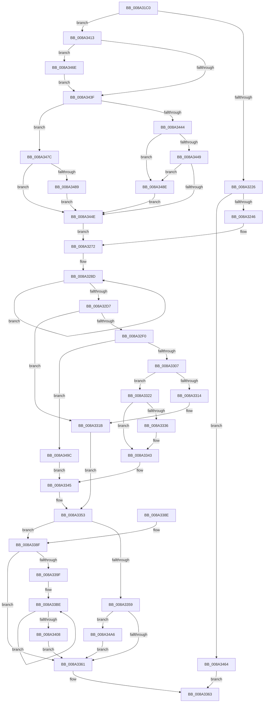

# DbgkpQueueMessage

- RVA: `0x008A31C0`–`0x008A34CE` (길이 `782` bytes)
- VA: `0x00000001408A31C0`
- 실행 섹션: `PAGE`
- PDB 이름 있음: `예`; PDB Function 태그: `아니요`
- unwind 정보 RVA: `0x0007EE44`
- 디코드: `209`개 명령, `782/782` bytes 표시
- 미해석 바이트: `0` (있으면 어셈블리에 `.byte`로 보존)

> 이 문서는 커널 이미지의 기계어와 PDB 기호를 분석해 생성했습니다. 4번과 5번은 함수 원형과 자료형을 바이너리 사용 방식에서 추정한 C 해석이며 원본 소스 복구 결과는 아닙니다.

## 1. Dependencies

- 직접 호출 지점: **15**; 고유 호출 대상: **11**
- 직접 호출자로 확인된 함수: **5**
- RIP 상대 이미지 참조: **2**

### Outgoing calls
- `0x008A320C` → [memset](../../text/6C/memset_function_006C6C40.md) (function, `0x006C6C40`)
- `0x008A3233` → [ExAllocatePool2](../../poolcode/B8/ExAllocatePool2_function_00B820F0.md) (function, `0x00B820F0`)
- `0x008A3256` → [ObfReferenceObjectWithTag](../../text/21/ObfReferenceObjectWithTag_function_00210710.md) (function, `0x00210710`)
- `0x008A3260` → [ObfReferenceObjectWithTag](../../text/21/ObfReferenceObjectWithTag_function_00210710.md) (function, `0x00210710`)
- `0x008A32F7` → [ExAcquireFastMutex](../../text/20/ExAcquireFastMutex_function_0020E5A0.md) (function, `0x0020E5A0`)
- `0x008A333E` → [KeSetEvent](../../text/33/KeSetEvent_function_0033F310.md) (function, `0x0033F310`)
- `0x008A3348` → [ExReleaseFastMutex](../../text/25/ExReleaseFastMutex_function_002519C0.md) (function, `0x002519C0`)
- `0x008A336E` → [_security_check_cookie](../../text/6A/_security_check_cookie_function_006AC640.md) (function, `0x006AC640`)
- `0x008A3396` → [ExReleaseFastMutex](../../text/25/ExReleaseFastMutex_function_002519C0.md) (function, `0x002519C0`)
- `0x008A33B0` → [KeWaitForSingleObject](../../text/20/KeWaitForSingleObject_function_0020E6B0.md) (function, `0x0020E6B0`)
- `0x008A3426` → [ExAcquireFastMutex](../../text/20/ExAcquireFastMutex_function_0020E5A0.md) (function, `0x0020E5A0`)
- `0x008A345A` → [KeInitializeEvent](../../text/40/KeInitializeEvent_function_0040DD10.md) (function, `0x0040DD10`)
- `0x008A34B0` → [ObfDereferenceObjectWithTag](../../text/2F/ObfDereferenceObjectWithTag_function_002F78E0.md) (function, `0x002F78E0`)
- `0x008A34BA` → [ObfDereferenceObjectWithTag](../../text/2F/ObfDereferenceObjectWithTag_function_002F78E0.md) (function, `0x002F78E0`)
- `0x008A34C4` → [ExFreePoolWithTag](../../poolcode/B8/ExFreePoolWithTag_function_00B82870.md) (function, `0x00B82870`)

### Direct callers
- [DbgkPostModuleMessage](../../text/49/DbgkPostModuleMessage_function_004913C4.md) at `0x004914E4`
- [DbgkForwardException](DbgkForwardException_function_008A2D60.md) at `0x008A2F4E`
- [DbgkpPostFakeThreadMessages](../A1/DbgkpPostFakeThreadMessages_function_00A108CC.md) at `0x00A10A74`
- [DbgkSendSystemDllMessages](../A1/DbgkSendSystemDllMessages_function_00A10C04.md) at `0x00A10E68`
- [DbgkpSendApiMessage](../A7/DbgkpSendApiMessage_function_00A79458.md) at `0x00A794DF`

### Static image references
- `0x008A31D7` → RVA `0x00E0A740` (`.data`; read)
- `0x008A338F` → RVA `0x00F8F220` (`.data`; read)

## 2. Other-region calls and transfers

- 다른 실행 섹션으로 향하는 call: **15**
  - `0x008A320C` → [memset](../../text/6C/memset_function_006C6C40.md) (`PAGE` → `.text`)
  - `0x008A3233` → [ExAllocatePool2](../../poolcode/B8/ExAllocatePool2_function_00B820F0.md) (`PAGE` → `POOLCODE`)
  - `0x008A3256` → [ObfReferenceObjectWithTag](../../text/21/ObfReferenceObjectWithTag_function_00210710.md) (`PAGE` → `.text`)
  - `0x008A3260` → [ObfReferenceObjectWithTag](../../text/21/ObfReferenceObjectWithTag_function_00210710.md) (`PAGE` → `.text`)
  - `0x008A32F7` → [ExAcquireFastMutex](../../text/20/ExAcquireFastMutex_function_0020E5A0.md) (`PAGE` → `.text`)
  - `0x008A333E` → [KeSetEvent](../../text/33/KeSetEvent_function_0033F310.md) (`PAGE` → `.text`)
  - `0x008A3348` → [ExReleaseFastMutex](../../text/25/ExReleaseFastMutex_function_002519C0.md) (`PAGE` → `.text`)
  - `0x008A336E` → [_security_check_cookie](../../text/6A/_security_check_cookie_function_006AC640.md) (`PAGE` → `.text`)
  - `0x008A3396` → [ExReleaseFastMutex](../../text/25/ExReleaseFastMutex_function_002519C0.md) (`PAGE` → `.text`)
  - `0x008A33B0` → [KeWaitForSingleObject](../../text/20/KeWaitForSingleObject_function_0020E6B0.md) (`PAGE` → `.text`)
  - `0x008A3426` → [ExAcquireFastMutex](../../text/20/ExAcquireFastMutex_function_0020E5A0.md) (`PAGE` → `.text`)
  - `0x008A345A` → [KeInitializeEvent](../../text/40/KeInitializeEvent_function_0040DD10.md) (`PAGE` → `.text`)
  - `0x008A34B0` → [ObfDereferenceObjectWithTag](../../text/2F/ObfDereferenceObjectWithTag_function_002F78E0.md) (`PAGE` → `.text`)
  - `0x008A34BA` → [ObfDereferenceObjectWithTag](../../text/2F/ObfDereferenceObjectWithTag_function_002F78E0.md) (`PAGE` → `.text`)
  - `0x008A34C4` → [ExFreePoolWithTag](../../poolcode/B8/ExFreePoolWithTag_function_00B82870.md) (`PAGE` → `POOLCODE`)
- 별도 외부 분기/꼬리 이동을 확인하지 못했습니다.

## 3. Assembly (complete function range)

```asm
008A31C0  48 89 5C 24 20                  mov qword ptr [rsp + 0x20], rbx
008A31C5  55                              push rbp
008A31C6  56                              push rsi
008A31C7  57                              push rdi
008A31C8  41 54                           push r12
008A31CA  41 55                           push r13
008A31CC  41 56                           push r14
008A31CE  41 57                           push r15
008A31D0  48 81 EC C0 01 00 00            sub rsp, 0x1c0
008A31D7  48 8B 05 62 75 56 00            mov rax, qword ptr [rip + 0x567562]
008A31DE  48 33 C4                        xor rax, rsp
008A31E1  48 89 84 24 B0 01 00 00         mov qword ptr [rsp + 0x1b0], rax
008A31E9  48 8B BC 24 20 02 00 00         mov rdi, qword ptr [rsp + 0x220]
008A31F1  49 8B F0                        mov rsi, r8
008A31F4  4C 8B FA                        mov r15, rdx
008A31F7  4C 8B E9                        mov r13, rcx
008A31FA  BD 68 01 00 00                  mov ebp, 0x168
008A31FF  48 8D 4C 24 40                  lea rcx, [rsp + 0x40]
008A3204  44 8B C5                        mov r8d, ebp
008A3207  33 D2                           xor edx, edx
008A3209  41 8B D9                        mov ebx, r9d
008A320C  E8 2F 3A E2 FF                  call 0x1406c6c40
008A3211  8B C3                           mov eax, ebx
008A3213  41 BC 02 00 00 00               mov r12d, 2
008A3219  41 23 C4                        and eax, r12d
008A321C  89 44 24 30                     mov dword ptr [rsp + 0x30], eax
008A3220  0F 84 ED 01 00 00               je 0x1408a3413
008A3226  41 B8 44 62 67 45               mov r8d, 0x45676244
008A322C  41 8D 4C 24 3F                  lea ecx, [r12 + 0x3f]
008A3231  8B D5                           mov edx, ebp
008A3233  E8 B8 EE 2D 00                  call 0x140b820f0
008A3238  33 ED                           xor ebp, ebp
008A323A  4C 8B F0                        mov r14, rax
008A323D  48 85 C0                        test rax, rax
008A3240  0F 84 1E 02 00 00               je 0x1408a3464
008A3246  83 CB 04                        or ebx, 4
008A3249  49 8B CD                        mov rcx, r13
008A324C  89 58 4C                        mov dword ptr [rax + 0x4c], ebx
008A324F  BB 44 62 67 4F                  mov ebx, 0x4f676244
008A3254  8B D3                           mov edx, ebx
008A3256  E8 B5 D4 96 FF                  call 0x140210710
008A325B  8B D3                           mov edx, ebx
008A325D  49 8B CF                        mov rcx, r15
008A3260  E8 AB D4 96 FF                  call 0x140210710
008A3265  65 48 8B 04 25 88 01 00 00      mov rax, qword ptr gs:[0x188]
008A326E  49 89 46 50                     mov qword ptr [r14 + 0x50], rax
008A3272  49 8D 5E 58                     lea rbx, [r14 + 0x58]
008A3276  4D 89 6E 38                     mov qword ptr [r14 + 0x38], r13
008A327A  48 8B C3                        mov rax, rbx
008A327D  4D 89 7E 40                     mov qword ptr [r14 + 0x40], r15
008A3281  48 8B CE                        mov rcx, rsi
008A3284  49 8B D4                        mov rdx, r12
008A3287  41 B8 80 00 00 00               mov r8d, 0x80
008A328D  0F 10 01                        movups xmm0, xmmword ptr [rcx]
008A3290  0F 11 00                        movups xmmword ptr [rax], xmm0
008A3293  0F 10 49 10                     movups xmm1, xmmword ptr [rcx + 0x10]
008A3297  0F 11 48 10                     movups xmmword ptr [rax + 0x10], xmm1
008A329B  0F 10 41 20                     movups xmm0, xmmword ptr [rcx + 0x20]
008A329F  0F 11 40 20                     movups xmmword ptr [rax + 0x20], xmm0
008A32A3  0F 10 49 30                     movups xmm1, xmmword ptr [rcx + 0x30]
008A32A7  0F 11 48 30                     movups xmmword ptr [rax + 0x30], xmm1
008A32AB  0F 10 41 40                     movups xmm0, xmmword ptr [rcx + 0x40]
008A32AF  0F 11 40 40                     movups xmmword ptr [rax + 0x40], xmm0
008A32B3  0F 10 49 50                     movups xmm1, xmmword ptr [rcx + 0x50]
008A32B7  0F 11 48 50                     movups xmmword ptr [rax + 0x50], xmm1
008A32BB  0F 10 41 60                     movups xmm0, xmmword ptr [rcx + 0x60]
008A32BF  0F 11 40 60                     movups xmmword ptr [rax + 0x60], xmm0
008A32C3  49 03 C0                        add rax, r8
008A32C6  0F 10 49 70                     movups xmm1, xmmword ptr [rcx + 0x70]
008A32CA  49 03 C8                        add rcx, r8
008A32CD  0F 11 48 F0                     movups xmmword ptr [rax - 0x10], xmm1
008A32D1  48 83 EA 01                     sub rdx, 1
008A32D5  75 B6                           jne 0x1408a328d
008A32D7  0F 10 01                        movups xmm0, xmmword ptr [rcx]
008A32DA  0F 11 00                        movups xmmword ptr [rax], xmm0
008A32DD  41 0F 10 8F 08 05 00 00         movups xmm1, xmmword ptr [r15 + 0x508]
008A32E5  F3 41 0F 7F 4E 28               movdqu xmmword ptr [r14 + 0x28], xmm1
008A32EB  48 85 FF                        test rdi, rdi
008A32EE  74 2B                           je 0x1408a331b
008A32F0  4C 8D 67 18                     lea r12, [rdi + 0x18]
008A32F4  49 8B CC                        mov rcx, r12
008A32F7  E8 A4 B2 96 FF                  call 0x14020e5a0
008A32FC  8B 47 60                        mov eax, dword ptr [rdi + 0x60]
008A32FF  A8 01                           test al, 1
008A3301  0F 85 95 01 00 00               jne 0x1408a349c
008A3307  48 8D 47 50                     lea rax, [rdi + 0x50]
008A330B  48 8B 48 08                     mov rcx, qword ptr [rax + 8]
008A330F  48 39 01                        cmp qword ptr [rcx], rax
008A3312  74 0E                           je 0x1408a3322
008A3314  B9 03 00 00 00                  mov ecx, 3
008A3319  CD 29                           int 0x29
008A331B  BF 53 03 00 C0                  mov edi, 0xc0000353
008A3320  EB 31                           jmp 0x1408a3353
008A3322  49 89 06                        mov qword ptr [r14], rax
008A3325  49 89 4E 08                     mov qword ptr [r14 + 8], rcx
008A3329  4C 89 31                        mov qword ptr [rcx], r14
008A332C  4C 89 70 08                     mov qword ptr [rax + 8], r14
008A3330  39 6C 24 30                     cmp dword ptr [rsp + 0x30], ebp
008A3334  75 0D                           jne 0x1408a3343
008A3336  45 33 C0                        xor r8d, r8d
008A3339  33 D2                           xor edx, edx
008A333B  48 8B CF                        mov rcx, rdi
008A333E  E8 CD BF A9 FF                  call 0x14033f310
008A3343  8B FD                           mov edi, ebp
008A3345  49 8B CC                        mov rcx, r12
008A3348  E8 73 E6 9A FF                  call 0x1402519c0
008A334D  41 BC 02 00 00 00               mov r12d, 2
008A3353  39 6C 24 30                     cmp dword ptr [rsp + 0x30], ebp
008A3357  74 36                           je 0x1408a338f
008A3359  85 FF                           test edi, edi
008A335B  0F 88 45 01 00 00               js 0x1408a34a6
008A3361  8B C7                           mov eax, edi
008A3363  48 8B 8C 24 B0 01 00 00         mov rcx, qword ptr [rsp + 0x1b0]
008A336B  48 33 CC                        xor rcx, rsp
008A336E  E8 CD 92 E0 FF                  call 0x1406ac640
008A3373  48 8B 9C 24 18 02 00 00         mov rbx, qword ptr [rsp + 0x218]
008A337B  48 81 C4 C0 01 00 00            add rsp, 0x1c0
008A3382  41 5F                           pop r15
008A3384  41 5E                           pop r14
008A3386  41 5D                           pop r13
008A3388  41 5C                           pop r12
008A338A  5F                              pop rdi
008A338B  5E                              pop rsi
008A338C  5D                              pop rbp
008A338D  C3                              ret
008A338E  CC                              int3
008A338F  48 8D 0D 8A BE 6E 00            lea rcx, [rip + 0x6ebe8a]
008A3396  E8 25 E6 9A FF                  call 0x1402519c0
008A339B  85 FF                           test edi, edi
008A339D  78 C2                           js 0x1408a3361
008A339F  49 8D 4E 10                     lea rcx, [r14 + 0x10]
008A33A3  48 89 6C 24 20                  mov qword ptr [rsp + 0x20], rbp
008A33A8  45 33 C9                        xor r9d, r9d
008A33AB  45 33 C0                        xor r8d, r8d
008A33AE  33 D2                           xor edx, edx
008A33B0  E8 FB B2 96 FF                  call 0x14020e6b0
008A33B5  41 8B 7E 48                     mov edi, dword ptr [r14 + 0x48]
008A33B9  B8 80 00 00 00                  mov eax, 0x80
008A33BE  0F 10 03                        movups xmm0, xmmword ptr [rbx]
008A33C1  0F 11 06                        movups xmmword ptr [rsi], xmm0
008A33C4  0F 10 4B 10                     movups xmm1, xmmword ptr [rbx + 0x10]
008A33C8  0F 11 4E 10                     movups xmmword ptr [rsi + 0x10], xmm1
008A33CC  0F 10 43 20                     movups xmm0, xmmword ptr [rbx + 0x20]
008A33D0  0F 11 46 20                     movups xmmword ptr [rsi + 0x20], xmm0
008A33D4  0F 10 4B 30                     movups xmm1, xmmword ptr [rbx + 0x30]
008A33D8  0F 11 4E 30                     movups xmmword ptr [rsi + 0x30], xmm1
008A33DC  0F 10 43 40                     movups xmm0, xmmword ptr [rbx + 0x40]
008A33E0  0F 11 46 40                     movups xmmword ptr [rsi + 0x40], xmm0
008A33E4  0F 10 4B 50                     movups xmm1, xmmword ptr [rbx + 0x50]
008A33E8  0F 11 4E 50                     movups xmmword ptr [rsi + 0x50], xmm1
008A33EC  0F 10 43 60                     movups xmm0, xmmword ptr [rbx + 0x60]
008A33F0  0F 11 46 60                     movups xmmword ptr [rsi + 0x60], xmm0
008A33F4  48 03 F0                        add rsi, rax
008A33F7  0F 10 4B 70                     movups xmm1, xmmword ptr [rbx + 0x70]
008A33FB  48 03 D8                        add rbx, rax
008A33FE  0F 11 4E F0                     movups xmmword ptr [rsi - 0x10], xmm1
008A3402  49 83 EC 01                     sub r12, 1
008A3406  75 B6                           jne 0x1408a33be
008A3408  0F 10 03                        movups xmm0, xmmword ptr [rbx]
008A340B  0F 11 06                        movups xmmword ptr [rsi], xmm0
008A340E  E9 4E FF FF FF                  jmp 0x1408a3361
008A3413  48 8D 0D 06 BE 6E 00            lea rcx, [rip + 0x6ebe06]
008A341A  89 9C 24 8C 00 00 00            mov dword ptr [rsp + 0x8c], ebx
008A3421  4C 8D 74 24 40                  lea r14, [rsp + 0x40]
008A3426  E8 75 B1 96 FF                  call 0x14020e5a0
008A342B  8B 4E 28                        mov ecx, dword ptr [rsi + 0x28]
008A342E  33 ED                           xor ebp, ebp
008A3430  49 8B BD 08 03 00 00            mov rdi, qword ptr [r13 + 0x308]
008A3437  8D 41 FF                        lea eax, [rcx - 1]
008A343A  83 F8 01                        cmp eax, 1
008A343D  76 2F                           jbe 0x1408a346e
008A343F  83 F9 05                        cmp ecx, 5
008A3442  74 38                           je 0x1408a347c
008A3444  83 F9 03                        cmp ecx, 3
008A3447  74 45                           je 0x1408a348e
008A3449  83 F9 04                        cmp ecx, 4
008A344C  74 40                           je 0x1408a348e
008A344E  45 33 C0                        xor r8d, r8d
008A3451  48 8D 4C 24 50                  lea rcx, [rsp + 0x50]
008A3456  41 8D 50 01                     lea edx, [r8 + 1]
008A345A  E8 B1 A8 B6 FF                  call 0x14040dd10
008A345F  E9 0E FE FF FF                  jmp 0x1408a3272
008A3464  B8 9A 00 00 C0                  mov eax, 0xc000009a
008A3469  E9 F5 FE FF FF                  jmp 0x1408a3363
008A346E  41 F6 87 A0 05 00 00 40         test byte ptr [r15 + 0x5a0], 0x40
008A3476  48 0F 45 FD                     cmovne rdi, rbp
008A347A  EB C3                           jmp 0x1408a343f
008A347C  41 8B 87 A0 05 00 00            mov eax, dword ptr [r15 + 0x5a0]
008A3483  23 C3                           and eax, ebx
008A3485  A8 40                           test al, 0x40
008A3487  74 C5                           je 0x1408a344e
008A3489  48 8B FD                        mov rdi, rbp
008A348C  EB C0                           jmp 0x1408a344e
008A348E  41 F6 87 A0 05 00 00 80         test byte ptr [r15 + 0x5a0], 0x80
008A3496  48 0F 45 FD                     cmovne rdi, rbp
008A349A  EB B2                           jmp 0x1408a344e
008A349C  BF 54 03 00 C0                  mov edi, 0xc0000354
008A34A1  E9 9F FE FF FF                  jmp 0x1408a3345
008A34A6  BB 44 62 67 4F                  mov ebx, 0x4f676244
008A34AB  49 8B CD                        mov rcx, r13
008A34AE  8B D3                           mov edx, ebx
008A34B0  E8 2B 44 A5 FF                  call 0x1402f78e0
008A34B5  8B D3                           mov edx, ebx
008A34B7  49 8B CF                        mov rcx, r15
008A34BA  E8 21 44 A5 FF                  call 0x1402f78e0
008A34BF  33 D2                           xor edx, edx
008A34C1  49 8B CE                        mov rcx, r14
008A34C4  E8 A7 F3 2D 00                  call 0x140b82870
008A34C9  E9 93 FE FF FF                  jmp 0x1408a3361
```

## 4. C-style interpretation (structured pseudocode)

```c
__int64 __fastcall DbgkpQueueMessage(__int64 a1, __int64 a2, __int64 a3, int a4, __int64 a5)
{
    __int64 result;
    __int64 v_r12;
    __int64 v_rbp;
    __int64 v_rbx;
    __int64 v_rdi;
    __int64 v_rsi;
    __int64 v_rsp;
    unsigned __int64 v_stack_m1B8;
    unsigned int v_stack_m1C8;
    unsigned __int64 v_stack_m48;
    unsigned __int64 v_stack_p20;
    unsigned __int64 v_stack_p40;
    unsigned __int64 v_stack_p50;
    unsigned int v_stack_p8C;

    v_stack_p20 = v_rbx;
    v_rsp = (v_rsp) - (448);
    result = (*(unsigned __int64 *)(v_rip + 5666146)) ^ (v_rsp);
    v_stack_m48 = result;
    a2 = 0;
    result = memset(v_stack_m1B8, a2, 360, a4);
    result = (unsigned int)(((unsigned int)((unsigned int)((unsigned int)(a4)))) & (2));
    v_stack_m1C8 = (unsigned int)(result);
    if (condition_is_equal) goto loc_008A3413;
    result = ExAllocatePool2(2 + 63, 360, (unsigned int)(0x45676244ULL), a4);
    v_rbp = 0;
    if (result == 0) goto loc_008A3464;
    v_rbx = (unsigned int)(((unsigned int)(a4)) | (4));
    *(unsigned int *)(result + 76) = (unsigned int)(v_rbx);
    result = ObfReferenceObjectWithTag(a1, (unsigned int)((unsigned int)((unsigned int)(0x4F676244ULL))), (unsigned int)(0x45676244ULL), a4);
    result = ObfReferenceObjectWithTag(0, (unsigned int)((unsigned int)((unsigned int)(0x4F676244ULL))), (unsigned int)(0x45676244ULL), a4);
    *(unsigned __int64 *)(result + 80) = *(unsigned __int64 *)(gs_base + (0 + 392));
loc_008A3272:
    *(unsigned __int64 *)(result + 56) = a1;
    *(unsigned __int64 *)(result + 64) = 0;
loc_008A328D:
    *(unsigned __int64 *)(result + 88) = v_xmm0;
    *(unsigned __int64 *)(result + 88 + 16) = v_xmm1;
    *(unsigned __int64 *)(result + 88 + 32) = v_xmm0;
    *(unsigned __int64 *)(result + 88 + 48) = v_xmm1;
    *(unsigned __int64 *)(result + 88 + 64) = v_xmm0;
    *(unsigned __int64 *)(result + 88 + 80) = v_xmm1;
    *(unsigned __int64 *)(result + 88 + 96) = v_xmm0;
    result = (result + 88) + (128);
    a1 = (a3) + (128);
    *(unsigned __int64 *)(result - 16) = v_xmm1;
    a2 = (2) - (1);
    if (condition_is_not_equal) goto loc_008A328D;
    *(unsigned __int64 *)(result) = v_xmm0;
    *(unsigned __int64 *)(result + 40) = v_xmm1;
    if (a5 == 0) goto loc_008A331B;
    result = ExAcquireFastMutex(a5 + 24, a2, 128, a4);
    if ((((unsigned __int8)((unsigned int)(*(unsigned int *)(a5 + 96)))) & (1)) != 0) goto loc_008A349C;
    if ((*(unsigned __int64 *)(*(unsigned __int64 *)(a5 + 80 + 8))) == (a5 + 80)) goto loc_008A3322;
loc_008A331B:
    goto loc_008A3353;
loc_008A3322:
    *(unsigned __int64 *)(result) = a5 + 80;
    *(unsigned __int64 *)(result + 8) = 3;
    *(unsigned __int64 *)(3) = result;
    *(unsigned __int64 *)(a5 + 80 + 8) = result;
    result = a5 + 80;
    if (v_stack_m1C8 == 0) {
        a3 = 0;
        a2 = 0;
        a1 = (unsigned int)(0xC0000353ULL);
        result = KeSetEvent(a1, a2, a3, a4);
    }
loc_008A3345:
    result = ExReleaseFastMutex(a5 + 24, a2, a3, a4);
loc_008A3353:
    if (v_stack_m1C8 == 0) goto loc_008A338F;
    if (sign_flag) goto loc_008A34A6;
loc_008A3361:
loc_008A3363:
    a1 = (v_stack_m48) ^ (v_rsp);
    result = _security_check_cookie(a1, a2, a3, a4);
    v_rsp = (v_rsp) + (448);
    return result;
loc_008A338F:
    result = ExReleaseFastMutex(v_rip + 7257738, a2, a3, a4);
    if (sign_flag) goto loc_008A3361;
    v_stack_p20 = 0;
    a4 = 0;
    a3 = 0;
    a2 = 0;
    result = KeWaitForSingleObject(result + 16, a2, a3, a4);
loc_008A33BE:
    *(unsigned __int64 *)(a3) = v_xmm0;
    *(unsigned __int64 *)(a3 + 16) = v_xmm1;
    *(unsigned __int64 *)(a3 + 32) = v_xmm0;
    *(unsigned __int64 *)(a3 + 48) = v_xmm1;
    *(unsigned __int64 *)(a3 + 64) = v_xmm0;
    *(unsigned __int64 *)(a3 + 80) = v_xmm1;
    *(unsigned __int64 *)(a3 + 96) = v_xmm0;
    v_rsi = (a3) + (128);
    v_rbx = (v_stack_p20) + (128);
    *(unsigned __int64 *)(v_rsi - 16) = v_xmm1;
    v_r12 = (2) - (1);
    if (condition_is_not_equal) goto loc_008A33BE;
    *(unsigned __int64 *)(v_rsi) = v_xmm0;
    goto loc_008A3361;
loc_008A3413:
    v_stack_p8C = (unsigned int)(v_rbx);
    result = ExAcquireFastMutex(v_rip + 7257606, a2, a3, a4);
    v_rbp = 0;
    if (((unsigned int)((unsigned int)(*(unsigned int *)(v_rsi + 40)) - 1)) <= 1) goto loc_008A346E;
loc_008A343F:
    if (((unsigned int)((unsigned int)(*(unsigned int *)(v_rsi + 40)))) == 5) goto loc_008A347C;
    if (((unsigned int)((unsigned int)(*(unsigned int *)(v_rsi + 40)))) == 3) goto loc_008A348E;
    if (((unsigned int)((unsigned int)(*(unsigned int *)(v_rsi + 40)))) == 4) goto loc_008A348E;
loc_008A344E:
    a3 = 0;
    result = KeInitializeEvent(v_stack_p50, a3 + 1, a3, a4);
    goto loc_008A3272;
loc_008A3464:
    goto loc_008A3363;
loc_008A346E:
    v_rdi = *(unsigned __int64 *)(a1 + 776);
    if (((*(unsigned __int8 *)(a2 + 1440)) & (64)) != 0) { v_rdi = 0; }
    goto loc_008A343F;
loc_008A347C:
    result = (unsigned int)(((unsigned int)(*(unsigned int *)(a2 + 1440))) & ((unsigned int)(v_rbx)));
    if ((((unsigned __int8)(result)) & (64)) == 0) goto loc_008A344E;
    goto loc_008A344E;
loc_008A348E:
    v_rdi = 0;
    if (((*(unsigned __int8 *)(a2 + 1440)) & (128)) != 0) { v_rdi = 0; }
    goto loc_008A344E;
loc_008A349C:
    goto loc_008A3345;
loc_008A34A6:
    result = ObfDereferenceObjectWithTag(a1, (unsigned int)((unsigned int)((unsigned int)(0x4F676244ULL))), a3, a4);
    result = ObfDereferenceObjectWithTag(0, (unsigned int)((unsigned int)((unsigned int)(0x4F676244ULL))), a3, a4);
    a2 = 0;
    result = ExFreePoolWithTag(v_stack_p40, a2, a3, a4);
    goto loc_008A3361;
}
```

## 5. (Beta) C Style

```c
int64_t DbgkpQueueMessage(void *Arg1, void *Arg2, void *Arg3, int32_t Arg4, int64_t Arg5)
{
    uint8_t *arg1 = (uint8_t *)Arg1;
    uint8_t *arg2 = (uint8_t *)Arg2;
    uint8_t *arg3 = (uint8_t *)Arg3;

    int64_t result;
    int64_t local_r12;
    int64_t local_rbp;
    int64_t local_rbx;
    int64_t local_rdi;
    int64_t local_rsi;
    int64_t local_rsp;
    uint64_t v_stack_m1B8;
    uint32_t v_stack_m1C8;
    uint64_t v_stack_m48;
    uint64_t v_stack_p20;
    uint64_t v_stack_p40;
    uint64_t v_stack_p50;
    uint32_t v_stack_p8C;

    v_stack_p20 = local_rbx;
    local_rsp = (local_rsp) - (448);
    result = (*(uint64_t *)(v_rip + 0x567562)) ^ (local_rsp);
    v_stack_m48 = result;
    Arg2 = 0;
    result = memset(v_stack_m1B8, Arg2, 360, Arg4);
    result = (uint32_t)(((uint32_t)((uint32_t)((uint32_t)(Arg4)))) & (2));
    v_stack_m1C8 = (uint32_t)(result);
    if (condition_is_equal) goto loc_008A3413;
    result = ExAllocatePool2(2 + 63, 360, (uint32_t)(0x45676244ULL), Arg4);
    local_rbp = 0;
    if (result == 0) goto loc_008A3464;
    local_rbx = (uint32_t)(((uint32_t)(Arg4)) | (4));
    *(uint32_t *)(result + 0x4C) = (uint32_t)(local_rbx);
    result = ObfReferenceObjectWithTag(Arg1, (uint32_t)((uint32_t)((uint32_t)(0x4F676244ULL))), (uint32_t)(0x45676244ULL), Arg4);
    result = ObfReferenceObjectWithTag(0, (uint32_t)((uint32_t)((uint32_t)(0x4F676244ULL))), (uint32_t)(0x45676244ULL), Arg4);
    *(uint64_t *)(result + 0x50) = *(uint64_t *)(gs_base + (0 + 0x188));
loc_008A3272:
    *(void **)(result + 0x38) = Arg1;
    *(uint64_t *)(result + 0x40) = 0;
loc_008A328D:
    *(uint64_t *)(result + 0x58) = v_xmm0;
    *(uint64_t *)(result + 0x58 + 0x10) = v_xmm1;
    *(uint64_t *)(result + 0x58 + 0x20) = v_xmm0;
    *(uint64_t *)(result + 0x58 + 0x30) = v_xmm1;
    *(uint64_t *)(result + 0x58 + 0x40) = v_xmm0;
    *(uint64_t *)(result + 0x58 + 0x50) = v_xmm1;
    *(uint64_t *)(result + 0x58 + 0x60) = v_xmm0;
    result = (result + 88) + (128);
    Arg1 = (Arg3) + (128);
    *(uint64_t *)(result - 0x10) = v_xmm1;
    Arg2 = (2) - (1);
    if (condition_is_not_equal) goto loc_008A328D;
    *(uint64_t *)(result) = v_xmm0;
    *(uint64_t *)(result + 0x28) = v_xmm1;
    if (Arg5 == 0) goto loc_008A331B;
    result = ExAcquireFastMutex(Arg5 + 24, Arg2, 128, Arg4);
    if ((((uint8_t)((uint32_t)(*(uint32_t *)(Arg5 + 0x60)))) & (1)) != 0) goto loc_008A349C;
    if ((*(uint64_t *)(*(uint64_t *)(Arg5 + 0x50 + 0x8))) == (Arg5 + 80)) goto loc_008A3322;
loc_008A331B:
    goto loc_008A3353;
loc_008A3322:
    *(uint64_t *)(result) = Arg5 + 80;
    *(uint64_t *)(result + 0x8) = 3;
    *(uint64_t *)(3) = result;
    *(uint64_t *)(Arg5 + 0x50 + 0x8) = result;
    result = Arg5 + 80;
    if (v_stack_m1C8 == 0) {
        Arg3 = 0;
        Arg2 = 0;
        Arg1 = (uint32_t)(0xC0000353ULL);
        result = KeSetEvent(Arg1, Arg2, Arg3, Arg4);
    }
loc_008A3345:
    result = ExReleaseFastMutex(Arg5 + 24, Arg2, Arg3, Arg4);
loc_008A3353:
    if (v_stack_m1C8 == 0) goto loc_008A338F;
    if (sign_flag) goto loc_008A34A6;
loc_008A3361:
loc_008A3363:
    Arg1 = (v_stack_m48) ^ (local_rsp);
    result = _security_check_cookie(Arg1, Arg2, Arg3, Arg4);
    local_rsp = (local_rsp) + (448);
    return result;
loc_008A338F:
    result = ExReleaseFastMutex(v_rip + 7257738, Arg2, Arg3, Arg4);
    if (sign_flag) goto loc_008A3361;
    v_stack_p20 = 0;
    Arg4 = 0;
    Arg3 = 0;
    Arg2 = 0;
    result = KeWaitForSingleObject(result + 16, Arg2, Arg3, Arg4);
loc_008A33BE:
    *(uint64_t *)(arg3) = v_xmm0;
    *(uint64_t *)(arg3 + 0x10) = v_xmm1;
    *(uint64_t *)(arg3 + 0x20) = v_xmm0;
    *(uint64_t *)(arg3 + 0x30) = v_xmm1;
    *(uint64_t *)(arg3 + 0x40) = v_xmm0;
    *(uint64_t *)(arg3 + 0x50) = v_xmm1;
    *(uint64_t *)(arg3 + 0x60) = v_xmm0;
    local_rsi = (Arg3) + (128);
    local_rbx = (v_stack_p20) + (128);
    *(uint64_t *)(local_rsi - 0x10) = v_xmm1;
    local_r12 = (2) - (1);
    if (condition_is_not_equal) goto loc_008A33BE;
    *(uint64_t *)(local_rsi) = v_xmm0;
    goto loc_008A3361;
loc_008A3413:
    v_stack_p8C = (uint32_t)(local_rbx);
    result = ExAcquireFastMutex(v_rip + 7257606, Arg2, Arg3, Arg4);
    local_rbp = 0;
    if (((uint32_t)((uint32_t)(*(uint32_t *)(local_rsi + 0x28)) - 1)) <= 1) goto loc_008A346E;
loc_008A343F:
    if (((uint32_t)((uint32_t)(*(uint32_t *)(local_rsi + 0x28)))) == 5) goto loc_008A347C;
    if (((uint32_t)((uint32_t)(*(uint32_t *)(local_rsi + 0x28)))) == 3) goto loc_008A348E;
    if (((uint32_t)((uint32_t)(*(uint32_t *)(local_rsi + 0x28)))) == 4) goto loc_008A348E;
loc_008A344E:
    Arg3 = 0;
    result = KeInitializeEvent(v_stack_p50, Arg3 + 1, Arg3, Arg4);
    goto loc_008A3272;
loc_008A3464:
    goto loc_008A3363;
loc_008A346E:
    local_rdi = *(uint64_t *)(arg1 + 0x308);
    if (((*(uint8_t *)(arg2 + 0x5A0)) & (64)) != 0) { local_rdi = 0; }
    goto loc_008A343F;
loc_008A347C:
    result = (uint32_t)(((uint32_t)(*(uint32_t *)(arg2 + 0x5A0))) & ((uint32_t)(local_rbx)));
    if ((((uint8_t)(result)) & (64)) == 0) goto loc_008A344E;
    goto loc_008A344E;
loc_008A348E:
    local_rdi = 0;
    if (((*(uint8_t *)(arg2 + 0x5A0)) & (128)) != 0) { local_rdi = 0; }
    goto loc_008A344E;
loc_008A349C:
    goto loc_008A3345;
loc_008A34A6:
    result = ObfDereferenceObjectWithTag(Arg1, (uint32_t)((uint32_t)((uint32_t)(0x4F676244ULL))), Arg3, Arg4);
    result = ObfDereferenceObjectWithTag(0, (uint32_t)((uint32_t)((uint32_t)(0x4F676244ULL))), Arg3, Arg4);
    Arg2 = 0;
    result = ExFreePoolWithTag(v_stack_p40, Arg2, Arg3, Arg4);
    goto loc_008A3361;
}
```

### 관측된 메모리 오프셋

구조체 형식이 확인되지 않은 접근은 인자 기준의 오프셋으로만 기록했습니다.

| 기준 인자 | 오프셋 표현 | 폭 (bit) | 접근 |
|---|---:|---:|---|
| `Arg1` | `+ 0x308` | `64` | `R` |
| `Arg2` | `+ 0x508` | `128` | `R` |
| `Arg2` | `+ 0x5A0` | `8` | `R` |
| `Arg2` | `+ 0x5A0` | `32` | `R` |
| `Arg3` | `- 0x10` | `128` | `R` |
| `Arg3` | `+ 0x0` | `128` | `R` |
| `Arg3` | `+ 0x10` | `128` | `R` |
| `Arg3` | `+ 0x20` | `128` | `R` |
| `Arg3` | `+ 0x28` | `32` | `R` |
| `Arg3` | `+ 0x30` | `128` | `R` |
| `Arg3` | `+ 0x40` | `128` | `R` |
| `Arg3` | `+ 0x50` | `128` | `R` |
| `Arg3` | `+ 0x60` | `128` | `R` |
| `Arg3` | `+ 0x70` | `128` | `R` |

## 6. Execution-region graph

[열기: 2D/3D 그래프와 함수 탐색 컨트롤 패널](../../../control-panel.html?section=page&rva=0x008A31C0&view=graph)

- 2D 그래프는 위에서 아래로 흐르고, 3D 그래프는 빈 공간을 드래그해 회전합니다. Shift+드래그는 이동, 휠은 확대·축소, 함수 노드 선택은 대상 보고서 이동입니다.

### Static fallback


