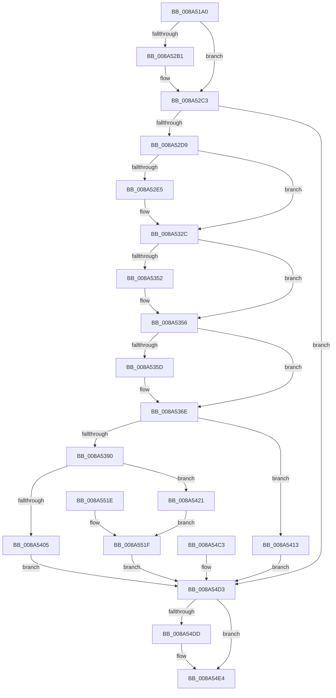

# EtwQueryProcessTelemetryInfo

- RVA: `0x008A51A0`–`0x008A5523` (길이 `899` bytes)
- VA: `0x00000001408A51A0`
- 실행 섹션: `PAGE`
- PDB 이름 있음: `예`; PDB Function 태그: `아니요`
- unwind 정보 RVA: `0x0007EFC8`
- 디코드: `219`개 명령, `899/899` bytes 표시
- 미해석 바이트: `0` (있으면 어셈블리에 `.byte`로 보존)

> 이 문서는 커널 이미지의 기계어와 PDB 기호를 분석해 생성했습니다. 4번과 5번은 함수 원형과 자료형을 바이너리 사용 방식에서 추정한 C 해석이며 원본 소스 복구 결과는 아닙니다.

## 1. Dependencies

- 직접 호출 지점: **27**; 고유 호출 대상: **20**
- 직접 호출자로 확인된 함수: **2**
- RIP 상대 이미지 참조: **2**

### Outgoing calls
- `0x008A5208` → [memset](../../text/6C/memset_function_006C6C40.md) (function, `0x006C6C40`)
- `0x008A521B` → [memset](../../text/6C/memset_function_006C6C40.md) (function, `0x006C6C40`)
- `0x008A5250` → [PsReferencePrimaryTokenWithTag](../../text/20/PsReferencePrimaryTokenWithTag_function_0020FF80.md) (function, `0x0020FF80`)
- `0x008A526F` → [EtwpQueryTokenPackageInfo](EtwpQueryTokenPackageInfo_function_008A5878.md) (function, `0x008A5878`)
- `0x008A5290` → [ExAcquireResourceSharedLite](../../text/21/ExAcquireResourceSharedLite_function_00211BC0.md) (function, `0x00211BC0`)
- `0x008A52BC` → [memcpy](../../text/6C/memcpy_function_006C6840.md) (function, `0x006C6840`)
- `0x008A52C7` → [ExReleaseResourceLite](../../text/25/ExReleaseResourceLite_function_0025FA10.md) (function, `0x0025FA10`)
- `0x008A52CC` → [KeLeaveCriticalRegion](../../text/25/KeLeaveCriticalRegion_function_0025D8B0.md) (function, `0x0025D8B0`)
- `0x008A52DC` → [PsAcquireProcessExitSynchronization](PsAcquireProcessExitSynchronization_function_008A5BF0.md) (function, `0x008A5BF0`)
- `0x008A52F2` → [KiStackAttachProcess](../../text/21/KiStackAttachProcess_function_00216820.md) (function, `0x00216820`)
- `0x008A52FF` → [EtwpQueryProcessOtherInfo](EtwpQueryProcessOtherInfo_function_008A5BB0.md) (function, `0x008A5BB0`)
- `0x008A530C` → [EtwpQueryProcessCommandLine](EtwpQueryProcessCommandLine_function_008A5C20.md) (function, `0x008A5C20`)
- `0x008A531B` → [KiUnstackDetachProcess](../../text/21/KiUnstackDetachProcess_function_00217D30.md) (function, `0x00217D30`)
- `0x008A5327` → [ExReleaseRundownProtection](../../text/34/ExReleaseRundownProtection_function_00349E80.md) (function, `0x00349E80`)
- `0x008A5369` → [ProbeForWrite](../8E/ProbeForWrite_function_008E91C0.md) (function, `0x008E91C0`)
- `0x008A537C` → [memset](../../text/6C/memset_function_006C6C40.md) (function, `0x006C6C40`)
- `0x008A53A0` → [EtwpGetProcessStartKey](../../text/45/EtwpGetProcessStartKey_function_00459180.md) (function, `0x00459180`)
- `0x008A53D5` → [PsGetSessionCreateTime](PsGetSessionCreateTime_function_008A4FF8.md) (function, `0x008A4FF8`)
- `0x008A53DE` → [PsGetProcessSessionId](../../text/22/PsGetProcessSessionId_function_002233A0.md) (function, `0x002233A0`)
- `0x008A543A` → [memcpy](../../text/6C/memcpy_function_006C6840.md) (function, `0x006C6840`)
- `0x008A5459` → [memcpy](../../text/6C/memcpy_function_006C6840.md) (function, `0x006C6840`)
- `0x008A547C` → [memcpy](../../text/6C/memcpy_function_006C6840.md) (function, `0x006C6840`)
- `0x008A549D` → [memcpy](../../text/6C/memcpy_function_006C6840.md) (function, `0x006C6840`)
- `0x008A54BC` → [memcpy](../../text/6C/memcpy_function_006C6840.md) (function, `0x006C6840`)
- `0x008A54DF` → [ExFreePoolWithTag](../../poolcode/B8/ExFreePoolWithTag_function_00B82870.md) (function, `0x00B82870`)
- `0x008A54F4` → [ObFastDereferenceObject](../../text/3E/ObFastDereferenceObject_function_003ED5F0.md) (function, `0x003ED5F0`)
- `0x008A5506` → [_security_check_cookie](../../text/6A/_security_check_cookie_function_006AC640.md) (function, `0x006AC640`)

### Direct callers
- [PfSnLogScenarioDecision](../95/PfSnLogScenarioDecision_function_0095F2BC.md) at `0x0095F35D`
- [NtQueryInformationProcess](../9A/NtQueryInformationProcess_function_009AA250.md) at `0x009ABF73`

### Static image references
- `0x008A51B3` → RVA `0x00E0A740` (`.data`; read)
- `0x008A5235` → RVA `0x00002F28` (`.rdata`; read)

## 2. Other-region calls and transfers

- 다른 실행 섹션으로 향하는 call: **21**
  - `0x008A5208` → [memset](../../text/6C/memset_function_006C6C40.md) (`PAGE` → `.text`)
  - `0x008A521B` → [memset](../../text/6C/memset_function_006C6C40.md) (`PAGE` → `.text`)
  - `0x008A5250` → [PsReferencePrimaryTokenWithTag](../../text/20/PsReferencePrimaryTokenWithTag_function_0020FF80.md) (`PAGE` → `.text`)
  - `0x008A5290` → [ExAcquireResourceSharedLite](../../text/21/ExAcquireResourceSharedLite_function_00211BC0.md) (`PAGE` → `.text`)
  - `0x008A52BC` → [memcpy](../../text/6C/memcpy_function_006C6840.md) (`PAGE` → `.text`)
  - `0x008A52C7` → [ExReleaseResourceLite](../../text/25/ExReleaseResourceLite_function_0025FA10.md) (`PAGE` → `.text`)
  - `0x008A52CC` → [KeLeaveCriticalRegion](../../text/25/KeLeaveCriticalRegion_function_0025D8B0.md) (`PAGE` → `.text`)
  - `0x008A52F2` → [KiStackAttachProcess](../../text/21/KiStackAttachProcess_function_00216820.md) (`PAGE` → `.text`)
  - `0x008A531B` → [KiUnstackDetachProcess](../../text/21/KiUnstackDetachProcess_function_00217D30.md) (`PAGE` → `.text`)
  - `0x008A5327` → [ExReleaseRundownProtection](../../text/34/ExReleaseRundownProtection_function_00349E80.md) (`PAGE` → `.text`)
  - `0x008A537C` → [memset](../../text/6C/memset_function_006C6C40.md) (`PAGE` → `.text`)
  - `0x008A53A0` → [EtwpGetProcessStartKey](../../text/45/EtwpGetProcessStartKey_function_00459180.md) (`PAGE` → `.text`)
  - `0x008A53DE` → [PsGetProcessSessionId](../../text/22/PsGetProcessSessionId_function_002233A0.md) (`PAGE` → `.text`)
  - `0x008A543A` → [memcpy](../../text/6C/memcpy_function_006C6840.md) (`PAGE` → `.text`)
  - `0x008A5459` → [memcpy](../../text/6C/memcpy_function_006C6840.md) (`PAGE` → `.text`)
  - `0x008A547C` → [memcpy](../../text/6C/memcpy_function_006C6840.md) (`PAGE` → `.text`)
  - `0x008A549D` → [memcpy](../../text/6C/memcpy_function_006C6840.md) (`PAGE` → `.text`)
  - `0x008A54BC` → [memcpy](../../text/6C/memcpy_function_006C6840.md) (`PAGE` → `.text`)
  - `0x008A54DF` → [ExFreePoolWithTag](../../poolcode/B8/ExFreePoolWithTag_function_00B82870.md) (`PAGE` → `POOLCODE`)
  - `0x008A54F4` → [ObFastDereferenceObject](../../text/3E/ObFastDereferenceObject_function_003ED5F0.md) (`PAGE` → `.text`)
  - `0x008A5506` → [_security_check_cookie](../../text/6A/_security_check_cookie_function_006AC640.md) (`PAGE` → `.text`)
- 별도 외부 분기/꼬리 이동을 확인하지 못했습니다.

## 3. Assembly (complete function range)

```asm
008A51A0  40 53                           push rbx
008A51A2  56                              push rsi
008A51A3  57                              push rdi
008A51A4  41 54                           push r12
008A51A6  41 55                           push r13
008A51A8  41 56                           push r14
008A51AA  41 57                           push r15
008A51AC  48 81 EC 90 03 00 00            sub rsp, 0x390
008A51B3  48 8B 05 86 55 56 00            mov rax, qword ptr [rip + 0x565586]
008A51BA  48 33 C4                        xor rax, rsp
008A51BD  48 89 84 24 80 03 00 00         mov qword ptr [rsp + 0x380], rax
008A51C5  44 88 4C 24 20                  mov byte ptr [rsp + 0x20], r9b
008A51CA  41 8B F8                        mov edi, r8d
008A51CD  48 8B F2                        mov rsi, rdx
008A51D0  4C 8B F1                        mov r14, rcx
008A51D3  48 89 4C 24 58                  mov qword ptr [rsp + 0x58], rcx
008A51D8  4C 8B A4 24 F0 03 00 00         mov r12, qword ptr [rsp + 0x3f0]
008A51E0  0F 57 C0                        xorps xmm0, xmm0
008A51E3  0F 11 84 24 00 03 00 00         movups xmmword ptr [rsp + 0x300], xmm0
008A51EB  0F 11 84 24 10 03 00 00         movups xmmword ptr [rsp + 0x310], xmm0
008A51F3  0F 11 84 24 20 03 00 00         movups xmmword ptr [rsp + 0x320], xmm0
008A51FB  33 D2                           xor edx, edx
008A51FD  41 B8 A0 02 00 00               mov r8d, 0x2a0
008A5203  48 8D 4C 24 60                  lea rcx, [rsp + 0x60]
008A5208  E8 33 1A E2 FF                  call 0x1406c6c40
008A520D  33 D2                           xor edx, edx
008A520F  44 8D 42 44                     lea r8d, [rdx + 0x44]
008A5213  48 8D 8C 24 30 03 00 00         lea rcx, [rsp + 0x330]
008A521B  E8 20 1A E2 FF                  call 0x1406c6c40
008A5220  0F 57 C0                        xorps xmm0, xmm0
008A5223  0F 11 44 24 40                  movups xmmword ptr [rsp + 0x40], xmm0
008A5228  48 83 64 24 30 00               and qword ptr [rsp + 0x30], 0
008A522E  49 8B 86 50 03 00 00            mov rax, qword ptr [r14 + 0x350]
008A5235  48 8D 0D EC DC 75 FF            lea rcx, [rip - 0x8a2314]
008A523C  48 85 C0                        test rax, rax
008A523F  48 0F 45 C8                     cmovne rcx, rax
008A5243  48 89 4C 24 38                  mov qword ptr [rsp + 0x38], rcx
008A5248  BA 44 66 6C 74                  mov edx, 0x746c6644
008A524D  49 8B CE                        mov rcx, r14
008A5250  E8 2B AD 96 FF                  call 0x14020ff80
008A5255  4C 8B F8                        mov r15, rax
008A5258  48 89 44 24 50                  mov qword ptr [rsp + 0x50], rax
008A525D  83 64 24 28 00                  and dword ptr [rsp + 0x28], 0
008A5262  4C 8D 44 24 28                  lea r8, [rsp + 0x28]
008A5267  48 8D 54 24 60                  lea rdx, [rsp + 0x60]
008A526C  48 8B C8                        mov rcx, rax
008A526F  E8 04 06 00 00                  call 0x1408a5878
008A5274  BB 23 00 00 C0                  mov ebx, 0xc0000023
008A5279  65 48 8B 0C 25 88 01 00 00      mov rcx, qword ptr gs:[0x188]
008A5282  66 FF 89 E4 01 00 00            dec word ptr [rcx + 0x1e4]
008A5289  90                              nop
008A528A  B2 01                           mov dl, 1
008A528C  49 8B 4F 30                     mov rcx, qword ptr [r15 + 0x30]
008A5290  E8 2B C9 96 FF                  call 0x140211bc0
008A5295  49 8B 87 98 00 00 00            mov rax, qword ptr [r15 + 0x98]
008A529C  48 8B 10                        mov rdx, qword ptr [rax]
008A529F  0F B6 42 01                     movzx eax, byte ptr [rdx + 1]
008A52A3  44 8D 2C 85 08 00 00 00         lea r13d, [rax*4 + 8]
008A52AB  41 83 FD 44                     cmp r13d, 0x44
008A52AF  77 12                           ja 0x1408a52c3
008A52B1  45 8B C5                        mov r8d, r13d
008A52B4  48 8D 8C 24 30 03 00 00         lea rcx, [rsp + 0x330]
008A52BC  E8 7F 15 E2 FF                  call 0x1406c6840
008A52C1  33 DB                           xor ebx, ebx
008A52C3  49 8B 4F 30                     mov rcx, qword ptr [r15 + 0x30]
008A52C7  E8 44 A7 9B FF                  call 0x14025fa10
008A52CC  E8 DF 85 9B FF                  call 0x14025d8b0
008A52D1  85 DB                           test ebx, ebx
008A52D3  0F 88 FA 01 00 00               js 0x1408a54d3
008A52D9  49 8B CE                        mov rcx, r14
008A52DC  E8 0F 09 00 00                  call 0x1408a5bf0
008A52E1  85 C0                           test eax, eax
008A52E3  78 47                           js 0x1408a532c
008A52E5  4C 8D 84 24 00 03 00 00         lea r8, [rsp + 0x300]
008A52ED  33 D2                           xor edx, edx
008A52EF  49 8B CE                        mov rcx, r14
008A52F2  E8 29 15 97 FF                  call 0x140216820
008A52F7  48 8D 54 24 30                  lea rdx, [rsp + 0x30]
008A52FC  49 8B CE                        mov rcx, r14
008A52FF  E8 AC 08 00 00                  call 0x1408a5bb0
008A5304  48 8D 54 24 40                  lea rdx, [rsp + 0x40]
008A5309  49 8B CE                        mov rcx, r14
008A530C  E8 0F 09 00 00                  call 0x1408a5c20
008A5311  33 D2                           xor edx, edx
008A5313  48 8D 8C 24 00 03 00 00         lea rcx, [rsp + 0x300]
008A531B  E8 10 2A 97 FF                  call 0x140217d30
008A5320  49 8D 8E E8 01 00 00            lea rcx, [r14 + 0x1e8]
008A5327  E8 54 4B AA FF                  call 0x140349e80
008A532C  48 8B 44 24 38                  mov rax, qword ptr [rsp + 0x38]
008A5331  0F B7 00                        movzx eax, word ptr [rax]
008A5334  0F B7 4C 24 40                  movzx ecx, word ptr [rsp + 0x40]
008A5339  41 03 C5                        add eax, r13d
008A533C  03 C8                           add ecx, eax
008A533E  03 4C 24 68                     add ecx, dword ptr [rsp + 0x68]
008A5342  48 8B 5C 24 60                  mov rbx, qword ptr [rsp + 0x60]
008A5347  8D 5B 64                        lea ebx, [rbx + 0x64]
008A534A  8D 1C 0B                        lea ebx, [rbx + rcx]
008A534D  4D 85 E4                        test r12, r12
008A5350  74 04                           je 0x1408a5356
008A5352  41 89 1C 24                     mov dword ptr [r12], ebx
008A5356  80 7C 24 20 00                  cmp byte ptr [rsp + 0x20], 0
008A535B  74 11                           je 0x1408a536e
008A535D  48 8B D7                        mov rdx, rdi
008A5360  41 B8 04 00 00 00               mov r8d, 4
008A5366  48 8B CE                        mov rcx, rsi
008A5369  E8 52 3E 04 00                  call 0x1408e91c0
008A536E  44 8B C7                        mov r8d, edi
008A5371  3B DF                           cmp ebx, edi
008A5373  44 0F 42 C3                     cmovb r8d, ebx
008A5377  33 D2                           xor edx, edx
008A5379  48 8B CE                        mov rcx, rsi
008A537C  E8 BF 18 E2 FF                  call 0x1406c6c40
008A5381  41 BC 60 00 00 00               mov r12d, 0x60
008A5387  41 3B FC                        cmp edi, r12d
008A538A  0F 82 83 00 00 00               jb 0x1408a5413
008A5390  44 89 26                        mov dword ptr [rsi], r12d
008A5393  41 8B 86 D0 01 00 00            mov eax, dword ptr [r14 + 0x1d0]
008A539A  89 46 04                        mov dword ptr [rsi + 4], eax
008A539D  49 8B CE                        mov rcx, r14
008A53A0  E8 DB 3D BB FF                  call 0x140459180
008A53A5  48 89 46 08                     mov qword ptr [rsi + 8], rax
008A53A9  49 8B 86 F8 01 00 00            mov rax, qword ptr [r14 + 0x1f8]
008A53B0  48 89 46 10                     mov qword ptr [rsi + 0x10], rax
008A53B4  49 8B 86 80 06 00 00            mov rax, qword ptr [r14 + 0x680]
008A53BB  48 89 46 18                     mov qword ptr [rsi + 0x18], rax
008A53BF  49 8B 86 88 06 00 00            mov rax, qword ptr [r14 + 0x688]
008A53C6  48 89 46 20                     mov qword ptr [rsi + 0x20], rax
008A53CA  49 8B 86 78 06 00 00            mov rax, qword ptr [r14 + 0x678]
008A53D1  48 89 46 28                     mov qword ptr [rsi + 0x28], rax
008A53D5  E8 1E FC FF FF                  call 0x1408a4ff8
008A53DA  48 89 46 30                     mov qword ptr [rsi + 0x30], rax
008A53DE  E8 BD DF 97 FF                  call 0x1402233a0
008A53E3  89 46 38                        mov dword ptr [rsi + 0x38], eax
008A53E6  A1 C4 02 00 00 80 F7 FF FF      movabs eax, dword ptr [0xfffff780000002c4]
008A53EF  89 46 3C                        mov dword ptr [rsi + 0x3c], eax
008A53F2  48 8B 44 24 30                  mov rax, qword ptr [rsp + 0x30]
008A53F7  89 46 40                        mov dword ptr [rsi + 0x40], eax
008A53FA  8B 44 24 34                     mov eax, dword ptr [rsp + 0x34]
008A53FE  89 46 44                        mov dword ptr [rsi + 0x44], eax
008A5401  3B FB                           cmp edi, ebx
008A5403  73 1C                           jae 0x1408a5421
008A5405  BB 05 00 00 80                  mov ebx, 0x80000005
008A540A  89 5C 24 24                     mov dword ptr [rsp + 0x24], ebx
008A540E  E9 C0 00 00 00                  jmp 0x1408a54d3
008A5413  BB 04 00 00 C0                  mov ebx, 0xc0000004
008A5418  89 5C 24 24                     mov dword ptr [rsp + 0x24], ebx
008A541C  E9 B2 00 00 00                  jmp 0x1408a54d3
008A5421  48 8D 7E 60                     lea rdi, [rsi + 0x60]
008A5425  44 89 66 48                     mov dword ptr [rsi + 0x48], r12d
008A5429  41 8B DD                        mov ebx, r13d
008A542C  45 8B C5                        mov r8d, r13d
008A542F  48 8D 94 24 30 03 00 00         lea rdx, [rsp + 0x330]
008A5437  48 8B CF                        mov rcx, rdi
008A543A  E8 01 14 E2 FF                  call 0x1406c6840
008A543F  48 03 FB                        add rdi, rbx
008A5442  8B C7                           mov eax, edi
008A5444  2B C6                           sub eax, esi
008A5446  89 46 4C                        mov dword ptr [rsi + 0x4c], eax
008A5449  48 8B 5C 24 38                  mov rbx, qword ptr [rsp + 0x38]
008A544E  44 0F B7 03                     movzx r8d, word ptr [rbx]
008A5452  48 8B 53 08                     mov rdx, qword ptr [rbx + 8]
008A5456  48 8B CF                        mov rcx, rdi
008A5459  E8 E2 13 E2 FF                  call 0x1406c6840
008A545E  0F B7 1B                        movzx ebx, word ptr [rbx]
008A5461  48 83 C3 02                     add rbx, 2
008A5465  48 03 DF                        add rbx, rdi
008A5468  8B C3                           mov eax, ebx
008A546A  2B C6                           sub eax, esi
008A546C  89 46 50                        mov dword ptr [rsi + 0x50], eax
008A546F  4C 8B 44 24 60                  mov r8, qword ptr [rsp + 0x60]
008A5474  48 8D 54 24 78                  lea rdx, [rsp + 0x78]
008A5479  48 8B CB                        mov rcx, rbx
008A547C  E8 BF 13 E2 FF                  call 0x1406c6840
008A5481  48 03 5C 24 60                  add rbx, qword ptr [rsp + 0x60]
008A5486  8B C3                           mov eax, ebx
008A5488  2B C6                           sub eax, esi
008A548A  89 46 54                        mov dword ptr [rsi + 0x54], eax
008A548D  4C 8B 44 24 68                  mov r8, qword ptr [rsp + 0x68]
008A5492  48 8D 94 24 78 01 00 00         lea rdx, [rsp + 0x178]
008A549A  48 8B CB                        mov rcx, rbx
008A549D  E8 9E 13 E2 FF                  call 0x1406c6840
008A54A2  48 03 5C 24 68                  add rbx, qword ptr [rsp + 0x68]
008A54A7  8B C3                           mov eax, ebx
008A54A9  2B C6                           sub eax, esi
008A54AB  89 46 58                        mov dword ptr [rsi + 0x58], eax
008A54AE  44 0F B7 44 24 40               movzx r8d, word ptr [rsp + 0x40]
008A54B4  48 8B 54 24 48                  mov rdx, qword ptr [rsp + 0x48]
008A54B9  48 8B CB                        mov rcx, rbx
008A54BC  E8 7F 13 E2 FF                  call 0x1406c6840
008A54C1  EB 5C                           jmp 0x1408a551f
008A54C3  8B D8                           mov ebx, eax
008A54C5  89 44 24 24                     mov dword ptr [rsp + 0x24], eax
008A54C9  4C 8B 7C 24 50                  mov r15, qword ptr [rsp + 0x50]
008A54CE  4C 8B 74 24 58                  mov r14, qword ptr [rsp + 0x58]
008A54D3  48 8B 4C 24 48                  mov rcx, qword ptr [rsp + 0x48]
008A54D8  48 85 C9                        test rcx, rcx
008A54DB  74 07                           je 0x1408a54e4
008A54DD  33 D2                           xor edx, edx
008A54DF  E8 8C D3 2D 00                  call 0x140b82870
008A54E4  49 8D 8E 48 02 00 00            lea rcx, [r14 + 0x248]
008A54EB  41 B8 44 66 6C 74               mov r8d, 0x746c6644
008A54F1  49 8B D7                        mov rdx, r15
008A54F4  E8 F7 80 B4 FF                  call 0x1403ed5f0
008A54F9  8B C3                           mov eax, ebx
008A54FB  48 8B 8C 24 80 03 00 00         mov rcx, qword ptr [rsp + 0x380]
008A5503  48 33 CC                        xor rcx, rsp
008A5506  E8 35 71 E0 FF                  call 0x1406ac640
008A550B  48 81 C4 90 03 00 00            add rsp, 0x390
008A5512  41 5F                           pop r15
008A5514  41 5E                           pop r14
008A5516  41 5D                           pop r13
008A5518  41 5C                           pop r12
008A551A  5F                              pop rdi
008A551B  5E                              pop rsi
008A551C  5B                              pop rbx
008A551D  C3                              ret
008A551E  CC                              int3
008A551F  33 DB                           xor ebx, ebx
008A5521  EB B0                           jmp 0x1408a54d3
```

## 4. C-style interpretation (structured pseudocode)

```c
__int64 __fastcall EtwQueryProcessTelemetryInfo(__int64 a1, __int64 a2, int a3, unsigned __int8 a4, __int64 a5)
{
    __int64 result;
    __int64 v_rbx;
    __int64 v_rdi;
    __int64 v_rsp;
    unsigned __int64 v_stack_m250;
    unsigned __int64 v_stack_m350;
    unsigned int v_stack_m360;
    unsigned __int64 v_stack_m368;
    unsigned __int64 v_stack_m370;
    unsigned __int64 v_stack_m378;
    unsigned __int64 v_stack_m380;
    unsigned __int64 v_stack_m388;
    unsigned __int64 v_stack_m390;
    unsigned int v_stack_m394;
    unsigned __int64 v_stack_m398;
    unsigned int v_stack_m3A0;
    unsigned int v_stack_m3A4;
    unsigned __int8 v_stack_m3A8;
    unsigned __int64 v_stack_m48;
    unsigned __int64 v_stack_m98;
    unsigned __int64 v_stack_mA8;
    unsigned __int64 v_stack_mB8;
    unsigned __int64 v_stack_mC8;

    v_rsp = (v_rsp) - (912);
    result = (*(unsigned __int64 *)(v_rip + 5657990)) ^ (v_rsp);
    v_stack_m48 = result;
    v_stack_m3A8 = a4;
    v_stack_m370 = a1;
    v_stack_mC8 = v_xmm0;
    v_stack_mB8 = v_xmm0;
    v_stack_mA8 = v_xmm0;
    a2 = 0;
    result = memset(v_stack_m368, a2, 672, a4);
    a2 = 0;
    result = memset(v_stack_m98, a2, a2 + 68, a4);
    v_stack_m388 = v_xmm0;
    a1 = v_rip - 9052948;
    if (*(unsigned __int64 *)(a1 + 848) != 0) { a1 = *(unsigned __int64 *)(a1 + 848); }
    v_stack_m390 = a1;
    result = PsReferencePrimaryTokenWithTag(a1, (unsigned int)(0x746C6644ULL), a2 + 68, a4);
    v_stack_m378 = result;
    result = EtwpQueryTokenPackageInfo(result, v_stack_m368, v_stack_m3A0, a4);
    result = ExAcquireResourceSharedLite(*(unsigned __int64 *)(result + 48), 1, v_stack_m3A0, a4);
    result = *(unsigned __int8 *)(*(unsigned __int64 *)(*(unsigned __int64 *)(result + 152)) + 1);
    v_rbx = (unsigned int)(0xC0000023ULL);
    if (((unsigned int)(*(unsigned __int8 *)(*(unsigned __int64 *)(*(unsigned __int64 *)(result + 152)) + 1) * 4 + 8)) <= 68) {
        a3 = (unsigned int)(*(unsigned __int8 *)(*(unsigned __int64 *)(*(unsigned __int64 *)(result + 152)) + 1) * 4 + 8);
        a1 = v_stack_m98;
        result = memcpy(a1, *(unsigned __int64 *)(*(unsigned __int64 *)(result + 152)), a3, a4);
        v_rbx = 0;
    }
    result = ExReleaseResourceLite(*(unsigned __int64 *)(result + 48), *(unsigned __int64 *)(*(unsigned __int64 *)(result + 152)), a3, a4);
    result = KeLeaveCriticalRegion(*(unsigned __int64 *)(result + 48), *(unsigned __int64 *)(*(unsigned __int64 *)(result + 152)), a3, a4);
    if (sign_flag) goto loc_008A54D3;
    result = PsAcquireProcessExitSynchronization(a1, *(unsigned __int64 *)(*(unsigned __int64 *)(result + 152)), a3, a4);
    if (!(sign_flag)) {
        a3 = v_stack_mC8;
        a2 = 0;
        a1 = a1;
        result = KiStackAttachProcess(a1, a2, a3, a4);
        a2 = v_stack_m398;
        a1 = a1;
        result = EtwpQueryProcessOtherInfo(a1, a2, a3, a4);
        a2 = v_stack_m388;
        a1 = a1;
        result = EtwpQueryProcessCommandLine(a1, a2, a3, a4);
        a2 = 0;
        a1 = v_stack_mC8;
        result = KiUnstackDetachProcess(a1, a2, a3, a4);
        a1 = a1 + 488;
        result = ExReleaseRundownProtection(a1, a2, a3, a4);
    }
    result = (unsigned int)((*(unsigned __int16 *)(v_stack_m390)) + ((unsigned int)(*(unsigned __int8 *)(*(unsigned __int64 *)(*(unsigned __int64 *)(result + 152)) + 1) * 4 + 8)));
    a1 = (unsigned int)((v_stack_m388) + ((unsigned int)(result)));
    a1 = (unsigned int)((a1) + (v_stack_m360));
    if (a5 != 0) {
        *(unsigned int *)(a5) = (unsigned int)(v_stack_m368 + 100 + a1 * 1);
    }
    if (v_stack_m3A8 != 0) {
        a2 = (unsigned int)(a3);
        a3 = 4;
        a1 = a2;
        result = ProbeForWrite(a1, a2, a3, a4);
    }
    a3 = (unsigned int)((unsigned int)((unsigned int)(a3)));
    if (((unsigned int)(v_stack_m368 + 100 + a1 * 1)) < ((unsigned int)((unsigned int)(a3)))) { a3 = (unsigned int)(v_stack_m368 + 100 + a1 * 1); }
    a2 = 0;
    result = memset(0, a2, a3, a4);
    if (((unsigned int)((unsigned int)(a3))) < 96) goto loc_008A5413;
    *(unsigned int *)(a2) = 96;
    *(unsigned int *)(a2 + 4) = (unsigned int)((unsigned int)(*(unsigned int *)(a1 + 464)));
    result = EtwpGetProcessStartKey(a1, a2, a3, a4);
    *(unsigned __int64 *)(a2 + 8) = result;
    *(unsigned __int64 *)(a2 + 16) = *(unsigned __int64 *)(a1 + 504);
    *(unsigned __int64 *)(a2 + 24) = *(unsigned __int64 *)(a1 + 1664);
    *(unsigned __int64 *)(a2 + 32) = *(unsigned __int64 *)(a1 + 1672);
    *(unsigned __int64 *)(a2 + 40) = *(unsigned __int64 *)(a1 + 1656);
    result = PsGetSessionCreateTime(a1, a2, a3, a4);
    *(unsigned __int64 *)(a2 + 48) = result;
    result = PsGetProcessSessionId(a1, a2, a3, a4);
    *(unsigned int *)(a2 + 56) = (unsigned int)(result);
    *(unsigned int *)(a2 + 60) = (unsigned int)(result);
    *(unsigned int *)(a2 + 64) = (unsigned int)(v_stack_m398);
    *(unsigned int *)(a2 + 68) = (unsigned int)((unsigned int)(v_stack_m394));
    if (((unsigned int)((unsigned int)(a3))) >= ((unsigned int)(v_stack_m368 + 100 + a1 * 1))) goto loc_008A5421;
    v_stack_m3A4 = (unsigned int)((unsigned int)(0x80000005ULL));
    goto loc_008A54D3;
loc_008A5413:
    v_stack_m3A4 = (unsigned int)((unsigned int)(0xC0000004ULL));
    goto loc_008A54D3;
loc_008A5421:
    *(unsigned int *)(a2 + 72) = 96;
    result = memcpy(a2 + 96, v_stack_m98, (unsigned int)((unsigned int)(*(unsigned __int8 *)(*(unsigned __int64 *)(*(unsigned __int64 *)(result + 152)) + 1) * 4 + 8)), a4);
    v_rdi = (a2 + 96) + ((unsigned int)((unsigned int)(*(unsigned __int8 *)(*(unsigned __int64 *)(*(unsigned __int64 *)(result + 152)) + 1) * 4 + 8)));
    result = (unsigned int)(((unsigned int)((unsigned int)(v_rdi))) - (0));
    *(unsigned int *)(a2 + 76) = (unsigned int)(result);
    result = memcpy(v_rdi, *(unsigned __int64 *)(v_stack_m390 + 8), *(unsigned __int16 *)(v_stack_m390), a4);
    v_rbx = (*(unsigned __int16 *)(v_stack_m390)) + (2);
    v_rbx = (v_rbx) + (v_rdi);
    result = (unsigned int)(((unsigned int)((unsigned int)(v_rbx))) - (0));
    *(unsigned int *)(a2 + 80) = (unsigned int)(result);
    result = memcpy(v_rbx, v_stack_m350, v_stack_m368, a4);
    v_rbx = (v_rbx) + (v_stack_m368);
    result = (unsigned int)(((unsigned int)((unsigned int)(v_rbx))) - (0));
    *(unsigned int *)(a2 + 84) = (unsigned int)(result);
    result = memcpy(v_rbx, v_stack_m250, v_stack_m360, a4);
    v_rbx = (v_rbx) + (v_stack_m360);
    result = (unsigned int)(((unsigned int)((unsigned int)(v_rbx))) - (0));
    *(unsigned int *)(a2 + 88) = (unsigned int)(result);
    result = memcpy(v_rbx, v_stack_m380, v_stack_m388, a4);
    goto loc_008A551F;
loc_008A54D3:
    if (v_stack_m380 != 0) {
        a2 = 0;
        result = ExFreePoolWithTag(v_stack_m380, a2, v_stack_m388, a4);
    }
    result = ObFastDereferenceObject(a1 + 584, result, (unsigned int)(0x746C6644ULL), a4);
    a1 = (v_stack_m48) ^ (v_rsp);
    result = _security_check_cookie(a1, result, (unsigned int)(0x746C6644ULL), a4);
    v_rsp = (v_rsp) + (912);
    return result;
loc_008A551F:
    v_rbx = 0;
    goto loc_008A54D3;
}
```

## 5. (Beta) C Style

```c
int64_t EtwQueryProcessTelemetryInfo(void *Arg1, void *Arg2, int32_t Arg3, uint8_t Arg4, int64_t Arg5)
{
    uint8_t *arg1 = (uint8_t *)Arg1;
    uint8_t *arg2 = (uint8_t *)Arg2;

    int64_t result;
    int64_t local_rbx;
    int64_t local_rdi;
    int64_t local_rsp;
    uint64_t v_stack_m250;
    uint64_t v_stack_m350;
    uint32_t v_stack_m360;
    uint64_t v_stack_m368;
    uint64_t v_stack_m370;
    uint64_t v_stack_m378;
    uint64_t v_stack_m380;
    uint64_t v_stack_m388;
    uint64_t v_stack_m390;
    uint32_t v_stack_m394;
    uint64_t v_stack_m398;
    uint32_t v_stack_m3A0;
    uint32_t v_stack_m3A4;
    uint8_t v_stack_m3A8;
    uint64_t v_stack_m48;
    uint64_t v_stack_m98;
    uint64_t v_stack_mA8;
    uint64_t v_stack_mB8;
    uint64_t v_stack_mC8;

    local_rsp = (local_rsp) - (912);
    result = (*(uint64_t *)(v_rip + 0x565586)) ^ (local_rsp);
    v_stack_m48 = result;
    v_stack_m3A8 = Arg4;
    v_stack_m370 = Arg1;
    v_stack_mC8 = v_xmm0;
    v_stack_mB8 = v_xmm0;
    v_stack_mA8 = v_xmm0;
    Arg2 = 0;
    result = memset(v_stack_m368, Arg2, 672, Arg4);
    Arg2 = 0;
    result = memset(v_stack_m98, Arg2, Arg2 + 68, Arg4);
    v_stack_m388 = v_xmm0;
    Arg1 = v_rip - 9052948;
    if (*(uint64_t *)(arg1 + 0x350) != 0) { Arg1 = *(uint64_t *)(arg1 + 0x350); }
    v_stack_m390 = Arg1;
    result = PsReferencePrimaryTokenWithTag(Arg1, (uint32_t)(0x746C6644ULL), Arg2 + 68, Arg4);
    v_stack_m378 = result;
    result = EtwpQueryTokenPackageInfo(result, v_stack_m368, v_stack_m3A0, Arg4);
    result = ExAcquireResourceSharedLite(*(uint64_t *)(result + 0x30), 1, v_stack_m3A0, Arg4);
    result = *(uint8_t *)(*(uint64_t *)(*(uint64_t *)(result + 0x98)) + 0x1);
    local_rbx = (uint32_t)(0xC0000023ULL);
    if (((uint32_t)(*(uint8_t *)(*(uint64_t *)(*(uint64_t *)(result + 0x98)) + 0x1) * 4 + 8)) <= 68) {
        Arg3 = (uint32_t)(*(uint8_t *)(*(uint64_t *)(*(uint64_t *)(result + 0x98)) + 0x1) * 4 + 8);
        Arg1 = v_stack_m98;
        result = memcpy(Arg1, *(uint64_t *)(*(uint64_t *)(result + 0x98)), Arg3, Arg4);
        local_rbx = 0;
    }
    result = ExReleaseResourceLite(*(uint64_t *)(result + 0x30), *(uint64_t *)(*(uint64_t *)(result + 0x98)), Arg3, Arg4);
    result = KeLeaveCriticalRegion(*(uint64_t *)(result + 0x30), *(uint64_t *)(*(uint64_t *)(result + 0x98)), Arg3, Arg4);
    if (sign_flag) goto loc_008A54D3;
    result = PsAcquireProcessExitSynchronization(Arg1, *(uint64_t *)(*(uint64_t *)(result + 0x98)), Arg3, Arg4);
    if (!(sign_flag)) {
        Arg3 = v_stack_mC8;
        Arg2 = 0;
        Arg1 = Arg1;
        result = KiStackAttachProcess(Arg1, Arg2, Arg3, Arg4);
        Arg2 = v_stack_m398;
        Arg1 = Arg1;
        result = EtwpQueryProcessOtherInfo(Arg1, Arg2, Arg3, Arg4);
        Arg2 = v_stack_m388;
        Arg1 = Arg1;
        result = EtwpQueryProcessCommandLine(Arg1, Arg2, Arg3, Arg4);
        Arg2 = 0;
        Arg1 = v_stack_mC8;
        result = KiUnstackDetachProcess(Arg1, Arg2, Arg3, Arg4);
        Arg1 = Arg1 + 488;
        result = ExReleaseRundownProtection(Arg1, Arg2, Arg3, Arg4);
    }
    result = (uint32_t)((*(uint16_t *)(v_stack_m390)) + ((uint32_t)(*(uint8_t *)(*(uint64_t *)(*(uint64_t *)(result + 0x98)) + 0x1) * 4 + 8)));
    Arg1 = (uint32_t)((v_stack_m388) + ((uint32_t)(result)));
    Arg1 = (uint32_t)((Arg1) + (v_stack_m360));
    if (Arg5 != 0) {
        *(uint32_t *)(Arg5) = (uint32_t)(v_stack_m368 + 100 + Arg1 * 1);
    }
    if (v_stack_m3A8 != 0) {
        Arg2 = (uint32_t)(Arg3);
        Arg3 = 4;
        Arg1 = Arg2;
        result = ProbeForWrite(Arg1, Arg2, Arg3, Arg4);
    }
    Arg3 = (uint32_t)((uint32_t)((uint32_t)(Arg3)));
    if (((uint32_t)(v_stack_m368 + 100 + Arg1 * 1)) < ((uint32_t)((uint32_t)(Arg3)))) { Arg3 = (uint32_t)(v_stack_m368 + 100 + Arg1 * 1); }
    Arg2 = 0;
    result = memset(0, Arg2, Arg3, Arg4);
    if (((uint32_t)((uint32_t)(Arg3))) < 96) goto loc_008A5413;
    *(uint32_t *)(arg2) = 96;
    *(uint32_t *)(arg2 + 0x4) = (uint32_t)((uint32_t)(*(uint32_t *)(arg1 + 0x1D0)));
    result = EtwpGetProcessStartKey(Arg1, Arg2, Arg3, Arg4);
    *(uint64_t *)(arg2 + 0x8) = result;
    *(uint64_t *)(arg2 + 0x10) = *(uint64_t *)(arg1 + 0x1F8);
    *(uint64_t *)(arg2 + 0x18) = *(uint64_t *)(arg1 + 0x680);
    *(uint64_t *)(arg2 + 0x20) = *(uint64_t *)(arg1 + 0x688);
    *(uint64_t *)(arg2 + 0x28) = *(uint64_t *)(arg1 + 0x678);
    result = PsGetSessionCreateTime(Arg1, Arg2, Arg3, Arg4);
    *(uint64_t *)(arg2 + 0x30) = result;
    result = PsGetProcessSessionId(Arg1, Arg2, Arg3, Arg4);
    *(uint32_t *)(arg2 + 0x38) = (uint32_t)(result);
    *(uint32_t *)(arg2 + 0x3C) = (uint32_t)(result);
    *(uint32_t *)(arg2 + 0x40) = (uint32_t)(v_stack_m398);
    *(uint32_t *)(arg2 + 0x44) = (uint32_t)((uint32_t)(v_stack_m394));
    if (((uint32_t)((uint32_t)(Arg3))) >= ((uint32_t)(v_stack_m368 + 100 + Arg1 * 1))) goto loc_008A5421;
    v_stack_m3A4 = (uint32_t)((uint32_t)(0x80000005ULL));
    goto loc_008A54D3;
loc_008A5413:
    v_stack_m3A4 = (uint32_t)((uint32_t)(0xC0000004ULL));
    goto loc_008A54D3;
loc_008A5421:
    *(uint32_t *)(arg2 + 0x48) = 96;
    result = memcpy(Arg2 + 96, v_stack_m98, (uint32_t)((uint32_t)(*(uint8_t *)(*(uint64_t *)(*(uint64_t *)(result + 0x98)) + 0x1) * 4 + 8)), Arg4);
    local_rdi = (Arg2 + 96) + ((uint32_t)((uint32_t)(*(uint8_t *)(*(uint64_t *)(*(uint64_t *)(result + 0x98)) + 0x1) * 4 + 8)));
    result = (uint32_t)(((uint32_t)((uint32_t)(local_rdi))) - (0));
    *(uint32_t *)(arg2 + 0x4C) = (uint32_t)(result);
    result = memcpy(local_rdi, *(uint64_t *)(v_stack_m390 + 0x8), *(uint16_t *)(v_stack_m390), Arg4);
    local_rbx = (*(uint16_t *)(v_stack_m390)) + (2);
    local_rbx = (local_rbx) + (local_rdi);
    result = (uint32_t)(((uint32_t)((uint32_t)(local_rbx))) - (0));
    *(uint32_t *)(arg2 + 0x50) = (uint32_t)(result);
    result = memcpy(local_rbx, v_stack_m350, v_stack_m368, Arg4);
    local_rbx = (local_rbx) + (v_stack_m368);
    result = (uint32_t)(((uint32_t)((uint32_t)(local_rbx))) - (0));
    *(uint32_t *)(arg2 + 0x54) = (uint32_t)(result);
    result = memcpy(local_rbx, v_stack_m250, v_stack_m360, Arg4);
    local_rbx = (local_rbx) + (v_stack_m360);
    result = (uint32_t)(((uint32_t)((uint32_t)(local_rbx))) - (0));
    *(uint32_t *)(arg2 + 0x58) = (uint32_t)(result);
    result = memcpy(local_rbx, v_stack_m380, v_stack_m388, Arg4);
    goto loc_008A551F;
loc_008A54D3:
    if (v_stack_m380 != 0) {
        Arg2 = 0;
        result = ExFreePoolWithTag(v_stack_m380, Arg2, v_stack_m388, Arg4);
    }
    result = ObFastDereferenceObject(Arg1 + 584, result, (uint32_t)(0x746C6644ULL), Arg4);
    Arg1 = (v_stack_m48) ^ (local_rsp);
    result = _security_check_cookie(Arg1, result, (uint32_t)(0x746C6644ULL), Arg4);
    local_rsp = (local_rsp) + (912);
    return result;
loc_008A551F:
    local_rbx = 0;
    goto loc_008A54D3;
}
```

### 관측된 메모리 오프셋

구조체 형식이 확인되지 않은 접근은 인자 기준의 오프셋으로만 기록했습니다.

| 기준 인자 | 오프셋 표현 | 폭 (bit) | 접근 |
|---|---:|---:|---|
| `Arg1` | `+ 0x1D0` | `32` | `R` |
| `Arg1` | `+ 0x1E8` | `64` | `R` |
| `Arg1` | `+ 0x1F8` | `64` | `R` |
| `Arg1` | `+ 0x248` | `64` | `R` |
| `Arg1` | `+ 0x350` | `64` | `R` |
| `Arg1` | `+ 0x678` | `64` | `R` |
| `Arg1` | `+ 0x680` | `64` | `R` |
| `Arg1` | `+ 0x688` | `64` | `R` |
| `Arg2` | `+ 0x0` | `32` | `W` |
| `Arg2` | `+ 0x4` | `32` | `W` |
| `Arg2` | `+ 0x8` | `64` | `W` |
| `Arg2` | `+ 0x10` | `64` | `W` |
| `Arg2` | `+ 0x18` | `64` | `W` |
| `Arg2` | `+ 0x20` | `64` | `W` |
| `Arg2` | `+ 0x28` | `64` | `W` |
| `Arg2` | `+ 0x30` | `64` | `W` |
| `Arg2` | `+ 0x38` | `32` | `W` |
| `Arg2` | `+ 0x3C` | `32` | `W` |
| `Arg2` | `+ 0x40` | `32` | `W` |
| `Arg2` | `+ 0x44` | `32` | `W` |
| `Arg2` | `+ 0x48` | `32` | `W` |
| `Arg2` | `+ 0x4C` | `32` | `W` |
| `Arg2` | `+ 0x50` | `32` | `W` |
| `Arg2` | `+ 0x54` | `32` | `W` |
| `Arg2` | `+ 0x58` | `32` | `W` |
| `Arg2` | `+ 0x60` | `64` | `R` |

## 6. Execution-region graph

[열기: 2D/3D 그래프와 함수 탐색 컨트롤 패널](../../../control-panel.html?section=page&rva=0x008A51A0&view=graph)

- 2D 그래프는 위에서 아래로 흐르고, 3D 그래프는 빈 공간을 드래그해 회전합니다. Shift+드래그는 이동, 휠은 확대·축소, 함수 노드 선택은 대상 보고서 이동입니다.

### Static fallback


