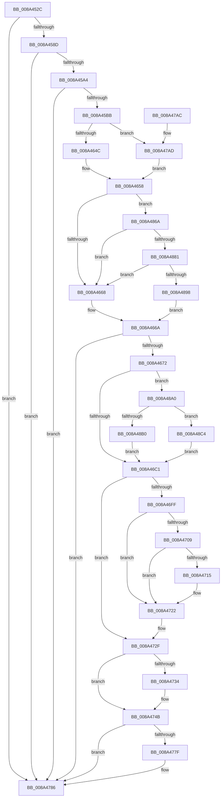

# EtwTraceAppStateChange

- RVA: `0x008A452C`–`0x008A48CC` (길이 `928` bytes)
- VA: `0x00000001408A452C`
- 실행 섹션: `PAGE`
- PDB 이름 있음: `예`; PDB Function 태그: `아니요`
- unwind 정보 RVA: `0x0007EF60`
- 디코드: `221`개 명령, `928/928` bytes 표시
- 미해석 바이트: `0` (있으면 어셈블리에 `.byte`로 보존)

> 이 문서는 커널 이미지의 기계어와 PDB 기호를 분석해 생성했습니다. 4번과 5번은 함수 원형과 자료형을 바이너리 사용 방식에서 추정한 C 해석이며 원본 소스 복구 결과는 아닙니다.

## 1. Dependencies

- 직접 호출 지점: **21**; 고유 호출 대상: **19**
- 직접 호출자로 확인된 함수: **1**
- RIP 상대 이미지 참조: **4**

### Outgoing calls
- `0x008A4568` → [memset](../../text/6C/memset_function_006C6C40.md) (function, `0x006C6C40`)
- `0x008A45C2` → [EtwpInitStateChangeInfo](EtwpInitStateChangeInfo_function_008A48D4.md) (function, `0x008A48D4`)
- `0x008A4650` → [EtwpWriteAppStateChange](EtwpWriteAppStateChange_function_008A3840.md) (function, `0x008A3840`)
- `0x008A4681` → [memset](../../text/6C/memset_function_006C6C40.md) (function, `0x006C6C40`)
- `0x008A46C9` → [PsReferencePrimaryTokenWithTag](../../text/20/PsReferencePrimaryTokenWithTag_function_0020FF80.md) (function, `0x0020FF80`)
- `0x008A46E0` → [EtwpQueryTokenPackageInfo](EtwpQueryTokenPackageInfo_function_008A5878.md) (function, `0x008A5878`)
- `0x008A46F5` → [ObFastDereferenceObject](../../text/3E/ObFastDereferenceObject_function_003ED5F0.md) (function, `0x003ED5F0`)
- `0x008A470C` → [EtwpAppStateChangeSummaryShouldLogCommandLine](../A2/EtwpAppStateChangeSummaryShouldLogCommandLine_function_00A2FBD4.md) (function, `0x00A2FBD4`)
- `0x008A471D` → [EtwpQueryProcessCommandLine](EtwpQueryProcessCommandLine_function_008A5C20.md) (function, `0x008A5C20`)
- `0x008A472A` → [EtwpQueryProcessOtherInfo](EtwpQueryProcessOtherInfo_function_008A5BB0.md) (function, `0x008A5BB0`)
- `0x008A473A` → [KiUnstackDetachProcess](../../text/21/KiUnstackDetachProcess_function_00217D30.md) (function, `0x00217D30`)
- `0x008A4746` → [ExReleaseRundownProtection](../../text/34/ExReleaseRundownProtection_function_00349E80.md) (function, `0x00349E80`)
- `0x008A4770` → [EtwpWriteAppStateChangeSummary](EtwpWriteAppStateChangeSummary_function_008A4990.md) (function, `0x008A4990`)
- `0x008A4781` → [ExFreePoolWithTag](../../poolcode/B8/ExFreePoolWithTag_function_00B82870.md) (function, `0x00B82870`)
- `0x008A4790` → [_security_check_cookie](../../text/6A/_security_check_cookie_function_006AC640.md) (function, `0x006AC640`)
- `0x008A47B8` → [memset](../../text/6C/memset_function_006C6C40.md) (function, `0x006C6C40`)
- `0x008A47C5` → [PsQueryStatisticsProcess](../91/PsQueryStatisticsProcess_function_00919350.md) (function, `0x00919350`)
- `0x008A47CF` → [ObGetProcessHandleCount](../91/ObGetProcessHandleCount_function_009195D0.md) (function, `0x009195D0`)
- `0x008A485C` → [EtwpWriteAppStateChangeWithStats](../A5/EtwpWriteAppStateChangeWithStats_function_00A55F7C.md) (function, `0x00A55F7C`)
- `0x008A48A7` → [ExAcquireRundownProtection](../../text/21/ExAcquireRundownProtection_function_00216620.md) (function, `0x00216620`)
- `0x008A48B7` → [KeStackAttachProcess](../../text/21/KeStackAttachProcess_function_00216800.md) (function, `0x00216800`)

### Direct callers
- [PsSetProcessTelemetryAppState](PsSetProcessTelemetryAppState_function_008A35F0.md) at `0x008A3711`

### Static image references
- `0x008A4547` → RVA `0x00E0A740` (`.data`; read)
- `0x008A4572` → RVA `0x00E091A0` (`.data`; read)
- `0x008A4597` → RVA `0x00E091B0` (`.data`; read)
- `0x008A45A4` → RVA `0x00E091B8` (`.data`; read)

## 2. Other-region calls and transfers

- 다른 실행 섹션으로 향하는 call: **11**
  - `0x008A4568` → [memset](../../text/6C/memset_function_006C6C40.md) (`PAGE` → `.text`)
  - `0x008A4681` → [memset](../../text/6C/memset_function_006C6C40.md) (`PAGE` → `.text`)
  - `0x008A46C9` → [PsReferencePrimaryTokenWithTag](../../text/20/PsReferencePrimaryTokenWithTag_function_0020FF80.md) (`PAGE` → `.text`)
  - `0x008A46F5` → [ObFastDereferenceObject](../../text/3E/ObFastDereferenceObject_function_003ED5F0.md) (`PAGE` → `.text`)
  - `0x008A473A` → [KiUnstackDetachProcess](../../text/21/KiUnstackDetachProcess_function_00217D30.md) (`PAGE` → `.text`)
  - `0x008A4746` → [ExReleaseRundownProtection](../../text/34/ExReleaseRundownProtection_function_00349E80.md) (`PAGE` → `.text`)
  - `0x008A4781` → [ExFreePoolWithTag](../../poolcode/B8/ExFreePoolWithTag_function_00B82870.md) (`PAGE` → `POOLCODE`)
  - `0x008A4790` → [_security_check_cookie](../../text/6A/_security_check_cookie_function_006AC640.md) (`PAGE` → `.text`)
  - `0x008A47B8` → [memset](../../text/6C/memset_function_006C6C40.md) (`PAGE` → `.text`)
  - `0x008A48A7` → [ExAcquireRundownProtection](../../text/21/ExAcquireRundownProtection_function_00216620.md) (`PAGE` → `.text`)
  - `0x008A48B7` → [KeStackAttachProcess](../../text/21/KeStackAttachProcess_function_00216800.md) (`PAGE` → `.text`)
- 별도 외부 분기/꼬리 이동을 확인하지 못했습니다.

## 3. Assembly (complete function range)

```asm
008A452C  48 89 5C 24 18                  mov qword ptr [rsp + 0x18], rbx
008A4531  55                              push rbp
008A4532  56                              push rsi
008A4533  57                              push rdi
008A4534  41 56                           push r14
008A4536  41 57                           push r15
008A4538  48 8D AC 24 D0 FC FF FF         lea rbp, [rsp - 0x330]
008A4540  48 81 EC 30 04 00 00            sub rsp, 0x430
008A4547  48 8B 05 F2 61 56 00            mov rax, qword ptr [rip + 0x5661f2]
008A454E  48 33 C4                        xor rax, rsp
008A4551  48 89 85 20 03 00 00            mov qword ptr [rbp + 0x320], rax
008A4558  48 8B DA                        mov rbx, rdx
008A455B  48 8B F9                        mov rdi, rcx
008A455E  33 D2                           xor edx, edx
008A4560  48 8D 4D EC                     lea rcx, [rbp - 0x14]
008A4564  44 8D 42 62                     lea r8d, [rdx + 0x62]
008A4568  E8 D3 26 E2 FF                  call 0x1406c6c40
008A456D  33 C0                           xor eax, eax
008A456F  0F 57 C0                        xorps xmm0, xmm0
008A4572  39 05 28 4C 56 00               cmp dword ptr [rip + 0x564c28], eax
008A4578  0F 11 45 C0                     movups xmmword ptr [rbp - 0x40], xmm0
008A457C  48 89 45 E0                     mov qword ptr [rbp - 0x20], rax
008A4580  0F 11 45 D0                     movups xmmword ptr [rbp - 0x30], xmm0
008A4584  89 45 E8                        mov dword ptr [rbp - 0x18], eax
008A4587  0F 86 F9 01 00 00               jbe 0x1408a4786
008A458D  48 BA 01 00 00 00 00 60 00 00   movabs rdx, 0x600000000001
008A4597  48 85 15 12 4C 56 00            test qword ptr [rip + 0x564c12], rdx
008A459E  0F 84 E2 01 00 00               je 0x1408a4786
008A45A4  48 8B 05 0D 4C 56 00            mov rax, qword ptr [rip + 0x564c0d]
008A45AB  48 23 C2                        and rax, rdx
008A45AE  48 3B 05 03 4C 56 00            cmp rax, qword ptr [rip + 0x564c03]
008A45B5  0F 85 CB 01 00 00               jne 0x1408a4786
008A45BB  48 8D 55 EC                     lea rdx, [rbp - 0x14]
008A45BF  48 8B CF                        mov rcx, rdi
008A45C2  E8 0D 03 00 00                  call 0x1408a48d4
008A45C7  4C 8B 0B                        mov r9, qword ptr [rbx]
008A45CA  49 BB 4B 59 86 38 D6 C5 6D 34   movabs r11, 0x346dc5d63886594b
008A45D4  8A 43 30                        mov al, byte ptr [rbx + 0x30]
008A45D7  49 8B C9                        mov rcx, r9
008A45DA  48 2B 4B 10                     sub rcx, qword ptr [rbx + 0x10]
008A45DE  4C 8B 43 20                     mov r8, qword ptr [rbx + 0x20]
008A45E2  4C 2B 8F 80 06 00 00            sub r9, qword ptr [rdi + 0x680]
008A45E9  44 8A 53 34                     mov r10b, byte ptr [rbx + 0x34]
008A45ED  88 45 ED                        mov byte ptr [rbp - 0x13], al
008A45F0  49 8B C3                        mov rax, r11
008A45F3  48 F7 E1                        mul rcx
008A45F6  49 8B C8                        mov rcx, r8
008A45F9  44 88 55 EC                     mov byte ptr [rbp - 0x14], r10b
008A45FD  48 2B 4B 18                     sub rcx, qword ptr [rbx + 0x18]
008A4601  49 8B C3                        mov rax, r11
008A4604  48 C1 EA 0B                     shr rdx, 0xb
008A4608  48 89 55 15                     mov qword ptr [rbp + 0x15], rdx
008A460C  48 F7 E1                        mul rcx
008A460F  49 8B C3                        mov rax, r11
008A4612  48 C1 EA 0B                     shr rdx, 0xb
008A4616  48 89 55 1D                     mov qword ptr [rbp + 0x1d], rdx
008A461A  49 F7 E1                        mul r9
008A461D  49 8B C3                        mov rax, r11
008A4620  48 C1 EA 0B                     shr rdx, 0xb
008A4624  48 89 55 25                     mov qword ptr [rbp + 0x25], rdx
008A4628  49 F7 E0                        mul r8
008A462B  49 8B C3                        mov rax, r11
008A462E  48 C1 EA 0B                     shr rdx, 0xb
008A4632  48 89 55 2D                     mov qword ptr [rbp + 0x2d], rdx
008A4636  48 F7 63 28                     mul qword ptr [rbx + 0x28]
008A463A  48 C1 EA 0B                     shr rdx, 0xb
008A463E  48 89 55 35                     mov qword ptr [rbp + 0x35], rdx
008A4642  41 80 FA 03                     cmp r10b, 3
008A4646  0F 84 61 01 00 00               je 0x1408a47ad
008A464C  48 8D 4D EC                     lea rcx, [rbp - 0x14]
008A4650  E8 EB F1 FF FF                  call 0x1408a3840
008A4655  45 33 FF                        xor r15d, r15d
008A4658  83 3D 41 4B 56 00 00            cmp dword ptr [rip + 0x564b41], 0
008A465F  40 B6 01                        mov sil, 1
008A4662  0F 87 02 02 00 00               ja 0x1408a486a
008A4668  32 C0                           xor al, al
008A466A  84 C0                           test al, al
008A466C  0F 84 14 01 00 00               je 0x1408a4786
008A4672  33 D2                           xor edx, edx
008A4674  48 8D 8D 80 00 00 00            lea rcx, [rbp + 0x80]
008A467B  41 B8 A0 02 00 00               mov r8d, 0x2a0
008A4681  E8 BA 25 E2 FF                  call 0x1406c6c40
008A4686  48 83 64 24 38 00               and qword ptr [rsp + 0x38], 0
008A468C  0F 57 C9                        xorps xmm1, xmm1
008A468F  83 64 24 30 00                  and dword ptr [rsp + 0x30], 0
008A4694  0F 57 C0                        xorps xmm0, xmm0
008A4697  0F 11 44 24 40                  movups xmmword ptr [rsp + 0x40], xmm0
008A469C  45 32 F6                        xor r14b, r14b
008A469F  0F 11 4D 50                     movups xmmword ptr [rbp + 0x50], xmm1
008A46A3  0F 11 4D 60                     movups xmmword ptr [rbp + 0x60], xmm1
008A46A7  0F 11 4D 70                     movups xmmword ptr [rbp + 0x70], xmm1
008A46AB  65 48 8B 04 25 88 01 00 00      mov rax, qword ptr gs:[0x188]
008A46B4  48 39 B8 B8 00 00 00            cmp qword ptr [rax + 0xb8], rdi
008A46BB  0F 85 DF 01 00 00               jne 0x1408a48a0
008A46C1  BA 44 66 6C 74                  mov edx, 0x746c6644
008A46C6  48 8B CF                        mov rcx, rdi
008A46C9  E8 B2 B8 96 FF                  call 0x14020ff80
008A46CE  4C 8D 44 24 30                  lea r8, [rsp + 0x30]
008A46D3  48 8B C8                        mov rcx, rax
008A46D6  48 8D 95 80 00 00 00            lea rdx, [rbp + 0x80]
008A46DD  48 8B D8                        mov rbx, rax
008A46E0  E8 93 11 00 00                  call 0x1408a5878
008A46E5  48 8D 8F 48 02 00 00            lea rcx, [rdi + 0x248]
008A46EC  41 B8 44 66 6C 74               mov r8d, 0x746c6644
008A46F2  48 8B D3                        mov rdx, rbx
008A46F5  E8 F6 8E B4 FF                  call 0x1403ed5f0
008A46FA  40 84 F6                        test sil, sil
008A46FD  74 30                           je 0x1408a472f
008A46FF  48 83 BF E0 02 00 00 00         cmp qword ptr [rdi + 0x2e0], 0
008A4707  74 19                           je 0x1408a4722
008A4709  48 8B CF                        mov rcx, rdi
008A470C  E8 C3 B4 18 00                  call 0x140a2fbd4
008A4711  84 C0                           test al, al
008A4713  74 0D                           je 0x1408a4722
008A4715  48 8D 54 24 40                  lea rdx, [rsp + 0x40]
008A471A  48 8B CF                        mov rcx, rdi
008A471D  E8 FE 14 00 00                  call 0x1408a5c20
008A4722  48 8D 54 24 38                  lea rdx, [rsp + 0x38]
008A4727  48 8B CF                        mov rcx, rdi
008A472A  E8 81 14 00 00                  call 0x1408a5bb0
008A472F  45 84 F6                        test r14b, r14b
008A4732  74 17                           je 0x1408a474b
008A4734  33 D2                           xor edx, edx
008A4736  48 8D 4D 50                     lea rcx, [rbp + 0x50]
008A473A  E8 F1 35 97 FF                  call 0x140217d30
008A473F  48 8D 8F E8 01 00 00            lea rcx, [rdi + 0x1e8]
008A4746  E8 35 57 AA FF                  call 0x140349e80
008A474B  48 8D 44 24 40                  lea rax, [rsp + 0x40]
008A4750  4D 8B C7                        mov r8, r15
008A4753  48 89 44 24 28                  mov qword ptr [rsp + 0x28], rax
008A4758  4C 8D 8D 80 00 00 00            lea r9, [rbp + 0x80]
008A475F  48 8D 44 24 38                  lea rax, [rsp + 0x38]
008A4764  48 8B CF                        mov rcx, rdi
008A4767  48 8D 55 EC                     lea rdx, [rbp - 0x14]
008A476B  48 89 44 24 20                  mov qword ptr [rsp + 0x20], rax
008A4770  E8 1B 02 00 00                  call 0x1408a4990
008A4775  48 8B 4C 24 48                  mov rcx, qword ptr [rsp + 0x48]
008A477A  48 85 C9                        test rcx, rcx
008A477D  74 07                           je 0x1408a4786
008A477F  33 D2                           xor edx, edx
008A4781  E8 EA E0 2D 00                  call 0x140b82870
008A4786  48 8B 8D 20 03 00 00            mov rcx, qword ptr [rbp + 0x320]
008A478D  48 33 CC                        xor rcx, rsp
008A4790  E8 AB 7E E0 FF                  call 0x1406ac640
008A4795  48 8B 9C 24 70 04 00 00         mov rbx, qword ptr [rsp + 0x470]
008A479D  48 81 C4 30 04 00 00            add rsp, 0x430
008A47A4  41 5F                           pop r15
008A47A6  41 5E                           pop r14
008A47A8  5F                              pop rdi
008A47A9  5E                              pop rsi
008A47AA  5D                              pop rbp
008A47AB  C3                              ret
008A47AC  CC                              int3
008A47AD  33 D2                           xor edx, edx
008A47AF  48 8D 4C 24 50                  lea rcx, [rsp + 0x50]
008A47B4  44 8D 42 68                     lea r8d, [rdx + 0x68]
008A47B8  E8 83 24 E2 FF                  call 0x1406c6c40
008A47BD  48 8D 54 24 50                  lea rdx, [rsp + 0x50]
008A47C2  48 8B CF                        mov rcx, rdi
008A47C5  E8 86 4B 07 00                  call 0x140919350
008A47CA  33 D2                           xor edx, edx
008A47CC  48 8B CF                        mov rcx, rdi
008A47CF  E8 FC 4D 07 00                  call 0x1409195d0
008A47D4  89 45 C0                        mov dword ptr [rbp - 0x40], eax
008A47D7  41 B8 FF FF FF FF               mov r8d, 0xffffffff
008A47DD  48 8B 87 D8 03 00 00            mov rax, qword ptr [rdi + 0x3d8]
008A47E4  41 B9 00 04 00 00               mov r9d, 0x400
008A47EA  48 C1 E0 0C                     shl rax, 0xc
008A47EE  41 8B C8                        mov ecx, r8d
008A47F1  48 89 45 C4                     mov qword ptr [rbp - 0x3c], rax
008A47F5  48 8B 87 E0 03 00 00            mov rax, qword ptr [rdi + 0x3e0]
008A47FC  48 C1 E0 0C                     shl rax, 0xc
008A4800  4C 39 44 24 78                  cmp qword ptr [rsp + 0x78], r8
008A4805  48 89 45 CC                     mov qword ptr [rbp - 0x34], rax
008A4809  41 8B C0                        mov eax, r8d
008A480C  0F 4C 44 24 78                  cmovl eax, dword ptr [rsp + 0x78]
008A4811  4C 39 45 80                     cmp qword ptr [rbp - 0x80], r8
008A4815  89 45 DC                        mov dword ptr [rbp - 0x24], eax
008A4818  41 8B C0                        mov eax, r8d
008A481B  0F 4C 45 80                     cmovl eax, dword ptr [rbp - 0x80]
008A481F  89 45 E0                        mov dword ptr [rbp - 0x20], eax
008A4822  48 8B 45 90                     mov rax, qword ptr [rbp - 0x70]
008A4826  48 99                           cqo
008A4828  49 F7 F9                        idiv r9
008A482B  49 3B C0                        cmp rax, r8
008A482E  0F 4C C8                        cmovl ecx, eax
008A4831  48 8B 45 98                     mov rax, qword ptr [rbp - 0x68]
008A4835  48 99                           cqo
008A4837  89 4D E4                        mov dword ptr [rbp - 0x1c], ecx
008A483A  49 F7 F9                        idiv r9
008A483D  48 8D 55 EC                     lea rdx, [rbp - 0x14]
008A4841  48 8B CF                        mov rcx, rdi
008A4844  49 3B C0                        cmp rax, r8
008A4847  44 0F 4C C0                     cmovl r8d, eax
008A484B  48 8B 44 24 68                  mov rax, qword ptr [rsp + 0x68]
008A4850  44 89 45 E8                     mov dword ptr [rbp - 0x18], r8d
008A4854  4C 8D 45 C0                     lea r8, [rbp - 0x40]
008A4858  48 89 45 D4                     mov qword ptr [rbp - 0x2c], rax
008A485C  E8 1B 17 1B 00                  call 0x140a55f7c
008A4861  4C 8D 7D C0                     lea r15, [rbp - 0x40]
008A4865  E9 EE FD FF FF                  jmp 0x1408a4658
008A486A  48 BA 00 00 00 00 00 40 00 00   movabs rdx, 0x400000000000
008A4874  48 85 15 35 49 56 00            test qword ptr [rip + 0x564935], rdx
008A487B  0F 84 E7 FD FF FF               je 0x1408a4668
008A4881  48 8B 05 30 49 56 00            mov rax, qword ptr [rip + 0x564930]
008A4888  48 23 C2                        and rax, rdx
008A488B  48 3B 05 26 49 56 00            cmp rax, qword ptr [rip + 0x564926]
008A4892  0F 85 D0 FD FF FF               jne 0x1408a4668
008A4898  40 8A C6                        mov al, sil
008A489B  E9 CA FD FF FF                  jmp 0x1408a466a
008A48A0  48 8D 8F E8 01 00 00            lea rcx, [rdi + 0x1e8]
008A48A7  E8 74 1D 97 FF                  call 0x140216620
008A48AC  84 C0                           test al, al
008A48AE  74 14                           je 0x1408a48c4
008A48B0  48 8D 55 50                     lea rdx, [rbp + 0x50]
008A48B4  48 8B CF                        mov rcx, rdi
008A48B7  E8 44 1F 97 FF                  call 0x140216800
008A48BC  44 8A F6                        mov r14b, sil
008A48BF  E9 FD FD FF FF                  jmp 0x1408a46c1
008A48C4  40 32 F6                        xor sil, sil
008A48C7  E9 F5 FD FF FF                  jmp 0x1408a46c1
```

## 4. C-style interpretation (structured pseudocode)

```c
__int64 __fastcall EtwTraceAppStateChange(__int64 a1, __int64 a2)
{
    __int64 result;
    __int64 v_r14;
    __int64 v_r15;
    __int64 v_rsi;
    __int64 v_rsp;
    unsigned __int64 v_stack_m2D8;
    unsigned __int64 v_stack_m2E8;
    unsigned __int64 v_stack_m2F8;
    unsigned __int64 v_stack_m308;
    unsigned __int64 v_stack_m323;
    unsigned __int64 v_stack_m32B;
    unsigned __int64 v_stack_m333;
    unsigned __int64 v_stack_m33B;
    unsigned __int64 v_stack_m343;
    unsigned __int64 v_stack_m358;
    unsigned __int8 v_stack_m36B;
    unsigned __int64 v_stack_m36C;
    unsigned int v_stack_m370;
    unsigned int v_stack_m374;
    unsigned __int64 v_stack_m378;
    unsigned int v_stack_m37C;
    unsigned __int64 v_stack_m38;
    unsigned __int64 v_stack_m384;
    unsigned __int64 v_stack_m388;
    unsigned __int64 v_stack_m38C;
    unsigned __int64 v_stack_m394;
    unsigned __int64 v_stack_m398;
    unsigned __int64 v_stack_m3C0;
    unsigned __int64 v_stack_m3C8;
    unsigned __int64 v_stack_m3D8;
    unsigned __int64 v_stack_m410;
    unsigned __int64 v_stack_m418;
    unsigned __int64 v_stack_m420;
    unsigned int v_stack_m428;
    unsigned __int64 v_stack_m430;
    unsigned __int64 v_stack_m438;
    unsigned __int64 v_stack_p18;
    unsigned __int64 v_stack_p50;
    unsigned __int64 v_stack_p68;
    unsigned __int64 v_stack_p78;

    v_stack_p18 = v_rbx;
    v_rsp = (v_rsp) - (0x430ULL);
    result = (*(unsigned __int64 *)(v_rip + 5661170)) ^ (v_rsp);
    v_stack_m38 = result;
    a2 = 0;
    result = memset(v_stack_m36C, a2, a2 + 98, a4);
    result = 0;
    v_stack_m398 = v_xmm0;
    v_stack_m378 = 0;
    v_stack_m388 = v_xmm0;
    v_stack_m370 = 0;
    if ((*(unsigned int *)(v_rip + 5655592)) <= 0) goto loc_008A4786;
    if (((*(unsigned __int64 *)(v_rip + 5655570)) & (0)) == 0) goto loc_008A4786;
    result = (*(unsigned __int64 *)(v_rip + 5655565)) & (0);
    if (result != (*(unsigned __int64 *)(v_rip + 5655555))) goto loc_008A4786;
    result = EtwpInitStateChangeInfo(a1, v_stack_m36C, a2 + 98, a4);
    a1 = (*(unsigned __int64 *)(a2)) - (*(unsigned __int64 *)(a2 + 16));
    a4 = (*(unsigned __int64 *)(a2)) - (*(unsigned __int64 *)(a1 + 1664));
    v_stack_m36B = (unsigned __int8)(*(unsigned __int8 *)(a2 + 48));
    v_stack_m36C = (unsigned __int8)(*(unsigned __int8 *)(a2 + 52));
    a1 = (*(unsigned __int64 *)(a2 + 32)) - (*(unsigned __int64 *)(a2 + 24));
    a2 = (v_stack_m36C) >> (11);
    v_stack_m343 = a2;
    a2 = (a2) >> (11);
    v_stack_m33B = a2;
    a2 = (a2) >> (11);
    v_stack_m333 = a2;
    a2 = (a2) >> (11);
    v_stack_m32B = a2;
    a2 = (a2) >> (11);
    v_stack_m323 = a2;
    if (((unsigned __int8)(*(unsigned __int8 *)(a2 + 52))) == 3) goto loc_008A47AD;
    result = EtwpWriteAppStateChange(v_stack_m36C, a2, *(unsigned __int64 *)(a2 + 32), a4);
    v_r15 = 0;
loc_008A4658:
    if ((*(unsigned int *)(v_rip + 5655361)) > 0) goto loc_008A486A;
loc_008A4668:
    result = 0;
loc_008A466A:
    if (0 == 0) goto loc_008A4786;
    a2 = 0;
    result = memset(v_stack_m2D8, a2, 672, a4);
    v_stack_m418 = v_xmm0;
    v_r14 = 0;
    v_stack_m308 = v_xmm1;
    v_stack_m2F8 = v_xmm1;
    v_stack_m2E8 = v_xmm1;
    if ((*(unsigned __int64 *)(*(unsigned __int64 *)(gs_base + (0 + 392)) + 184)) != a1) goto loc_008A48A0;
loc_008A46C1:
    result = PsReferencePrimaryTokenWithTag(a1, (unsigned int)(0x746C6644ULL), 672, a4);
    result = EtwpQueryTokenPackageInfo(result, v_stack_m2D8, v_stack_m428, a4);
    result = ObFastDereferenceObject(a1 + 584, result, (unsigned int)(0x746C6644ULL), a4);
    if (1 == 0) goto loc_008A472F;
    if ((*(unsigned __int64 *)(a1 + 736)) == 0) goto loc_008A4722;
    result = EtwpAppStateChangeSummaryShouldLogCommandLine(a1, result, (unsigned int)(0x746C6644ULL), a4);
    if ((unsigned __int8)(result) != 0) {
        a2 = v_stack_m418;
        a1 = a1;
        result = EtwpQueryProcessCommandLine(a1, a2, (unsigned int)(0x746C6644ULL), a4);
    }
    result = EtwpQueryProcessOtherInfo(a1, v_stack_m420, (unsigned int)(0x746C6644ULL), a4);
loc_008A472F:
    if (0 != 0) {
        a2 = 0;
        a1 = v_stack_m308;
        result = KiUnstackDetachProcess(a1, a2, (unsigned int)(0x746C6644ULL), a4);
        a1 = a1 + 488;
        result = ExReleaseRundownProtection(a1, a2, (unsigned int)(0x746C6644ULL), a4);
    }
    v_stack_m430 = v_stack_m418;
    v_stack_m438 = v_stack_m420;
    result = EtwpWriteAppStateChangeSummary(a1, v_stack_m36C, 0, v_stack_m2D8);
    if (v_stack_m410 != 0) {
        a2 = 0;
        result = ExFreePoolWithTag(v_stack_m410, a2, 0, v_stack_m2D8);
    }
    a1 = (v_stack_m38) ^ (v_rsp);
    result = _security_check_cookie(a1, a2, 0, v_stack_m2D8);
    v_rsp = (v_rsp) + (0x430ULL);
    return result;
loc_008A47AD:
    a2 = 0;
    result = memset(v_stack_p50, a2, a2 + 104, v_stack_m2D8);
    result = PsQueryStatisticsProcess(a1, v_stack_p50, a2 + 104, v_stack_m2D8);
    a2 = 0;
    result = ObGetProcessHandleCount(a1, a2, a2 + 104, v_stack_m2D8);
    v_stack_m398 = (unsigned int)(result);
    result = (*(unsigned __int64 *)(a1 + 984)) << (12);
    v_stack_m394 = result;
    result = (*(unsigned __int64 *)(a1 + 992)) << (12);
    v_stack_m38C = result;
    result = (unsigned int)((unsigned int)((unsigned int)(0xFFFFFFFFULL)));
    if (v_stack_p78 < ((unsigned int)(0xFFFFFFFFULL))) { result = v_stack_p78; }
    v_stack_m37C = (unsigned int)(result);
    result = (unsigned int)((unsigned int)((unsigned int)(0xFFFFFFFFULL)));
    if (v_stack_m3D8 < ((unsigned int)(0xFFFFFFFFULL))) { result = v_stack_m3D8; }
    v_stack_m378 = (unsigned int)(result);
    a1 = (unsigned int)((unsigned int)((unsigned int)(0xFFFFFFFFULL)));
    if (v_stack_m3C8 < ((unsigned int)(0xFFFFFFFFULL))) { a1 = (unsigned int)(v_stack_m3C8); }
    v_stack_m374 = (unsigned int)(a1);
    a3 = (unsigned int)(0xFFFFFFFFULL);
    if (v_stack_m3C0 < ((unsigned int)(0xFFFFFFFFULL))) { a3 = (unsigned int)(v_stack_m3C0); }
    v_stack_m370 = (unsigned int)(a3);
    v_stack_m384 = v_stack_p68;
    result = EtwpWriteAppStateChangeWithStats(a1, v_stack_m36C, v_stack_m398, (unsigned int)(0x400ULL));
    goto loc_008A4658;
loc_008A486A:
    if (((*(unsigned __int64 *)(v_rip + 5654837)) & (v_stack_m36C)) == 0) goto loc_008A4668;
    result = (*(unsigned __int64 *)(v_rip + 5654832)) & (v_stack_m36C);
    if (result != (*(unsigned __int64 *)(v_rip + 5654822))) goto loc_008A4668;
    goto loc_008A466A;
loc_008A48A0:
    result = ExAcquireRundownProtection(a1 + 488, v_stack_m36C, v_stack_m398, (unsigned int)(0x400ULL));
    if ((unsigned __int8)(result) == 0) goto loc_008A48C4;
    result = KeStackAttachProcess(a1, v_stack_m308, v_stack_m398, (unsigned int)(0x400ULL));
    goto loc_008A46C1;
loc_008A48C4:
    v_rsi = 0;
    goto loc_008A46C1;
}
```

## 5. (Beta) C Style

```c
int64_t EtwTraceAppStateChange(void *Arg1, void *Arg2)
{
    uint8_t *arg1 = (uint8_t *)Arg1;
    uint8_t *arg2 = (uint8_t *)Arg2;

    int64_t result;
    int64_t local_r14;
    int64_t local_r15;
    int64_t local_rsi;
    int64_t local_rsp;
    uint64_t v_stack_m2D8;
    uint64_t v_stack_m2E8;
    uint64_t v_stack_m2F8;
    uint64_t v_stack_m308;
    uint64_t v_stack_m323;
    uint64_t v_stack_m32B;
    uint64_t v_stack_m333;
    uint64_t v_stack_m33B;
    uint64_t v_stack_m343;
    uint64_t v_stack_m358;
    uint8_t v_stack_m36B;
    uint64_t v_stack_m36C;
    uint32_t v_stack_m370;
    uint32_t v_stack_m374;
    uint64_t v_stack_m378;
    uint32_t v_stack_m37C;
    uint64_t v_stack_m38;
    uint64_t v_stack_m384;
    uint64_t v_stack_m388;
    uint64_t v_stack_m38C;
    uint64_t v_stack_m394;
    uint64_t v_stack_m398;
    uint64_t v_stack_m3C0;
    uint64_t v_stack_m3C8;
    uint64_t v_stack_m3D8;
    uint64_t v_stack_m410;
    uint64_t v_stack_m418;
    uint64_t v_stack_m420;
    uint32_t v_stack_m428;
    uint64_t v_stack_m430;
    uint64_t v_stack_m438;
    uint64_t v_stack_p18;
    uint64_t v_stack_p50;
    uint64_t v_stack_p68;
    uint64_t v_stack_p78;

    v_stack_p18 = local_rbx;
    local_rsp = (local_rsp) - (0x430ULL);
    result = (*(uint64_t *)(v_rip + 0x5661F2)) ^ (local_rsp);
    v_stack_m38 = result;
    Arg2 = 0;
    result = memset(v_stack_m36C, Arg2, Arg2 + 98, a4);
    result = 0;
    v_stack_m398 = v_xmm0;
    v_stack_m378 = 0;
    v_stack_m388 = v_xmm0;
    v_stack_m370 = 0;
    if ((*(uint32_t *)(v_rip + 0x564C28)) <= 0) goto loc_008A4786;
    if (((*(uint64_t *)(v_rip + 0x564C12)) & (0)) == 0) goto loc_008A4786;
    result = (*(uint64_t *)(v_rip + 0x564C0D)) & (0);
    if (result != (*(uint64_t *)(v_rip + 0x564C03))) goto loc_008A4786;
    result = EtwpInitStateChangeInfo(Arg1, v_stack_m36C, Arg2 + 98, a4);
    Arg1 = (*(uint64_t *)(arg2)) - (*(uint64_t *)(arg2 + 0x10));
    a4 = (*(uint64_t *)(arg2)) - (*(uint64_t *)(arg1 + 0x680));
    v_stack_m36B = (uint8_t)(*(uint8_t *)(arg2 + 0x30));
    v_stack_m36C = (uint8_t)(*(uint8_t *)(arg2 + 0x34));
    Arg1 = (*(uint64_t *)(arg2 + 0x20)) - (*(uint64_t *)(arg2 + 0x18));
    Arg2 = (v_stack_m36C) >> (11);
    v_stack_m343 = Arg2;
    Arg2 = (Arg2) >> (11);
    v_stack_m33B = Arg2;
    Arg2 = (Arg2) >> (11);
    v_stack_m333 = Arg2;
    Arg2 = (Arg2) >> (11);
    v_stack_m32B = Arg2;
    Arg2 = (Arg2) >> (11);
    v_stack_m323 = Arg2;
    if (((uint8_t)(*(uint8_t *)(arg2 + 0x34))) == 3) goto loc_008A47AD;
    result = EtwpWriteAppStateChange(v_stack_m36C, Arg2, *(uint64_t *)(arg2 + 0x20), a4);
    local_r15 = 0;
loc_008A4658:
    if ((*(uint32_t *)(v_rip + 0x564B41)) > 0) goto loc_008A486A;
loc_008A4668:
    result = 0;
loc_008A466A:
    if (0 == 0) goto loc_008A4786;
    Arg2 = 0;
    result = memset(v_stack_m2D8, Arg2, 672, a4);
    v_stack_m418 = v_xmm0;
    local_r14 = 0;
    v_stack_m308 = v_xmm1;
    v_stack_m2F8 = v_xmm1;
    v_stack_m2E8 = v_xmm1;
    if ((*(uint64_t *)(*(uint64_t *)(gs_base + (0 + 0x188)) + 0xB8)) != Arg1) goto loc_008A48A0;
loc_008A46C1:
    result = PsReferencePrimaryTokenWithTag(Arg1, (uint32_t)(0x746C6644ULL), 672, a4);
    result = EtwpQueryTokenPackageInfo(result, v_stack_m2D8, v_stack_m428, a4);
    result = ObFastDereferenceObject(Arg1 + 584, result, (uint32_t)(0x746C6644ULL), a4);
    if (1 == 0) goto loc_008A472F;
    if ((*(uint64_t *)(arg1 + 0x2E0)) == 0) goto loc_008A4722;
    result = EtwpAppStateChangeSummaryShouldLogCommandLine(Arg1, result, (uint32_t)(0x746C6644ULL), a4);
    if ((uint8_t)(result) != 0) {
        Arg2 = v_stack_m418;
        Arg1 = Arg1;
        result = EtwpQueryProcessCommandLine(Arg1, Arg2, (uint32_t)(0x746C6644ULL), a4);
    }
    result = EtwpQueryProcessOtherInfo(Arg1, v_stack_m420, (uint32_t)(0x746C6644ULL), a4);
loc_008A472F:
    if (0 != 0) {
        Arg2 = 0;
        Arg1 = v_stack_m308;
        result = KiUnstackDetachProcess(Arg1, Arg2, (uint32_t)(0x746C6644ULL), a4);
        Arg1 = Arg1 + 488;
        result = ExReleaseRundownProtection(Arg1, Arg2, (uint32_t)(0x746C6644ULL), a4);
    }
    v_stack_m430 = v_stack_m418;
    v_stack_m438 = v_stack_m420;
    result = EtwpWriteAppStateChangeSummary(Arg1, v_stack_m36C, 0, v_stack_m2D8);
    if (v_stack_m410 != 0) {
        Arg2 = 0;
        result = ExFreePoolWithTag(v_stack_m410, Arg2, 0, v_stack_m2D8);
    }
    Arg1 = (v_stack_m38) ^ (local_rsp);
    result = _security_check_cookie(Arg1, Arg2, 0, v_stack_m2D8);
    local_rsp = (local_rsp) + (0x430ULL);
    return result;
loc_008A47AD:
    Arg2 = 0;
    result = memset(v_stack_p50, Arg2, Arg2 + 104, v_stack_m2D8);
    result = PsQueryStatisticsProcess(Arg1, v_stack_p50, Arg2 + 104, v_stack_m2D8);
    Arg2 = 0;
    result = ObGetProcessHandleCount(Arg1, Arg2, Arg2 + 104, v_stack_m2D8);
    v_stack_m398 = (uint32_t)(result);
    result = (*(uint64_t *)(arg1 + 0x3D8)) << (12);
    v_stack_m394 = result;
    result = (*(uint64_t *)(arg1 + 0x3E0)) << (12);
    v_stack_m38C = result;
    result = (uint32_t)((uint32_t)((uint32_t)(0xFFFFFFFFULL)));
    if (v_stack_p78 < ((uint32_t)(0xFFFFFFFFULL))) { result = v_stack_p78; }
    v_stack_m37C = (uint32_t)(result);
    result = (uint32_t)((uint32_t)((uint32_t)(0xFFFFFFFFULL)));
    if (v_stack_m3D8 < ((uint32_t)(0xFFFFFFFFULL))) { result = v_stack_m3D8; }
    v_stack_m378 = (uint32_t)(result);
    Arg1 = (uint32_t)((uint32_t)((uint32_t)(0xFFFFFFFFULL)));
    if (v_stack_m3C8 < ((uint32_t)(0xFFFFFFFFULL))) { Arg1 = (uint32_t)(v_stack_m3C8); }
    v_stack_m374 = (uint32_t)(Arg1);
    a3 = (uint32_t)(0xFFFFFFFFULL);
    if (v_stack_m3C0 < ((uint32_t)(0xFFFFFFFFULL))) { a3 = (uint32_t)(v_stack_m3C0); }
    v_stack_m370 = (uint32_t)(a3);
    v_stack_m384 = v_stack_p68;
    result = EtwpWriteAppStateChangeWithStats(Arg1, v_stack_m36C, v_stack_m398, (uint32_t)(0x400ULL));
    goto loc_008A4658;
loc_008A486A:
    if (((*(uint64_t *)(v_rip + 0x564935)) & (v_stack_m36C)) == 0) goto loc_008A4668;
    result = (*(uint64_t *)(v_rip + 0x564930)) & (v_stack_m36C);
    if (result != (*(uint64_t *)(v_rip + 0x564926))) goto loc_008A4668;
    goto loc_008A466A;
loc_008A48A0:
    result = ExAcquireRundownProtection(Arg1 + 488, v_stack_m36C, v_stack_m398, (uint32_t)(0x400ULL));
    if ((uint8_t)(result) == 0) goto loc_008A48C4;
    result = KeStackAttachProcess(Arg1, v_stack_m308, v_stack_m398, (uint32_t)(0x400ULL));
    goto loc_008A46C1;
loc_008A48C4:
    local_rsi = 0;
    goto loc_008A46C1;
}
```

### 관측된 메모리 오프셋

구조체 형식이 확인되지 않은 접근은 인자 기준의 오프셋으로만 기록했습니다.

| 기준 인자 | 오프셋 표현 | 폭 (bit) | 접근 |
|---|---:|---:|---|
| `Arg1` | `+ 0x1E8` | `64` | `R` |
| `Arg1` | `+ 0x248` | `64` | `R` |
| `Arg1` | `+ 0x2E0` | `64` | `R` |
| `Arg1` | `+ 0x3D8` | `64` | `R` |
| `Arg1` | `+ 0x3E0` | `64` | `R` |
| `Arg1` | `+ 0x680` | `64` | `R` |
| `Arg2` | `+ 0x0` | `64` | `R` |
| `Arg2` | `+ 0x10` | `64` | `R` |
| `Arg2` | `+ 0x18` | `64` | `R` |
| `Arg2` | `+ 0x20` | `64` | `R` |
| `Arg2` | `+ 0x28` | `64` | `R` |
| `Arg2` | `+ 0x30` | `8` | `R` |
| `Arg2` | `+ 0x34` | `8` | `R` |

## 6. Execution-region graph

[열기: 2D/3D 그래프와 함수 탐색 컨트롤 패널](../../../control-panel.html?section=page&rva=0x008A452C&view=graph)

- 2D 그래프는 위에서 아래로 흐르고, 3D 그래프는 빈 공간을 드래그해 회전합니다. Shift+드래그는 이동, 휠은 확대·축소, 함수 노드 선택은 대상 보고서 이동입니다.

### Static fallback


