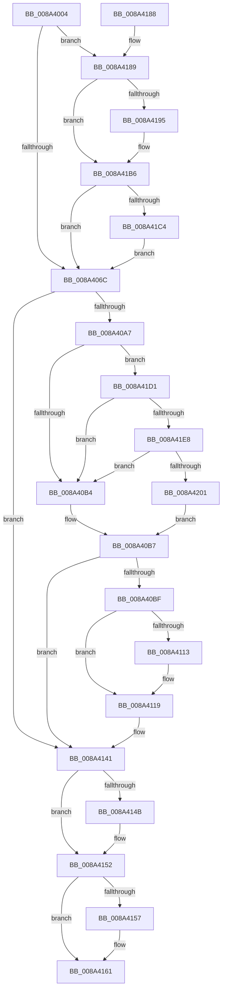

# EtwTraceProcess

- RVA: `0x008A4004`–`0x008A4206` (길이 `514` bytes)
- VA: `0x00000001408A4004`
- 실행 섹션: `PAGE`
- PDB 이름 있음: `예`; PDB Function 태그: `아니요`
- unwind 정보 RVA: `0x0007EEF4`
- 디코드: `120`개 명령, `514/514` bytes 표시
- 미해석 바이트: `0` (있으면 어셈블리에 `.byte`로 보존)

> 이 문서는 커널 이미지의 기계어와 PDB 기호를 분석해 생성했습니다. 4번과 5번은 함수 원형과 자료형을 바이너리 사용 방식에서 추정한 C 해석이며 원본 소스 복구 결과는 아닙니다.

## 1. Dependencies

- 직접 호출 지점: **15**; 고유 호출 대상: **12**
- 직접 호출자로 확인된 함수: **2**
- RIP 상대 이미지 참조: **5**

### Outgoing calls
- `0x008A404C` → [memset](../../text/6C/memset_function_006C6C40.md) (function, `0x006C6C40`)
- `0x008A408F` → [EtwpWriteProcessEvent](EtwpWriteProcessEvent_function_008A420C.md) (function, `0x008A420C`)
- `0x008A40CA` → [memset](../../text/6C/memset_function_006C6C40.md) (function, `0x006C6C40`)
- `0x008A40E5` → [EtwpWriteProcessStarted](../A4/EtwpWriteProcessStarted_function_00A487A4.md) (function, `0x00A487A4`)
- `0x008A40F2` → [EtwpInitStateChangeInfo](EtwpInitStateChangeInfo_function_008A48D4.md) (function, `0x008A48D4`)
- `0x008A4102` → [EtwpWriteAppStateChange](EtwpWriteAppStateChange_function_008A3840.md) (function, `0x008A3840`)
- `0x008A410A` → [EtwpAppStateChangeSummaryShouldLogCommandLine](../A2/EtwpAppStateChangeSummaryShouldLogCommandLine_function_00A2FBD4.md) (function, `0x00A2FBD4`)
- `0x008A413C` → [EtwpWriteAppStateChangeSummary](EtwpWriteAppStateChangeSummary_function_008A4990.md) (function, `0x008A4990`)
- `0x008A414D` → [ExFreePoolWithTag](../../poolcode/B8/ExFreePoolWithTag_function_00B82870.md) (function, `0x00B82870`)
- `0x008A415C` → [ExFreePoolWithTag](../../poolcode/B8/ExFreePoolWithTag_function_00B82870.md) (function, `0x00B82870`)
- `0x008A416B` → [_security_check_cookie](../../text/6A/_security_check_cookie_function_006AC640.md) (function, `0x006AC640`)
- `0x008A4197` → [IoSetThreadHardErrorMode](../../text/46/IoSetThreadHardErrorMode_function_00466BF0.md) (function, `0x00466BF0`)
- `0x008A41AA` → [EtwpEnumerateAddressSpace](EtwpEnumerateAddressSpace_function_008A7590.md) (function, `0x008A7590`)
- `0x008A41B1` → [IoSetThreadHardErrorMode](../../text/46/IoSetThreadHardErrorMode_function_00466BF0.md) (function, `0x00466BF0`)
- `0x008A41C7` → [EtwpLogProcessPerfCtrs](../7B/EtwpLogProcessPerfCtrs_function_007B85C0.md) (function, `0x007B85C0`)

### Direct callers
- [PspExitProcess](../90/PspExitProcess_function_00904830.md) at `0x009048B3`
- [PspInsertThread](../9F/PspInsertThread_function_009F0314.md) at `0x009F0B0C`

### Static image references
- `0x008A4021` → RVA `0x00E0A740` (`.data`; read)
- `0x008A40A7` → RVA `0x00E091A0` (`.data`; read)
- `0x008A4189` → RVA `0x00FC6B00` (`ALMOSTRO`; read)
- `0x008A41DB` → RVA `0x00E091B0` (`.data`; read)
- `0x008A41E8` → RVA `0x00E091B8` (`.data`; read)

## 2. Other-region calls and transfers

- 다른 실행 섹션으로 향하는 call: **7**
  - `0x008A404C` → [memset](../../text/6C/memset_function_006C6C40.md) (`PAGE` → `.text`)
  - `0x008A40CA` → [memset](../../text/6C/memset_function_006C6C40.md) (`PAGE` → `.text`)
  - `0x008A414D` → [ExFreePoolWithTag](../../poolcode/B8/ExFreePoolWithTag_function_00B82870.md) (`PAGE` → `POOLCODE`)
  - `0x008A415C` → [ExFreePoolWithTag](../../poolcode/B8/ExFreePoolWithTag_function_00B82870.md) (`PAGE` → `POOLCODE`)
  - `0x008A416B` → [_security_check_cookie](../../text/6A/_security_check_cookie_function_006AC640.md) (`PAGE` → `.text`)
  - `0x008A4197` → [IoSetThreadHardErrorMode](../../text/46/IoSetThreadHardErrorMode_function_00466BF0.md) (`PAGE` → `.text`)
  - `0x008A41B1` → [IoSetThreadHardErrorMode](../../text/46/IoSetThreadHardErrorMode_function_00466BF0.md) (`PAGE` → `.text`)
- 별도 외부 분기/꼬리 이동을 확인하지 못했습니다.

## 3. Assembly (complete function range)

```asm
008A4004  48 89 5C 24 18                  mov qword ptr [rsp + 0x18], rbx
008A4009  48 89 74 24 20                  mov qword ptr [rsp + 0x20], rsi
008A400E  55                              push rbp
008A400F  57                              push rdi
008A4010  41 56                           push r14
008A4012  48 8D AC 24 90 FD FF FF         lea rbp, [rsp - 0x270]
008A401A  48 81 EC 70 03 00 00            sub rsp, 0x370
008A4021  48 8B 05 18 67 56 00            mov rax, qword ptr [rip + 0x566718]
008A4028  48 33 C4                        xor rax, rsp
008A402B  48 89 85 60 02 00 00            mov qword ptr [rbp + 0x260], rax
008A4032  0F B7 F2                        movzx esi, dx
008A4035  48 8B F9                        mov rdi, rcx
008A4038  45 33 F6                        xor r14d, r14d
008A403B  48 8D 4D C0                     lea rcx, [rbp - 0x40]
008A403F  33 D2                           xor edx, edx
008A4041  4C 89 74 24 38                  mov qword ptr [rsp + 0x38], r14
008A4046  41 B8 A0 02 00 00               mov r8d, 0x2a0
008A404C  E8 EF 2B E2 FF                  call 0x1406c6c40
008A4051  B8 02 03 00 00                  mov eax, 0x302
008A4056  4C 89 74 24 30                  mov qword ptr [rsp + 0x30], r14
008A405B  0F 57 C0                        xorps xmm0, xmm0
008A405E  0F 11 44 24 40                  movups xmmword ptr [rsp + 0x40], xmm0
008A4063  66 3B F0                        cmp si, ax
008A4066  0F 84 1D 01 00 00               je 0x1408a4189
008A406C  48 8D 44 24 38                  lea rax, [rsp + 0x38]
008A4071  0F B7 D6                        movzx edx, si
008A4074  48 89 44 24 28                  mov qword ptr [rsp + 0x28], rax
008A4079  4C 8D 4D C0                     lea r9, [rbp - 0x40]
008A407D  48 8D 44 24 40                  lea rax, [rsp + 0x40]
008A4082  48 8B CF                        mov rcx, rdi
008A4085  4C 8D 44 24 30                  lea r8, [rsp + 0x30]
008A408A  48 89 44 24 20                  mov qword ptr [rsp + 0x20], rax
008A408F  E8 78 01 00 00                  call 0x1408a420c
008A4094  48 8B 5C 24 38                  mov rbx, qword ptr [rsp + 0x38]
008A4099  B8 01 03 00 00                  mov eax, 0x301
008A409E  66 3B F0                        cmp si, ax
008A40A1  0F 85 9A 00 00 00               jne 0x1408a4141
008A40A7  44 39 35 F2 50 56 00            cmp dword ptr [rip + 0x5650f2], r14d
008A40AE  0F 87 1D 01 00 00               ja 0x1408a41d1
008A40B4  41 8A C6                        mov al, r14b
008A40B7  84 C0                           test al, al
008A40B9  0F 84 82 00 00 00               je 0x1408a4141
008A40BF  33 D2                           xor edx, edx
008A40C1  48 8D 4C 24 50                  lea rcx, [rsp + 0x50]
008A40C6  44 8D 42 62                     lea r8d, [rdx + 0x62]
008A40CA  E8 71 2B E2 FF                  call 0x1406c6c40
008A40CF  4C 8D 4C 24 40                  lea r9, [rsp + 0x40]
008A40D4  48 89 5C 24 20                  mov qword ptr [rsp + 0x20], rbx
008A40D9  4C 8D 45 C0                     lea r8, [rbp - 0x40]
008A40DD  48 8B CF                        mov rcx, rdi
008A40E0  48 8D 54 24 30                  lea rdx, [rsp + 0x30]
008A40E5  E8 BA 46 1A 00                  call 0x140a487a4
008A40EA  48 8D 54 24 50                  lea rdx, [rsp + 0x50]
008A40EF  48 8B CF                        mov rcx, rdi
008A40F2  E8 DD 07 00 00                  call 0x1408a48d4
008A40F7  48 8D 4C 24 50                  lea rcx, [rsp + 0x50]
008A40FC  66 44 89 74 24 50               mov word ptr [rsp + 0x50], r14w
008A4102  E8 39 F7 FF FF                  call 0x1408a3840
008A4107  48 8B CF                        mov rcx, rdi
008A410A  E8 C5 BA 18 00                  call 0x140a2fbd4
008A410F  84 C0                           test al, al
008A4111  75 06                           jne 0x1408a4119
008A4113  66 44 89 74 24 40               mov word ptr [rsp + 0x40], r14w
008A4119  48 8D 44 24 40                  lea rax, [rsp + 0x40]
008A411E  45 33 C0                        xor r8d, r8d
008A4121  48 89 44 24 28                  mov qword ptr [rsp + 0x28], rax
008A4126  4C 8D 4D C0                     lea r9, [rbp - 0x40]
008A412A  48 8D 44 24 30                  lea rax, [rsp + 0x30]
008A412F  48 8B CF                        mov rcx, rdi
008A4132  48 8D 54 24 50                  lea rdx, [rsp + 0x50]
008A4137  48 89 44 24 20                  mov qword ptr [rsp + 0x20], rax
008A413C  E8 4F 08 00 00                  call 0x1408a4990
008A4141  48 8B 4C 24 48                  mov rcx, qword ptr [rsp + 0x48]
008A4146  48 85 C9                        test rcx, rcx
008A4149  74 07                           je 0x1408a4152
008A414B  33 D2                           xor edx, edx
008A414D  E8 1E E7 2D 00                  call 0x140b82870
008A4152  48 85 DB                        test rbx, rbx
008A4155  74 0A                           je 0x1408a4161
008A4157  33 D2                           xor edx, edx
008A4159  48 8B CB                        mov rcx, rbx
008A415C  E8 0F E7 2D 00                  call 0x140b82870
008A4161  48 8B 8D 60 02 00 00            mov rcx, qword ptr [rbp + 0x260]
008A4168  48 33 CC                        xor rcx, rsp
008A416B  E8 D0 84 E0 FF                  call 0x1406ac640
008A4170  4C 8D 9C 24 70 03 00 00         lea r11, [rsp + 0x370]
008A4178  49 8B 5B 30                     mov rbx, qword ptr [r11 + 0x30]
008A417C  49 8B 73 38                     mov rsi, qword ptr [r11 + 0x38]
008A4180  49 8B E3                        mov rsp, r11
008A4183  41 5E                           pop r14
008A4185  5F                              pop rdi
008A4186  5D                              pop rbp
008A4187  C3                              ret
008A4188  CC                              int3
008A4189  F7 05 6D 29 72 00 04 C0 00 00   test dword ptr [rip + 0x72296d], 0xc004
008A4193  74 21                           je 0x1408a41b6
008A4195  33 C9                           xor ecx, ecx
008A4197  E8 54 2A BC FF                  call 0x140466bf0
008A419C  4C 8D 05 5D 29 72 00            lea r8, [rip + 0x72295d]
008A41A3  33 D2                           xor edx, edx
008A41A5  48 8B CF                        mov rcx, rdi
008A41A8  8A D8                           mov bl, al
008A41AA  E8 E1 33 00 00                  call 0x1408a7590
008A41AF  8A CB                           mov cl, bl
008A41B1  E8 3A 2A BC FF                  call 0x140466bf0
008A41B6  8B 05 44 29 72 00               mov eax, dword ptr [rip + 0x722944]
008A41BC  A8 08                           test al, 8
008A41BE  0F 84 A8 FE FF FF               je 0x1408a406c
008A41C4  48 8B CF                        mov rcx, rdi
008A41C7  E8 F4 43 F1 FF                  call 0x1407b85c0
008A41CC  E9 9B FE FF FF                  jmp 0x1408a406c
008A41D1  48 BA 03 00 00 00 00 60 00 00   movabs rdx, 0x600000000003
008A41DB  48 85 15 CE 4F 56 00            test qword ptr [rip + 0x564fce], rdx
008A41E2  0F 84 CC FE FF FF               je 0x1408a40b4
008A41E8  48 8B 05 C9 4F 56 00            mov rax, qword ptr [rip + 0x564fc9]
008A41EF  48 23 C2                        and rax, rdx
008A41F2  48 3B 05 BF 4F 56 00            cmp rax, qword ptr [rip + 0x564fbf]
008A41F9  B0 01                           mov al, 1
008A41FB  0F 85 B3 FE FF FF               jne 0x1408a40b4
008A4201  E9 B1 FE FF FF                  jmp 0x1408a40b7
```

## 4. C-style interpretation (structured pseudocode)

```c
__int64 __fastcall EtwTraceProcess(__int64 a1, int a2)
{
    __int64 result;
    __int64 v_r14;
    __int64 v_rbx;
    __int64 v_rsp;
    unsigned __int64 v_stack_m18;
    unsigned __int64 v_stack_m28;
    unsigned __int64 v_stack_m288;
    unsigned __int64 v_stack_m2C8;
    unsigned __int64 v_stack_m338;
    unsigned __int64 v_stack_m340;
    unsigned __int64 v_stack_m348;
    unsigned __int64 v_stack_m350;
    unsigned __int64 v_stack_m358;
    unsigned __int64 v_stack_m360;
    unsigned __int64 v_stack_m368;
    unsigned __int64 v_stack_p18;
    unsigned __int64 v_stack_p20;

    v_stack_p18 = v_rbx;
    v_stack_p20 = v_rsi;
    v_rsp = (v_rsp) - (880);
    result = (*(unsigned __int64 *)(v_rip + 5662488)) ^ (v_rsp);
    v_stack_m28 = result;
    v_r14 = 0;
    a2 = 0;
    v_stack_m350 = 0;
    result = memset(v_stack_m2C8, a2, 672, a4);
    v_stack_m358 = 0;
    v_stack_m348 = v_xmm0;
    if (((unsigned __int16)((unsigned __int16)(a2))) == 770) goto loc_008A4189;
loc_008A406C:
    v_stack_m360 = v_stack_m350;
    v_stack_m368 = v_stack_m348;
    result = EtwpWriteProcessEvent(a1, (unsigned __int16)((unsigned __int16)(a2)), v_stack_m358, v_stack_m2C8);
    if (((unsigned __int16)((unsigned __int16)(a2))) != 769) goto loc_008A4141;
    if ((*(unsigned int *)(v_rip + 5656818)) > 0) goto loc_008A41D1;
loc_008A40B4:
loc_008A40B7:
    if (0 == 0) goto loc_008A4141;
    a2 = 0;
    result = memset(v_stack_m338, a2, a2 + 98, v_stack_m2C8);
    v_stack_m368 = v_stack_m350;
    result = EtwpWriteProcessStarted(a1, v_stack_m358, v_stack_m2C8, v_stack_m348);
    result = EtwpInitStateChangeInfo(a1, v_stack_m338, v_stack_m2C8, v_stack_m348);
    v_stack_m338 = 0;
    result = EtwpWriteAppStateChange(v_stack_m338, v_stack_m338, v_stack_m2C8, v_stack_m348);
    result = EtwpAppStateChangeSummaryShouldLogCommandLine(a1, v_stack_m338, v_stack_m2C8, v_stack_m348);
    if ((unsigned __int8)(result) == 0) {
        v_stack_m348 = 0;
    }
    a3 = 0;
    v_stack_m360 = v_stack_m348;
    v_stack_m368 = v_stack_m358;
    result = EtwpWriteAppStateChangeSummary(a1, v_stack_m338, a3, v_stack_m2C8);
loc_008A4141:
    if (v_stack_m340 != 0) {
        a2 = 0;
        result = ExFreePoolWithTag(v_stack_m340, a2, a3, v_stack_m2C8);
    }
    if (v_stack_m350 != 0) {
        a2 = 0;
        a1 = v_stack_m350;
        result = ExFreePoolWithTag(a1, a2, a3, v_stack_m2C8);
    }
    a1 = (v_stack_m28) ^ (v_rsp);
    result = _security_check_cookie(a1, a2, a3, v_stack_m2C8);
    return result;
loc_008A4189:
    v_rbx = *(unsigned __int64 *)(v_stack_m18 + 48);
    if (((*(unsigned int *)(v_rip + 7481709)) & (0xC004ULL)) != 0) {
        a1 = 0;
        result = IoSetThreadHardErrorMode(a1, a2, a3, v_stack_m2C8);
        a3 = v_rip + 7481693;
        a2 = 0;
        a1 = 0;
        v_rbx = (unsigned __int8)(result);
        result = EtwpEnumerateAddressSpace(a1, a2, a3, v_stack_m2C8);
        a1 = (unsigned __int8)(v_rbx);
        result = IoSetThreadHardErrorMode(a1, a2, a3, v_stack_m2C8);
    }
    if ((((unsigned __int8)((unsigned int)(*(unsigned int *)(v_rip + 7481668)))) & (8)) == 0) goto loc_008A406C;
    result = EtwpLogProcessPerfCtrs(a1, a2, a3, v_stack_m2C8);
    goto loc_008A406C;
loc_008A41D1:
    if (((*(unsigned __int64 *)(v_rip + 5656526)) & (0)) == 0) goto loc_008A40B4;
    result = (*(unsigned __int64 *)(v_rip + 5656521)) & (0);
    if (result != (*(unsigned __int64 *)(v_rip + 5656511))) goto loc_008A40B4;
    goto loc_008A40B7;
}
```

## 5. (Beta) C Style

```c
int64_t EtwTraceProcess(int64_t Arg1, int32_t Arg2)
{
    int64_t result;
    int64_t local_r14;
    int64_t local_rbx;
    int64_t local_rsp;
    uint64_t v_stack_m18;
    uint64_t v_stack_m28;
    uint64_t v_stack_m288;
    uint64_t v_stack_m2C8;
    uint64_t v_stack_m338;
    uint64_t v_stack_m340;
    uint64_t v_stack_m348;
    uint64_t v_stack_m350;
    uint64_t v_stack_m358;
    uint64_t v_stack_m360;
    uint64_t v_stack_m368;
    uint64_t v_stack_p18;
    uint64_t v_stack_p20;

    v_stack_p18 = local_rbx;
    v_stack_p20 = local_rsi;
    local_rsp = (local_rsp) - (880);
    result = (*(uint64_t *)(v_rip + 0x566718)) ^ (local_rsp);
    v_stack_m28 = result;
    local_r14 = 0;
    Arg2 = 0;
    v_stack_m350 = 0;
    result = memset(v_stack_m2C8, Arg2, 672, a4);
    v_stack_m358 = 0;
    v_stack_m348 = v_xmm0;
    if (((uint16_t)((uint16_t)(Arg2))) == 770) goto loc_008A4189;
loc_008A406C:
    v_stack_m360 = v_stack_m350;
    v_stack_m368 = v_stack_m348;
    result = EtwpWriteProcessEvent(Arg1, (uint16_t)((uint16_t)(Arg2)), v_stack_m358, v_stack_m2C8);
    if (((uint16_t)((uint16_t)(Arg2))) != 769) goto loc_008A4141;
    if ((*(uint32_t *)(v_rip + 0x5650F2)) > 0) goto loc_008A41D1;
loc_008A40B4:
loc_008A40B7:
    if (0 == 0) goto loc_008A4141;
    Arg2 = 0;
    result = memset(v_stack_m338, Arg2, Arg2 + 98, v_stack_m2C8);
    v_stack_m368 = v_stack_m350;
    result = EtwpWriteProcessStarted(Arg1, v_stack_m358, v_stack_m2C8, v_stack_m348);
    result = EtwpInitStateChangeInfo(Arg1, v_stack_m338, v_stack_m2C8, v_stack_m348);
    v_stack_m338 = 0;
    result = EtwpWriteAppStateChange(v_stack_m338, v_stack_m338, v_stack_m2C8, v_stack_m348);
    result = EtwpAppStateChangeSummaryShouldLogCommandLine(Arg1, v_stack_m338, v_stack_m2C8, v_stack_m348);
    if ((uint8_t)(result) == 0) {
        v_stack_m348 = 0;
    }
    a3 = 0;
    v_stack_m360 = v_stack_m348;
    v_stack_m368 = v_stack_m358;
    result = EtwpWriteAppStateChangeSummary(Arg1, v_stack_m338, a3, v_stack_m2C8);
loc_008A4141:
    if (v_stack_m340 != 0) {
        Arg2 = 0;
        result = ExFreePoolWithTag(v_stack_m340, Arg2, a3, v_stack_m2C8);
    }
    if (v_stack_m350 != 0) {
        Arg2 = 0;
        Arg1 = v_stack_m350;
        result = ExFreePoolWithTag(Arg1, Arg2, a3, v_stack_m2C8);
    }
    Arg1 = (v_stack_m28) ^ (local_rsp);
    result = _security_check_cookie(Arg1, Arg2, a3, v_stack_m2C8);
    return result;
loc_008A4189:
    local_rbx = *(uint64_t *)(v_stack_m18 + 0x30);
    if (((*(uint32_t *)(v_rip + 0x72296D)) & (0xC004ULL)) != 0) {
        Arg1 = 0;
        result = IoSetThreadHardErrorMode(Arg1, Arg2, a3, v_stack_m2C8);
        a3 = v_rip + 7481693;
        Arg2 = 0;
        Arg1 = 0;
        local_rbx = (uint8_t)(result);
        result = EtwpEnumerateAddressSpace(Arg1, Arg2, a3, v_stack_m2C8);
        Arg1 = (uint8_t)(local_rbx);
        result = IoSetThreadHardErrorMode(Arg1, Arg2, a3, v_stack_m2C8);
    }
    if ((((uint8_t)((uint32_t)(*(uint32_t *)(v_rip + 0x722944)))) & (8)) == 0) goto loc_008A406C;
    result = EtwpLogProcessPerfCtrs(Arg1, Arg2, a3, v_stack_m2C8);
    goto loc_008A406C;
loc_008A41D1:
    if (((*(uint64_t *)(v_rip + 0x564FCE)) & (0)) == 0) goto loc_008A40B4;
    result = (*(uint64_t *)(v_rip + 0x564FC9)) & (0);
    if (result != (*(uint64_t *)(v_rip + 0x564FBF))) goto loc_008A40B4;
    goto loc_008A40B7;
}
```

## 6. Execution-region graph

[열기: 2D/3D 그래프와 함수 탐색 컨트롤 패널](../../../control-panel.html?section=page&rva=0x008A4004&view=graph)

- 2D 그래프는 위에서 아래로 흐르고, 3D 그래프는 빈 공간을 드래그해 회전합니다. Shift+드래그는 이동, 휠은 확대·축소, 함수 노드 선택은 대상 보고서 이동입니다.

### Static fallback


