# EtwpBuildProcessEvent

- RVA: `0x008A552C`–`0x008A5872` (길이 `838` bytes)
- VA: `0x00000001408A552C`
- 실행 섹션: `PAGE`
- PDB 이름 있음: `예`; PDB Function 태그: `아니요`
- unwind 정보 RVA: `0x0007F000`
- 디코드: `206`개 명령, `838/838` bytes 표시
- 미해석 바이트: `0` (있으면 어셈블리에 `.byte`로 보존)

> 이 문서는 커널 이미지의 기계어와 PDB 기호를 분석해 생성했습니다. 4번과 5번은 함수 원형과 자료형을 바이너리 사용 방식에서 추정한 C 해석이며 원본 소스 복구 결과는 아닙니다.

## 1. Dependencies

- 직접 호출 지점: **9**; 고유 호출 대상: **9**
- 직접 호출자로 확인된 함수: **2**
- RIP 상대 이미지 참조: **1**

### Outgoing calls
- `0x008A5563` → [RtlInitAnsiString](../../text/47/RtlInitAnsiString_function_00470F40.md) (function, `0x00470F40`)
- `0x008A558E` → [PsGetProcessSessionIdEx](../../text/22/PsGetProcessSessionIdEx_function_0022F8F0.md) (function, `0x0022F8F0`)
- `0x008A55EF` → [PsReferencePrimaryTokenWithTag](../../text/20/PsReferencePrimaryTokenWithTag_function_0020FF80.md) (function, `0x0020FF80`)
- `0x008A5608` → [EtwpQueryTokenPackageInfo](EtwpQueryTokenPackageInfo_function_008A5878.md) (function, `0x008A5878`)
- `0x008A561A` → [SeQueryInformationToken](../8B/SeQueryInformationToken_function_008B5090.md) (function, `0x008B5090`)
- `0x008A5631` → [ObFastDereferenceObject](../../text/3E/ObFastDereferenceObject_function_003ED5F0.md) (function, `0x003ED5F0`)
- `0x008A56C0` → [EtwpQueryProcessOtherInfo](EtwpQueryProcessOtherInfo_function_008A5BB0.md) (function, `0x008A5BB0`)
- `0x008A57B0` → [RtlUnicodeStringToAnsiString](../90/RtlUnicodeStringToAnsiString_function_0090D1F0.md) (function, `0x0090D1F0`)
- `0x008A5806` → [EtwpQueryProcessCommandLine](EtwpQueryProcessCommandLine_function_008A5C20.md) (function, `0x008A5C20`)

### Direct callers
- [EtwpWriteProcessEvent](EtwpWriteProcessEvent_function_008A420C.md) at `0x008A42E6`
- [EtwpTraceProcessRundown](EtwpTraceProcessRundown_function_008A5024.md) at `0x008A5105`

### Static image references
- `0x008A5636` → RVA `0x000105E0` (`.rdata`; read)

## 2. Other-region calls and transfers

- 다른 실행 섹션으로 향하는 call: **4**
  - `0x008A5563` → [RtlInitAnsiString](../../text/47/RtlInitAnsiString_function_00470F40.md) (`PAGE` → `.text`)
  - `0x008A558E` → [PsGetProcessSessionIdEx](../../text/22/PsGetProcessSessionIdEx_function_0022F8F0.md) (`PAGE` → `.text`)
  - `0x008A55EF` → [PsReferencePrimaryTokenWithTag](../../text/20/PsReferencePrimaryTokenWithTag_function_0020FF80.md) (`PAGE` → `.text`)
  - `0x008A5631` → [ObFastDereferenceObject](../../text/3E/ObFastDereferenceObject_function_003ED5F0.md) (`PAGE` → `.text`)
- 별도 외부 분기/꼬리 이동을 확인하지 못했습니다.

## 3. Assembly (complete function range)

```asm
008A552C  48 8B C4                        mov rax, rsp
008A552F  48 89 58 20                     mov qword ptr [rax + 0x20], rbx
008A5533  44 88 40 18                     mov byte ptr [rax + 0x18], r8b
008A5537  66 89 50 10                     mov word ptr [rax + 0x10], dx
008A553B  55                              push rbp
008A553C  56                              push rsi
008A553D  57                              push rdi
008A553E  41 54                           push r12
008A5540  41 55                           push r13
008A5542  41 56                           push r14
008A5544  41 57                           push r15
008A5546  48 83 EC 20                     sub rsp, 0x20
008A554A  4C 8B AC 24 A0 00 00 00         mov r13, qword ptr [rsp + 0xa0]
008A5552  4C 8B F1                        mov r14, rcx
008A5555  33 FF                           xor edi, edi
008A5557  49 8B CD                        mov rcx, r13
008A555A  33 D2                           xor edx, edx
008A555C  48 89 78 08                     mov qword ptr [rax + 8], rdi
008A5560  49 8B D9                        mov rbx, r9
008A5563  E8 D8 B9 BC FF                  call 0x140470f40
008A5568  4C 8B A4 24 B0 00 00 00         mov r12, qword ptr [rsp + 0xb0]
008A5570  49 8B CE                        mov rcx, r14
008A5573  4C 89 33                        mov qword ptr [rbx], r14
008A5576  41 8B 86 D0 01 00 00            mov eax, dword ptr [r14 + 0x1d0]
008A557D  89 43 08                        mov dword ptr [rbx + 8], eax
008A5580  41 8B 86 D0 02 00 00            mov eax, dword ptr [r14 + 0x2d0]
008A5587  49 89 3C 24                     mov qword ptr [r12], rdi
008A558B  89 43 0C                        mov dword ptr [rbx + 0xc], eax
008A558E  E8 5D A3 98 FF                  call 0x14022f8f0
008A5593  89 43 10                        mov dword ptr [rbx + 0x10], eax
008A5596  4C 8D 7B 20                     lea r15, [rbx + 0x20]
008A559A  41 8B 86 54 05 00 00            mov eax, dword ptr [r14 + 0x554]
008A55A1  8D 6F 04                        lea ebp, [rdi + 4]
008A55A4  89 43 14                        mov dword ptr [rbx + 0x14], eax
008A55A7  49 8B 46 28                     mov rax, qword ptr [r14 + 0x28]
008A55AB  48 25 00 F0 FF FF               and rax, 0xfffffffffffff000
008A55B1  41 89 3F                        mov dword ptr [r15], edi
008A55B4  48 89 43 18                     mov qword ptr [rbx + 0x18], rax
008A55B8  49 39 BE 10 03 00 00            cmp qword ptr [r14 + 0x310], rdi
008A55BF  0F 85 6B 02 00 00               jne 0x1408a5830
008A55C5  8B CD                           mov ecx, ebp
008A55C7  41 F6 86 FA 05 00 00 07         test byte ptr [r14 + 0x5fa], 7
008A55CF  76 03                           jbe 0x1408a55d4
008A55D1  41 89 0F                        mov dword ptr [r15], ecx
008A55D4  48 8B B4 24 88 00 00 00         mov rsi, qword ptr [rsp + 0x88]
008A55DC  BA 44 66 6C 74                  mov edx, 0x746c6644
008A55E1  49 8B CE                        mov rcx, r14
008A55E4  48 89 1E                        mov qword ptr [rsi], rbx
008A55E7  48 C7 46 08 24 00 00 00         mov qword ptr [rsi + 8], 0x24
008A55EF  E8 8C A9 96 FF                  call 0x14020ff80
008A55F4  4D 8B C7                        mov r8, r15
008A55F7  48 8B C8                        mov rcx, rax
008A55FA  4C 8B BC 24 98 00 00 00         mov r15, qword ptr [rsp + 0x98]
008A5602  48 8B F8                        mov rdi, rax
008A5605  49 8B D7                        mov rdx, r15
008A5608  E8 6B 02 00 00                  call 0x1408a5878
008A560D  4C 8D 44 24 60                  lea r8, [rsp + 0x60]
008A5612  BA 01 00 00 00                  mov edx, 1
008A5617  48 8B CF                        mov rcx, rdi
008A561A  E8 71 FA 00 00                  call 0x1408b5090
008A561F  49 8D 8E 48 02 00 00            lea rcx, [r14 + 0x248]
008A5626  41 B8 44 66 6C 74               mov r8d, 0x746c6644
008A562C  48 8B D7                        mov rdx, rdi
008A562F  8B D8                           mov ebx, eax
008A5631  E8 BA 7F B4 FF                  call 0x1403ed5f0
008A5636  48 8D 05 A3 AF 76 FF            lea rax, [rip - 0x89505d]
008A563D  85 DB                           test ebx, ebx
008A563F  0F 88 0E 02 00 00               js 0x1408a5853
008A5645  48 8B 54 24 60                  mov rdx, qword ptr [rsp + 0x60]
008A564A  49 89 14 24                     mov qword ptr [r12], rdx
008A564E  48 8B 02                        mov rax, qword ptr [rdx]
008A5651  0F B6 48 01                     movzx ecx, byte ptr [rax + 1]
008A5655  8D 0C 8D 18 00 00 00            lea ecx, [rcx*4 + 0x18]
008A565C  45 33 E4                        xor r12d, r12d
008A565F  48 89 56 10                     mov qword ptr [rsi + 0x10], rdx
008A5663  44 89 66 1C                     mov dword ptr [rsi + 0x1c], r12d
008A5667  49 8D 9E 38 03 00 00            lea rbx, [r14 + 0x338]
008A566E  48 83 CF FF                     or rdi, 0xffffffffffffffff
008A5672  89 4E 18                        mov dword ptr [rsi + 0x18], ecx
008A5675  48 FF C7                        inc rdi
008A5678  44 38 24 3B                     cmp byte ptr [rbx + rdi], r12b
008A567C  75 F7                           jne 0x1408a5675
008A567E  83 FF 0E                        cmp edi, 0xe
008A5681  0F 84 09 01 00 00               je 0x1408a5790
008A5687  89 7E 28                        mov dword ptr [rsi + 0x28], edi
008A568A  48 8D 05 4F AF 76 FF            lea rax, [rip - 0x8950b1]
008A5691  40 8A 7C 24 70                  mov dil, byte ptr [rsp + 0x70]
008A5696  41 BD 01 00 00 00               mov r13d, 1
008A569C  48 89 5E 20                     mov qword ptr [rsi + 0x20], rbx
008A56A0  44 89 66 2C                     mov dword ptr [rsi + 0x2c], r12d
008A56A4  48 89 46 30                     mov qword ptr [rsi + 0x30], rax
008A56A8  4C 89 6E 38                     mov qword ptr [rsi + 0x38], r13
008A56AC  40 84 FF                        test dil, dil
008A56AF  0F 84 C9 00 00 00               je 0x1408a577e
008A56B5  48 8B 94 24 80 00 00 00         mov rdx, qword ptr [rsp + 0x80]
008A56BD  49 8B CE                        mov rcx, r14
008A56C0  E8 EB 04 00 00                  call 0x1408a5bb0
008A56C5  48 8B 9C 24 A8 00 00 00         mov rbx, qword ptr [rsp + 0xa8]
008A56CD  66 44 89 23                     mov word ptr [rbx], r12w
008A56D1  4D 39 A6 E0 02 00 00            cmp qword ptr [r14 + 0x2e0], r12
008A56D8  0F 85 19 01 00 00               jne 0x1408a57f7
008A56DE  8B C5                           mov eax, ebp
008A56E0  48 8D 0D F9 AE 76 FF            lea rcx, [rip - 0x895107]
008A56E7  48 03 C0                        add rax, rax
008A56EA  41 03 ED                        add ebp, r13d
008A56ED  8B D5                           mov edx, ebp
008A56EF  41 03 ED                        add ebp, r13d
008A56F2  48 03 D2                        add rdx, rdx
008A56F5  48 89 0C C6                     mov qword ptr [rsi + rax*8], rcx
008A56F9  48 C7 44 C6 08 02 00 00 00      mov qword ptr [rsi + rax*8 + 8], 2
008A5702  49 8D 47 18                     lea rax, [r15 + 0x18]
008A5706  41 8B 0F                        mov ecx, dword ptr [r15]
008A5709  48 89 04 D6                     mov qword ptr [rsi + rdx*8], rax
008A570D  49 8D 87 18 01 00 00            lea rax, [r15 + 0x118]
008A5714  89 4C D6 08                     mov dword ptr [rsi + rdx*8 + 8], ecx
008A5718  44 89 64 D6 0C                  mov dword ptr [rsi + rdx*8 + 0xc], r12d
008A571D  41 8B 4F 08                     mov ecx, dword ptr [r15 + 8]
008A5721  8B D5                           mov edx, ebp
008A5723  41 03 ED                        add ebp, r13d
008A5726  48 03 D2                        add rdx, rdx
008A5729  48 89 04 D6                     mov qword ptr [rsi + rdx*8], rax
008A572D  B8 27 03 00 00                  mov eax, 0x327
008A5732  89 4C D6 08                     mov dword ptr [rsi + rdx*8 + 8], ecx
008A5736  44 89 64 D6 0C                  mov dword ptr [rsi + rdx*8 + 0xc], r12d
008A573B  66 39 44 24 68                  cmp word ptr [rsp + 0x68], ax
008A5740  75 1C                           jne 0x1408a575e
008A5742  8B CD                           mov ecx, ebp
008A5744  49 8D 86 C0 05 00 00            lea rax, [r14 + 0x5c0]
008A574B  48 03 C9                        add rcx, rcx
008A574E  41 03 ED                        add ebp, r13d
008A5751  48 89 04 CE                     mov qword ptr [rsi + rcx*8], rax
008A5755  48 C7 44 CE 08 08 00 00 00      mov qword ptr [rsi + rcx*8 + 8], 8
008A575E  48 8B 84 24 90 00 00 00         mov rax, qword ptr [rsp + 0x90]
008A5766  48 8B 5C 24 78                  mov rbx, qword ptr [rsp + 0x78]
008A576B  89 28                           mov dword ptr [rax], ebp
008A576D  48 83 C4 20                     add rsp, 0x20
008A5771  41 5F                           pop r15
008A5773  41 5E                           pop r14
008A5775  41 5D                           pop r13
008A5777  41 5C                           pop r12
008A5779  5F                              pop rdi
008A577A  5E                              pop rsi
008A577B  5D                              pop rbp
008A577C  C3                              ret
008A577D  CC                              int3
008A577E  48 8B 84 24 80 00 00 00         mov rax, qword ptr [rsp + 0x80]
008A5786  33 C9                           xor ecx, ecx
008A5788  48 89 08                        mov qword ptr [rax], rcx
008A578B  E9 35 FF FF FF                  jmp 0x1408a56c5
008A5790  49 8B 96 50 03 00 00            mov rdx, qword ptr [r14 + 0x350]
008A5797  48 85 D2                        test rdx, rdx
008A579A  0F 84 E7 FE FF FF               je 0x1408a5687
008A57A0  66 44 39 22                     cmp word ptr [rdx], r12w
008A57A4  0F 84 DD FE FF FF               je 0x1408a5687
008A57AA  41 B0 01                        mov r8b, 1
008A57AD  49 8B CD                        mov rcx, r13
008A57B0  E8 3B 7A 06 00                  call 0x14090d1f0
008A57B5  85 C0                           test eax, eax
008A57B7  0F 88 CA FE FF FF               js 0x1408a5687
008A57BD  41 0F B7 7D 00                  movzx edi, word ptr [r13]
008A57C2  49 8B 55 08                     mov rdx, qword ptr [r13 + 8]
008A57C6  48 8D 1C 3A                     lea rbx, [rdx + rdi]
008A57CA  48 8B CB                        mov rcx, rbx
008A57CD  48 8B C3                        mov rax, rbx
008A57D0  4C 8B C0                        mov r8, rax
008A57D3  48 3B CA                        cmp rcx, rdx
008A57D6  74 12                           je 0x1408a57ea
008A57D8  48 8D 58 FF                     lea rbx, [rax - 1]
008A57DC  80 3B 5C                        cmp byte ptr [rbx], 0x5c
008A57DF  48 8B CB                        mov rcx, rbx
008A57E2  48 8B C3                        mov rax, rbx
008A57E5  75 E9                           jne 0x1408a57d0
008A57E7  49 8B D8                        mov rbx, r8
008A57EA  41 8B 45 08                     mov eax, dword ptr [r13 + 8]
008A57EE  2B C3                           sub eax, ebx
008A57F0  03 F8                           add edi, eax
008A57F2  E9 90 FE FF FF                  jmp 0x1408a5687
008A57F7  40 84 FF                        test dil, dil
008A57FA  0F 84 DE FE FF FF               je 0x1408a56de
008A5800  48 8B D3                        mov rdx, rbx
008A5803  49 8B CE                        mov rcx, r14
008A5806  E8 15 04 00 00                  call 0x1408a5c20
008A580B  0F B7 0B                        movzx ecx, word ptr [rbx]
008A580E  66 85 C9                        test cx, cx
008A5811  0F 84 C7 FE FF FF               je 0x1408a56de
008A5817  48 8B 43 08                     mov rax, qword ptr [rbx + 8]
008A581B  BD 05 00 00 00                  mov ebp, 5
008A5820  48 89 46 40                     mov qword ptr [rsi + 0x40], rax
008A5824  89 4E 48                        mov dword ptr [rsi + 0x48], ecx
008A5827  44 89 66 4C                     mov dword ptr [rsi + 0x4c], r12d
008A582B  E9 AE FE FF FF                  jmp 0x1408a56de
008A5830  41 0F B7 86 EC 06 00 00         movzx eax, word ptr [r14 + 0x6ec]
008A5838  B9 4C 01 00 00                  mov ecx, 0x14c
008A583D  66 3B C1                        cmp ax, cx
008A5840  75 20                           jne 0x1408a5862
008A5842  41 C7 07 02 00 00 00            mov dword ptr [r15], 2
008A5849  B9 06 00 00 00                  mov ecx, 6
008A584E  E9 74 FD FF FF                  jmp 0x1408a55c7
008A5853  8B CD                           mov ecx, ebp
008A5855  48 89 44 24 60                  mov qword ptr [rsp + 0x60], rax
008A585A  48 8B D0                        mov rdx, rax
008A585D  E9 FA FD FF FF                  jmp 0x1408a565c
008A5862  B9 C4 01 00 00                  mov ecx, 0x1c4
008A5867  66 3B C1                        cmp ax, cx
008A586A  0F 85 55 FD FF FF               jne 0x1408a55c5
008A5870  EB D0                           jmp 0x1408a5842
```

## 4. C-style interpretation (structured pseudocode)

```c
__int64 __fastcall EtwpBuildProcessEvent(__int64 a1, int a2, unsigned __int8 a3, __int64 a4, __int64 a5, __int64 a6, __int64 a7, __int64 a8, __int64 a9, __int64 a10, __int64 a11)
{
    __int64 result;
    __int64 v_r12;
    __int64 v_rbp;
    __int64 v_rdi;
    __int64 v_rsp;
    unsigned __int16 v_stack_p10;
    unsigned __int8 v_stack_p18;
    unsigned __int64 v_stack_p20;
    unsigned __int64 v_stack_p60;
    unsigned __int64 v_stack_p8;

    *(unsigned __int64 *)(v_rsp + 32) = v_rbx;
    *(unsigned __int8 *)(v_rsp + 24) = a3;
    *(unsigned __int16 *)(v_rsp + 16) = (unsigned __int16)(a2);
    v_rsp = (v_rsp) - (32);
    v_rdi = 0;
    a2 = 0;
    *(unsigned __int64 *)(v_rsp + 8) = 0;
    result = RtlInitAnsiString(a9, a2, a3, a4);
    *(unsigned __int64 *)(a4) = a1;
    *(unsigned int *)(a4 + 8) = (unsigned int)((unsigned int)(*(unsigned int *)(a1 + 464)));
    *(unsigned __int64 *)(a11) = 0;
    *(unsigned int *)(a4 + 12) = (unsigned int)((unsigned int)(*(unsigned int *)(a1 + 720)));
    result = PsGetProcessSessionIdEx(a1, a2, a3, a4);
    *(unsigned int *)(a4 + 16) = (unsigned int)(result);
    *(unsigned int *)(a4 + 20) = (unsigned int)((unsigned int)(*(unsigned int *)(a1 + 1364)));
    result = (*(unsigned __int64 *)(a1 + 40)) & (0xFFFFFFFFFFFFF000ULL);
    *(unsigned int *)(a4 + 32) = 0;
    *(unsigned __int64 *)(a4 + 24) = result;
    if ((*(unsigned __int64 *)(a1 + 784)) != 0) goto loc_008A5830;
loc_008A55C5:
loc_008A55C7:
    if (!(condition_is_below_or_equal)) {
        *(unsigned int *)(a4 + 32) = (unsigned int)((unsigned int)((unsigned int)(v_rdi + 4)));
    }
    *(unsigned __int64 *)(a6) = a4;
    *(unsigned __int64 *)(a6 + 8) = 36;
    result = PsReferencePrimaryTokenWithTag(a1, (unsigned int)(0x746C6644ULL), a3, a4);
    result = EtwpQueryTokenPackageInfo(result, a8, a4 + 32, a4);
    result = SeQueryInformationToken(result, 1, v_stack_p8, a4);
    result = ObFastDereferenceObject(a1 + 584, result, (unsigned int)(0x746C6644ULL), a4);
    if (sign_flag) goto loc_008A5853;
    *(unsigned __int64 *)(a11) = v_stack_p8;
loc_008A565C:
    v_r12 = 0;
    *(unsigned __int64 *)(a6 + 16) = v_stack_p8;
    *(unsigned int *)(a6 + 28) = 0;
    v_rdi = (result) | (-1);
    *(unsigned int *)(a6 + 24) = (unsigned int)(*(unsigned __int8 *)(*(unsigned __int64 *)(v_stack_p8) + 1) * 4 + 24);
loc_008A5675:
    v_rdi = (v_rdi) + 1;
    if ((*(unsigned __int8 *)(a1 + 824 + v_rdi * 1)) != 0) goto loc_008A5675;
    if (((unsigned int)(v_rdi)) == 14) goto loc_008A5790;
loc_008A5687:
    *(unsigned int *)(a6 + 40) = (unsigned int)(v_rdi);
    *(unsigned __int64 *)(a6 + 32) = a1 + 824;
    *(unsigned int *)(a6 + 44) = 0;
    *(unsigned __int64 *)(a6 + 48) = v_rip - 8999089;
    *(unsigned __int64 *)(a6 + 56) = 1;
    if ((unsigned __int8)(v_stack_p18) == 0) goto loc_008A577E;
    result = EtwpQueryProcessOtherInfo(a1, a5, (unsigned int)(0x746C6644ULL), a4);
loc_008A56C5:
    *(unsigned __int16 *)(a10) = 0;
    if ((*(unsigned __int64 *)(a1 + 736)) != 0) goto loc_008A57F7;
loc_008A56DE:
    result = ((unsigned int)((unsigned int)(v_rdi + 4))) + ((unsigned int)((unsigned int)(v_rdi + 4)));
    v_rbp = (unsigned int)((v_rdi + 4) + (1));
    v_rbp = (unsigned int)((v_rbp) + (1));
    a2 = ((unsigned int)((unsigned int)(v_rbp))) + ((unsigned int)((unsigned int)(v_rbp)));
    *(unsigned __int64 *)(a6 + result * 8) = v_rip - 8999175;
    *(unsigned __int64 *)(a6 + result * 8 + 8) = 2;
    *(unsigned __int64 *)(a6 + a2 * 8) = a8 + 24;
    *(unsigned int *)(a6 + a2 * 8 + 8) = (unsigned int)((unsigned int)(*(unsigned int *)(a8)));
    *(unsigned int *)(a6 + a2 * 8 + 12) = 0;
    v_rbp = (unsigned int)((v_rbp) + (1));
    a2 = ((unsigned int)((unsigned int)(v_rbp))) + ((unsigned int)((unsigned int)(v_rbp)));
    *(unsigned __int64 *)(a6 + a2 * 8) = a8 + 280;
    *(unsigned int *)(a6 + a2 * 8 + 8) = (unsigned int)((unsigned int)(*(unsigned int *)(a8 + 8)));
    *(unsigned int *)(a6 + a2 * 8 + 12) = 0;
    result = 807;
    if (v_stack_p10 == 807) {
        a1 = (unsigned int)(v_rbp);
        result = a1 + 1472;
        a1 = (a1) + (a1);
        v_rbp = (unsigned int)((v_rbp) + (1));
        *(unsigned __int64 *)(a6 + a1 * 8) = result;
        *(unsigned __int64 *)(a6 + a1 * 8 + 8) = 8;
    }
    *(unsigned int *)(a7) = (unsigned int)(v_rbp);
    v_rsp = (v_rsp) + (32);
    return a7;
loc_008A577E:
    a1 = 0;
    *(unsigned __int64 *)(a5) = 0;
    goto loc_008A56C5;
loc_008A5790:
    if (*(unsigned __int64 *)(a1 + 848) == 0) goto loc_008A5687;
    if ((*(unsigned __int16 *)(*(unsigned __int64 *)(a1 + 848))) == 0) goto loc_008A5687;
    result = RtlUnicodeStringToAnsiString(1, *(unsigned __int64 *)(a1 + 848), 1, a4);
    if (sign_flag) goto loc_008A5687;
loc_008A57D0:
    if ((*(unsigned __int64 *)(1 + 8) + *(unsigned __int16 *)(1) * 1) == (*(unsigned __int64 *)(1 + 8))) goto loc_008A57EA;
    if ((*(unsigned __int8 *)(*(unsigned __int64 *)(1 + 8) + *(unsigned __int16 *)(1) * 1 - 1)) != 92) goto loc_008A57D0;
loc_008A57EA:
    result = (unsigned int)(((unsigned int)(*(unsigned int *)(1 + 8))) - ((unsigned int)(*(unsigned __int64 *)(1 + 8) + *(unsigned __int16 *)(1) * 1)));
    v_rdi = (unsigned int)((*(unsigned __int16 *)(1)) + ((unsigned int)(result)));
    goto loc_008A5687;
loc_008A57F7:
    if ((unsigned __int8)(v_rdi) == 0) goto loc_008A56DE;
    result = EtwpQueryProcessCommandLine(0, *(unsigned __int64 *)(1 + 8) + *(unsigned __int16 *)(1) * 1, *(unsigned __int64 *)(1 + 8) + *(unsigned __int16 *)(1) * 1, a4);
    if ((unsigned __int16)(*(unsigned __int16 *)(*(unsigned __int64 *)(1 + 8) + *(unsigned __int16 *)(1) * 1)) == 0) goto loc_008A56DE;
    *(unsigned __int64 *)(a6 + 64) = *(unsigned __int64 *)(*(unsigned __int64 *)(1 + 8) + *(unsigned __int16 *)(1) * 1 + 8);
    *(unsigned int *)(a6 + 72) = (unsigned int)(*(unsigned __int16 *)(*(unsigned __int64 *)(1 + 8) + *(unsigned __int16 *)(1) * 1));
    *(unsigned int *)(a6 + 76) = 0;
    goto loc_008A56DE;
loc_008A5830:
    if (((unsigned __int16)(*(unsigned __int16 *)(a1 + 1772))) != 332) goto loc_008A5862;
loc_008A5842:
    *(unsigned int *)(a8) = 2;
    goto loc_008A55C7;
loc_008A5853:
    v_stack_p60 = *(unsigned __int16 *)(a1 + 1772);
    goto loc_008A565C;
loc_008A5862:
    if (((unsigned __int16)(*(unsigned __int16 *)(a1 + 1772))) != 452) goto loc_008A55C5;
    goto loc_008A5842;
}
```

## 5. (Beta) C Style

```c
void *EtwpBuildProcessEvent(void *Arg1, int32_t Arg2, uint8_t Arg3, void *Arg4, void *Arg5, void *Arg6, void *Arg7, void *Arg8, void *Arg9, void *Arg10, void *Arg11)
{
    uint8_t *arg1 = (uint8_t *)Arg1;
    uint8_t *arg4 = (uint8_t *)Arg4;
    uint8_t *arg5 = (uint8_t *)Arg5;
    uint8_t *arg6 = (uint8_t *)Arg6;
    uint8_t *arg7 = (uint8_t *)Arg7;
    uint8_t *arg8 = (uint8_t *)Arg8;
    uint8_t *arg9 = (uint8_t *)Arg9;
    uint8_t *arg10 = (uint8_t *)Arg10;
    uint8_t *arg11 = (uint8_t *)Arg11;

    int64_t result;
    int64_t local_r12;
    int64_t local_rbp;
    int64_t local_rdi;
    int64_t local_rsp;
    uint16_t v_stack_p10;
    uint8_t v_stack_p18;
    uint64_t v_stack_p20;
    uint64_t v_stack_p60;
    uint64_t v_stack_p8;

    *(uint64_t *)(local_rsp + 0x20) = local_rbx;
    *(uint8_t *)(local_rsp + 0x18) = Arg3;
    *(uint16_t *)(local_rsp + 0x10) = (uint16_t)(Arg2);
    local_rsp = (local_rsp) - (32);
    local_rdi = 0;
    Arg2 = 0;
    *(uint64_t *)(local_rsp + 0x8) = 0;
    result = RtlInitAnsiString(Arg9, Arg2, Arg3, Arg4);
    *(void **)(arg4) = Arg1;
    *(uint32_t *)(arg4 + 0x8) = (uint32_t)((uint32_t)(*(uint32_t *)(arg1 + 0x1D0)));
    *(uint64_t *)(arg11) = 0;
    *(uint32_t *)(arg4 + 0xC) = (uint32_t)((uint32_t)(*(uint32_t *)(arg1 + 0x2D0)));
    result = PsGetProcessSessionIdEx(Arg1, Arg2, Arg3, Arg4);
    *(uint32_t *)(arg4 + 0x10) = (uint32_t)(result);
    *(uint32_t *)(arg4 + 0x14) = (uint32_t)((uint32_t)(*(uint32_t *)(arg1 + 0x554)));
    result = (*(uint64_t *)(arg1 + 0x28)) & (0xFFFFFFFFFFFFF000ULL);
    *(uint32_t *)(arg4 + 0x20) = 0;
    *(uint64_t *)(arg4 + 0x18) = result;
    if ((*(uint64_t *)(arg1 + 0x310)) != 0) goto loc_008A5830;
loc_008A55C5:
loc_008A55C7:
    if (!(condition_is_below_or_equal)) {
        *(uint32_t *)(arg4 + 0x20) = (uint32_t)((uint32_t)((uint32_t)(local_rdi + 4)));
    }
    *(void **)(arg6) = Arg4;
    *(uint64_t *)(arg6 + 0x8) = 36;
    result = PsReferencePrimaryTokenWithTag(Arg1, (uint32_t)(0x746C6644ULL), Arg3, Arg4);
    result = EtwpQueryTokenPackageInfo(result, Arg8, Arg4 + 32, Arg4);
    result = SeQueryInformationToken(result, 1, v_stack_p8, Arg4);
    result = ObFastDereferenceObject(Arg1 + 584, result, (uint32_t)(0x746C6644ULL), Arg4);
    if (sign_flag) goto loc_008A5853;
    *(uint64_t *)(arg11) = v_stack_p8;
loc_008A565C:
    local_r12 = 0;
    *(uint64_t *)(arg6 + 0x10) = v_stack_p8;
    *(uint32_t *)(arg6 + 0x1C) = 0;
    local_rdi = (result) | (-1);
    *(uint32_t *)(arg6 + 0x18) = (uint32_t)(*(uint8_t *)(*(uint64_t *)(v_stack_p8) + 0x1) * 4 + 24);
loc_008A5675:
    local_rdi = (local_rdi) + 1;
    if ((*(uint8_t *)(arg1 + 0x338 + local_rdi * 1)) != 0) goto loc_008A5675;
    if (((uint32_t)(local_rdi)) == 14) goto loc_008A5790;
loc_008A5687:
    *(uint32_t *)(arg6 + 0x28) = (uint32_t)(local_rdi);
    *(void **)(arg6 + 0x20) = Arg1 + 824;
    *(uint32_t *)(arg6 + 0x2C) = 0;
    *(uint64_t *)(arg6 + 0x30) = v_rip - 8999089;
    *(uint64_t *)(arg6 + 0x38) = 1;
    if ((uint8_t)(v_stack_p18) == 0) goto loc_008A577E;
    result = EtwpQueryProcessOtherInfo(Arg1, Arg5, (uint32_t)(0x746C6644ULL), Arg4);
loc_008A56C5:
    *(uint16_t *)(arg10) = 0;
    if ((*(uint64_t *)(arg1 + 0x2E0)) != 0) goto loc_008A57F7;
loc_008A56DE:
    result = ((uint32_t)((uint32_t)(local_rdi + 4))) + ((uint32_t)((uint32_t)(local_rdi + 4)));
    local_rbp = (uint32_t)((local_rdi + 4) + (1));
    local_rbp = (uint32_t)((local_rbp) + (1));
    Arg2 = ((uint32_t)((uint32_t)(local_rbp))) + ((uint32_t)((uint32_t)(local_rbp)));
    *(uint64_t *)(arg6 + result * 8) = v_rip - 8999175;
    *(uint64_t *)(arg6 + result * 8 + 0x8) = 2;
    *(void **)(arg6 + Arg2 * 8) = Arg8 + 24;
    *(uint32_t *)(arg6 + Arg2 * 8 + 0x8) = (uint32_t)((uint32_t)(*(uint32_t *)(arg8)));
    *(uint32_t *)(arg6 + Arg2 * 8 + 0xC) = 0;
    local_rbp = (uint32_t)((local_rbp) + (1));
    Arg2 = ((uint32_t)((uint32_t)(local_rbp))) + ((uint32_t)((uint32_t)(local_rbp)));
    *(void **)(arg6 + Arg2 * 8) = Arg8 + 280;
    *(uint32_t *)(arg6 + Arg2 * 8 + 0x8) = (uint32_t)((uint32_t)(*(uint32_t *)(arg8 + 0x8)));
    *(uint32_t *)(arg6 + Arg2 * 8 + 0xC) = 0;
    result = 807;
    if (v_stack_p10 == 807) {
        Arg1 = (uint32_t)(local_rbp);
        result = Arg1 + 1472;
        Arg1 = (Arg1) + (Arg1);
        local_rbp = (uint32_t)((local_rbp) + (1));
        *(uint64_t *)(arg6 + arg1 * 8) = result;
        *(uint64_t *)(arg6 + arg1 * 8 + 0x8) = 8;
    }
    *(uint32_t *)(arg7) = (uint32_t)(local_rbp);
    local_rsp = (local_rsp) + (32);
    return Arg7;
loc_008A577E:
    Arg1 = 0;
    *(uint64_t *)(arg5) = 0;
    goto loc_008A56C5;
loc_008A5790:
    if (*(uint64_t *)(arg1 + 0x350) == 0) goto loc_008A5687;
    if ((*(uint16_t *)(*(uint64_t *)(arg1 + 0x350))) == 0) goto loc_008A5687;
    result = RtlUnicodeStringToAnsiString(1, *(uint64_t *)(arg1 + 0x350), 1, Arg4);
    if (sign_flag) goto loc_008A5687;
loc_008A57D0:
    if ((*(uint64_t *)(1 + 0x8) + *(uint16_t *)(1) * 1) == (*(uint64_t *)(1 + 0x8))) goto loc_008A57EA;
    if ((*(uint8_t *)(*(uint64_t *)(1 + 0x8) + *(uint16_t *)(1) * 1 - 0x1)) != 92) goto loc_008A57D0;
loc_008A57EA:
    result = (uint32_t)(((uint32_t)(*(uint32_t *)(1 + 0x8))) - ((uint32_t)(*(uint64_t *)(1 + 0x8) + *(uint16_t *)(1) * 1)));
    local_rdi = (uint32_t)((*(uint16_t *)(1)) + ((uint32_t)(result)));
    goto loc_008A5687;
loc_008A57F7:
    if ((uint8_t)(local_rdi) == 0) goto loc_008A56DE;
    result = EtwpQueryProcessCommandLine(0, *(uint64_t *)(1 + 0x8) + *(uint16_t *)(1) * 1, *(uint64_t *)(1 + 0x8) + *(uint16_t *)(1) * 1, Arg4);
    if ((uint16_t)(*(uint16_t *)(*(uint64_t *)(1 + 0x8) + *(uint16_t *)(1) * 1)) == 0) goto loc_008A56DE;
    *(uint64_t *)(arg6 + 0x40) = *(uint64_t *)(*(uint64_t *)(1 + 0x8) + *(uint16_t *)(1) * 1 + 0x8);
    *(uint32_t *)(arg6 + 0x48) = (uint32_t)(*(uint16_t *)(*(uint64_t *)(1 + 0x8) + *(uint16_t *)(1) * 1));
    *(uint32_t *)(arg6 + 0x4C) = 0;
    goto loc_008A56DE;
loc_008A5830:
    if (((uint16_t)(*(uint16_t *)(arg1 + 0x6EC))) != 332) goto loc_008A5862;
loc_008A5842:
    *(uint32_t *)(arg8) = 2;
    goto loc_008A55C7;
loc_008A5853:
    v_stack_p60 = *(uint16_t *)(arg1 + 0x6EC);
    goto loc_008A565C;
loc_008A5862:
    if (((uint16_t)(*(uint16_t *)(arg1 + 0x6EC))) != 452) goto loc_008A55C5;
    goto loc_008A5842;
}
```

### 관측된 메모리 오프셋

구조체 형식이 확인되지 않은 접근은 인자 기준의 오프셋으로만 기록했습니다.

| 기준 인자 | 오프셋 표현 | 폭 (bit) | 접근 |
|---|---:|---:|---|
| `Arg1` | `+ 0x0 + rdi*1` | `8` | `R` |
| `Arg1` | `+ 0x28` | `64` | `R` |
| `Arg1` | `+ 0x1D0` | `32` | `R` |
| `Arg1` | `+ 0x248` | `64` | `R` |
| `Arg1` | `+ 0x2D0` | `32` | `R` |
| `Arg1` | `+ 0x2E0` | `64` | `R` |
| `Arg1` | `+ 0x310` | `64` | `R` |
| `Arg1` | `+ 0x338` | `64` | `R` |
| `Arg1` | `+ 0x350` | `64` | `R` |
| `Arg1` | `+ 0x554` | `32` | `R` |
| `Arg1` | `+ 0x5C0` | `64` | `R` |
| `Arg1` | `+ 0x5FA` | `8` | `R` |
| `Arg1` | `+ 0x6EC` | `16` | `R` |
| `Arg4` | `+ 0x0` | `32` | `W` |
| `Arg4` | `+ 0x0` | `64` | `W` |
| `Arg4` | `+ 0x8` | `32` | `W` |
| `Arg4` | `+ 0xC` | `32` | `W` |
| `Arg4` | `+ 0x10` | `32` | `W` |
| `Arg4` | `+ 0x14` | `32` | `W` |
| `Arg4` | `+ 0x18` | `64` | `W` |
| `Arg4` | `+ 0x20` | `64` | `R` |
| `Arg5` | `+ 0x0` | `64` | `W` |
| `Arg6` | `+ 0x0` | `64` | `W` |
| `Arg6` | `+ 0x0 + rax*8` | `64` | `W` |
| `Arg6` | `+ 0x0 + rcx*8` | `64` | `W` |
| `Arg6` | `+ 0x0 + rdx*8` | `64` | `W` |
| `Arg6` | `+ 0x8` | `64` | `W` |
| `Arg6` | `+ 0x8 + rax*8` | `64` | `W` |
| `Arg6` | `+ 0x8 + rcx*8` | `64` | `W` |
| `Arg6` | `+ 0x8 + rdx*8` | `32` | `W` |
| `Arg6` | `+ 0xC + rdx*8` | `32` | `W` |
| `Arg6` | `+ 0x10` | `64` | `W` |

추가 오프셋 22개는 표에서 생략했습니다.

## 6. Execution-region graph

[열기: 2D/3D 그래프와 함수 탐색 컨트롤 패널](../../../control-panel.html?section=page&rva=0x008A552C&view=graph)

- 2D 그래프는 위에서 아래로 흐르고, 3D 그래프는 빈 공간을 드래그해 회전합니다. Shift+드래그는 이동, 휠은 확대·축소, 함수 노드 선택은 대상 보고서 이동입니다.

### Static fallback

```mermaid
flowchart TD
  bb_008A552C[BB_008A552C]
  bb_008A55C5[BB_008A55C5]
  bb_008A55C7[BB_008A55C7]
  bb_008A55D1[BB_008A55D1]
  bb_008A55D4[BB_008A55D4]
  bb_008A5645[BB_008A5645]
  bb_008A565C[BB_008A565C]
  bb_008A5675[BB_008A5675]
  bb_008A567E[BB_008A567E]
  bb_008A5687[BB_008A5687]
  bb_008A56B5[BB_008A56B5]
  bb_008A56C5[BB_008A56C5]
  bb_008A56DE[BB_008A56DE]
  bb_008A5742[BB_008A5742]
  bb_008A575E[BB_008A575E]
  bb_008A577D[BB_008A577D]
  bb_008A577E[BB_008A577E]
  bb_008A5790[BB_008A5790]
  bb_008A57A0[BB_008A57A0]
  bb_008A57AA[BB_008A57AA]
  bb_008A57BD[BB_008A57BD]
  bb_008A57D0[BB_008A57D0]
  bb_008A57D8[BB_008A57D8]
  bb_008A57E7[BB_008A57E7]
  bb_008A57EA[BB_008A57EA]
  bb_008A57F7[BB_008A57F7]
  bb_008A5800[BB_008A5800]
  bb_008A5817[BB_008A5817]
  bb_008A5830[BB_008A5830]
  bb_008A5842[BB_008A5842]
  bb_008A5853[BB_008A5853]
  bb_008A5862[BB_008A5862]
  bb_008A5870[BB_008A5870]
  bb_008A552C -->|branch| bb_008A5830
  bb_008A552C -->|fallthrough| bb_008A55C5
  bb_008A55C5 -->|flow| bb_008A55C7
  bb_008A55C7 -->|branch| bb_008A55D4
  bb_008A55C7 -->|fallthrough| bb_008A55D1
  bb_008A55D1 -->|flow| bb_008A55D4
  bb_008A55D4 -->|branch| bb_008A5853
  bb_008A55D4 -->|fallthrough| bb_008A5645
  bb_008A5645 -->|flow| bb_008A565C
  bb_008A565C -->|flow| bb_008A5675
  bb_008A5675 -->|branch| bb_008A5675
  bb_008A5675 -->|fallthrough| bb_008A567E
  bb_008A567E -->|branch| bb_008A5790
  bb_008A567E -->|fallthrough| bb_008A5687
  bb_008A5687 -->|branch| bb_008A577E
  bb_008A5687 -->|fallthrough| bb_008A56B5
  bb_008A56B5 -->|flow| bb_008A56C5
  bb_008A56C5 -->|branch| bb_008A57F7
  bb_008A56C5 -->|fallthrough| bb_008A56DE
  bb_008A56DE -->|branch| bb_008A575E
  bb_008A56DE -->|fallthrough| bb_008A5742
  bb_008A5742 -->|flow| bb_008A575E
  bb_008A577D -->|flow| bb_008A577E
  bb_008A577E -->|branch| bb_008A56C5
  bb_008A5790 -->|branch| bb_008A5687
  bb_008A5790 -->|fallthrough| bb_008A57A0
  bb_008A57A0 -->|branch| bb_008A5687
  bb_008A57A0 -->|fallthrough| bb_008A57AA
  bb_008A57AA -->|branch| bb_008A5687
  bb_008A57AA -->|fallthrough| bb_008A57BD
  bb_008A57BD -->|flow| bb_008A57D0
  bb_008A57D0 -->|branch| bb_008A57EA
  bb_008A57D0 -->|fallthrough| bb_008A57D8
  bb_008A57D8 -->|branch| bb_008A57D0
  bb_008A57D8 -->|fallthrough| bb_008A57E7
  bb_008A57E7 -->|flow| bb_008A57EA
  bb_008A57EA -->|branch| bb_008A5687
  bb_008A57F7 -->|branch| bb_008A56DE
  bb_008A57F7 -->|fallthrough| bb_008A5800
  bb_008A5800 -->|branch| bb_008A56DE
  bb_008A5800 -->|fallthrough| bb_008A5817
  bb_008A5817 -->|branch| bb_008A56DE
  bb_008A5830 -->|branch| bb_008A5862
  bb_008A5830 -->|fallthrough| bb_008A5842
  bb_008A5842 -->|branch| bb_008A55C7
  bb_008A5853 -->|branch| bb_008A565C
  bb_008A5862 -->|branch| bb_008A55C5
  bb_008A5862 -->|fallthrough| bb_008A5870
  bb_008A5870 -->|branch| bb_008A5842
```


