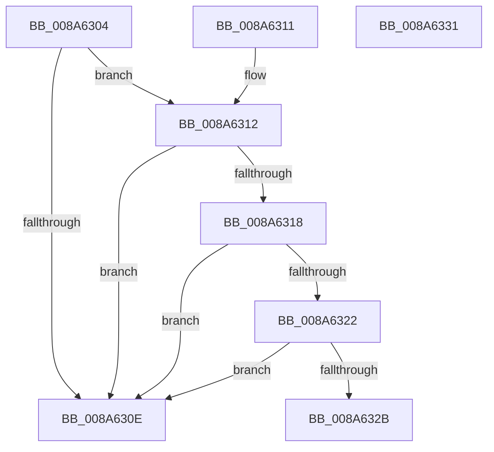

# EtwpIsProcessZombie

- RVA: `0x008A6304`–`0x008A6332` (길이 `46` bytes)
- VA: `0x00000001408A6304`
- 실행 섹션: `PAGE`
- PDB 이름 있음: `예`; PDB Function 태그: `아니요`
- unwind 정보 RVA: `0x000DB714`
- 디코드: `17`개 명령, `46/46` bytes 표시
- 미해석 바이트: `0` (있으면 어셈블리에 `.byte`로 보존)

> 이 문서는 커널 이미지의 기계어와 PDB 기호를 분석해 생성했습니다. 4번과 5번은 함수 원형과 자료형을 바이너리 사용 방식에서 추정한 C 해석이며 원본 소스 복구 결과는 아닙니다.

## 1. Dependencies

- 직접 호출 지점: **0**; 고유 호출 대상: **0**
- 직접 호출자로 확인된 함수: **2**
- RIP 상대 이미지 참조: **0**

### Outgoing calls
- 직접 디코드된 call 명령이 없습니다.

### Direct callers
- [EtwpProcessEnumCallback](EtwpProcessEnumCallback_function_008A5F40.md) at `0x008A5FAC`
- [EtwpPsProvProcessEnumCallback](../A7/EtwpPsProvProcessEnumCallback_function_00A76690.md) at `0x00A766F4`

### Static image references
- 디코드된 RIP-relative 메모리 참조가 없습니다.

## 2. Other-region calls and transfers

- 다른 실행 섹션으로 향하는 call: **0**
- 별도 외부 분기/꼬리 이동을 확인하지 못했습니다.

## 3. Assembly (complete function range)

```asm
008A6304  8B 81 F4 01 00 00               mov eax, dword ptr [rcx + 0x1f4]
008A630A  A8 04                           test al, 4
008A630C  75 04                           jne 0x1408a6312
008A630E  33 C0                           xor eax, eax
008A6310  C3                              ret
008A6311  CC                              int3
008A6312  83 79 04 00                     cmp dword ptr [rcx + 4], 0
008A6316  74 F6                           je 0x1408a630e
008A6318  8B 81 80 03 00 00               mov eax, dword ptr [rcx + 0x380]
008A631E  85 C0                           test eax, eax
008A6320  75 EC                           jne 0x1408a630e
008A6322  48 8D 41 30                     lea rax, [rcx + 0x30]
008A6326  48 39 00                        cmp qword ptr [rax], rax
008A6329  75 E3                           jne 0x1408a630e
008A632B  B8 01 00 00 00                  mov eax, 1
008A6330  C3                              ret
008A6331  CC                              int3
```

## 4. C-style interpretation (structured pseudocode)

```c
__int64 __fastcall EtwpIsProcessZombie(__int64 a1)
{
    __int64 result;

    if ((((unsigned __int8)((unsigned int)(*(unsigned int *)(a1 + 500)))) & (4)) != 0) goto loc_008A6312;
loc_008A630E:
    result = 0;
    return result;
loc_008A6312:
    if ((*(unsigned int *)(a1 + 4)) == 0) goto loc_008A630E;
    if ((unsigned int)((unsigned int)(*(unsigned int *)(a1 + 896))) != 0) goto loc_008A630E;
    if ((*(unsigned __int64 *)(a1 + 48)) != (a1 + 48)) goto loc_008A630E;
    return 1;
}
```

## 5. (Beta) C Style

```c
int64_t EtwpIsProcessZombie(void *Arg1)
{
    uint8_t *arg1 = (uint8_t *)Arg1;

    int64_t result;

    if ((((uint8_t)((uint32_t)(*(uint32_t *)(arg1 + 0x1F4)))) & (4)) != 0) goto loc_008A6312;
loc_008A630E:
    result = 0;
    return result;
loc_008A6312:
    if ((*(uint32_t *)(arg1 + 0x4)) == 0) goto loc_008A630E;
    if ((uint32_t)((uint32_t)(*(uint32_t *)(arg1 + 0x380))) != 0) goto loc_008A630E;
    if ((*(uint64_t *)(arg1 + 0x30)) != (Arg1 + 48)) goto loc_008A630E;
    return 1;
}
```

### 관측된 메모리 오프셋

구조체 형식이 확인되지 않은 접근은 인자 기준의 오프셋으로만 기록했습니다.

| 기준 인자 | 오프셋 표현 | 폭 (bit) | 접근 |
|---|---:|---:|---|
| `Arg1` | `+ 0x0` | `64` | `R` |
| `Arg1` | `+ 0x4` | `32` | `R` |
| `Arg1` | `+ 0x30` | `64` | `R` |
| `Arg1` | `+ 0x1F4` | `32` | `R` |
| `Arg1` | `+ 0x380` | `32` | `R` |

## 6. Execution-region graph

[열기: 2D/3D 그래프와 함수 탐색 컨트롤 패널](../../../control-panel.html?section=page&rva=0x008A6304&view=graph)

- 2D 그래프는 위에서 아래로 흐르고, 3D 그래프는 빈 공간을 드래그해 회전합니다. Shift+드래그는 이동, 휠은 확대·축소, 함수 노드 선택은 대상 보고서 이동입니다.

### Static fallback


