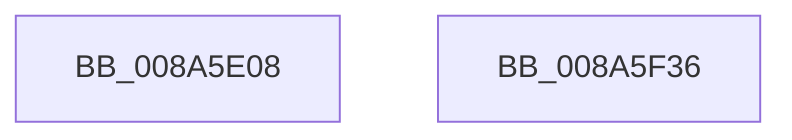

# EtwpProcessPerfCtrsRundown

- RVA: `0x008A5E08`–`0x008A5F37` (길이 `303` bytes)
- VA: `0x00000001408A5E08`
- 실행 섹션: `PAGE`
- PDB 이름 있음: `예`; PDB Function 태그: `아니요`
- unwind 정보 RVA: `0x0007F09C`
- 디코드: `66`개 명령, `303/303` bytes 표시
- 미해석 바이트: `0` (있으면 어셈블리에 `.byte`로 보존)

> 이 문서는 커널 이미지의 기계어와 PDB 기호를 분석해 생성했습니다. 4번과 5번은 함수 원형과 자료형을 바이너리 사용 방식에서 추정한 C 해석이며 원본 소스 복구 결과는 아닙니다.

## 1. Dependencies

- 직접 호출 지점: **3**; 고유 호출 대상: **3**
- 직접 호출자로 확인된 함수: **1**
- RIP 상대 이미지 참조: **1**

### Outgoing calls
- `0x008A5E43` → [ObGetProcessHandleCount](../91/ObGetProcessHandleCount_function_009195D0.md) (function, `0x009195D0`)
- `0x008A5F10` → [EtwpLogKernelEvent](../../text/25/EtwpLogKernelEvent_function_0025CC00.md) (function, `0x0025CC00`)
- `0x008A5F1C` → [_security_check_cookie](../../text/6A/_security_check_cookie_function_006AC640.md) (function, `0x006AC640`)

### Direct callers
- [EtwpProcessEnumCallback](EtwpProcessEnumCallback_function_008A5F40.md) at `0x008A606E`

### Static image references
- `0x008A5E1F` → RVA `0x00E0A740` (`.data`; read)

## 2. Other-region calls and transfers

- 다른 실행 섹션으로 향하는 call: **2**
  - `0x008A5F10` → [EtwpLogKernelEvent](../../text/25/EtwpLogKernelEvent_function_0025CC00.md) (`PAGE` → `.text`)
  - `0x008A5F1C` → [_security_check_cookie](../../text/6A/_security_check_cookie_function_006AC640.md) (`PAGE` → `.text`)
- 별도 외부 분기/꼬리 이동을 확인하지 못했습니다.

## 3. Assembly (complete function range)

```asm
008A5E08  48 89 5C 24 18                  mov qword ptr [rsp + 0x18], rbx
008A5E0D  48 89 7C 24 20                  mov qword ptr [rsp + 0x20], rdi
008A5E12  55                              push rbp
008A5E13  48 8D 6C 24 A9                  lea rbp, [rsp - 0x57]
008A5E18  48 81 EC C0 00 00 00            sub rsp, 0xc0
008A5E1F  48 8B 05 1A 49 56 00            mov rax, qword ptr [rip + 0x56491a]
008A5E26  48 33 C4                        xor rax, rsp
008A5E29  48 89 45 47                     mov qword ptr [rbp + 0x47], rax
008A5E2D  33 C0                           xor eax, eax
008A5E2F  48 8B FA                        mov rdi, rdx
008A5E32  89 45 D3                        mov dword ptr [rbp - 0x2d], eax
008A5E35  33 D2                           xor edx, edx
008A5E37  8B 81 D0 01 00 00               mov eax, dword ptr [rcx + 0x1d0]
008A5E3D  48 8B D9                        mov rbx, rcx
008A5E40  89 45 C7                        mov dword ptr [rbp - 0x39], eax
008A5E43  E8 88 37 07 00                  call 0x1409195d0
008A5E48  89 45 CF                        mov dword ptr [rbp - 0x31], eax
008A5E4B  48 8D 4D 37                     lea rcx, [rbp + 0x37]
008A5E4F  8B 83 04 04 00 00               mov eax, dword ptr [rbx + 0x404]
008A5E55  41 B9 01 00 00 00               mov r9d, 1
008A5E5B  89 45 CB                        mov dword ptr [rbp - 0x35], eax
008A5E5E  48 8B 83 28 02 00 00            mov rax, qword ptr [rbx + 0x228]
008A5E65  48 89 45 FF                     mov qword ptr [rbp - 1], rax
008A5E69  48 8B 83 20 02 00 00            mov rax, qword ptr [rbx + 0x220]
008A5E70  48 89 45 D7                     mov qword ptr [rbp - 0x29], rax
008A5E74  48 8B 83 80 04 00 00            mov rax, qword ptr [rbx + 0x480]
008A5E7B  48 C1 E0 0C                     shl rax, 0xc
008A5E7F  48 89 45 07                     mov qword ptr [rbp + 7], rax
008A5E83  48 8B 83 A0 04 00 00            mov rax, qword ptr [rbx + 0x4a0]
008A5E8A  48 C1 E0 0C                     shl rax, 0xc
008A5E8E  48 89 45 DF                     mov qword ptr [rbp - 0x21], rax
008A5E92  48 8B 83 08 02 00 00            mov rax, qword ptr [rbx + 0x208]
008A5E99  48 89 45 17                     mov qword ptr [rbp + 0x17], rax
008A5E9D  48 8B 83 18 02 00 00            mov rax, qword ptr [rbx + 0x218]
008A5EA4  48 89 45 EF                     mov qword ptr [rbp - 0x11], rax
008A5EA8  48 8B 83 00 02 00 00            mov rax, qword ptr [rbx + 0x200]
008A5EAF  48 89 45 1F                     mov qword ptr [rbp + 0x1f], rax
008A5EB3  48 8B 83 10 02 00 00            mov rax, qword ptr [rbx + 0x210]
008A5EBA  48 89 45 F7                     mov qword ptr [rbp - 9], rax
008A5EBE  48 8B 83 D8 03 00 00            mov rax, qword ptr [rbx + 0x3d8]
008A5EC5  48 C1 E0 0C                     shl rax, 0xc
008A5EC9  48 89 45 0F                     mov qword ptr [rbp + 0xf], rax
008A5ECD  48 8B 83 E0 03 00 00            mov rax, qword ptr [rbx + 0x3e0]
008A5ED4  83 65 43 00                     and dword ptr [rbp + 0x43], 0
008A5ED8  44 8B 07                        mov r8d, dword ptr [rdi]
008A5EDB  48 8B 97 50 05 00 00            mov rdx, qword ptr [rdi + 0x550]
008A5EE2  48 C1 E0 0C                     shl rax, 0xc
008A5EE6  48 89 45 E7                     mov qword ptr [rbp - 0x19], rax
008A5EEA  48 8B 45 0F                     mov rax, qword ptr [rbp + 0xf]
008A5EEE  48 89 45 27                     mov qword ptr [rbp + 0x27], rax
008A5EF2  48 8D 45 C7                     lea rax, [rbp - 0x39]
008A5EF6  C7 44 24 28 02 18 50 00         mov dword ptr [rsp + 0x28], 0x501802
008A5EFE  48 89 45 37                     mov qword ptr [rbp + 0x37], rax
008A5F02  C7 45 3F 68 00 00 00            mov dword ptr [rbp + 0x3f], 0x68
008A5F09  66 C7 44 24 20 21 03            mov word ptr [rsp + 0x20], 0x321
008A5F10  E8 EB 6C 9B FF                  call 0x14025cc00
008A5F15  48 8B 4D 47                     mov rcx, qword ptr [rbp + 0x47]
008A5F19  48 33 CC                        xor rcx, rsp
008A5F1C  E8 1F 67 E0 FF                  call 0x1406ac640
008A5F21  4C 8D 9C 24 C0 00 00 00         lea r11, [rsp + 0xc0]
008A5F29  49 8B 5B 20                     mov rbx, qword ptr [r11 + 0x20]
008A5F2D  49 8B 7B 28                     mov rdi, qword ptr [r11 + 0x28]
008A5F31  49 8B E3                        mov rsp, r11
008A5F34  5D                              pop rbp
008A5F35  C3                              ret
008A5F36  CC                              int3
```

## 4. C-style interpretation (structured pseudocode)

```c
__int64 __fastcall EtwpProcessPerfCtrsRundown(__int64 a1, __int64 a2)
{
    __int64 result;
    __int64 v_rsp;
    unsigned __int64 v_stack_m18;
    unsigned int v_stack_m1C;
    unsigned int v_stack_m20;
    unsigned __int64 v_stack_m28;
    unsigned __int64 v_stack_m38;
    unsigned __int64 v_stack_m40;
    unsigned __int64 v_stack_m48;
    unsigned __int64 v_stack_m50;
    unsigned __int64 v_stack_m58;
    unsigned __int64 v_stack_m5F;
    unsigned __int64 v_stack_m60;
    unsigned __int64 v_stack_m68;
    unsigned __int64 v_stack_m70;
    unsigned __int64 v_stack_m78;
    unsigned __int64 v_stack_m8;
    unsigned __int64 v_stack_m80;
    unsigned __int64 v_stack_m88;
    unsigned int v_stack_m8C;
    unsigned int v_stack_m90;
    unsigned int v_stack_m94;
    unsigned int v_stack_m98;
    unsigned int v_stack_mA0;
    unsigned __int16 v_stack_mA8;
    unsigned __int64 v_stack_p18;
    unsigned __int64 v_stack_p20;

    v_stack_p18 = v_rbx;
    v_stack_p20 = v_rdi;
    v_rsp = (v_rsp) - (192);
    result = (*(unsigned __int64 *)(v_rip + 5654810)) ^ (v_rsp);
    v_stack_m18 = result;
    result = 0;
    v_stack_m8C = 0;
    a2 = 0;
    v_stack_m98 = (unsigned int)((unsigned int)(*(unsigned int *)(a1 + 464)));
    result = ObGetProcessHandleCount(a1, a2, a3, a4);
    v_stack_m90 = (unsigned int)(result);
    v_stack_m94 = (unsigned int)((unsigned int)(*(unsigned int *)(a1 + 1028)));
    v_stack_m60 = *(unsigned __int64 *)(a1 + 552);
    v_stack_m88 = *(unsigned __int64 *)(a1 + 544);
    result = (*(unsigned __int64 *)(a1 + 1152)) << (12);
    v_stack_m58 = result;
    result = (*(unsigned __int64 *)(a1 + 1184)) << (12);
    v_stack_m80 = result;
    v_stack_m48 = *(unsigned __int64 *)(a1 + 520);
    v_stack_m70 = *(unsigned __int64 *)(a1 + 536);
    v_stack_m40 = *(unsigned __int64 *)(a1 + 512);
    v_stack_m68 = *(unsigned __int64 *)(a1 + 528);
    result = (*(unsigned __int64 *)(a1 + 984)) << (12);
    v_stack_m50 = result;
    result = (*(unsigned __int64 *)(a1 + 992)) << (12);
    v_stack_m78 = result;
    v_stack_m38 = v_stack_m50;
    v_stack_mA0 = 0x501802ULL;
    v_stack_m28 = v_stack_m98;
    v_stack_m20 = 104;
    v_stack_mA8 = 801;
    result = EtwpLogKernelEvent(v_stack_m28, *(unsigned __int64 *)(a2 + 1360), (unsigned int)(*(unsigned int *)(a2)), 1);
    a1 = (v_stack_m18) ^ (v_rsp);
    result = _security_check_cookie(a1, *(unsigned __int64 *)(a2 + 1360), (unsigned int)(*(unsigned int *)(a2)), 1);
    return result;
}
```

## 5. (Beta) C Style

```c
int64_t EtwpProcessPerfCtrsRundown(void *Arg1, void *Arg2)
{
    uint8_t *arg1 = (uint8_t *)Arg1;
    uint8_t *arg2 = (uint8_t *)Arg2;

    int64_t result;
    int64_t local_rsp;
    uint64_t v_stack_m18;
    uint32_t v_stack_m1C;
    uint32_t v_stack_m20;
    uint64_t v_stack_m28;
    uint64_t v_stack_m38;
    uint64_t v_stack_m40;
    uint64_t v_stack_m48;
    uint64_t v_stack_m50;
    uint64_t v_stack_m58;
    uint64_t v_stack_m5F;
    uint64_t v_stack_m60;
    uint64_t v_stack_m68;
    uint64_t v_stack_m70;
    uint64_t v_stack_m78;
    uint64_t v_stack_m8;
    uint64_t v_stack_m80;
    uint64_t v_stack_m88;
    uint32_t v_stack_m8C;
    uint32_t v_stack_m90;
    uint32_t v_stack_m94;
    uint32_t v_stack_m98;
    uint32_t v_stack_mA0;
    uint16_t v_stack_mA8;
    uint64_t v_stack_p18;
    uint64_t v_stack_p20;

    v_stack_p18 = local_rbx;
    v_stack_p20 = local_rdi;
    local_rsp = (local_rsp) - (192);
    result = (*(uint64_t *)(v_rip + 0x56491A)) ^ (local_rsp);
    v_stack_m18 = result;
    result = 0;
    v_stack_m8C = 0;
    Arg2 = 0;
    v_stack_m98 = (uint32_t)((uint32_t)(*(uint32_t *)(arg1 + 0x1D0)));
    result = ObGetProcessHandleCount(Arg1, Arg2, a3, a4);
    v_stack_m90 = (uint32_t)(result);
    v_stack_m94 = (uint32_t)((uint32_t)(*(uint32_t *)(arg1 + 0x404)));
    v_stack_m60 = *(uint64_t *)(arg1 + 0x228);
    v_stack_m88 = *(uint64_t *)(arg1 + 0x220);
    result = (*(uint64_t *)(arg1 + 0x480)) << (12);
    v_stack_m58 = result;
    result = (*(uint64_t *)(arg1 + 0x4A0)) << (12);
    v_stack_m80 = result;
    v_stack_m48 = *(uint64_t *)(arg1 + 0x208);
    v_stack_m70 = *(uint64_t *)(arg1 + 0x218);
    v_stack_m40 = *(uint64_t *)(arg1 + 0x200);
    v_stack_m68 = *(uint64_t *)(arg1 + 0x210);
    result = (*(uint64_t *)(arg1 + 0x3D8)) << (12);
    v_stack_m50 = result;
    result = (*(uint64_t *)(arg1 + 0x3E0)) << (12);
    v_stack_m78 = result;
    v_stack_m38 = v_stack_m50;
    v_stack_mA0 = 0x501802ULL;
    v_stack_m28 = v_stack_m98;
    v_stack_m20 = 104;
    v_stack_mA8 = 801;
    result = EtwpLogKernelEvent(v_stack_m28, *(uint64_t *)(arg2 + 0x550), (uint32_t)(*(uint32_t *)(arg2)), 1);
    Arg1 = (v_stack_m18) ^ (local_rsp);
    result = _security_check_cookie(Arg1, *(uint64_t *)(arg2 + 0x550), (uint32_t)(*(uint32_t *)(arg2)), 1);
    return result;
}
```

### 관측된 메모리 오프셋

구조체 형식이 확인되지 않은 접근은 인자 기준의 오프셋으로만 기록했습니다.

| 기준 인자 | 오프셋 표현 | 폭 (bit) | 접근 |
|---|---:|---:|---|
| `Arg1` | `+ 0x1D0` | `32` | `R` |
| `Arg1` | `+ 0x200` | `64` | `R` |
| `Arg1` | `+ 0x208` | `64` | `R` |
| `Arg1` | `+ 0x210` | `64` | `R` |
| `Arg1` | `+ 0x218` | `64` | `R` |
| `Arg1` | `+ 0x220` | `64` | `R` |
| `Arg1` | `+ 0x228` | `64` | `R` |
| `Arg1` | `+ 0x3D8` | `64` | `R` |
| `Arg1` | `+ 0x3E0` | `64` | `R` |
| `Arg1` | `+ 0x404` | `32` | `R` |
| `Arg1` | `+ 0x480` | `64` | `R` |
| `Arg1` | `+ 0x4A0` | `64` | `R` |
| `Arg2` | `+ 0x0` | `32` | `R` |
| `Arg2` | `+ 0x550` | `64` | `R` |

## 6. Execution-region graph

[열기: 2D/3D 그래프와 함수 탐색 컨트롤 패널](../../../control-panel.html?section=page&rva=0x008A5E08&view=graph)

- 2D 그래프는 위에서 아래로 흐르고, 3D 그래프는 빈 공간을 드래그해 회전합니다. Shift+드래그는 이동, 휠은 확대·축소, 함수 노드 선택은 대상 보고서 이동입니다.

### Static fallback


