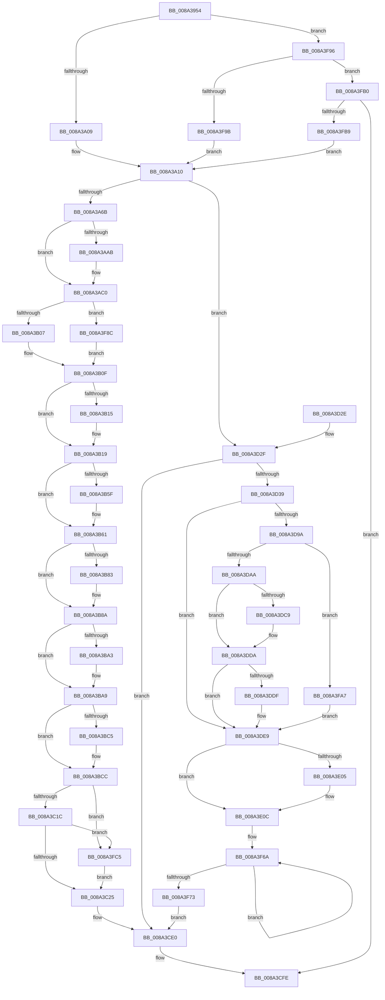

# EtwpPsProvTraceProcess

- RVA: `0x008A3954`–`0x008A3FFD` (길이 `1,705` bytes)
- VA: `0x00000001408A3954`
- 실행 섹션: `PAGE`
- PDB 이름 있음: `예`; PDB Function 태그: `아니요`
- unwind 정보 RVA: `0x0007EEC8`
- 디코드: `367`개 명령, `1,705/1,705` bytes 표시
- 미해석 바이트: `0` (있으면 어셈블리에 `.byte`로 보존)

> 이 문서는 커널 이미지의 기계어와 PDB 기호를 분석해 생성했습니다. 4번과 5번은 함수 원형과 자료형을 바이너리 사용 방식에서 추정한 C 해석이며 원본 소스 복구 결과는 아닙니다.

## 1. Dependencies

- 직접 호출 지점: **24**; 고유 호출 대상: **16**
- 직접 호출자로 확인된 함수: **2**
- RIP 상대 이미지 참조: **7**

### Outgoing calls
- `0x008A39C0` → [memset](../../text/6C/memset_function_006C6C40.md) (function, `0x006C6C40`)
- `0x008A3AA2` → [PsLookupProcessByProcessId](PsLookupProcessByProcessId_function_008A2AA0.md) (function, `0x008A2AA0`)
- `0x008A3ABB` → [ObfDereferenceObject](../../text/2F/ObfDereferenceObject_function_002F9350.md) (function, `0x002F9350`)
- `0x008A3AD6` → [PsGetProcessSessionId](../../text/22/PsGetProcessSessionId_function_002233A0.md) (function, `0x002233A0`)
- `0x008A3B3C` → [PsReferencePrimaryTokenWithTag](../../text/20/PsReferencePrimaryTokenWithTag_function_0020FF80.md) (function, `0x0020FF80`)
- `0x008A3B51` → [SeQueryInformationToken](../8B/SeQueryInformationToken_function_008B5090.md) (function, `0x008B5090`)
- `0x008A3B85` → [ExFreePoolWithTag](../../poolcode/B8/ExFreePoolWithTag_function_00B82870.md) (function, `0x00B82870`)
- `0x008A3B96` → [SeQueryInformationToken](../8B/SeQueryInformationToken_function_008B5090.md) (function, `0x008B5090`)
- `0x008A3BC7` → [ExFreePoolWithTag](../../poolcode/B8/ExFreePoolWithTag_function_00B82870.md) (function, `0x00B82870`)
- `0x008A3BD3` → [SeQueryTokenIntegrity](../../text/41/SeQueryTokenIntegrity_function_00419CF4.md) (function, `0x00419CF4`)
- `0x008A3C07` → [ObFastDereferenceObject](../../text/3E/ObFastDereferenceObject_function_003ED5F0.md) (function, `0x003ED5F0`)
- `0x008A3CBB` → [EtwpQueryProcessEnabledSecurityMitigations](../../text/49/EtwpQueryProcessEnabledSecurityMitigations_function_0049BED0.md) (function, `0x0049BED0`)
- `0x008A3CF9` → [EtwWrite](../../text/41/EtwWrite_function_0041C720.md) (function, `0x0041C720`)
- `0x008A3D08` → [_security_check_cookie](../../text/6A/_security_check_cookie_function_006AC640.md) (function, `0x006AC640`)
- `0x008A3D48` → [PsQueryStatisticsProcess](../91/PsQueryStatisticsProcess_function_00919350.md) (function, `0x00919350`)
- `0x008A3D7D` → [PsReferencePrimaryTokenWithTag](../../text/20/PsReferencePrimaryTokenWithTag_function_0020FF80.md) (function, `0x0020FF80`)
- `0x008A3D91` → [SeQueryInformationToken](../8B/SeQueryInformationToken_function_008B5090.md) (function, `0x008B5090`)
- `0x008A3DBB` → [SeQueryInformationToken](../8B/SeQueryInformationToken_function_008B5090.md) (function, `0x008B5090`)
- `0x008A3DE4` → [ExFreePoolWithTag](../../poolcode/B8/ExFreePoolWithTag_function_00B82870.md) (function, `0x00B82870`)
- `0x008A3DF6` → [ObFastDereferenceObject](../../text/3E/ObFastDereferenceObject_function_003ED5F0.md) (function, `0x003ED5F0`)
- `0x008A3E07` → [ExFreePoolWithTag](../../poolcode/B8/ExFreePoolWithTag_function_00B82870.md) (function, `0x00B82870`)
- `0x008A3E24` → [ObGetProcessHandleCount](../91/ObGetProcessHandleCount_function_009195D0.md) (function, `0x009195D0`)
- `0x008A3FDF` → [RtlStringCchPrintfW](../../text/48/RtlStringCchPrintfW_function_00482D5C.md) (function, `0x00482D5C`)
- `0x008A3FEF` → [RtlInitUnicodeString](../../text/42/RtlInitUnicodeString_function_0042A780.md) (function, `0x0042A780`)

### Direct callers
- [EtwpWriteProcessEvent](EtwpWriteProcessEvent_function_008A420C.md) at `0x008A432D`
- [sub_00B413EC](../B4/Unknown_function_00B413EC.md) at `0x00B4149D`

### Static image references
- `0x008A397A` → RVA `0x00E0A740` (`.data`; read)
- `0x008A3A09` → RVA `0x00011170` (`.rdata`; read)
- `0x008A3C33` → RVA `0x000105E0` (`.rdata`; read)
- `0x008A3CE0` → RVA `0x00EFF9E8` (`.data`; read)
- `0x008A3F9B` → RVA `0x00011180` (`.rdata`; read)
- `0x008A3FB9` → RVA `0x00021CA8` (`.rdata`; read)
- `0x008A3FD1` → RVA `0x00B07520` (` ?? ::NNGAKEGL::`string'`; read)

## 2. Other-region calls and transfers

- 다른 실행 섹션으로 향하는 call: **17**
  - `0x008A39C0` → [memset](../../text/6C/memset_function_006C6C40.md) (`PAGE` → `.text`)
  - `0x008A3ABB` → [ObfDereferenceObject](../../text/2F/ObfDereferenceObject_function_002F9350.md) (`PAGE` → `.text`)
  - `0x008A3AD6` → [PsGetProcessSessionId](../../text/22/PsGetProcessSessionId_function_002233A0.md) (`PAGE` → `.text`)
  - `0x008A3B3C` → [PsReferencePrimaryTokenWithTag](../../text/20/PsReferencePrimaryTokenWithTag_function_0020FF80.md) (`PAGE` → `.text`)
  - `0x008A3B85` → [ExFreePoolWithTag](../../poolcode/B8/ExFreePoolWithTag_function_00B82870.md) (`PAGE` → `POOLCODE`)
  - `0x008A3BC7` → [ExFreePoolWithTag](../../poolcode/B8/ExFreePoolWithTag_function_00B82870.md) (`PAGE` → `POOLCODE`)
  - `0x008A3BD3` → [SeQueryTokenIntegrity](../../text/41/SeQueryTokenIntegrity_function_00419CF4.md) (`PAGE` → `.text`)
  - `0x008A3C07` → [ObFastDereferenceObject](../../text/3E/ObFastDereferenceObject_function_003ED5F0.md) (`PAGE` → `.text`)
  - `0x008A3CBB` → [EtwpQueryProcessEnabledSecurityMitigations](../../text/49/EtwpQueryProcessEnabledSecurityMitigations_function_0049BED0.md) (`PAGE` → `.text`)
  - `0x008A3CF9` → [EtwWrite](../../text/41/EtwWrite_function_0041C720.md) (`PAGE` → `.text`)
  - `0x008A3D08` → [_security_check_cookie](../../text/6A/_security_check_cookie_function_006AC640.md) (`PAGE` → `.text`)
  - `0x008A3D7D` → [PsReferencePrimaryTokenWithTag](../../text/20/PsReferencePrimaryTokenWithTag_function_0020FF80.md) (`PAGE` → `.text`)
  - `0x008A3DE4` → [ExFreePoolWithTag](../../poolcode/B8/ExFreePoolWithTag_function_00B82870.md) (`PAGE` → `POOLCODE`)
  - `0x008A3DF6` → [ObFastDereferenceObject](../../text/3E/ObFastDereferenceObject_function_003ED5F0.md) (`PAGE` → `.text`)
  - `0x008A3E07` → [ExFreePoolWithTag](../../poolcode/B8/ExFreePoolWithTag_function_00B82870.md) (`PAGE` → `POOLCODE`)
  - `0x008A3FDF` → [RtlStringCchPrintfW](../../text/48/RtlStringCchPrintfW_function_00482D5C.md) (`PAGE` → `.text`)
  - `0x008A3FEF` → [RtlInitUnicodeString](../../text/42/RtlInitUnicodeString_function_0042A780.md) (`PAGE` → `.text`)
- 별도 외부 분기/꼬리 이동을 확인하지 못했습니다.

## 3. Assembly (complete function range)

```asm
008A3954  48 8B C4                        mov rax, rsp
008A3957  48 89 58 10                     mov qword ptr [rax + 0x10], rbx
008A395B  48 89 70 18                     mov qword ptr [rax + 0x18], rsi
008A395F  48 89 78 20                     mov qword ptr [rax + 0x20], rdi
008A3963  55                              push rbp
008A3964  41 54                           push r12
008A3966  41 55                           push r13
008A3968  41 56                           push r14
008A396A  41 57                           push r15
008A396C  48 8D A8 68 FE FF FF            lea rbp, [rax - 0x198]
008A3973  48 81 EC 70 02 00 00            sub rsp, 0x270
008A397A  48 8B 05 BF 6D 56 00            mov rax, qword ptr [rip + 0x566dbf]
008A3981  48 33 C4                        xor rax, rsp
008A3984  48 89 85 60 01 00 00            mov qword ptr [rbp + 0x160], rax
008A398B  33 F6                           xor esi, esi
008A398D  4D 8B F8                        mov r15, r8
008A3990  44 8B F2                        mov r14d, edx
008A3993  89 74 24 34                     mov dword ptr [rsp + 0x34], esi
008A3997  48 8B D9                        mov rbx, rcx
008A399A  89 74 24 54                     mov dword ptr [rsp + 0x54], esi
008A399E  33 D2                           xor edx, edx
008A39A0  89 74 24 58                     mov dword ptr [rsp + 0x58], esi
008A39A4  44 8D 46 68                     lea r8d, [rsi + 0x68]
008A39A8  89 74 24 30                     mov dword ptr [rsp + 0x30], esi
008A39AC  48 8D 4D C0                     lea rcx, [rbp - 0x40]
008A39B0  89 74 24 40                     mov dword ptr [rsp + 0x40], esi
008A39B4  4D 8B E9                        mov r13, r9
008A39B7  48 89 74 24 78                  mov qword ptr [rsp + 0x78], rsi
008A39BC  48 89 75 80                     mov qword ptr [rbp - 0x80], rsi
008A39C0  E8 7B 32 E2 FF                  call 0x1406c6c40
008A39C5  0F B7 95 C0 01 00 00            movzx edx, word ptr [rbp + 0x1c0]
008A39CC  48 83 CF FF                     or rdi, 0xffffffffffffffff
008A39D0  83 4C 24 5C FF                  or dword ptr [rsp + 0x5c], 0xffffffff
008A39D5  0F 57 C0                        xorps xmm0, xmm0
008A39D8  8B CA                           mov ecx, edx
008A39DA  89 74 24 44                     mov dword ptr [rsp + 0x44], esi
008A39DE  41 B9 01 03 00 00               mov r9d, 0x301
008A39E4  89 74 24 48                     mov dword ptr [rsp + 0x48], esi
008A39E8  89 74 24 4C                     mov dword ptr [rsp + 0x4c], esi
008A39EC  89 74 24 50                     mov dword ptr [rsp + 0x50], esi
008A39F0  48 89 7D 88                     mov qword ptr [rbp - 0x78], rdi
008A39F4  89 74 24 60                     mov dword ptr [rsp + 0x60], esi
008A39F8  0F 11 45 A8                     movups xmmword ptr [rbp - 0x58], xmm0
008A39FC  0F 11 45 98                     movups xmmword ptr [rbp - 0x68], xmm0
008A3A00  41 2B C9                        sub ecx, r9d
008A3A03  0F 85 8D 05 00 00               jne 0x1408a3f96
008A3A09  4C 8D 25 60 D7 76 FF            lea r12, [rip - 0x8928a0]
008A3A10  8B 83 D0 01 00 00               mov eax, dword ptr [rbx + 0x1d0]
008A3A16  B9 FD FF 00 00                  mov ecx, 0xfffd
008A3A1B  89 44 24 70                     mov dword ptr [rsp + 0x70], eax
008A3A1F  BE 03 00 00 00                  mov esi, 3
008A3A24  48 8D 44 24 70                  lea rax, [rsp + 0x70]
008A3A29  48 C7 45 38 04 00 00 00         mov qword ptr [rbp + 0x38], 4
008A3A31  48 89 45 30                     mov qword ptr [rbp + 0x30], rax
008A3A35  48 8D 83 78 06 00 00            lea rax, [rbx + 0x678]
008A3A3C  48 89 45 40                     mov qword ptr [rbp + 0x40], rax
008A3A40  48 8D 83 F8 01 00 00            lea rax, [rbx + 0x1f8]
008A3A47  48 89 45 50                     mov qword ptr [rbp + 0x50], rax
008A3A4B  0F B7 C2                        movzx eax, dx
008A3A4E  66 41 2B C1                     sub ax, r9w
008A3A52  48 C7 45 48 08 00 00 00         mov qword ptr [rbp + 0x48], 8
008A3A5A  48 C7 45 58 08 00 00 00         mov qword ptr [rbp + 0x58], 8
008A3A62  66 85 C1                        test cx, ax
008A3A65  0F 85 C4 02 00 00               jne 0x1408a3d2f
008A3A6B  8B 83 D0 02 00 00               mov eax, dword ptr [rbx + 0x2d0]
008A3A71  48 8D 54 24 68                  lea rdx, [rsp + 0x68]
008A3A76  33 C9                           xor ecx, ecx
008A3A78  89 44 24 54                     mov dword ptr [rsp + 0x54], eax
008A3A7C  48 89 4C 24 68                  mov qword ptr [rsp + 0x68], rcx
008A3A81  48 8D 44 24 54                  lea rax, [rsp + 0x54]
008A3A86  48 89 4C 24 38                  mov qword ptr [rsp + 0x38], rcx
008A3A8B  48 89 4D 90                     mov qword ptr [rbp - 0x70], rcx
008A3A8F  48 8B 8B D0 02 00 00            mov rcx, qword ptr [rbx + 0x2d0]
008A3A96  48 89 45 60                     mov qword ptr [rbp + 0x60], rax
008A3A9A  48 C7 45 68 04 00 00 00         mov qword ptr [rbp + 0x68], 4
008A3AA2  E8 F9 EF FF FF                  call 0x1408a2aa0
008A3AA7  85 C0                           test eax, eax
008A3AA9  78 15                           js 0x1408a3ac0
008A3AAB  48 8B 4C 24 68                  mov rcx, qword ptr [rsp + 0x68]
008A3AB0  48 8B 81 78 06 00 00            mov rax, qword ptr [rcx + 0x678]
008A3AB7  48 89 45 88                     mov qword ptr [rbp - 0x78], rax
008A3ABB  E8 90 58 A5 FF                  call 0x1402f9350
008A3AC0  83 65 7C 00                     and dword ptr [rbp + 0x7c], 0
008A3AC4  48 8D 45 88                     lea rax, [rbp - 0x78]
008A3AC8  48 8B CB                        mov rcx, rbx
008A3ACB  48 89 45 70                     mov qword ptr [rbp + 0x70], rax
008A3ACF  C7 45 78 08 00 00 00            mov dword ptr [rbp + 0x78], 8
008A3AD6  E8 C5 F8 97 FF                  call 0x1402233a0
008A3ADB  83 A5 8C 00 00 00 00            and dword ptr [rbp + 0x8c], 0
008A3AE2  B9 04 00 00 00                  mov ecx, 4
008A3AE7  89 44 24 58                     mov dword ptr [rsp + 0x58], eax
008A3AEB  48 8D 44 24 58                  lea rax, [rsp + 0x58]
008A3AF0  48 89 85 80 00 00 00            mov qword ptr [rbp + 0x80], rax
008A3AF7  89 8D 88 00 00 00               mov dword ptr [rbp + 0x88], ecx
008A3AFD  41 F6 C6 01                     test r14b, 1
008A3B01  0F 84 85 04 00 00               je 0x1408a3f8c
008A3B07  C7 44 24 34 01 00 00 00         mov dword ptr [rsp + 0x34], 1
008A3B0F  41 F6 C6 08                     test r14b, 8
008A3B13  74 04                           je 0x1408a3b19
008A3B15  89 74 24 34                     mov dword ptr [rsp + 0x34], esi
008A3B19  83 A5 9C 00 00 00 00            and dword ptr [rbp + 0x9c], 0
008A3B20  48 8D 44 24 34                  lea rax, [rsp + 0x34]
008A3B25  89 8D 98 00 00 00               mov dword ptr [rbp + 0x98], ecx
008A3B2B  BE 44 66 6C 74                  mov esi, 0x746c6644
008A3B30  8B D6                           mov edx, esi
008A3B32  48 89 85 90 00 00 00            mov qword ptr [rbp + 0x90], rax
008A3B39  48 8B CB                        mov rcx, rbx
008A3B3C  E8 3F C4 96 FF                  call 0x14020ff80
008A3B41  4C 8D 44 24 38                  lea r8, [rsp + 0x38]
008A3B46  BA 12 00 00 00                  mov edx, 0x12
008A3B4B  48 8B C8                        mov rcx, rax
008A3B4E  4C 8B F0                        mov r14, rax
008A3B51  E8 3A 15 01 00                  call 0x1408b5090
008A3B56  48 8B 4C 24 38                  mov rcx, qword ptr [rsp + 0x38]
008A3B5B  85 C0                           test eax, eax
008A3B5D  78 02                           js 0x1408a3b61
008A3B5F  8B 39                           mov edi, dword ptr [rcx]
008A3B61  89 7C 24 30                     mov dword ptr [rsp + 0x30], edi
008A3B65  48 8D 44 24 30                  lea rax, [rsp + 0x30]
008A3B6A  33 FF                           xor edi, edi
008A3B6C  48 89 85 A0 00 00 00            mov qword ptr [rbp + 0xa0], rax
008A3B73  48 C7 85 A8 00 00 00 04 00 00 00  mov qword ptr [rbp + 0xa8], 4
008A3B7E  48 85 C9                        test rcx, rcx
008A3B81  74 07                           je 0x1408a3b8a
008A3B83  33 D2                           xor edx, edx
008A3B85  E8 E6 EC 2D 00                  call 0x140b82870
008A3B8A  4C 8D 45 90                     lea r8, [rbp - 0x70]
008A3B8E  BA 14 00 00 00                  mov edx, 0x14
008A3B93  49 8B CE                        mov rcx, r14
008A3B96  E8 F5 14 01 00                  call 0x1408b5090
008A3B9B  48 8B 4D 90                     mov rcx, qword ptr [rbp - 0x70]
008A3B9F  85 C0                           test eax, eax
008A3BA1  78 06                           js 0x1408a3ba9
008A3BA3  8B 01                           mov eax, dword ptr [rcx]
008A3BA5  89 44 24 5C                     mov dword ptr [rsp + 0x5c], eax
008A3BA9  48 C7 85 B8 00 00 00 04 00 00 00  mov qword ptr [rbp + 0xb8], 4
008A3BB4  48 8D 44 24 5C                  lea rax, [rsp + 0x5c]
008A3BB9  48 89 85 B0 00 00 00            mov qword ptr [rbp + 0xb0], rax
008A3BC0  48 85 C9                        test rcx, rcx
008A3BC3  74 07                           je 0x1408a3bcc
008A3BC5  33 D2                           xor edx, edx
008A3BC7  E8 A4 EC 2D 00                  call 0x140b82870
008A3BCC  48 8D 55 98                     lea rdx, [rbp - 0x68]
008A3BD0  49 8B CE                        mov rcx, r14
008A3BD3  E8 1C 61 B7 FF                  call 0x140419cf4
008A3BD8  48 8B 55 98                     mov rdx, qword ptr [rbp - 0x68]
008A3BDC  48 8D 8B 48 02 00 00            lea rcx, [rbx + 0x248]
008A3BE3  44 8B C6                        mov r8d, esi
008A3BE6  0F B6 42 01                     movzx eax, byte ptr [rdx + 1]
008A3BEA  48 89 95 C0 00 00 00            mov qword ptr [rbp + 0xc0], rdx
008A3BF1  49 8B D6                        mov rdx, r14
008A3BF4  89 BD CC 00 00 00               mov dword ptr [rbp + 0xcc], edi
008A3BFA  8D 04 85 08 00 00 00            lea eax, [rax*4 + 8]
008A3C01  89 85 C8 00 00 00               mov dword ptr [rbp + 0xc8], eax
008A3C07  E8 E4 99 B4 FF                  call 0x1403ed5f0
008A3C0C  48 8B 83 50 03 00 00            mov rax, qword ptr [rbx + 0x350]
008A3C13  48 85 C0                        test rax, rax
008A3C16  0F 84 A9 03 00 00               je 0x1408a3fc5
008A3C1C  66 39 38                        cmp word ptr [rax], di
008A3C1F  0F 84 A0 03 00 00               je 0x1408a3fc5
008A3C25  0F B7 08                        movzx ecx, word ptr [rax]
008A3C28  48 8B 40 08                     mov rax, qword ptr [rax + 8]
008A3C2C  48 89 85 D0 00 00 00            mov qword ptr [rbp + 0xd0], rax
008A3C33  48 8D 05 A6 C9 76 FF            lea rax, [rip - 0x89365a]
008A3C3A  48 89 85 E0 00 00 00            mov qword ptr [rbp + 0xe0], rax
008A3C41  49 8D 45 04                     lea rax, [r13 + 4]
008A3C45  48 89 85 00 01 00 00            mov qword ptr [rbp + 0x100], rax
008A3C4C  49 8D 47 18                     lea rax, [r15 + 0x18]
008A3C50  48 89 85 10 01 00 00            mov qword ptr [rbp + 0x110], rax
008A3C57  41 8B 07                        mov eax, dword ptr [r15]
008A3C5A  89 85 18 01 00 00               mov dword ptr [rbp + 0x118], eax
008A3C60  49 8D 87 18 01 00 00            lea rax, [r15 + 0x118]
008A3C67  48 89 85 20 01 00 00            mov qword ptr [rbp + 0x120], rax
008A3C6E  41 8B 47 08                     mov eax, dword ptr [r15 + 8]
008A3C72  89 8D D8 00 00 00               mov dword ptr [rbp + 0xd8], ecx
008A3C78  48 8B CB                        mov rcx, rbx
008A3C7B  89 85 28 01 00 00               mov dword ptr [rbp + 0x128], eax
008A3C81  89 BD DC 00 00 00               mov dword ptr [rbp + 0xdc], edi
008A3C87  48 C7 85 E8 00 00 00 02 00 00 00  mov qword ptr [rbp + 0xe8], 2
008A3C92  4C 89 AD F0 00 00 00            mov qword ptr [rbp + 0xf0], r13
008A3C99  48 C7 85 F8 00 00 00 04 00 00 00  mov qword ptr [rbp + 0xf8], 4
008A3CA4  48 C7 85 08 01 00 00 04 00 00 00  mov qword ptr [rbp + 0x108], 4
008A3CAF  89 BD 1C 01 00 00               mov dword ptr [rbp + 0x11c], edi
008A3CB5  89 BD 2C 01 00 00               mov dword ptr [rbp + 0x12c], edi
008A3CBB  E8 10 82 BF FF                  call 0x14049bed0
008A3CC0  89 44 24 60                     mov dword ptr [rsp + 0x60], eax
008A3CC4  BE 11 00 00 00                  mov esi, 0x11
008A3CC9  48 8D 44 24 60                  lea rax, [rsp + 0x60]
008A3CCE  48 C7 85 38 01 00 00 04 00 00 00  mov qword ptr [rbp + 0x138], 4
008A3CD9  48 89 85 30 01 00 00            mov qword ptr [rbp + 0x130], rax
008A3CE0  48 8B 0D 01 BD 65 00            mov rcx, qword ptr [rip + 0x65bd01]
008A3CE7  48 8D 45 30                     lea rax, [rbp + 0x30]
008A3CEB  44 8B CE                        mov r9d, esi
008A3CEE  48 89 44 24 20                  mov qword ptr [rsp + 0x20], rax
008A3CF3  45 33 C0                        xor r8d, r8d
008A3CF6  49 8B D4                        mov rdx, r12
008A3CF9  E8 22 8A B7 FF                  call 0x14041c720
008A3CFE  48 8B 8D 60 01 00 00            mov rcx, qword ptr [rbp + 0x160]
008A3D05  48 33 CC                        xor rcx, rsp
008A3D08  E8 33 89 E0 FF                  call 0x1406ac640
008A3D0D  4C 8D 9C 24 70 02 00 00         lea r11, [rsp + 0x270]
008A3D15  49 8B 5B 38                     mov rbx, qword ptr [r11 + 0x38]
008A3D19  49 8B 73 40                     mov rsi, qword ptr [r11 + 0x40]
008A3D1D  49 8B 7B 48                     mov rdi, qword ptr [r11 + 0x48]
008A3D21  49 8B E3                        mov rsp, r11
008A3D24  41 5F                           pop r15
008A3D26  41 5E                           pop r14
008A3D28  41 5D                           pop r13
008A3D2A  41 5C                           pop r12
008A3D2C  5D                              pop rbp
008A3D2D  C3                              ret
008A3D2E  CC                              int3
008A3D2F  B8 02 03 00 00                  mov eax, 0x302
008A3D34  66 3B D0                        cmp dx, ax
008A3D37  75 A7                           jne 0x1408a3ce0
008A3D39  45 33 FF                        xor r15d, r15d
008A3D3C  48 8D 55 C0                     lea rdx, [rbp - 0x40]
008A3D40  48 8B CB                        mov rcx, rbx
008A3D43  4C 89 7C 24 38                  mov qword ptr [rsp + 0x38], r15
008A3D48  E8 03 56 07 00                  call 0x140919350
008A3D4D  48 8D 83 C0 05 00 00            lea rax, [rbx + 0x5c0]
008A3D54  48 C7 45 68 08 00 00 00         mov qword ptr [rbp + 0x68], 8
008A3D5C  48 89 45 60                     mov qword ptr [rbp + 0x60], rax
008A3D60  45 8D 6F 04                     lea r13d, [r15 + 4]
008A3D64  48 8D 83 54 05 00 00            lea rax, [rbx + 0x554]
008A3D6B  4C 89 6D 78                     mov qword ptr [rbp + 0x78], r13
008A3D6F  BE 44 66 6C 74                  mov esi, 0x746c6644
008A3D74  48 89 45 70                     mov qword ptr [rbp + 0x70], rax
008A3D78  8B D6                           mov edx, esi
008A3D7A  48 8B CB                        mov rcx, rbx
008A3D7D  E8 FE C1 96 FF                  call 0x14020ff80
008A3D82  4C 8D 44 24 38                  lea r8, [rsp + 0x38]
008A3D87  48 8B C8                        mov rcx, rax
008A3D8A  41 8D 57 12                     lea edx, [r15 + 0x12]
008A3D8E  4C 8B F0                        mov r14, rax
008A3D91  E8 FA 12 01 00                  call 0x1408b5090
008A3D96  85 C0                           test eax, eax
008A3D98  78 4F                           js 0x1408a3de9
008A3D9A  48 8B 4C 24 38                  mov rcx, qword ptr [rsp + 0x38]
008A3D9F  8B 11                           mov edx, dword ptr [rcx]
008A3DA1  83 FA 01                        cmp edx, 1
008A3DA4  0F 85 FD 01 00 00               jne 0x1408a3fa7
008A3DAA  4C 8D 44 24 68                  lea r8, [rsp + 0x68]
008A3DAF  4C 89 7C 24 68                  mov qword ptr [rsp + 0x68], r15
008A3DB4  41 8D 57 14                     lea edx, [r15 + 0x14]
008A3DB8  49 8B CE                        mov rcx, r14
008A3DBB  E8 D0 12 01 00                  call 0x1408b5090
008A3DC0  4C 8B 44 24 68                  mov r8, qword ptr [rsp + 0x68]
008A3DC5  85 C0                           test eax, eax
008A3DC7  78 11                           js 0x1408a3dda
008A3DC9  41 8B 00                        mov eax, dword ptr [r8]
008A3DCC  F7 D8                           neg eax
008A3DCE  1B C9                           sbb ecx, ecx
008A3DD0  83 E1 FD                        and ecx, 0xfffffffd
008A3DD3  41 03 CD                        add ecx, r13d
008A3DD6  89 4C 24 30                     mov dword ptr [rsp + 0x30], ecx
008A3DDA  4D 85 C0                        test r8, r8
008A3DDD  74 0A                           je 0x1408a3de9
008A3DDF  33 D2                           xor edx, edx
008A3DE1  49 8B C8                        mov rcx, r8
008A3DE4  E8 87 EA 2D 00                  call 0x140b82870
008A3DE9  48 8D 8B 48 02 00 00            lea rcx, [rbx + 0x248]
008A3DF0  44 8B C6                        mov r8d, esi
008A3DF3  49 8B D6                        mov rdx, r14
008A3DF6  E8 F5 97 B4 FF                  call 0x1403ed5f0
008A3DFB  48 8B 4C 24 38                  mov rcx, qword ptr [rsp + 0x38]
008A3E00  48 85 C9                        test rcx, rcx
008A3E03  74 07                           je 0x1408a3e0c
008A3E05  33 D2                           xor edx, edx
008A3E07  E8 64 EA 2D 00                  call 0x140b82870
008A3E0C  48 8D 44 24 30                  lea rax, [rsp + 0x30]
008A3E11  4C 89 AD 88 00 00 00            mov qword ptr [rbp + 0x88], r13
008A3E18  33 D2                           xor edx, edx
008A3E1A  48 89 85 80 00 00 00            mov qword ptr [rbp + 0x80], rax
008A3E21  48 8B CB                        mov rcx, rbx
008A3E24  E8 A7 57 07 00                  call 0x1409195d0
008A3E29  89 44 24 40                     mov dword ptr [rsp + 0x40], eax
008A3E2D  BA FF FF FF FF                  mov edx, 0xffffffff
008A3E32  48 8D 44 24 40                  lea rax, [rsp + 0x40]
008A3E37  4C 89 AD 98 00 00 00            mov qword ptr [rbp + 0x98], r13
008A3E3E  48 89 85 90 00 00 00            mov qword ptr [rbp + 0x90], rax
008A3E45  48 8B 83 D8 03 00 00            mov rax, qword ptr [rbx + 0x3d8]
008A3E4C  48 C1 E0 0C                     shl rax, 0xc
008A3E50  48 89 44 24 78                  mov qword ptr [rsp + 0x78], rax
008A3E55  48 8D 44 24 78                  lea rax, [rsp + 0x78]
008A3E5A  48 89 85 A0 00 00 00            mov qword ptr [rbp + 0xa0], rax
008A3E61  48 8B 83 E0 03 00 00            mov rax, qword ptr [rbx + 0x3e0]
008A3E68  48 8B 4D 00                     mov rcx, qword ptr [rbp]
008A3E6C  48 C1 E0 0C                     shl rax, 0xc
008A3E70  44 39 7D EC                     cmp dword ptr [rbp - 0x14], r15d
008A3E74  48 89 45 80                     mov qword ptr [rbp - 0x80], rax
008A3E78  48 8D 45 80                     lea rax, [rbp - 0x80]
008A3E7C  48 89 85 B0 00 00 00            mov qword ptr [rbp + 0xb0], rax
008A3E83  48 8D 45 D8                     lea rax, [rbp - 0x28]
008A3E87  48 89 85 C0 00 00 00            mov qword ptr [rbp + 0xc0], rax
008A3E8E  8B 45 E8                        mov eax, dword ptr [rbp - 0x18]
008A3E91  0F 45 C2                        cmovne eax, edx
008A3E94  48 C7 85 A8 00 00 00 08 00 00 00  mov qword ptr [rbp + 0xa8], 8
008A3E9F  44 39 7D F4                     cmp dword ptr [rbp - 0xc], r15d
008A3EA3  89 44 24 44                     mov dword ptr [rsp + 0x44], eax
008A3EA7  48 8D 44 24 44                  lea rax, [rsp + 0x44]
008A3EAC  48 89 85 D0 00 00 00            mov qword ptr [rbp + 0xd0], rax
008A3EB3  8B 45 F0                        mov eax, dword ptr [rbp - 0x10]
008A3EB6  0F 45 C2                        cmovne eax, edx
008A3EB9  48 C7 85 B8 00 00 00 08 00 00 00  mov qword ptr [rbp + 0xb8], 8
008A3EC4  48 C1 F9 0A                     sar rcx, 0xa
008A3EC8  89 44 24 48                     mov dword ptr [rsp + 0x48], eax
008A3ECC  48 8D 44 24 48                  lea rax, [rsp + 0x48]
008A3ED1  48 89 85 E0 00 00 00            mov qword ptr [rbp + 0xe0], rax
008A3ED8  48 8B C1                        mov rax, rcx
008A3EDB  48 C1 F8 20                     sar rax, 0x20
008A3EDF  85 C0                           test eax, eax
008A3EE1  48 89 4D 00                     mov qword ptr [rbp], rcx
008A3EE5  48 8D 44 24 4C                  lea rax, [rsp + 0x4c]
008A3EEA  48 C7 85 C8 00 00 00 08 00 00 00  mov qword ptr [rbp + 0xc8], 8
008A3EF5  0F 45 CA                        cmovne ecx, edx
008A3EF8  48 89 85 F0 00 00 00            mov qword ptr [rbp + 0xf0], rax
008A3EFF  89 4C 24 4C                     mov dword ptr [rsp + 0x4c], ecx
008A3F03  48 8B 4D 08                     mov rcx, qword ptr [rbp + 8]
008A3F07  48 C1 F9 0A                     sar rcx, 0xa
008A3F0B  48 8B C1                        mov rax, rcx
008A3F0E  48 89 4D 08                     mov qword ptr [rbp + 8], rcx
008A3F12  48 C1 F8 20                     sar rax, 0x20
008A3F16  85 C0                           test eax, eax
008A3F18  4C 89 AD D8 00 00 00            mov qword ptr [rbp + 0xd8], r13
008A3F1F  48 8D 44 24 50                  lea rax, [rsp + 0x50]
008A3F24  4C 89 AD E8 00 00 00            mov qword ptr [rbp + 0xe8], r13
008A3F2B  0F 45 CA                        cmovne ecx, edx
008A3F2E  48 89 85 00 01 00 00            mov qword ptr [rbp + 0x100], rax
008A3F35  48 8D 83 A8 04 00 00            lea rax, [rbx + 0x4a8]
008A3F3C  4C 89 AD F8 00 00 00            mov qword ptr [rbp + 0xf8], r13
008A3F43  48 81 C3 38 03 00 00            add rbx, 0x338
008A3F4A  89 4C 24 50                     mov dword ptr [rsp + 0x50], ecx
008A3F4E  48 89 9D 20 01 00 00            mov qword ptr [rbp + 0x120], rbx
008A3F55  4C 89 AD 08 01 00 00            mov qword ptr [rbp + 0x108], r13
008A3F5C  48 89 85 10 01 00 00            mov qword ptr [rbp + 0x110], rax
008A3F63  4C 89 AD 18 01 00 00            mov qword ptr [rbp + 0x118], r13
008A3F6A  48 FF C7                        inc rdi
008A3F6D  44 38 3C 3B                     cmp byte ptr [rbx + rdi], r15b
008A3F71  75 F7                           jne 0x1408a3f6a
008A3F73  FF C7                           inc edi
008A3F75  44 89 BD 2C 01 00 00            mov dword ptr [rbp + 0x12c], r15d
008A3F7C  89 BD 28 01 00 00               mov dword ptr [rbp + 0x128], edi
008A3F82  BE 10 00 00 00                  mov esi, 0x10
008A3F87  E9 54 FD FF FF                  jmp 0x1408a3ce0
008A3F8C  BE 02 00 00 00                  mov esi, 2
008A3F91  E9 79 FB FF FF                  jmp 0x1408a3b0f
008A3F96  83 E9 01                        sub ecx, 1
008A3F99  75 15                           jne 0x1408a3fb0
008A3F9B  4C 8D 25 DE D1 76 FF            lea r12, [rip - 0x892e22]
008A3FA2  E9 69 FA FF FF                  jmp 0x1408a3a10
008A3FA7  89 54 24 30                     mov dword ptr [rsp + 0x30], edx
008A3FAB  E9 39 FE FF FF                  jmp 0x1408a3de9
008A3FB0  83 F9 01                        cmp ecx, 1
008A3FB3  0F 85 45 FD FF FF               jne 0x1408a3cfe
008A3FB9  4C 8D 25 E8 DC 77 FF            lea r12, [rip - 0x882318]
008A3FC0  E9 4B FA FF FF                  jmp 0x1408a3a10
008A3FC5  4C 8D 8B 38 03 00 00            lea r9, [rbx + 0x338]
008A3FCC  BA 0F 00 00 00                  mov edx, 0xf
008A3FD1  4C 8D 05 48 35 26 00            lea r8, [rip + 0x263548]
008A3FD8  48 8D 8D 40 01 00 00            lea rcx, [rbp + 0x140]
008A3FDF  E8 78 ED BD FF                  call 0x140482d5c
008A3FE4  48 8D 95 40 01 00 00            lea rdx, [rbp + 0x140]
008A3FEB  48 8D 4D A8                     lea rcx, [rbp - 0x58]
008A3FEF  E8 8C 67 B8 FF                  call 0x14042a780
008A3FF4  48 8D 45 A8                     lea rax, [rbp - 0x58]
008A3FF8  E9 28 FC FF FF                  jmp 0x1408a3c25
```

## 4. C-style interpretation (structured pseudocode)

```c
__int64 __fastcall EtwpPsProvTraceProcess(__int64 a1, int a2, __int64 a3, __int64 a4)
{
    __int64 result;
    __int64 v_r15;
    __int64 v_rbx;
    __int64 v_rdi;
    __int64 v_rsi;
    __int64 v_rsp;
    unsigned __int64 v_stack_m1F8;
    unsigned __int64 v_stack_m208;
    unsigned __int64 v_stack_m220;
    unsigned __int64 v_stack_m224;
    unsigned int v_stack_m228;
    unsigned int v_stack_m22C;
    unsigned __int64 v_stack_m230;
    unsigned int v_stack_m238;
    unsigned int v_stack_m23C;
    unsigned int v_stack_m240;
    unsigned int v_stack_m244;
    unsigned int v_stack_m248;
    unsigned int v_stack_m24C;
    unsigned int v_stack_m250;
    unsigned int v_stack_m254;
    unsigned int v_stack_m258;
    unsigned __int64 v_stack_m260;
    unsigned int v_stack_m264;
    unsigned int v_stack_m268;
    unsigned __int64 v_stack_m278;
    unsigned __int64 v_stack_m28;

    *(unsigned __int64 *)(v_rsp + 16) = v_rbx;
    *(unsigned __int64 *)(v_rsp + 24) = v_rsi;
    *(unsigned __int64 *)(v_rsp + 32) = v_rdi;
    v_rsp = (v_rsp) - (624);
    result = (*(unsigned __int64 *)(v_rip + 5664191)) ^ (v_rsp);
    *(unsigned __int64 *)(v_rsp - 408 + 352) = result;
    v_rsi = 0;
    v_stack_m264 = 0;
    v_stack_m244 = 0;
    a2 = 0;
    v_stack_m240 = 0;
    v_stack_m268 = 0;
    v_stack_m258 = 0;
    v_stack_m220 = 0;
    *(unsigned __int64 *)(v_rsp - 408 - 128) = 0;
    result = memset(v_rsp - 408 - 64, a2, v_rsi + 104, a4);
    v_rdi = (v_rdi) | (-1);
    v_stack_m254 = 0;
    v_stack_m250 = 0;
    v_stack_m24C = 0;
    v_stack_m248 = 0;
    *(unsigned __int64 *)(v_rsp - 408 - 120) = v_rdi;
    v_stack_m238 = 0;
    *(unsigned __int64 *)(v_rsp - 408 - 88) = v_xmm0;
    *(unsigned __int64 *)(v_rsp - 408 - 104) = v_xmm0;
    a1 = (unsigned int)(((unsigned int)((unsigned int)(*(unsigned __int16 *)(v_rsp - 408 + 448)))) - (769));
    if (condition_is_not_equal) goto loc_008A3F96;
loc_008A3A10:
    v_stack_m228 = (unsigned int)((unsigned int)(*(unsigned int *)(a1 + 464)));
    *(unsigned __int64 *)(v_rsp - 408 + 56) = 4;
    *(unsigned __int64 *)(v_rsp - 408 + 48) = v_stack_m228;
    *(unsigned __int64 *)(v_rsp - 408 + 64) = a1 + 1656;
    *(unsigned __int64 *)(v_rsp - 408 + 80) = a1 + 504;
    result = (unsigned __int16)(((unsigned __int16)(*(unsigned __int16 *)(v_rsp - 408 + 448))) - (769));
    *(unsigned __int64 *)(v_rsp - 408 + 72) = 8;
    *(unsigned __int64 *)(v_rsp - 408 + 88) = 8;
    if ((((unsigned __int16)((unsigned int)(0xFFFDULL))) & ((unsigned __int16)(result))) != 0) goto loc_008A3D2F;
    a1 = 0;
    v_stack_m244 = (unsigned int)((unsigned int)(*(unsigned int *)(a1 + 720)));
    v_stack_m230 = 0;
    v_stack_m260 = 0;
    *(unsigned __int64 *)(v_rsp - 408 - 112) = 0;
    *(unsigned __int64 *)(v_rsp - 408 + 96) = v_stack_m244;
    *(unsigned __int64 *)(v_rsp - 408 + 104) = 4;
    result = PsLookupProcessByProcessId(*(unsigned __int64 *)(a1 + 720), v_stack_m230, v_rsi + 104, 769);
    if (!(sign_flag)) {
        a1 = v_stack_m230;
        result = *(unsigned __int64 *)(a1 + 1656);
        *(unsigned __int64 *)(v_rsp - 408 - 120) = result;
        result = ObfDereferenceObject(a1, v_stack_m230, v_rsi + 104, 769);
    }
    *(unsigned __int64 *)(v_rsp - 408 + 112) = v_rsp - 408 - 120;
    *(unsigned int *)(v_rsp - 408 + 120) = 8;
    result = PsGetProcessSessionId(a1, v_stack_m230, v_rsi + 104, 769);
    v_stack_m240 = (unsigned int)(result);
    *(unsigned __int64 *)(v_rsp - 408 + 128) = v_stack_m240;
    *(unsigned int *)(v_rsp - 408 + 136) = 4;
    if ((((unsigned __int8)((unsigned int)(a2))) & (1)) == 0) goto loc_008A3F8C;
    v_stack_m264 = 1;
loc_008A3B0F:
    if ((((unsigned __int8)((unsigned int)(a2))) & (8)) != 0) {
        v_stack_m264 = 3;
    }
    *(unsigned int *)(v_rsp - 408 + 152) = 4;
    *(unsigned __int64 *)(v_rsp - 408 + 144) = v_stack_m264;
    result = PsReferencePrimaryTokenWithTag(a1, (unsigned int)((unsigned int)((unsigned int)(0x746C6644ULL))), v_rsi + 104, 769);
    result = SeQueryInformationToken(result, 18, v_stack_m260, 769);
    if (!(sign_flag)) {
        v_rdi = *(unsigned int *)(v_stack_m260);
    }
    v_stack_m268 = (unsigned int)(v_rdi);
    v_rdi = 0;
    *(unsigned __int64 *)(v_rsp - 408 + 160) = v_stack_m268;
    *(unsigned __int64 *)(v_rsp - 408 + 168) = 4;
    result = v_stack_m268;
    if (v_stack_m260 != 0) {
        a2 = 0;
        result = ExFreePoolWithTag(v_stack_m260, a2, v_stack_m260, 769);
    }
    result = SeQueryInformationToken(result, 20, v_rsp - 408 - 112, 769);
    if (!(sign_flag)) {
        result = *(unsigned int *)(*(unsigned __int64 *)(v_rsp - 408 - 112));
        v_stack_m23C = (unsigned int)(result);
    }
    *(unsigned __int64 *)(v_rsp - 408 + 184) = 4;
    *(unsigned __int64 *)(v_rsp - 408 + 176) = v_stack_m23C;
    result = v_stack_m23C;
    if (*(unsigned __int64 *)(v_rsp - 408 - 112) != 0) {
        a2 = 0;
        result = ExFreePoolWithTag(*(unsigned __int64 *)(v_rsp - 408 - 112), a2, v_rsp - 408 - 112, 769);
    }
    result = SeQueryTokenIntegrity(result, v_rsp - 408 - 104, v_rsp - 408 - 112, 769);
    *(unsigned __int64 *)(v_rsp - 408 + 192) = *(unsigned __int64 *)(v_rsp - 408 - 104);
    *(unsigned int *)(v_rsp - 408 + 204) = 0;
    *(unsigned int *)(v_rsp - 408 + 200) = (unsigned int)(*(unsigned __int8 *)(*(unsigned __int64 *)(v_rsp - 408 - 104) + 1) * 4 + 8);
    result = ObFastDereferenceObject(a1 + 584, result, (unsigned int)((unsigned int)((unsigned int)(0x746C6644ULL))), 769);
    if (*(unsigned __int64 *)(a1 + 848) == 0) goto loc_008A3FC5;
    if ((*(unsigned __int16 *)(*(unsigned __int64 *)(a1 + 848))) == 0) goto loc_008A3FC5;
loc_008A3C25:
    *(unsigned __int64 *)(v_rsp - 408 + 208) = *(unsigned __int64 *)(*(unsigned __int64 *)(a1 + 848) + 8);
    *(unsigned __int64 *)(v_rsp - 408 + 224) = v_rip - 8992346;
    *(unsigned __int64 *)(v_rsp - 408 + 256) = a4 + 4;
    *(unsigned __int64 *)(v_rsp - 408 + 272) = a3 + 24;
    *(unsigned int *)(v_rsp - 408 + 280) = (unsigned int)((unsigned int)(*(unsigned int *)(a3)));
    *(unsigned __int64 *)(v_rsp - 408 + 288) = a3 + 280;
    *(unsigned int *)(v_rsp - 408 + 216) = (unsigned int)(*(unsigned __int16 *)(*(unsigned __int64 *)(a1 + 848)));
    *(unsigned int *)(v_rsp - 408 + 296) = (unsigned int)((unsigned int)(*(unsigned int *)(a3 + 8)));
    *(unsigned int *)(v_rsp - 408 + 220) = 0;
    *(unsigned __int64 *)(v_rsp - 408 + 232) = 2;
    *(unsigned __int64 *)(v_rsp - 408 + 240) = a4;
    *(unsigned __int64 *)(v_rsp - 408 + 248) = 4;
    *(unsigned __int64 *)(v_rsp - 408 + 264) = 4;
    *(unsigned int *)(v_rsp - 408 + 284) = 0;
    *(unsigned int *)(v_rsp - 408 + 300) = 0;
    result = EtwpQueryProcessEnabledSecurityMitigations(a1, result, (unsigned int)((unsigned int)((unsigned int)(0x746C6644ULL))), 769);
    v_stack_m238 = (unsigned int)(result);
    *(unsigned __int64 *)(v_rsp - 408 + 312) = 4;
    *(unsigned __int64 *)(v_rsp - 408 + 304) = v_stack_m238;
loc_008A3CE0:
    v_stack_m278 = v_rsp - 408 + 48;
    a3 = 0;
    result = EtwWrite(*(unsigned __int64 *)(v_rip + 6667521), v_rip - 8988832, a3, 17);
loc_008A3CFE:
    a1 = (*(unsigned __int64 *)(v_rsp - 408 + 352)) ^ (v_rsp);
    result = _security_check_cookie(a1, v_rip - 8988832, a3, 17);
    return result;
loc_008A3D2F:
    if (((unsigned __int16)(v_rip - 8988832)) != 770) goto loc_008A3CE0;
    v_r15 = 0;
    v_stack_m238 = 0;
    result = PsQueryStatisticsProcess(*(unsigned __int64 *)(v_stack_m28 + 56), v_rsp - 408 - 64, a3, 17);
    *(unsigned __int64 *)(v_rsp - 408 + 104) = 8;
    *(unsigned __int64 *)(v_rsp - 408 + 96) = *(unsigned __int64 *)(v_stack_m28 + 56) + 1472;
    *(unsigned __int64 *)(v_rsp - 408 + 120) = v_r15 + 4;
    *(unsigned __int64 *)(v_rsp - 408 + 112) = *(unsigned __int64 *)(v_stack_m28 + 56) + 1364;
    result = PsReferencePrimaryTokenWithTag(*(unsigned __int64 *)(v_stack_m28 + 56), (unsigned int)((unsigned int)((unsigned int)(0x746C6644ULL))), a3, 17);
    result = SeQueryInformationToken(result, v_r15 + 18, v_stack_m238, 17);
    if (sign_flag) goto loc_008A3DE9;
    if (((unsigned int)((unsigned int)(*(unsigned int *)(v_stack_m238)))) != 1) goto loc_008A3FA7;
    v_stack_m208 = 0;
    result = SeQueryInformationToken(result, v_r15 + 20, v_stack_m208, 17);
    if (!(sign_flag)) {
        result = *(unsigned int *)(v_stack_m208);
        result = (unsigned int)(-(result));
        a1 = (unsigned int)((result) & (0xFFFFFFFDULL));
        a1 = (unsigned int)((a1) + ((unsigned int)(v_r15 + 4)));
        v_stack_m240 = (unsigned int)(a1);
    }
    if (v_stack_m208 != 0) {
        a2 = 0;
        a1 = v_stack_m208;
        result = ExFreePoolWithTag(a1, a2, v_stack_m208, 17);
    }
    result = ObFastDereferenceObject(*(unsigned __int64 *)(v_stack_m28 + 56) + 584, result, (unsigned int)((unsigned int)((unsigned int)(0x746C6644ULL))), 17);
    if (v_stack_m238 != 0) {
        a2 = 0;
        result = ExFreePoolWithTag(v_stack_m238, a2, (unsigned int)((unsigned int)((unsigned int)(0x746C6644ULL))), 17);
    }
    *(unsigned __int64 *)(v_rsp - 408 + 136) = v_r15 + 4;
    a2 = 0;
    *(unsigned __int64 *)(v_rsp - 408 + 128) = v_stack_m240;
    result = ObGetProcessHandleCount(*(unsigned __int64 *)(v_stack_m28 + 56), a2, (unsigned int)((unsigned int)((unsigned int)(0x746C6644ULL))), 17);
    v_stack_m230 = (unsigned int)(result);
    *(unsigned __int64 *)(v_rsp - 408 + 152) = v_r15 + 4;
    *(unsigned __int64 *)(v_rsp - 408 + 144) = v_stack_m230;
    result = (*(unsigned __int64 *)(*(unsigned __int64 *)(v_stack_m28 + 56) + 984)) << (12);
    v_stack_m1F8 = result;
    *(unsigned __int64 *)(v_rsp - 408 + 160) = v_stack_m1F8;
    result = (*(unsigned __int64 *)(*(unsigned __int64 *)(v_stack_m28 + 56) + 992)) << (12);
    *(unsigned __int64 *)(v_rsp - 408 - 128) = result;
    *(unsigned __int64 *)(v_rsp - 408 + 176) = v_rsp - 408 - 128;
    *(unsigned __int64 *)(v_rsp - 408 + 192) = v_rsp - 408 - 40;
    result = (unsigned int)(*(unsigned int *)(v_rsp - 408 - 24));
    if ((*(unsigned int *)(v_rsp - 408 - 20)) != 0) { result = (unsigned int)((unsigned int)(0xFFFFFFFFULL)); }
    *(unsigned __int64 *)(v_rsp - 408 + 168) = 8;
    v_stack_m22C = (unsigned int)(result);
    *(unsigned __int64 *)(v_rsp - 408 + 208) = v_stack_m22C;
    result = (unsigned int)(*(unsigned int *)(v_rsp - 408 - 16));
    if ((*(unsigned int *)(v_rsp - 408 - 12)) != 0) { result = (unsigned int)((unsigned int)(0xFFFFFFFFULL)); }
    *(unsigned __int64 *)(v_rsp - 408 + 184) = 8;
    a1 = (*(unsigned __int64 *)(v_rsp - 408)) >> (10);
    v_stack_m228 = (unsigned int)(result);
    *(unsigned __int64 *)(v_rsp - 408 + 224) = v_stack_m228;
    result = (a1) >> (32);
    *(unsigned __int64 *)(v_rsp - 408) = a1;
    *(unsigned __int64 *)(v_rsp - 408 + 200) = 8;
    if ((unsigned int)(result) != 0) { a1 = (unsigned int)((unsigned int)(0xFFFFFFFFULL)); }
    *(unsigned __int64 *)(v_rsp - 408 + 240) = v_stack_m224;
    v_stack_m224 = (unsigned int)(a1);
    a1 = (*(unsigned __int64 *)(v_rsp - 408 + 8)) >> (10);
    *(unsigned __int64 *)(v_rsp - 408 + 8) = a1;
    result = (a1) >> (32);
    *(unsigned __int64 *)(v_rsp - 408 + 216) = v_r15 + 4;
    *(unsigned __int64 *)(v_rsp - 408 + 232) = v_r15 + 4;
    if ((unsigned int)(result) != 0) { a1 = (unsigned int)((unsigned int)(0xFFFFFFFFULL)); }
    *(unsigned __int64 *)(v_rsp - 408 + 256) = v_stack_m220;
    *(unsigned __int64 *)(v_rsp - 408 + 248) = v_r15 + 4;
    v_rbx = (*(unsigned __int64 *)(v_stack_m28 + 56)) + (824);
    v_stack_m220 = (unsigned int)(a1);
    *(unsigned __int64 *)(v_rsp - 408 + 288) = v_rbx;
    *(unsigned __int64 *)(v_rsp - 408 + 264) = v_r15 + 4;
    *(unsigned __int64 *)(v_rsp - 408 + 272) = *(unsigned __int64 *)(v_stack_m28 + 56) + 1192;
    *(unsigned __int64 *)(v_rsp - 408 + 280) = v_r15 + 4;
loc_008A3F6A:
    v_rdi = (*(unsigned __int64 *)(v_stack_m28 + 72)) + 1;
    if ((*(unsigned __int8 *)(v_rbx + v_rdi * 1)) != 0) goto loc_008A3F6A;
    v_rdi = (unsigned int)((v_rdi) + 1);
    *(unsigned int *)(v_rsp - 408 + 300) = 0;
    *(unsigned int *)(v_rsp - 408 + 296) = (unsigned int)(v_rdi);
    goto loc_008A3CE0;
loc_008A3F8C:
    goto loc_008A3B0F;
loc_008A3F96:
    a1 = (unsigned int)((a1) - (1));
    if (condition_is_not_equal) goto loc_008A3FB0;
    goto loc_008A3A10;
loc_008A3FA7:
    v_stack_m240 = (unsigned int)((unsigned int)(0xFFFFFFFFULL));
    goto loc_008A3DE9;
loc_008A3FB0:
    if (((unsigned int)(a1)) != 1) goto loc_008A3CFE;
    goto loc_008A3A10;
loc_008A3FC5:
    result = RtlStringCchPrintfW(v_rsp - 408 + 320, 15, v_rip + 2504008, v_rbx + 824);
    result = RtlInitUnicodeString(v_rsp - 408 - 88, v_rsp - 408 + 320, v_rip + 2504008, v_rbx + 824);
    goto loc_008A3C25;
}
```

## 5. (Beta) C Style

```c
int64_t EtwpPsProvTraceProcess(void *Arg1, int32_t Arg2, void *Arg3, void *Arg4)
{
    uint8_t *arg1 = (uint8_t *)Arg1;
    uint8_t *arg3 = (uint8_t *)Arg3;
    uint8_t *arg4 = (uint8_t *)Arg4;

    int64_t result;
    int64_t local_r15;
    int64_t local_rbx;
    int64_t local_rdi;
    int64_t local_rsi;
    int64_t local_rsp;
    uint64_t v_stack_m1F8;
    uint64_t v_stack_m208;
    uint64_t v_stack_m220;
    uint64_t v_stack_m224;
    uint32_t v_stack_m228;
    uint32_t v_stack_m22C;
    uint64_t v_stack_m230;
    uint32_t v_stack_m238;
    uint32_t v_stack_m23C;
    uint32_t v_stack_m240;
    uint32_t v_stack_m244;
    uint32_t v_stack_m248;
    uint32_t v_stack_m24C;
    uint32_t v_stack_m250;
    uint32_t v_stack_m254;
    uint32_t v_stack_m258;
    uint64_t v_stack_m260;
    uint32_t v_stack_m264;
    uint32_t v_stack_m268;
    uint64_t v_stack_m278;
    uint64_t v_stack_m28;

    *(uint64_t *)(local_rsp + 0x10) = local_rbx;
    *(uint64_t *)(local_rsp + 0x18) = local_rsi;
    *(uint64_t *)(local_rsp + 0x20) = local_rdi;
    local_rsp = (local_rsp) - (624);
    result = (*(uint64_t *)(v_rip + 0x566DBF)) ^ (local_rsp);
    *(uint64_t *)(local_rsp - 0x198 + 0x160) = result;
    local_rsi = 0;
    v_stack_m264 = 0;
    v_stack_m244 = 0;
    Arg2 = 0;
    v_stack_m240 = 0;
    v_stack_m268 = 0;
    v_stack_m258 = 0;
    v_stack_m220 = 0;
    *(uint64_t *)(local_rsp - 0x198 - 0x80) = 0;
    result = memset(local_rsp - 408 - 64, Arg2, local_rsi + 104, Arg4);
    local_rdi = (local_rdi) | (-1);
    v_stack_m254 = 0;
    v_stack_m250 = 0;
    v_stack_m24C = 0;
    v_stack_m248 = 0;
    *(uint64_t *)(local_rsp - 0x198 - 0x78) = local_rdi;
    v_stack_m238 = 0;
    *(uint64_t *)(local_rsp - 0x198 - 0x58) = v_xmm0;
    *(uint64_t *)(local_rsp - 0x198 - 0x68) = v_xmm0;
    Arg1 = (uint32_t)(((uint32_t)((uint32_t)(*(uint16_t *)(local_rsp - 0x198 + 0x1C0)))) - (769));
    if (condition_is_not_equal) goto loc_008A3F96;
loc_008A3A10:
    v_stack_m228 = (uint32_t)((uint32_t)(*(uint32_t *)(arg1 + 0x1D0)));
    *(uint64_t *)(local_rsp - 0x198 + 0x38) = 4;
    *(uint64_t *)(local_rsp - 0x198 + 0x30) = v_stack_m228;
    *(void **)(local_rsp - 0x198 + 0x40) = Arg1 + 1656;
    *(void **)(local_rsp - 0x198 + 0x50) = Arg1 + 504;
    result = (uint16_t)(((uint16_t)(*(uint16_t *)(local_rsp - 0x198 + 0x1C0))) - (769));
    *(uint64_t *)(local_rsp - 0x198 + 0x48) = 8;
    *(uint64_t *)(local_rsp - 0x198 + 0x58) = 8;
    if ((((uint16_t)((uint32_t)(0xFFFDULL))) & ((uint16_t)(result))) != 0) goto loc_008A3D2F;
    Arg1 = 0;
    v_stack_m244 = (uint32_t)((uint32_t)(*(uint32_t *)(arg1 + 0x2D0)));
    v_stack_m230 = 0;
    v_stack_m260 = 0;
    *(uint64_t *)(local_rsp - 0x198 - 0x70) = 0;
    *(uint64_t *)(local_rsp - 0x198 + 0x60) = v_stack_m244;
    *(uint64_t *)(local_rsp - 0x198 + 0x68) = 4;
    result = PsLookupProcessByProcessId(*(uint64_t *)(arg1 + 0x2D0), v_stack_m230, local_rsi + 104, 769);
    if (!(sign_flag)) {
        Arg1 = v_stack_m230;
        result = *(uint64_t *)(arg1 + 0x678);
        *(uint64_t *)(local_rsp - 0x198 - 0x78) = result;
        result = ObfDereferenceObject(Arg1, v_stack_m230, local_rsi + 104, 769);
    }
    *(uint64_t *)(local_rsp - 0x198 + 0x70) = local_rsp - 408 - 120;
    *(uint32_t *)(local_rsp - 0x198 + 0x78) = 8;
    result = PsGetProcessSessionId(Arg1, v_stack_m230, local_rsi + 104, 769);
    v_stack_m240 = (uint32_t)(result);
    *(uint64_t *)(local_rsp - 0x198 + 0x80) = v_stack_m240;
    *(uint32_t *)(local_rsp - 0x198 + 0x88) = 4;
    if ((((uint8_t)((uint32_t)(Arg2))) & (1)) == 0) goto loc_008A3F8C;
    v_stack_m264 = 1;
loc_008A3B0F:
    if ((((uint8_t)((uint32_t)(Arg2))) & (8)) != 0) {
        v_stack_m264 = 3;
    }
    *(uint32_t *)(local_rsp - 0x198 + 0x98) = 4;
    *(uint64_t *)(local_rsp - 0x198 + 0x90) = v_stack_m264;
    result = PsReferencePrimaryTokenWithTag(Arg1, (uint32_t)((uint32_t)((uint32_t)(0x746C6644ULL))), local_rsi + 104, 769);
    result = SeQueryInformationToken(result, 18, v_stack_m260, 769);
    if (!(sign_flag)) {
        local_rdi = *(uint32_t *)(v_stack_m260);
    }
    v_stack_m268 = (uint32_t)(local_rdi);
    local_rdi = 0;
    *(uint64_t *)(local_rsp - 0x198 + 0xA0) = v_stack_m268;
    *(uint64_t *)(local_rsp - 0x198 + 0xA8) = 4;
    result = v_stack_m268;
    if (v_stack_m260 != 0) {
        Arg2 = 0;
        result = ExFreePoolWithTag(v_stack_m260, Arg2, v_stack_m260, 769);
    }
    result = SeQueryInformationToken(result, 20, local_rsp - 408 - 112, 769);
    if (!(sign_flag)) {
        result = *(uint32_t *)(*(uint64_t *)(local_rsp - 0x198 - 0x70));
        v_stack_m23C = (uint32_t)(result);
    }
    *(uint64_t *)(local_rsp - 0x198 + 0xB8) = 4;
    *(uint64_t *)(local_rsp - 0x198 + 0xB0) = v_stack_m23C;
    result = v_stack_m23C;
    if (*(uint64_t *)(local_rsp - 0x198 - 0x70) != 0) {
        Arg2 = 0;
        result = ExFreePoolWithTag(*(uint64_t *)(local_rsp - 0x198 - 0x70), Arg2, local_rsp - 408 - 112, 769);
    }
    result = SeQueryTokenIntegrity(result, local_rsp - 408 - 104, local_rsp - 408 - 112, 769);
    *(uint64_t *)(local_rsp - 0x198 + 0xC0) = *(uint64_t *)(local_rsp - 0x198 - 0x68);
    *(uint32_t *)(local_rsp - 0x198 + 0xCC) = 0;
    *(uint32_t *)(local_rsp - 0x198 + 0xC8) = (uint32_t)(*(uint8_t *)(*(uint64_t *)(local_rsp - 0x198 - 0x68) + 0x1) * 4 + 8);
    result = ObFastDereferenceObject(Arg1 + 584, result, (uint32_t)((uint32_t)((uint32_t)(0x746C6644ULL))), 769);
    if (*(uint64_t *)(arg1 + 0x350) == 0) goto loc_008A3FC5;
    if ((*(uint16_t *)(*(uint64_t *)(arg1 + 0x350))) == 0) goto loc_008A3FC5;
loc_008A3C25:
    *(uint64_t *)(local_rsp - 0x198 + 0xD0) = *(uint64_t *)(*(uint64_t *)(arg1 + 0x350) + 0x8);
    *(uint64_t *)(local_rsp - 0x198 + 0xE0) = v_rip - 8992346;
    *(void **)(local_rsp - 0x198 + 0x100) = Arg4 + 4;
    *(void **)(local_rsp - 0x198 + 0x110) = Arg3 + 24;
    *(uint32_t *)(local_rsp - 0x198 + 0x118) = (uint32_t)((uint32_t)(*(uint32_t *)(arg3)));
    *(void **)(local_rsp - 0x198 + 0x120) = Arg3 + 280;
    *(uint32_t *)(local_rsp - 0x198 + 0xD8) = (uint32_t)(*(uint16_t *)(*(uint64_t *)(arg1 + 0x350)));
    *(uint32_t *)(local_rsp - 0x198 + 0x128) = (uint32_t)((uint32_t)(*(uint32_t *)(arg3 + 0x8)));
    *(uint32_t *)(local_rsp - 0x198 + 0xDC) = 0;
    *(uint64_t *)(local_rsp - 0x198 + 0xE8) = 2;
    *(void **)(local_rsp - 0x198 + 0xF0) = Arg4;
    *(uint64_t *)(local_rsp - 0x198 + 0xF8) = 4;
    *(uint64_t *)(local_rsp - 0x198 + 0x108) = 4;
    *(uint32_t *)(local_rsp - 0x198 + 0x11C) = 0;
    *(uint32_t *)(local_rsp - 0x198 + 0x12C) = 0;
    result = EtwpQueryProcessEnabledSecurityMitigations(Arg1, result, (uint32_t)((uint32_t)((uint32_t)(0x746C6644ULL))), 769);
    v_stack_m238 = (uint32_t)(result);
    *(uint64_t *)(local_rsp - 0x198 + 0x138) = 4;
    *(uint64_t *)(local_rsp - 0x198 + 0x130) = v_stack_m238;
loc_008A3CE0:
    v_stack_m278 = local_rsp - 408 + 48;
    Arg3 = 0;
    result = EtwWrite(*(uint64_t *)(v_rip + 0x65BD01), v_rip - 8988832, Arg3, 17);
loc_008A3CFE:
    Arg1 = (*(uint64_t *)(local_rsp - 0x198 + 0x160)) ^ (local_rsp);
    result = _security_check_cookie(Arg1, v_rip - 8988832, Arg3, 17);
    return result;
loc_008A3D2F:
    if (((uint16_t)(v_rip - 8988832)) != 770) goto loc_008A3CE0;
    local_r15 = 0;
    v_stack_m238 = 0;
    result = PsQueryStatisticsProcess(*(uint64_t *)(v_stack_m28 + 0x38), local_rsp - 408 - 64, Arg3, 17);
    *(uint64_t *)(local_rsp - 0x198 + 0x68) = 8;
    *(uint64_t *)(local_rsp - 0x198 + 0x60) = *(uint64_t *)(v_stack_m28 + 0x38) + 1472;
    *(uint64_t *)(local_rsp - 0x198 + 0x78) = local_r15 + 4;
    *(uint64_t *)(local_rsp - 0x198 + 0x70) = *(uint64_t *)(v_stack_m28 + 0x38) + 1364;
    result = PsReferencePrimaryTokenWithTag(*(uint64_t *)(v_stack_m28 + 0x38), (uint32_t)((uint32_t)((uint32_t)(0x746C6644ULL))), Arg3, 17);
    result = SeQueryInformationToken(result, local_r15 + 18, v_stack_m238, 17);
    if (sign_flag) goto loc_008A3DE9;
    if (((uint32_t)((uint32_t)(*(uint32_t *)(v_stack_m238)))) != 1) goto loc_008A3FA7;
    v_stack_m208 = 0;
    result = SeQueryInformationToken(result, local_r15 + 20, v_stack_m208, 17);
    if (!(sign_flag)) {
        result = *(uint32_t *)(v_stack_m208);
        result = (uint32_t)(-(result));
        Arg1 = (uint32_t)((result) & (0xFFFFFFFDULL));
        Arg1 = (uint32_t)((Arg1) + ((uint32_t)(local_r15 + 4)));
        v_stack_m240 = (uint32_t)(Arg1);
    }
    if (v_stack_m208 != 0) {
        Arg2 = 0;
        Arg1 = v_stack_m208;
        result = ExFreePoolWithTag(Arg1, Arg2, v_stack_m208, 17);
    }
    result = ObFastDereferenceObject(*(uint64_t *)(v_stack_m28 + 0x38) + 584, result, (uint32_t)((uint32_t)((uint32_t)(0x746C6644ULL))), 17);
    if (v_stack_m238 != 0) {
        Arg2 = 0;
        result = ExFreePoolWithTag(v_stack_m238, Arg2, (uint32_t)((uint32_t)((uint32_t)(0x746C6644ULL))), 17);
    }
    *(uint64_t *)(local_rsp - 0x198 + 0x88) = local_r15 + 4;
    Arg2 = 0;
    *(uint64_t *)(local_rsp - 0x198 + 0x80) = v_stack_m240;
    result = ObGetProcessHandleCount(*(uint64_t *)(v_stack_m28 + 0x38), Arg2, (uint32_t)((uint32_t)((uint32_t)(0x746C6644ULL))), 17);
    v_stack_m230 = (uint32_t)(result);
    *(uint64_t *)(local_rsp - 0x198 + 0x98) = local_r15 + 4;
    *(uint64_t *)(local_rsp - 0x198 + 0x90) = v_stack_m230;
    result = (*(uint64_t *)(*(uint64_t *)(v_stack_m28 + 0x38) + 0x3D8)) << (12);
    v_stack_m1F8 = result;
    *(uint64_t *)(local_rsp - 0x198 + 0xA0) = v_stack_m1F8;
    result = (*(uint64_t *)(*(uint64_t *)(v_stack_m28 + 0x38) + 0x3E0)) << (12);
    *(uint64_t *)(local_rsp - 0x198 - 0x80) = result;
    *(uint64_t *)(local_rsp - 0x198 + 0xB0) = local_rsp - 408 - 128;
    *(uint64_t *)(local_rsp - 0x198 + 0xC0) = local_rsp - 408 - 40;
    result = (uint32_t)(*(uint32_t *)(local_rsp - 0x198 - 0x18));
    if ((*(uint32_t *)(local_rsp - 0x198 - 0x14)) != 0) { result = (uint32_t)((uint32_t)(0xFFFFFFFFULL)); }
    *(uint64_t *)(local_rsp - 0x198 + 0xA8) = 8;
    v_stack_m22C = (uint32_t)(result);
    *(uint64_t *)(local_rsp - 0x198 + 0xD0) = v_stack_m22C;
    result = (uint32_t)(*(uint32_t *)(local_rsp - 0x198 - 0x10));
    if ((*(uint32_t *)(local_rsp - 0x198 - 0xC)) != 0) { result = (uint32_t)((uint32_t)(0xFFFFFFFFULL)); }
    *(uint64_t *)(local_rsp - 0x198 + 0xB8) = 8;
    Arg1 = (*(uint64_t *)(local_rsp - 0x198)) >> (10);
    v_stack_m228 = (uint32_t)(result);
    *(uint64_t *)(local_rsp - 0x198 + 0xE0) = v_stack_m228;
    result = (Arg1) >> (32);
    *(void **)(local_rsp - 0x198) = Arg1;
    *(uint64_t *)(local_rsp - 0x198 + 0xC8) = 8;
    if ((uint32_t)(result) != 0) { Arg1 = (uint32_t)((uint32_t)(0xFFFFFFFFULL)); }
    *(uint64_t *)(local_rsp - 0x198 + 0xF0) = v_stack_m224;
    v_stack_m224 = (uint32_t)(Arg1);
    Arg1 = (*(uint64_t *)(local_rsp - 0x198 + 0x8)) >> (10);
    *(void **)(local_rsp - 0x198 + 0x8) = Arg1;
    result = (Arg1) >> (32);
    *(uint64_t *)(local_rsp - 0x198 + 0xD8) = local_r15 + 4;
    *(uint64_t *)(local_rsp - 0x198 + 0xE8) = local_r15 + 4;
    if ((uint32_t)(result) != 0) { Arg1 = (uint32_t)((uint32_t)(0xFFFFFFFFULL)); }
    *(uint64_t *)(local_rsp - 0x198 + 0x100) = v_stack_m220;
    *(uint64_t *)(local_rsp - 0x198 + 0xF8) = local_r15 + 4;
    local_rbx = (*(uint64_t *)(v_stack_m28 + 0x38)) + (824);
    v_stack_m220 = (uint32_t)(Arg1);
    *(uint64_t *)(local_rsp - 0x198 + 0x120) = local_rbx;
    *(uint64_t *)(local_rsp - 0x198 + 0x108) = local_r15 + 4;
    *(uint64_t *)(local_rsp - 0x198 + 0x110) = *(uint64_t *)(v_stack_m28 + 0x38) + 1192;
    *(uint64_t *)(local_rsp - 0x198 + 0x118) = local_r15 + 4;
loc_008A3F6A:
    local_rdi = (*(uint64_t *)(v_stack_m28 + 0x48)) + 1;
    if ((*(uint8_t *)(local_rbx + local_rdi * 1)) != 0) goto loc_008A3F6A;
    local_rdi = (uint32_t)((local_rdi) + 1);
    *(uint32_t *)(local_rsp - 0x198 + 0x12C) = 0;
    *(uint32_t *)(local_rsp - 0x198 + 0x128) = (uint32_t)(local_rdi);
    goto loc_008A3CE0;
loc_008A3F8C:
    goto loc_008A3B0F;
loc_008A3F96:
    Arg1 = (uint32_t)((Arg1) - (1));
    if (condition_is_not_equal) goto loc_008A3FB0;
    goto loc_008A3A10;
loc_008A3FA7:
    v_stack_m240 = (uint32_t)((uint32_t)(0xFFFFFFFFULL));
    goto loc_008A3DE9;
loc_008A3FB0:
    if (((uint32_t)(Arg1)) != 1) goto loc_008A3CFE;
    goto loc_008A3A10;
loc_008A3FC5:
    result = RtlStringCchPrintfW(local_rsp - 408 + 320, 15, v_rip + 2504008, local_rbx + 824);
    result = RtlInitUnicodeString(local_rsp - 408 - 88, local_rsp - 408 + 320, v_rip + 2504008, local_rbx + 824);
    goto loc_008A3C25;
}
```

### 관측된 메모리 오프셋

구조체 형식이 확인되지 않은 접근은 인자 기준의 오프셋으로만 기록했습니다.

| 기준 인자 | 오프셋 표현 | 폭 (bit) | 접근 |
|---|---:|---:|---|
| `Arg1` | `+ 0x0 + rdi*1` | `8` | `R` |
| `Arg1` | `+ 0x1D0` | `32` | `R` |
| `Arg1` | `+ 0x1F8` | `64` | `R` |
| `Arg1` | `+ 0x248` | `64` | `R` |
| `Arg1` | `+ 0x2D0` | `32` | `R` |
| `Arg1` | `+ 0x2D0` | `64` | `R` |
| `Arg1` | `+ 0x338` | `64` | `R` |
| `Arg1` | `+ 0x350` | `64` | `R` |
| `Arg1` | `+ 0x3D8` | `64` | `R` |
| `Arg1` | `+ 0x3E0` | `64` | `R` |
| `Arg1` | `+ 0x4A8` | `64` | `R` |
| `Arg1` | `+ 0x554` | `64` | `R` |
| `Arg1` | `+ 0x5C0` | `64` | `R` |
| `Arg1` | `+ 0x678` | `64` | `R` |
| `Arg3` | `+ 0x0` | `32` | `R` |
| `Arg3` | `+ 0x8` | `32` | `R` |
| `Arg3` | `+ 0x18` | `64` | `R` |
| `Arg3` | `+ 0x118` | `64` | `R` |
| `Arg4` | `+ 0x4` | `64` | `R` |

## 6. Execution-region graph

[열기: 2D/3D 그래프와 함수 탐색 컨트롤 패널](../../../control-panel.html?section=page&rva=0x008A3954&view=graph)

- 2D 그래프는 위에서 아래로 흐르고, 3D 그래프는 빈 공간을 드래그해 회전합니다. Shift+드래그는 이동, 휠은 확대·축소, 함수 노드 선택은 대상 보고서 이동입니다.

### Static fallback


