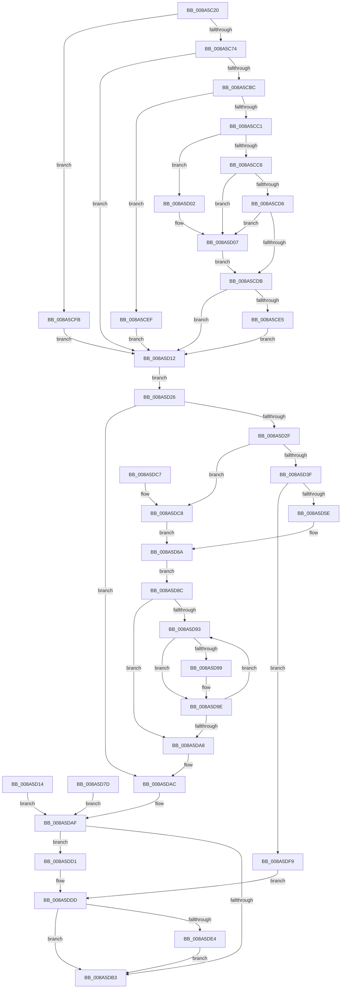

# EtwpQueryProcessCommandLine

- RVA: `0x008A5C20`–`0x008A5E00` (길이 `480` bytes)
- VA: `0x00000001408A5C20`
- 실행 섹션: `PAGE`
- PDB 이름 있음: `예`; PDB Function 태그: `아니요`
- unwind 정보 RVA: `0x0007F05C`
- 디코드: `132`개 명령, `480/480` bytes 표시
- 미해석 바이트: `0` (있으면 어셈블리에 `.byte`로 보존)

> 이 문서는 커널 이미지의 기계어와 PDB 기호를 분석해 생성했습니다. 4번과 5번은 함수 원형과 자료형을 바이너리 사용 방식에서 추정한 C 해석이며 원본 소스 복구 결과는 아닙니다.

## 1. Dependencies

- 직접 호출 지점: **4**; 고유 호출 대상: **4**
- 직접 호출자로 확인된 함수: **12**
- RIP 상대 이미지 참조: **0**

### Outgoing calls
- `0x008A5D02` → [ExRaiseDatatypeMisalignment](../89/ExRaiseDatatypeMisalignment_function_00899FD0.md) (function, `0x00899FD0`)
- `0x008A5D4D` → [ExAllocatePool2](../../poolcode/B8/ExAllocatePool2_function_00B820F0.md) (function, `0x00B820F0`)
- `0x008A5D76` → [memcpy](../../text/6C/memcpy_function_006C6840.md) (function, `0x006C6840`)
- `0x008A5DEA` → [ExFreePoolWithTag](../../poolcode/B8/ExFreePoolWithTag_function_00B82870.md) (function, `0x00B82870`)

### Direct callers
- [SepLogUnmatchedSessionFlagImpersonationAttempt](../../text/4D/SepLogUnmatchedSessionFlagImpersonationAttempt_function_004D8574.md) at `0x004D85EE`
- [EtwTimLogBlockNonCetBinaries](../7B/EtwTimLogBlockNonCetBinaries_function_007BA5B8.md) at `0x007BA682`
- [EtwTimLogControlProtectionUserModeReturnMismatch](../7B/EtwTimLogControlProtectionUserModeReturnMismatch_function_007BA9D4.md) at `0x007BAB35`
- [EtwTimLogProhibitLowILImageMap](../7B/EtwTimLogProhibitLowILImageMap_function_007BB1F4.md) at `0x007BB2B8`
- [EtwTimLogProhibitNonMicrosoftBinaries](../7B/EtwTimLogProhibitNonMicrosoftBinaries_function_007BB550.md) at `0x007BB615`
- [EtwTimLogUserCetSetContextIpValidationFailure](../7B/EtwTimLogUserCetSetContextIpValidationFailure_function_007BB920.md) at `0x007BB9E2`
- [EtwTraceAppStateChange](EtwTraceAppStateChange_function_008A452C.md) at `0x008A471D`
- [EtwQueryProcessTelemetryInfo](EtwQueryProcessTelemetryInfo_function_008A51A0.md) at `0x008A530C`
- [EtwpBuildProcessEvent](EtwpBuildProcessEvent_function_008A552C.md) at `0x008A5806`
- [EtwTimLogProhibitChildProcessCreation](../A4/EtwTimLogProhibitChildProcessCreation_function_00A43694.md) at `0x00A4371A`
- [EtwpTimLogMitigationForProcess](../A8/EtwpTimLogMitigationForProcess_function_00A81E6C.md) at `0x00A81F2A`
- [EtwTimLogRedirectionTrustPolicy](../AB/EtwTimLogRedirectionTrustPolicy_function_00ABA7E0.md) at `0x00ABAB0A`

### Static image references
- 디코드된 RIP-relative 메모리 참조가 없습니다.

## 2. Other-region calls and transfers

- 다른 실행 섹션으로 향하는 call: **3**
  - `0x008A5D4D` → [ExAllocatePool2](../../poolcode/B8/ExAllocatePool2_function_00B820F0.md) (`PAGE` → `POOLCODE`)
  - `0x008A5D76` → [memcpy](../../text/6C/memcpy_function_006C6840.md) (`PAGE` → `.text`)
  - `0x008A5DEA` → [ExFreePoolWithTag](../../poolcode/B8/ExFreePoolWithTag_function_00B82870.md) (`PAGE` → `POOLCODE`)
- 별도 외부 분기/꼬리 이동을 확인하지 못했습니다.

## 3. Assembly (complete function range)

```asm
008A5C20  48 89 5C 24 08                  mov qword ptr [rsp + 8], rbx
008A5C25  56                              push rsi
008A5C26  57                              push rdi
008A5C27  41 54                           push r12
008A5C29  41 56                           push r14
008A5C2B  41 57                           push r15
008A5C2D  48 83 EC 40                     sub rsp, 0x40
008A5C31  4C 8B F2                        mov r14, rdx
008A5C34  48 89 94 24 88 00 00 00         mov qword ptr [rsp + 0x88], rdx
008A5C3C  C6 44 24 78 00                  mov byte ptr [rsp + 0x78], 0
008A5C41  0F 57 C0                        xorps xmm0, xmm0
008A5C44  0F 11 44 24 20                  movups xmmword ptr [rsp + 0x20], xmm0
008A5C49  45 33 FF                        xor r15d, r15d
008A5C4C  66 44 89 3A                     mov word ptr [rdx], r15w
008A5C50  4C 8D 62 08                     lea r12, [rdx + 8]
008A5C54  4C 89 A4 24 80 00 00 00         mov qword ptr [rsp + 0x80], r12
008A5C5C  49 8B 1C 24                     mov rbx, qword ptr [r12]
008A5C60  48 8B 81 E0 02 00 00            mov rax, qword ptr [rcx + 0x2e0]
008A5C67  48 8B 48 20                     mov rcx, qword ptr [rax + 0x20]
008A5C6B  48 85 C9                        test rcx, rcx
008A5C6E  0F 84 87 00 00 00               je 0x1408a5cfb
008A5C74  0F 11 44 24 30                  movups xmmword ptr [rsp + 0x30], xmm0
008A5C79  48 83 C1 70                     add rcx, 0x70
008A5C7D  49 B9 00 00 FF FF FF 7F 00 00   movabs r9, 0x7fffffff0000
008A5C87  49 3B C9                        cmp rcx, r9
008A5C8A  49 0F 43 C9                     cmovae rcx, r9
008A5C8E  90                              nop
008A5C8F  8B 01                           mov eax, dword ptr [rcx]
008A5C91  89 44 24 30                     mov dword ptr [rsp + 0x30], eax
008A5C95  48 8B 51 08                     mov rdx, qword ptr [rcx + 8]
008A5C99  48 89 54 24 38                  mov qword ptr [rsp + 0x38], rdx
008A5C9E  0F 28 44 24 30                  movaps xmm0, xmmword ptr [rsp + 0x30]
008A5CA3  66 0F 7F 44 24 20               movdqa xmmword ptr [rsp + 0x20], xmm0
008A5CA9  B8 FE FF 00 00                  mov eax, 0xfffe
008A5CAE  66 0F 7E C6                     movd esi, xmm0
008A5CB2  66 23 F0                        and si, ax
008A5CB5  66 89 74 24 20                  mov word ptr [rsp + 0x20], si
008A5CBA  76 56                           jbe 0x1408a5d12
008A5CBC  48 85 D2                        test rdx, rdx
008A5CBF  74 2E                           je 0x1408a5cef
008A5CC1  F6 C2 01                        test dl, 1
008A5CC4  75 3C                           jne 0x1408a5d02
008A5CC6  0F B7 C6                        movzx eax, si
008A5CC9  4C 8D 04 10                     lea r8, [rax + rdx]
008A5CCD  48 8D 0C 10                     lea rcx, [rax + rdx]
008A5CD1  49 3B C9                        cmp rcx, r9
008A5CD4  77 31                           ja 0x1408a5d07
008A5CD6  4C 3B C2                        cmp r8, rdx
008A5CD9  72 2C                           jb 0x1408a5d07
008A5CDB  B8 00 08 00 00                  mov eax, 0x800
008A5CE0  66 3B F0                        cmp si, ax
008A5CE3  76 2D                           jbe 0x1408a5d12
008A5CE5  0F B7 F0                        movzx esi, ax
008A5CE8  66 89 44 24 20                  mov word ptr [rsp + 0x20], ax
008A5CED  EB 23                           jmp 0x1408a5d12
008A5CEF  41 0F B7 F7                     movzx esi, r15w
008A5CF3  66 44 89 7C 24 20               mov word ptr [rsp + 0x20], r15w
008A5CF9  EB 17                           jmp 0x1408a5d12
008A5CFB  0F B7 74 24 20                  movzx esi, word ptr [rsp + 0x20]
008A5D00  EB 10                           jmp 0x1408a5d12
008A5D02  E8 C9 42 FF FF                  call 0x140899fd0
008A5D07  41 0F B6 01                     movzx eax, byte ptr [r9]
008A5D0B  0F B7 74 24 20                  movzx esi, word ptr [rsp + 0x20]
008A5D10  EB C9                           jmp 0x1408a5cdb
008A5D12  EB 12                           jmp 0x1408a5d26
008A5D14  8B D8                           mov ebx, eax
008A5D16  45 33 FF                        xor r15d, r15d
008A5D19  4C 8B A4 24 80 00 00 00         mov r12, qword ptr [rsp + 0x80]
008A5D21  E9 89 00 00 00                  jmp 0x1408a5daf
008A5D26  66 85 F6                        test si, si
008A5D29  0F 84 7D 00 00 00               je 0x1408a5dac
008A5D2F  49 8D 7E 02                     lea rdi, [r14 + 2]
008A5D33  0F B7 07                        movzx eax, word ptr [rdi]
008A5D36  66 85 C0                        test ax, ax
008A5D39  0F 85 89 00 00 00               jne 0x1408a5dc8
008A5D3F  0F B7 D6                        movzx edx, si
008A5D42  B9 00 01 00 00                  mov ecx, 0x100
008A5D47  41 B8 45 74 77 50               mov r8d, 0x50777445
008A5D4D  E8 9E C3 2D 00                  call 0x140b820f0
008A5D52  48 8B D8                        mov rbx, rax
008A5D55  48 85 C0                        test rax, rax
008A5D58  0F 84 9B 00 00 00               je 0x1408a5df9
008A5D5E  C6 44 24 78 01                  mov byte ptr [rsp + 0x78], 1
008A5D63  49 89 04 24                     mov qword ptr [r12], rax
008A5D67  66 89 37                        mov word ptr [rdi], si
008A5D6A  44 0F B7 C6                     movzx r8d, si
008A5D6E  48 8B 54 24 28                  mov rdx, qword ptr [rsp + 0x28]
008A5D73  48 8B CB                        mov rcx, rbx
008A5D76  E8 C5 0A E2 FF                  call 0x1406c6840
008A5D7B  EB 0F                           jmp 0x1408a5d8c
008A5D7D  8B D8                           mov ebx, eax
008A5D7F  45 33 FF                        xor r15d, r15d
008A5D82  4C 8B A4 24 80 00 00 00         mov r12, qword ptr [rsp + 0x80]
008A5D8A  EB 23                           jmp 0x1408a5daf
008A5D8C  0F B7 C6                        movzx eax, si
008A5D8F  D1 E8                           shr eax, 1
008A5D91  74 15                           je 0x1408a5da8
008A5D93  66 83 3B 00                     cmp word ptr [rbx], 0
008A5D97  75 05                           jne 0x1408a5d9e
008A5D99  66 C7 03 20 00                  mov word ptr [rbx], 0x20
008A5D9E  48 83 C3 02                     add rbx, 2
008A5DA2  48 83 E8 01                     sub rax, 1
008A5DA6  75 EB                           jne 0x1408a5d93
008A5DA8  66 41 89 36                     mov word ptr [r14], si
008A5DAC  41 8B DF                        mov ebx, r15d
008A5DAF  85 DB                           test ebx, ebx
008A5DB1  78 1E                           js 0x1408a5dd1
008A5DB3  8B C3                           mov eax, ebx
008A5DB5  48 8B 5C 24 70                  mov rbx, qword ptr [rsp + 0x70]
008A5DBA  48 83 C4 40                     add rsp, 0x40
008A5DBE  41 5F                           pop r15
008A5DC0  41 5E                           pop r14
008A5DC2  41 5C                           pop r12
008A5DC4  5F                              pop rdi
008A5DC5  5E                              pop rsi
008A5DC6  C3                              ret
008A5DC7  CC                              int3
008A5DC8  66 3B F0                        cmp si, ax
008A5DCB  66 0F 43 F0                     cmovae si, ax
008A5DCF  EB 99                           jmp 0x1408a5d6a
008A5DD1  48 8B BC 24 88 00 00 00         mov rdi, qword ptr [rsp + 0x88]
008A5DD9  48 83 C7 02                     add rdi, 2
008A5DDD  80 7C 24 78 00                  cmp byte ptr [rsp + 0x78], 0
008A5DE2  74 CF                           je 0x1408a5db3
008A5DE4  33 D2                           xor edx, edx
008A5DE6  49 8B 0C 24                     mov rcx, qword ptr [r12]
008A5DEA  E8 81 CA 2D 00                  call 0x140b82870
008A5DEF  4D 89 3C 24                     mov qword ptr [r12], r15
008A5DF3  66 44 89 3F                     mov word ptr [rdi], r15w
008A5DF7  EB BA                           jmp 0x1408a5db3
008A5DF9  BB 9A 00 00 C0                  mov ebx, 0xc000009a
008A5DFE  EB DD                           jmp 0x1408a5ddd
```

## 4. C-style interpretation (structured pseudocode)

```c
__int64 __fastcall EtwpQueryProcessCommandLine(__int64 a1, __int64 a2)
{
    __int64 result;
    __int64 v_r15;
    __int64 v_rbx;
    __int64 v_rdi;
    __int64 v_rsi;
    __int64 v_rsp;
    unsigned __int64 v_stack_m30;
    unsigned __int64 v_stack_m38;
    unsigned __int64 v_stack_m40;
    unsigned __int64 v_stack_m48;
    unsigned __int8 v_stack_p10;
    unsigned __int64 v_stack_p18;
    unsigned __int64 v_stack_p20;
    unsigned __int8 v_stack_p78;
    unsigned __int64 v_stack_p8;
    unsigned __int64 v_stack_p88;

    v_stack_p8 = v_rbx;
    v_rsp = (v_rsp) - (64);
    v_stack_p20 = a2;
    v_stack_p10 = 0;
    v_stack_m48 = v_xmm0;
    v_r15 = 0;
    *(unsigned __int16 *)(a2) = 0;
    v_stack_p18 = a2 + 8;
    if (*(unsigned __int64 *)(*(unsigned __int64 *)(a1 + 736) + 32) == 0) goto loc_008A5CFB;
    v_stack_m38 = v_xmm0;
    a1 = (*(unsigned __int64 *)(*(unsigned __int64 *)(a1 + 736) + 32)) + (112);
    if (a1 >= a4) { a1 = a4; }
    v_stack_m38 = (unsigned int)((unsigned int)(*(unsigned int *)(a1)));
    v_stack_m30 = *(unsigned __int64 *)(a1 + 8);
    v_stack_m48 = v_xmm0;
    v_rsi = (unsigned __int16)((v_rsi) & ((unsigned __int16)((unsigned int)(0xFFFEULL))));
    v_stack_m48 = (unsigned __int16)(v_rsi);
    if (condition_is_below_or_equal) goto loc_008A5D12;
    if (*(unsigned __int64 *)(a1 + 8) == 0) goto loc_008A5CEF;
    if ((((unsigned __int8)(*(unsigned __int64 *)(a1 + 8))) & (1)) != 0) goto loc_008A5D02;
    if (((unsigned __int16)(v_rsi) + *(unsigned __int64 *)(a1 + 8) * 1) > a4) goto loc_008A5D07;
    if (((unsigned __int16)(v_rsi) + *(unsigned __int64 *)(a1 + 8) * 1) < (*(unsigned __int64 *)(a1 + 8))) goto loc_008A5D07;
loc_008A5CDB:
    if (((unsigned __int16)(v_rsi)) <= ((unsigned __int16)((unsigned int)(0x800ULL)))) goto loc_008A5D12;
    v_stack_m48 = (unsigned __int16)((unsigned int)(0x800ULL));
    goto loc_008A5D12;
loc_008A5CEF:
    v_stack_m48 = 0;
    goto loc_008A5D12;
loc_008A5CFB:
    goto loc_008A5D12;
loc_008A5D02:
    result = ExRaiseDatatypeMisalignment((unsigned __int16)(v_rsi) + *(unsigned __int64 *)(a1 + 8) * 1, *(unsigned __int64 *)(a1 + 8), (unsigned __int16)(v_rsi) + *(unsigned __int64 *)(a1 + 8) * 1, a4);
loc_008A5D07:
    goto loc_008A5CDB;
loc_008A5D12:
    goto loc_008A5D26;
loc_008A5D26:
    if ((unsigned __int16)(v_stack_m48) == 0) goto loc_008A5DAC;
    if ((unsigned __int16)(*(unsigned __int16 *)(a2 + 2)) != 0) goto loc_008A5DC8;
    result = ExAllocatePool2(256, (unsigned __int16)(v_stack_m48), (unsigned int)(0x50777445ULL), a4);
    if (result == 0) goto loc_008A5DF9;
    v_stack_p10 = 1;
    *(unsigned __int64 *)(a2 + 8) = result;
    *(unsigned __int16 *)(a2 + 2) = (unsigned __int16)(v_stack_m48);
loc_008A5D6A:
    result = memcpy(result, v_stack_m40, (unsigned __int16)(v_stack_m48), a4);
    goto loc_008A5D8C;
loc_008A5D8C:
    result = (unsigned int)(((unsigned __int16)(v_stack_m48)) >> (1));
    if (condition_is_equal) goto loc_008A5DA8;
loc_008A5D93:
    if ((*(unsigned __int16 *)(result)) == 0) {
        *(unsigned __int16 *)(result) = 32;
    }
    v_rbx = (result) + (2);
    result = (result) - (1);
    if (condition_is_not_equal) goto loc_008A5D93;
loc_008A5DA8:
    *(unsigned __int16 *)(a2) = (unsigned __int16)(v_stack_m48);
loc_008A5DAC:
loc_008A5DAF:
    if (sign_flag) goto loc_008A5DD1;
loc_008A5DB3:
    v_rsp = (v_rsp) + (64);
    return 0;
loc_008A5DC8:
    v_rsi = v_stack_m48;
    if (((unsigned __int16)(v_stack_m48)) >= 0) { v_rsi = 0; }
    goto loc_008A5D6A;
loc_008A5DD1:
    v_rdi = (v_stack_p88) + (2);
loc_008A5DDD:
    if (v_stack_p78 == 0) goto loc_008A5DB3;
    a2 = 0;
    result = ExFreePoolWithTag(*(unsigned __int64 *)(a2 + 8), a2, (unsigned __int16)(v_stack_m48), a4);
    *(unsigned __int64 *)(a2 + 8) = 0;
    *(unsigned __int16 *)(v_rdi) = 0;
    goto loc_008A5DB3;
loc_008A5DF9:
    goto loc_008A5DDD;
}
```

## 5. (Beta) C Style

```c
int64_t EtwpQueryProcessCommandLine(void *Arg1, void *Arg2)
{
    uint8_t *arg1 = (uint8_t *)Arg1;
    uint8_t *arg2 = (uint8_t *)Arg2;

    int64_t result;
    int64_t local_r15;
    int64_t local_rbx;
    int64_t local_rdi;
    int64_t local_rsi;
    int64_t local_rsp;
    uint64_t v_stack_m30;
    uint64_t v_stack_m38;
    uint64_t v_stack_m40;
    uint64_t v_stack_m48;
    uint8_t v_stack_p10;
    uint64_t v_stack_p18;
    uint64_t v_stack_p20;
    uint8_t v_stack_p78;
    uint64_t v_stack_p8;
    uint64_t v_stack_p88;

    v_stack_p8 = local_rbx;
    local_rsp = (local_rsp) - (64);
    v_stack_p20 = Arg2;
    v_stack_p10 = 0;
    v_stack_m48 = v_xmm0;
    local_r15 = 0;
    *(uint16_t *)(arg2) = 0;
    v_stack_p18 = Arg2 + 8;
    if (*(uint64_t *)(*(uint64_t *)(arg1 + 0x2E0) + 0x20) == 0) goto loc_008A5CFB;
    v_stack_m38 = v_xmm0;
    Arg1 = (*(uint64_t *)(*(uint64_t *)(arg1 + 0x2E0) + 0x20)) + (112);
    if (Arg1 >= a4) { Arg1 = a4; }
    v_stack_m38 = (uint32_t)((uint32_t)(*(uint32_t *)(arg1)));
    v_stack_m30 = *(uint64_t *)(arg1 + 0x8);
    v_stack_m48 = v_xmm0;
    local_rsi = (uint16_t)((local_rsi) & ((uint16_t)((uint32_t)(0xFFFEULL))));
    v_stack_m48 = (uint16_t)(local_rsi);
    if (condition_is_below_or_equal) goto loc_008A5D12;
    if (*(uint64_t *)(arg1 + 0x8) == 0) goto loc_008A5CEF;
    if ((((uint8_t)(*(uint64_t *)(arg1 + 0x8))) & (1)) != 0) goto loc_008A5D02;
    if (((uint16_t)(local_rsi) + *(uint64_t *)(arg1 + 0x8) * 1) > a4) goto loc_008A5D07;
    if (((uint16_t)(local_rsi) + *(uint64_t *)(arg1 + 0x8) * 1) < (*(uint64_t *)(arg1 + 0x8))) goto loc_008A5D07;
loc_008A5CDB:
    if (((uint16_t)(local_rsi)) <= ((uint16_t)((uint32_t)(0x800ULL)))) goto loc_008A5D12;
    v_stack_m48 = (uint16_t)((uint32_t)(0x800ULL));
    goto loc_008A5D12;
loc_008A5CEF:
    v_stack_m48 = 0;
    goto loc_008A5D12;
loc_008A5CFB:
    goto loc_008A5D12;
loc_008A5D02:
    result = ExRaiseDatatypeMisalignment((uint16_t)(local_rsi) + *(uint64_t *)(arg1 + 0x8) * 1, *(uint64_t *)(arg1 + 0x8), (uint16_t)(local_rsi) + *(uint64_t *)(arg1 + 0x8) * 1, a4);
loc_008A5D07:
    goto loc_008A5CDB;
loc_008A5D12:
    goto loc_008A5D26;
loc_008A5D26:
    if ((uint16_t)(v_stack_m48) == 0) goto loc_008A5DAC;
    if ((uint16_t)(*(uint16_t *)(arg2 + 0x2)) != 0) goto loc_008A5DC8;
    result = ExAllocatePool2(256, (uint16_t)(v_stack_m48), (uint32_t)(0x50777445ULL), a4);
    if (result == 0) goto loc_008A5DF9;
    v_stack_p10 = 1;
    *(uint64_t *)(arg2 + 0x8) = result;
    *(uint16_t *)(arg2 + 0x2) = (uint16_t)(v_stack_m48);
loc_008A5D6A:
    result = memcpy(result, v_stack_m40, (uint16_t)(v_stack_m48), a4);
    goto loc_008A5D8C;
loc_008A5D8C:
    result = (uint32_t)(((uint16_t)(v_stack_m48)) >> (1));
    if (condition_is_equal) goto loc_008A5DA8;
loc_008A5D93:
    if ((*(uint16_t *)(result)) == 0) {
        *(uint16_t *)(result) = 32;
    }
    local_rbx = (result) + (2);
    result = (result) - (1);
    if (condition_is_not_equal) goto loc_008A5D93;
loc_008A5DA8:
    *(uint16_t *)(arg2) = (uint16_t)(v_stack_m48);
loc_008A5DAC:
loc_008A5DAF:
    if (sign_flag) goto loc_008A5DD1;
loc_008A5DB3:
    local_rsp = (local_rsp) + (64);
    return 0;
loc_008A5DC8:
    local_rsi = v_stack_m48;
    if (((uint16_t)(v_stack_m48)) >= 0) { local_rsi = 0; }
    goto loc_008A5D6A;
loc_008A5DD1:
    local_rdi = (v_stack_p88) + (2);
loc_008A5DDD:
    if (v_stack_p78 == 0) goto loc_008A5DB3;
    Arg2 = 0;
    result = ExFreePoolWithTag(*(uint64_t *)(arg2 + 0x8), Arg2, (uint16_t)(v_stack_m48), a4);
    *(uint64_t *)(arg2 + 0x8) = 0;
    *(uint16_t *)(local_rdi) = 0;
    goto loc_008A5DB3;
loc_008A5DF9:
    goto loc_008A5DDD;
}
```

### 관측된 메모리 오프셋

구조체 형식이 확인되지 않은 접근은 인자 기준의 오프셋으로만 기록했습니다.

| 기준 인자 | 오프셋 표현 | 폭 (bit) | 접근 |
|---|---:|---:|---|
| `Arg1` | `+ 0x2E0` | `64` | `R` |
| `Arg2` | `+ 0x0` | `16` | `R` |
| `Arg2` | `+ 0x0` | `16` | `W` |
| `Arg2` | `+ 0x0` | `64` | `R` |
| `Arg2` | `+ 0x0` | `64` | `W` |
| `Arg2` | `+ 0x2` | `64` | `R` |
| `Arg2` | `+ 0x8` | `64` | `R` |

## 6. Execution-region graph

[열기: 2D/3D 그래프와 함수 탐색 컨트롤 패널](../../../control-panel.html?section=page&rva=0x008A5C20&view=graph)

- 2D 그래프는 위에서 아래로 흐르고, 3D 그래프는 빈 공간을 드래그해 회전합니다. Shift+드래그는 이동, 휠은 확대·축소, 함수 노드 선택은 대상 보고서 이동입니다.

### Static fallback


